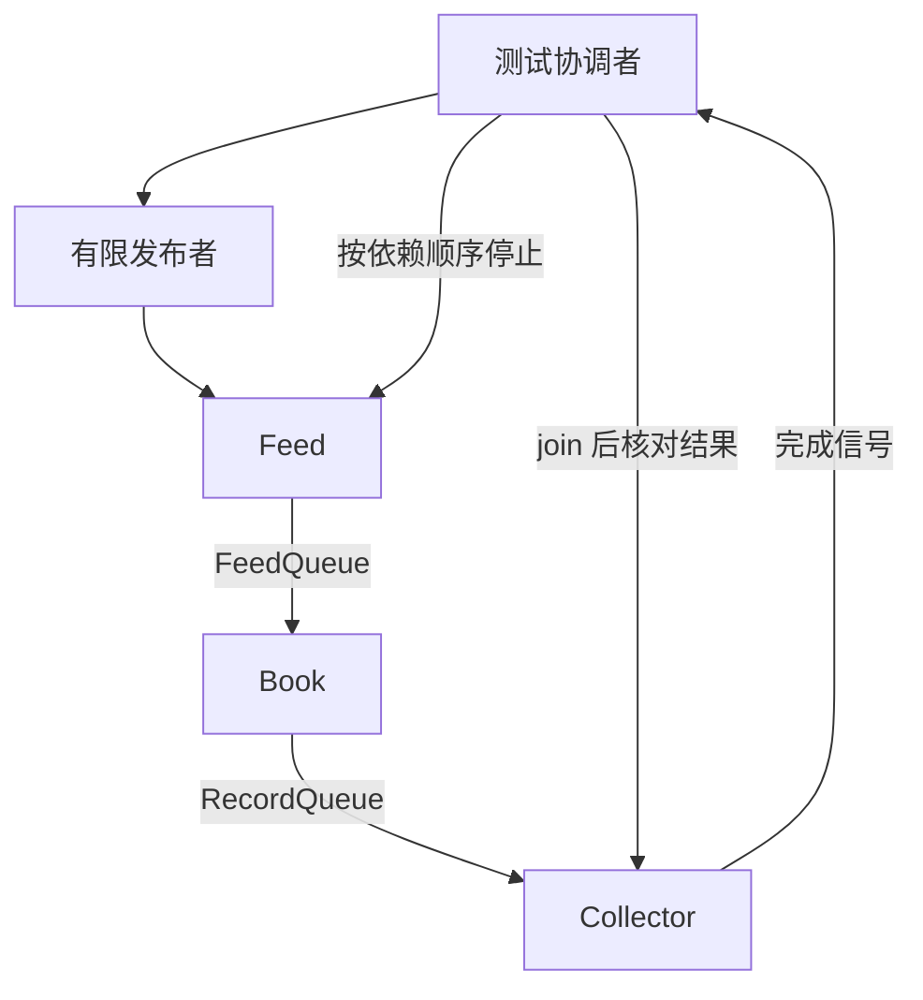

# qbook Implementation Plan（V2 实现计划）

文档版本：0.1｜日期：2026-10-20｜对应版本：V2 行情接入与并发处理

状态：**实现计划已编写；V2 代码任务尚未开始，构建、测试及版本验收尚未执行。** V0、V1 已有计划文档，但不能据此认为其代码已经完成。实施本版前，必须核对真实仓库中的基础工程和订单簿验收证据。

建议文件名为 `Implementation_Plan(V2).md`，与 `Sprint_Backlog.md` 的版本引用一致。本文按本次上传模板保留七章，第三章逐个展开协议、Feed、Book 和测试协作组件。声明、伪代码、命令和检查结果要求均为后续执行方案，不表示当前已建立这些代码或通过测试。

## 1. Implementation Overview（实现概述）

### 1.1 本次实现目标与范围

V2 把 V1 可以单独调用的订单簿接到实际消息输入上：Feed 收到字节并校验，合法事件成功进入队列后由 Book 更新对应品种，原始事件和周期快照再交给一个真正保存结果的测试消费者。这样可以检查从消息到业务状态、再到下游记录的完整本版流程。

| Backlog 任务 | 本版要实现的能力 | 可检查的交付结果 |
|---|---|---|
| V2-01 纯协议解码与受控编码器 | 从固定布局的单帧字节获得独立事件值，拒绝格式、字段或模式错误。 | `Protocol.h/.cpp`、固定样本、测试编码器及协议测试。 |
| V2-02 FeedThread 接收与接纳 | 在所属线程接收、赋接收时间、计数并重试入队；支持停止与故障退出。 | 单段/多段、非法输入、无发布端、满队列和接纳边界测试。 |
| V2-03 BookThread 分发与记录转交 | 按品种调用 Orderbook，保留原事件，周期生成快照，采集处理指标。 | 多品种、业务忽略、空簿、抽样、慢消费者和故障中断测试。 |
| V2-04 两阶段链路及测试消费者 | 正确组装寿命、异常包装和停止顺序，用收集结果验证整条链路。 | 网络集成、受控队列注入、积压停止、下游失败和部分启动失败证据。 |

本版不实现 ParquetWriter、WriterThread、生产 `main.cpp`、完整 `RunService()`、指标网络发布、UI 或 benchmark。测试消费者保存的是有限内存结果，不能据此声明文件已关闭、记录已落盘或断电后可恢复。正式持久化服务属于 V3。

**三个容易混淆的边界。** 收到消息表示 ZMQ 接收返回；有效解码表示格式、字段及模式检查通过；已接纳表示 `FeedQueue::try_push()` 成功。有效事件在满队列等待时遇到停止，可以尚未接纳；Book 得到事件后即使业务忽略，仍要处理时间元数据并转交原记录。测试分别记录这些事实，不用发布端发送数代替内部接纳数。

### 1.2 参考的 Requirement 与 Spec

| 文档及章节 | 本版采用的约束 | 验收范围 |
|---|---|---|
| `AGENTS.md` | 工程、命名、协作和文档规则。 | 实施前阅读实际文件，保留用户已有修改。 |
| `requirement.md` FR-03、FR-04；AC-02 | 接收、时间、基本校验和模式筛选。 | 字节及网络输入边界，不混入订单是否存在等状态判断。 |
| FR-05～FR-10；AC-03～AC-08 | 订单簿业务与周期快照。 | 复用 V1 业务，新增分发、已知品种集合及周期行为。 |
| FR-11、FR-13、FR-14 | 原始事件、阶段计数与抽样。 | 完成本版原记录转交和本地指标；文件保存、指标发布仍待后续。 |
| BR-02、BR-08、BR-11～BR-15；NFR-01～03、05～07 | 顺序、两种模式、业务忽略、正常停止和错误区别。 | 接纳后正常处理与下游交接，故障时退出且报告失败。 |
| `specs.md` 3.2～3.4、4.2 | 数据布局、DecodeResult、DecodeFrame、ValidateEvent 和 FeedThread。 | 固定接口和实际 ABI；不将 variant 内存直接当网络帧。 |
| `specs.md` 4.3.2.2、4.3.3、4.5 | BookThread、原事件转交、每 1024 条抽样及指标含义。 | 与 V0 指标原语、V1 Orderbook 的行为衔接。 |
| `specs.md` 4.1.3、5.1～5.4、6.3 | 失败广播、线程寿命、队列角色和集成验收。 | 所有相关线程结束后读取错误详情和销毁共享资源。 |
| `Sprint_Backlog.md` 3.3；V0、V1 实现计划 | 四项任务及前置条件。 | 保持版本范围，不把后续正式服务装配提前放进测试模块。 |

本文使用实际文件名 `requirement.md`、`specs.md`。真实行情源映射及业务差异仍按原待确认问题处理；本版受控样本采用已冻结的 qbook 本地协议规则，不从示例整数推导真实货币或数量单位。

### 1.3 现有代码与可复用组件

已阅读参考 nqbook 的 FeedThread、BookThread 和 CMake。它提供阶段划分与队列交接思路；qbook 要按已确定规格补齐输入检查、失败取消、不可变事件和明确的停止边界，不能仅改命名后认定完成。

| 来源 | 可复用内容 | 本版需要落实的差异 |
|---|---|---|
| V0 | `BookMode`、两条队列别名、ABI 检查、Config、RunControl、Metric/Metrics、测试基础。 | 核对真实代码和依赖锁；不重复定义队列类型或故障控制。 |
| V1 | 单品种 Orderbook、ApplyResult、移动安全与核心业务测试。 | Book 只分发事件，不重写业务算法；保留全部 V1 回归。 |
| qlib | 固定事件/record 类型、SPSC 队列、品种 map。 | 单队列只有两个所有者；map 插入后重查；满队列失败不会移动输入。 |
| nqbook Feed | SUB 接收、超时、按类型统计和队列重试。 | context/socket 移到 Run 局部；分离纯解码，字段校验，多段整体拒绝，观察全局失败。 |
| nqbook Book | 按品种访问、原记录转交、周期及抽样。 | 构造绑定模式；转交等待可被故障取消；下次周期使用完成后的 now+period；不补发错过周期。 |
| cppzmq/libzmq | C++ 消息/套接字封装和通信实现。 | 两者版本分别记录；连接成功不等于订阅已就绪或数据完整。 |

当前请求只生成文档；没有修改 qbook 生产代码、运行网络测试或认定旧版本实现已通过。

### 1.4 开发环境、依赖与工具链

继续使用 Linux / WSL2、x86-64、小端、8 字节指针、C++23、CMake 3.28 或以上、Ninja 和固定 Catch2 v3。V0/V1 的 qlib、fkYAML、spdlog 依赖不因新增网络测试而自动升级。本版新增 libzmq 与 cppzmq，实施时登记实际安装来源、版本/提交、库路径及导出目标；不编造已安装的补丁版本。

默认采用已准备好的 cppzmq CMake 包：`find_package(cppzmq CONFIG REQUIRED)`，链接官方 `cppzmq` 目标及其 libzmq 依赖。此查找只放在启用链路组件的分支中。若实际固定安装不提供该包，应先按其真实安装方式接入并更新依赖登记，不创建空目标绕过错误。配置阶段不自动下载 master 分支，不要求 Arrow、Parquet 或 Node。

为保留 V1 的独立核心构建，本版增加 `QBOOK_BUILD_PIPELINE`，默认 ON。它只控制 Feed/Book 阶段库及相关测试，不代表正式服务已实现；置 OFF 后仍能构建支持库、订单簿和纯协议测试，且不查找 ZMQ。其他开关与目标细节见第 2.3 节。

接入方案还核对了官方资料：[cppzmq CMake 目标](https://github.com/zeromq/cppzmq/blob/master/CMakeLists.txt)、[cppzmq 消息与接收实现](https://github.com/zeromq/cppzmq/blob/master/zmq.hpp)、[libzmq 接收错误](https://libzmq.readthedocs.io/en/latest/zmq_recv.html)、[socket 类型及 XPUB 订阅通知](https://libzmq.readthedocs.io/en/latest/zmq_socket.html)、[接收超时选项](https://libzmq.readthedocs.io/en/latest/zmq_setsockopt.html)、[TCP 临时端口](https://libzmq.readthedocs.io/en/latest/zmq_tcp.html)及 [LAST_ENDPOINT](https://libzmq.readthedocs.io/en/latest/zmq_getsockopt.html)。这些链接用于核对 API 含义，不能代替实际工程的版本锁；实施时以选定版本的头文件和编译结果复核。

### 1.5 实现约束与完成条件

**实现约束。** Feed 和 Book 各自只有一个执行线程；对象构造不启动线程。网络资源在 Feed 的 Run 线程创建、使用和销毁。停止分成普通停止与致命失败：前者按上游到下游排空，后者让所有等待退出且不宣称完整输出。工作线程不执行会向外逃逸的 Catch2 断言，异常由包装器送入 RunControl。

**测试与修改约束。** 主测试线程不并发查看 SPSC 的内部大小，也不读 Book 的容器或 Collector 的 vector。同步证据来自队列所有者发布的原子进度、promise/future 和 join 后结果。测试辅助只进入测试目标；不为计数方便增加生产 admission API，不修改 qlib 来迁就用例。用户已有目录和源码修改保留，提交/推送仍遵循实际授权。

**完成条件。** 四项任务均有实际代码、完整命令和真实通过证据；V0/V1 回归不退步；非法帧、业务忽略、快照时间、抽样范围、背压、普通停止、故障停止及部分启动失败都有明确结果。只用 `docs/releases/V2.md` 汇总必要环境、用例数、结果、未执行项和清理情况。当前文档不将 Backlog 任务标为完成。

## 2. Implementation Structure（实现结构）

### 2.1 技术模块与代码文件的对应关系

| 模块/任务 | 计划路径 | 本版职责 |
|---|---|---|
| 协议，V2-01 | `include/Protocol.h`、`src/Protocol.cpp` | 结果类型、单帧解码和基本字段校验；不包含网络或订单簿状态。 |
| 接入，V2-02 | `include/Threads/FeedThread.h`、`src/Threads/FeedThread.cpp` | 接收、时间、计数、模式过滤和成功入队边界。 |
| 处理，V2-03 | `include/Threads/BookThread.h`、`src/Threads/BookThread.cpp` | 多品种应用、原记录转交、周期快照及 Book 指标。 |
| 协议验证 | `tests/protocol_tests.cpp`、`tests/support/FeedEncoder.h` | 固定编码与独立预期，不用相同错误的往返测试自证。 |
| 固定样本 | `tests/fixtures/protocol/*.bin`、该目录 `README.md` | 手工独立核对的字段和偏移说明；具体文件名见第 3.1 节。 |
| 阶段/集成验证 | `tests/feed_tests.cpp`、`tests/book_thread_tests.cpp`、`tests/pipeline_tests.cpp` | 网络独测、受控队列及完整本版链路。 |
| 有限发布与收集 | `tests/support/FeedPublisher.h/.cpp`、`tests/support/RecordCollector.h/.cpp` | 发布冻结消息计划；保存有上限的记录，公布测试进度。 |
| Book 精确观察 | `tests/support/BookThreadInspector.h` | 单所有者调用私有处理方法、读取状态以核对抽样；不建立生产查询接口。 |
| 工程和交付 | `CMakeLists.txt`、`README.md`、`docs/releases/V2.md`、当前计划和 Backlog | 新依赖/目标、真实运行方式、验收结果及偏差。 |

这些路径相对 qbook 仓库根目录。只在源码真正实现后加入构建；不预建空的 Writer、服务入口或“总是成功”的测试。

### 2.2 各模块需要实现的类与组件

| 名称 | 角色及所有权 | 主要接口 |
|---|---|---|
| `DecodeError`、`DecodeResult` | 解码结果值，没有独立生命周期管理。 | 事件存在当且仅当返回的 error 为 None。 |
| `DecodeFrame`、`ValidateEvent` | 无状态自由函数。 | 字节到值、字段校验；不查簿、不改指标。 |
| `FeedThread` | 拥有端点字符串和模式，借用 FeedQueue。 | 构造、Run；内部 Connect/Receive/Consume/Enqueue。 |
| `BookThread` | 拥有多品种 Orderbook，借用两条队列。 | 构造、Run；内部 Consume/Apply/Forward/Snapshot。 |
| `FeedPublisher` | 测试类，拥有有限消息计划；其 Run 拥有 XPUB 网络资源。 | Run；通过共享测试信号报告绑定、订阅及发送进度。 |
| `RecordCollector` | 测试类，借用 RecordQueue，拥有有上限的记录 vector。 | Run、join 后 Results；运行期间只发布原子进度。 |
| `BookThreadInspector`、场景装配函数 | 测试访问和寿命管理。 | 单线程组件检查；按阶段启动、停止、join 和验证。 |

SPSC 指“单生产者、单消费者”。背压在这里指下游消费跟不上时，上游等待固定容量队列腾出位置；它不会自动让外部发布端可靠重传。

### 2.3 类与源文件、头文件的对应关系

Protocol 头文件只依赖标准类型、qlib 和公共模式定义，不包含 zmq.hpp。Book 头文件使用 `PipelineTypes.h` 中的队列别名，不能通过包含 FeedThread.h 来获取队列，从而把网络头文件带入业务处理声明。Feed 的 socket 类型只出现在其网络相关声明中；各自 `.cpp` 实现算法和具体依赖调用。

Book 的测试友元采用一致声明：所有构建中都前向声明 `qbook::testing::BookThreadInspector` 并声明 friend，定义只放在 tests 下。测试构建不能通过宏改变 BookThread 类定义；观察器仅在没有 Run 并发的情况下调用私有 Consume/Snapshot，不直接篡改生产计数来造结果。

| CMake 目标 | 源码与依赖 | 构建条件 |
|---|---|---|
| `qbook_support` | 保留 V0 的 Config、Runtime、Metric/Metrics 实现。 | 与 V0/V1 一致。 |
| `qbook_core` | 保留 V1 的真实 `src/Orderbook.cpp`；公开 qlib 和 include。 | 不依赖 ZMQ。 |
| `qbook_protocol`（STATIC） | `src/Protocol.cpp`；公开 include、C++23、`qlib::qlib`。 | V2-01 起可构建，不依赖 ZMQ。 |
| `qbook_pipeline`（STATIC） | `src/Threads/FeedThread.cpp`、`src/Threads/BookThread.cpp`；公开链接 core/support/protocol、`cppzmq`、`Threads::Threads`；日志使用既有 `qbook_logging`。 | `QBOOK_BUILD_PIPELINE=ON`。两个源文件随任务实现加入。 |
| `qbook_tests` | 保留 V0/V1 普通测试，再加入 `tests/protocol_tests.cpp`，链接新增 protocol 库。 | `BUILD_TESTING=ON`，不需要链路开关。 |
| `qbook_allocation_tests` | 保留 V1 专用分配失败测试和原来的链接隔离。 | `BUILD_TESTING=ON`；不能把其全局 new 替换链接进网络测试。 |
| `qbook_pipeline_tests` | 三个阶段/集成测试 `.cpp`，FeedPublisher.cpp、RecordCollector.cpp；链接 pipeline、Catch2 测试入口。 | 两个开关均 ON；不复制另一份生产阶段源码。 |

测试通过 Catch2 的 `catch_discover_tests` 登记，延续 `unit::`、`allocation::`，新程序使用 `pipeline::` 前缀。将 fixture 路径作为测试配置或编译定义传入，避免依赖测试进程碰巧从某个目录启动。对网络场景设置明确的 CTest TIMEOUT，正常成功仍要求真实断言执行。

`QBOOK_BUILD_PIPELINE=OFF` 的分支不调用 `find_package(cppzmq)`，不创建 pipeline 及其测试；`BUILD_TESTING=OFF` 不引入 Catch2 和任何测试辅助。`QBOOK_BUILD_SERVICE` 与 `QBOOK_BUILD_BENCHMARKS` 仍默认 OFF，显式开启本版未提供的功能继续报明确配置错误。该开关分支需要本版一次性验收，命令见第 5.2 节。

### 2.4 模块与类之间的实现依赖

生产依赖是 Protocol 提供纯解码，Feed 只向 FeedQueue 推送，Book 只从该队列取出并调用 V1 Orderbook，再向 RecordQueue 推送；测试 Collector 是输出唯一消费者。Metrics 是旁路的原子观察值，RunControl 是共享故障标志，二者都不能充当业务记录传递通道。

| 共享对象 | 唯一生产/写入者 | 唯一消费/读取业务状态者 | 销毁前提 |
|---|---|---|---|
| FeedQueue | 网络测试中 Feed；受控注入测试中独立生产者，二者不同时使用。 | Book；Feed 独测则由指定测试消费者代替。 | 两端均结束并 join。 |
| RecordQueue | Book。 | RecordCollector。 | Book 和 Collector 均结束并 join。 |
| Orderbook 与品种表 | Book。 | 同一 Book；组件检查中由单个测试线程接管。 | Run 已结束，没有外部引用。 |
| Collector 结果 vector | Collector。 | 运行时也只有 Collector；协调者在 join 后读取。 | 所有读取完成。 |
| Metrics | 每字段指定阶段单写者。 | 测试协调者可读原子值。 | 全部阶段结束。 |
| RunControl | 各线程异常包装器可竞争报告首错。 | 运行时只读 Failed；协调者在所有可能写者 join 后读 Stage/Error。 | 所有相关线程结束。 |

测试发布端在自己的线程拥有 XPUB socket，Feed 在另一个线程拥有 SUB socket，使用本机 TCP 端点连接。因为两端各有独立 context，本版测试不用依赖同一 context 的 inproc 地址。

### 2.5 整体编码顺序及其原因

1. 核对 V0/V1 的真实代码、布局和基线测试，记录构建目录是否已有；固定本版通信依赖。
2. 先写不依赖网络的 DecodeFrame、ValidateEvent、编码器和 golden 样本；这样网络失败和字段解释失败可以分开定位。
3. 实现 Feed，配一个唯一测试消费者验证接收、拒绝和入队边界；此时不拿订单簿结果掩盖接收缺失。
4. 用受控队列独立实现 Book，验证业务分发、原事件、快照、抽样及停止；无须等发布端才能调试所有业务路径。
5. 用有限发布端和真正保存结果的 Collector 连接两阶段，完成普通停止、下游故障和部分启动失败，再运行完整回归并更新验收记录。

## 3. Module Implementation（模块实现方案）

本章依次展开四个模块。每个模块都说明目标与依赖、类或组件实现、重要函数契约、调用流程、并发与错误处理、编码顺序及完成条件。

### 3.1 协议解码与受控编码器

#### 3.1.1 模块实现概述

1. **模块实现目标。** 对应 V2-01。把一段行情消息字节转换成独立的 `qlib::feed_event`，只有类型、长度、模式和基本字段全部合法时才返回事件；测试可以不启动网络就验证这些规则。
2. **对应的 Spec 章节。** `specs.md` 3.2～3.4、4.2.1、4.2.2.1；需求依据为 FR-03/04、BR-08/12/14、AC-02 和 NFR-06。重复订单、未知 ID、方向冲突和价位合计越界属于 Orderbook 的业务判断，不在这里提前拒绝。
3. **需要实现的组件与文件。** `include/Protocol.h`、`src/Protocol.cpp`、`tests/protocol_tests.cpp`、`tests/support/FeedEncoder.h`，以及 `tests/fixtures/protocol/` 中的固定字节样本和字段说明。本模块没有需要长期保存状态的解析器类。
4. **依赖与复用组件。** 直接使用 V0 的 `PipelineTypes.h`、固定版本 `qlib/common.h` 和 C++ 标准库的 span、optional、variant、array、memcpy。生产协议代码不包含 ZMQ、Orderbook、Metrics 或文件写入依赖。

#### 3.1.2 Class Implementation（无状态组件实现）

本模块用自由函数完成工作。模板中的“成员变量”和“成员函数”栏目分别说明结果值、局部数据和函数，不为满足栏目增加一个没有独立职责的类。

##### 3.1.2.1 组件的实现目标

一条消息先经过协议检查，才有资格进入 FeedQueue。解码成功不等于已接纳：后续 `Enqueue()` 成功才跨过接纳边界。本模块也不判断某个事件最终是否改变订单簿；例如已存在 ID 的新增仍应解码成功，让 Orderbook 返回业务忽略并保留原事件。

##### 3.1.2.2 声明与文件组织

`Protocol.h` 直接包含声明所需的 `<cstddef>`、`<cstdint>`、`<optional>`、`<span>` 和公共类型头，保持接口自足。公开声明与规格一致：

```cpp
namespace qbook {
enum class DecodeError : std::uint8_t {
  None, EmptyFrame, UnknownTag, WrongSize, ModeMismatch, InvalidField
};

struct DecodeResult {
  std::optional<qlib::feed_event> event;
  DecodeError error = DecodeError::None;
};

DecodeResult DecodeFrame(std::span<const std::byte> bytes,
                         std::int64_t recv_ns, BookMode mode) noexcept;
DecodeError ValidateEvent(const qlib::feed_event& event) noexcept;
}  // namespace qbook
```

`Protocol.cpp` 保存标签分派、逐字段读取和合法值检查。读取标量的模板辅助函数仅在该实现文件内部使用，不导出成通用反序列化 API。错误返回直接构造 `{std::nullopt, error}`；成功返回携带独立值的 optional 和 `None`，不返回默认构造但尚未填充的 `DecodeResult`。

测试编码器保存在 `tests/support/FeedEncoder.h`，使用如下测试专用值类型。常量 81 来自本版最大输入帧 `1 + sizeof(qlib::order)`；加编译期断言锁定该值，不能让协议尺寸变化悄悄扩大测试缓冲区而绕过 ABI 检查。

```cpp
namespace qbook::testing {
struct EncodedFrame {
  std::array<std::byte, 81> storage{};
  std::size_t size = 0;
  std::span<const std::byte> bytes() const noexcept {
    return {storage.data(), size};
  }
};

EncodedFrame EncodeFeedEvent(const qlib::feed_event& event) noexcept;
}  // namespace qbook::testing
```

编码器的输入前提是非 valueless 的 `feed_event`，即确实持有四种记录之一。返回对象拥有字节，`bytes()` 只借用其中 `[0,size)`；发布者必须保持返回对象活到发送调用完成。不能返回指向局部数组的 span，也不能用结构体整体复制来省略字段写入。

##### 3.1.2.3 数据的具体实现

| 数据 | 类型与初始化 | 生命周期、所有权及状态约束 |
|---|---|---|
| 输入消息 | `std::span<const std::byte>`。 | 调用者拥有；本函数只在调用期间读取，不保存指针，不修改原字节。 |
| 标签 | `std::uint8_t`，从首字节读取。 | 只接受 qlib 已冻结的四个 wire tag；不直接当作 variant 的对象布局。 |
| 本地记录 | `qlib::order/trade/level/cancel local{}`。 | 在栈上按值构造，逐字段填充；订单链接显式保持 nullptr。 |
| `DecodeResult::event` | `std::optional<qlib::feed_event>`。 | 结果拥有独立记录；消息缓冲释放后仍有效。失败结果为空。 |
| `DecodeResult::error` | `DecodeError`。 | 所有实际返回结果满足有事件当且仅当 error 为 None；临时默认值不代表解码成功。 |
| 接收时间 | 调用参数 `std::int64_t recv_ns`。 | Feed 在收到消息后取得的本机 Unix epoch 纳秒，直接覆盖本地记录；不使用发送者的 recv_ns。 |
| 测试编码缓冲 | `EncodedFrame` 的固定数组和有效长度。 | 值初始化为全零；写完后只有有效长度内的字节参与发送，尾部容量不参与消息。 |

V0 的公共契约头继续在生产构建中检查小端 x86-64、8 字节指针、字段类型、布局和倍率。协议函数不做动态分配；实施时检查四种记录及 variant 的构造/移动能力与 `noexcept` 路径相符，不能为了消除编译错误去掉前提检查。

##### 3.1.2.4 重要函数的具体实现

###### A. `DecodeFrame`：先确认消息形状，再产生独立事件

| 实现维度 | 具体方案 |
|---|---|
| 函数声明与职责 | `DecodeResult DecodeFrame(std::span<const std::byte> bytes, std::int64_t recv_ns, BookMode mode) noexcept`；解释一条已完整取得的单段消息。 |
| 输入、输出与契约 | 输入 span 必须在调用期间有效；recv_ns 来自调用方本机取时。成功返回独立事件，失败返回空事件及原因；不接收 ZMQ message 对象。 |
| 核心算法与数据结构 | 明确 switch 四个标签，检查每种精确长度与模式，使用 offsetof 和 memcpy 读取命名标量字段，再进行字段校验。 |
| 具体执行步骤 | ①空帧检查；②读取并识别标签；③检查精确帧长；④检查模式允许该类型；⑤建立 T{} 并读取非指针业务字段，枚举先读取 uint8_t 并检查；⑥覆盖 recv_ns，订单链接保持空；⑦调用 ValidateEvent；⑧一次构造成功或错误结果。 |
| 数据读取与修改 | 只读消息和参数；写本地记录及返回值。源字节、订单簿、指标和队列均不改变。 |
| 对其他函数的调用 | 内部 `ReadScalar`、已定义枚举值判断、`ValidateEvent`；不读时钟、不打印日志、不做入队。 |
| 边界情况与错误处理 | 按本章固定优先级返回一个错误；不接受多余尾字节或截断；订单 prev/next 和对端 recv_ns 不进入结果。 |
| 异常安全与状态一致性 | 逐字段复制只涉及固定标量；结果按值构造，无分配和外部副作用。不能用抛异常解释普通坏帧，也不能 catch 所有错误后默默返回一个空成功结果。 |
| 时间复杂度与空间复杂度 | 四种记录长度固定，每条消息固定数量操作，时间和额外空间均 O(1)；超长消息也在精确长度检查时拒绝，不遍历其全部字节。 |
| 并发、同步与线程安全 | 无静态可变状态；不同调用使用各自输入和局部结果，可独立执行。调用者不得同时改写被借用缓冲。 |
| 单元测试与验证方法 | 四标签及两模式矩阵、各错误优先级、字段极值、非对齐起始地址、对端指针/padding污染、recv覆盖、结果与输入缓冲生命周期分离。 |

###### B. `ValidateEvent`：只验证当前事件字段，不查询业务状态

| 实现维度 | 具体方案 |
|---|---|
| 函数声明与职责 | `DecodeError ValidateEvent(const qlib::feed_event& event) noexcept`；对一个值记录检查本版合法字段范围。 |
| 输入、输出与契约 | 输入借用且不变；返回 None 或 InvalidField，不接收 BookMode，不判断已接纳或当前订单是否存在。 |
| 核心算法与数据结构 | 用 `std::visit` 按实际类型检查；公共部分检查 side、seq、event_ns，再检查该类型数量、价格、ID、动作和类型枚举。 |
| 具体执行步骤 | ①防御检查 valueless_by_exception，若为真返回 InvalidField；②访问真实候选类型；③检查共同字段；④按下表执行类型特定规则；⑤任一不符返回 InvalidField，否则 None。 |
| 数据读取与修改 | 只读命名字段；不改 qty/new_qty，不归一化价格，不重写序号或时间。 |
| 对其他函数的调用 | 固定枚举判断和无状态 visitor；不调用 Orderbook、DecodeFrame、日志或计数。 |
| 边界情况与错误处理 | 非正 modify.new_qty 和 level.qty 是删除语义，不误拒绝；成交两侧为0允许、两个非0相同拒绝；品种0允许。 |
| 异常安全与状态一致性 | 在 visit 前排除无值状态；visitor 只做比较、布尔判断，不分配，不进行可能溢出的加减乘；返回错误没有外部副作用。 |
| 时间复杂度与空间复杂度 | 候选类型和字段数固定，时间、空间均 O(1)。 |
| 并发、同步与线程安全 | 只读输入且没有共享写入；调用期间输入必须保持稳定。 |
| 单元测试与验证方法 | 每条规则分别设置一个非法字段，并覆盖合法边界；直接构造值测试与字节解码测试相互补充；重复ID、未知ID、序号跳号等仍应通过。 |

###### C. `ReadScalar`：从任意对齐的字节位置读取标量

| 实现维度 | 具体方案 |
|---|---|
| 函数声明与职责 | 实现文件内部 `template<class Scalar> Scalar ReadScalar(std::span<const std::byte> payload, std::size_t offset) noexcept`；读取一个已证明在界内的整数标量。 |
| 输入、输出与契约 | payload 不含首字节标签；offset 是当前标准布局记录的 offsetof；要求 `offset + sizeof(Scalar)` 在已校验载荷内，返回值副本。 |
| 核心算法与数据结构 | 建立 `Scalar value{}`，使用 `std::memcpy(&value, payload.data()+offset, sizeof value)`；不将源地址转换成 Scalar* 或整个记录指针。 |
| 具体执行步骤 | ①限制 Scalar 为实际使用的平凡整数类型；②复制固定字节数；③按值返回。枚举用 uint8_t 读，检查通过后由调用者转换。 |
| 数据读取与修改 | 只读指定字节并写局部 value；无其他状态。 |
| 对其他函数的调用 | `std::memcpy`；不调用分配器和通用解析框架。 |
| 边界情况与错误处理 | 所有长度检查在调用前完成；每个固定字段的 offset 与宽度由编译期断言核对。不得把任意网络给出的偏移传入。 |
| 异常安全与状态一致性 | 对固定宽度整数的字节复制不抛；不构造来自对端的指针，不读取填充作为业务值。 |
| 时间复杂度与空间复杂度 | 每次复制1、4或8字节，时间、空间均 O(1)。 |
| 并发、同步与线程安全 | 只读调用方输入，没有共享缓存和可变静态数据。 |
| 单元测试与验证方法 | 通过 DecodeFrame 使用起始地址偏移1字节的合法缓冲，确认没有对齐前提；独立固定字节核对正值、0和负值字段。 |

###### D. `EncodeFeedEvent`：只为测试构造明确的消息字节

| 实现维度 | 具体方案 |
|---|---|
| 函数声明与职责 | `EncodedFrame EncodeFeedEvent(const qlib::feed_event& event) noexcept`；生成测试发布端可发送的拥有型字节值。 |
| 输入、输出与契约 | 输入为非 valueless 的四种记录之一；返回数组与精确有效长度。它不验证字段业务合法性，测试可编码负量等拒绝场景。 |
| 核心算法与数据结构 | 缓冲先清零；按实际候选类型选择显式 qlib tag，逐字段用 memcpy 写至 `1+offsetof(T,field)`，枚举转 uint8_t 后写入。 |
| 具体执行步骤 | ①零初始化结果；②选择类型并设置 tag、size；③写全部命名标量字段，包括测试给出的 recv_ns；④保留指针和padding区为0；⑤返回拥有值。 |
| 数据读取与修改 | 只读事件字段，写本地数组及size；不改变原事件，不访问输入订单链接所指对象。 |
| 对其他函数的调用 | 测试内部固定宽度写字段辅助、memcpy、明确类型分派；不调用 DecodeFrame 生成预期，也不把 variant.index 当唯一协议定义。 |
| 边界情况与错误处理 | 无效长度或未知标签不能由正常编码器表达，测试在返回值副本上截断、加尾或修改首字节；不得发出数组剩余未使用容量。 |
| 异常安全与状态一致性 | 固定数组和标量复制不分配；输入前提和候选类型的不抛访问条件在测试辅助定义中说明并检查。 |
| 时间复杂度与空间复杂度 | 固定最多81字节，时间、空间均 O(1)。 |
| 并发、同步与线程安全 | 返回值独立；其 span 仅在返回对象存活时有效，不把同一可变字节缓冲交给多个并发写入者。 |
| 单元测试与验证方法 | 编码结果与人工固定样本逐字节对比；断言每个指针/padding区为0，长度正确，recv原值可在字节中核对且解码后被覆盖。 |

##### 3.1.2.5 构造、初始化与资源释放

协议函数没有需要启动或关闭的对象。每次调用使用 `T{}` 创建本地记录，再创建按值结果；optional/variant 直接保存记录，不在堆上保存消息。消息所有者可以在解码返回后释放缓冲，返回事件仍完整有效。

编码器返回的 `EncodedFrame` 同样按值拥有数组，其 `bytes()` 不能比对象活得更久。测试中应先保存 `auto frame = EncodeFeedEvent(event)`，再将 `frame.bytes()` 交给发布者；不能缓存从临时返回值取得的 span。所有测试辅助仅参与测试目标，生产协议库不依赖 fixtures 或测试编码器。

##### 3.1.2.6 组件内部的关键实现流程

以一张限价新增为例：首字节0表示 order，消息总长必须为81；在 Mbo 模式允许处理。解析器创建 `qlib::order{}`，依固定偏移读取 seq、ID、价格、两种数量、品种、枚举和来源时间，把本机传入的 recv_ns 写入结果；prev/next 保持空。字段合法后返回持有该订单值的 feed_event，原消息里的地址字节和填充不会成为本地状态。

如果同样的81字节出现在 L2 模式，长度正确后即返回 ModeMismatch，不继续读取业务字段；Feed 随后负责累计一次拒绝。若 tag=0 但只有80字节，则先返回 WrongSize，不能因 L2 不支持订单而隐藏错误长度。这样同一输入在同一配置下有稳定且可测试的首个拒绝原因。

##### 3.1.2.7 组件实现顺序与依赖关系

1. 复核 V0 的生产 ABI 断言，建立 Protocol 公开结果类型和明确错误返回，不新增第二套事件类型。
2. 按实际字段实现内部 ReadScalar 和四个类型分支，先让独立合法样本准确解码，再补齐固定错误优先级。
3. 实现 ValidateEvent 全部字段规则，并验证删除例外；接入 DecodeFrame 最终检查。
4. 编写测试编码器，与独立固定字节对照，随后扩展拒绝、非对齐、指针/padding污染和生命周期测试。
5. 验证纯函数后再供 Feed 与网络测试使用；接口错误不要延迟到启动线程后排查。

#### 3.1.3 模块内部协作与调用流程

`FeedThread::Consume` 借用完整消息字节和接收时间，调用 `DecodeFrame`。DecodeFrame 先检查消息形状和模式，再读取字段并调用 `ValidateEvent`；结果只有成功事件或一个拒绝原因。Consume 决定如何计数、诊断和入队，协议函数不重复计数。

测试发布者使用 EncodeFeedEvent 生成受控输入，但固定样本的期望不能来自同一个编码器。否则编码和解码若同时错用相同偏移，往返仍可能通过。本版同时验证“已知字节→已知字段”和“已知字段→已知字节”，再把往返作为补充。

#### 3.1.4 模块关键算法的实现方案

**错误判定顺序。** 按 `EmptyFrame → UnknownTag → WrongSize → ModeMismatch → InvalidField` 执行，前一项满足就直接返回。无效 BookMode 值属于调用方配置问题；防御路径返回 ModeMismatch，不能将任意未知值当作 Mbo。多段消息的整条拒绝由 Feed 执行，不新增 DecodeError::Multipart 或把片段分别解码。

**标签、长度和模式表。** 下表长度包括首字节 tag。模式只决定允许的记录类型，不判断业务更新是否成功。

| 记录 | tag | 载荷大小 | 消息总长 | Mbo | L2 |
|---|---:|---:|---:|---|---|
| order | 0 | 80 | 81 | 允许 | 拒绝 |
| trade | 1 | 64 | 65 | 允许 | 允许 |
| level | 2 | 48 | 49 | 拒绝 | 允许 |
| cancel | 3 | 48 | 49 | 允许 | 拒绝 |

**字段读取位置。** 以下偏移相对载荷起点，不含tag；实际消息位置为 `1 + offset`。int64字段复制8字节，instrument_id复制4字节，枚举复制1字节。实现使用 offsetof，V0断言与固定样本验证下列数字。

| 类型 | 读取后保留的字段及偏移 | 明确忽略/覆盖的区域 |
|---|---|---|
| order | seq0、order_id8、price16、qty24、new_qty32、instrument_id56、side60、type61、action62、event_ns64。 | prev40～47、next48～55不读取；63为padding；recv_ns72～79由本机值覆盖，不从对端取值。 |
| trade | seq0、buy_order_id8、sell_order_id16、price24、qty32、event_ns40、instrument_id48、side52。 | 53～55为padding；recv_ns56～63由本机值覆盖。 |
| level | seq0、price8、qty16、event_ns24、instrument_id32、side36。 | 37～39为padding；recv_ns40～47由本机值覆盖。 |
| cancel | seq0、order_id8、qty16、instrument_id24、side28、event_ns32。 | 29～31为padding；recv_ns40～47由本机值覆盖。 |

使用 `memcpy` 只解决源缓冲可能未对齐及对象访问方式的问题，不把本机布局变成跨平台格式。本版明确固定小端配置，没有自动字节序转换、版本头或布局协商。同长度的错误版本可能无法被拒绝，真实发布端必须锁定兼容的字段与倍率。

**字段规则。** 不使用算术合计来校验输入，全部检查是字段比较；价格和数量维持 qlib 原始整数及既有倍率，不在解析器转换单位。

| 适用事件 | 必须成立的基本条件 | 本版明确允许或不检查的情况 |
|---|---|---|
| 所有事件 | side为buy/sell，seq≥0，event_ns≥0。 | instrument_id=0允许；event_ns=0表示来源未知；序号可重复或跳号，不排序、不查历史。recv_ns来自调用者本机时间，不按发送值校验。 |
| order共同字段 | order_id>0，type为limit/market，action为add/modify。 | 两种动作使用不同数量字段，不把所有数量一律要求为正。 |
| order add | qty>0；limit要求price>0。 | market的price不参与挂簿，new_qty不参与新增数量判断；重复ID和交叉价由业务处理。 |
| order modify | new_qty>0时price>0。 | new_qty≤0表示删除，price可为未使用值；qty不参与新剩余量判断；方向是否冲突、原ID是否存在留给Orderbook。 |
| trade | qty>0、price>0；两个ID均≥0；两者非0时必须不同。 | 一侧或两侧0允许；非0但未知ID不在这里拒绝。 |
| cancel | order_id>0、qty>0。 | 未知ID、超额撤销由业务处理；不检查输入side是否等于现有订单方向。 |
| level | price>0。 | qty可覆盖整个int64范围，非正为删除；不检查该价格是否已存在。 |

**独立固定样本。** 在 `tests/fixtures/protocol/` 建立 `order_add.bin`、`order_modify_delete.bin`、`trade.bin`、`cancel.bin`、`level.bin` 和 `README.md`。README 明确每个字节区间、十进制字段值、标签、总长和本地协议配置。样本由明确的常量字节/手工小端编码建立并人工对照，不调用生产 ReadScalar 或测试 EncodeFeedEvent 来计算期望。

至少有一个样本使用非对称字节模式，例如正ID的低字节依次不同，避免全部小数值或0掩盖错位；删除样本使用负 new_qty 验证有符号表示。解码时给出不同于样本recv字段的本机值，检查确实覆盖。样本属于可复验测试输入，保留在源码中，不列入临时清理产物。

#### 3.1.5 模块并发与同步实现

生产函数无共享可变状态，不使用全局缓存或懒初始化表。Feed 线程拥有收到的消息，在同步解码返回后才复用消息对象；队列中保存的是值，不依赖该消息继续存活。多个独立测试可调用纯函数，但不能同时修改同一字节数组或事件。

编码器只生成自己的返回值，不复用静态字节缓冲。网络发送发生在哪个线程，由测试发布者模块管理；这里不建立线程、套接字或回调。

#### 3.1.6 模块错误处理与恢复方案

坏帧是普通输入结果，返回 DecodeError 后即可继续处理下一条；没有需要回滚的外部状态，也没有“上次解码剩余字段”可污染下一次调用。每次建立新的T{}，错误分支直接返回空optional。不得留下填了一半的记录再标为成功。

部署平台或qlib布局不符由编译期契约失败明确暴露；这不是能靠忽略一条消息恢复的问题。DecodeFrame 的 noexcept 只适用于本章固定类型和无分配操作，不得在其中新增会抛异常的日志、string诊断或动态容器。可读错误说明由调用方映射固定错误码，不在每条坏帧上构造字符串。

#### 3.1.7 模块实现顺序

| 顺序 | 实施内容 | 进入下一步的结果 |
|---|---|---|
| 1 | 核对ABI、建立Protocol声明和固定错误结果。 | 编译期契约仍覆盖生产目标，接口不依赖网络。 |
| 2 | 四种合法解码及基本字段验证。 | 固定字节对应准确字段，recv和链接处理正确。 |
| 3 | 模式、长度、枚举、ID、数量及时间边界。 | 删除例外和拒绝优先级可重复检查。 |
| 4 | 编码器与独立fixtures。 | 两个方向各有独立期望，网络测试可复用输入。 |
| 5 | 污染字节、非对齐和输入生命周期回归。 | 输入不变、错误后可继续，结果不借用消息。 |

#### 3.1.8 模块测试与完成条件

必测范围包括四种有效类型、两模式接纳表、空帧/未知标签/所有长度偏差、每个枚举的非法值、seq与event_ns负值、合法0时间和品种0、有效/无效ID、两个相同非0成交ID、正数量上界及非正删除。单独证明“存在但未知的订单ID”仍可解码，避免把业务结果错误挪到入口拒绝。

对正确帧复制一份，将订单指针区和padding填入非零模式，解码结果仍只有空链接且业务字段不变；recv字段填入不同值，结果使用调用参数。随后覆盖或销毁原消息缓冲，结果字段仍正确。输入不变按字节检查是安全的，因为输入本来就是完整的字节数组；对返回结构体则逐字段比较，不用memcmp依赖其padding。

完成时 `tests/protocol_tests.cpp` 已登记并实际执行，固定样本和README齐全，编码/解码往返不是唯一证据，后续Feed可直接使用这组契约。当前仅为实现计划，代码和测试未执行；真实行情源兼容、网络投递和文件保存均不由本模块宣称通过。

### 3.2 行情接入与接纳

#### 3.2.1 模块实现概述

**1. 模块实现目标。** 本模块完成 V2-02：从 ZeroMQ 接收一条消息，取得本机接收时间，调用协议解码，然后将合法事件交给 FeedQueue。只有 `try_push()` 成功，这个事件才成为“已接纳事件”。收到字节、成功解码和成功接纳是三个不同边界，不能互相替代。

**2. 对应的 Spec 章节。** 依据 `specs.md` 4.2.1～4.2.3 的 FeedThread 契约、4.5.2.2 的 Feed 指标口径以及 5.1～5.2 的失败与生命周期规则；对应 FR-03、FR-04、FR-13 的接入部分、BR-08/12/14/15 和 AC-02。订单是否重复、改单方向是否冲突等状态相关判断仍由 Orderbook 完成。

**3. 需要实现的类与文件。** `include/Threads/FeedThread.h` 声明工作类，`src/Threads/FeedThread.cpp` 实现网络生命周期和接纳循环，`tests/feed_tests.cpp` 验证接入行为；测试发布端放在 `tests/support/FeedPublisher.h/.cpp`。发布端不成为生产服务的一部分。协议函数使用第 3.1 节的实现，不在接收类中复制解码代码。

**4. 依赖与复用组件。** 复用 V0 的 `BookMode`、`FeedQueue`、`Metrics`、`RunControl` 和固定日志依赖，使用已锁定的 libzmq/cppzmq。调用者先创建共享对象，再启动线程调用 `Run()`；本类构造时不创建线程、context 或 socket。V2 没有正式 `main.cpp`，装配与退出顺序由本版测试组织。

#### 3.2.2 Class Implementation（FeedThread 类实现）

##### 3.2.2.1 类的实现目标

`FeedThread` 保存“从哪里收、允许什么类型、交给谁”的固定配置，并持续执行接收流程。它不保存订单簿，不判断当前挂单，不写原始事件文件。消息缓冲属于 Feed；交给 Book 的是解码后的独立值，不是指向网络缓冲的引用。

例如，合法撤单到达后，`feed_messages` 加 1，`feed_bytes` 加该帧内容长度，`feed_orders` 加 1；随后才尝试入队。如果此时队列已满并收到正常停止请求，该撤单可以尚未接纳，`feed_dropped` 不应增加。这个差异必须出现在测试预期中。

##### 3.2.2.2 类的声明与文件组织

保持 Spec 中的接口，不增加公开的“已接纳计数”或测试回调。头文件包含声明所需的标准类型、公共队列与 ZeroMQ 类型；实现文件组织网络选项、时钟转换和诊断。以下是本版完成后的计划声明：

```cpp
namespace qbook {
class FeedThread {
 public:
  FeedThread(std::string endpoint, BookMode mode, FeedQueue& out);
  FeedThread(const FeedThread&) = delete;
  FeedThread& operator=(const FeedThread&) = delete;

  void Run(Metrics& metrics, std::stop_token stop,
           const RunControl& control);

 private:
  void Connect(zmq::socket_t& sub);
  bool Receive(zmq::socket_t& sub, zmq::message_t& message);
  void Consume(std::span<const std::byte> bytes, std::int64_t recv_ns,
               Metrics& metrics, std::stop_token stop,
               const RunControl& control);
  bool Enqueue(qlib::feed_event&& event, std::stop_token stop,
               const RunControl& control);

  std::string endpoint_;
  BookMode mode_;
  FeedQueue& feed_queue_;
};
}  // namespace qbook
```

一个对象只执行一次 `Run()`，禁止同时或重入运行。删除复制操作避免复制队列借用关系后误建第二个生产者；线程持有稳定对象引用，不在运行中移动对象。无需为这个使用契约另建生命周期状态机。

##### 3.2.2.3 成员变量的具体实现

| 成员或运行局部量 | 类型与初始化 | 生命周期、所有权和不变量 |
|---|---|---|
| `endpoint_` | `std::string`，从构造实参移动保存。 | 拥有地址副本，整个 Run 期间不变，不借用临时字符串。 |
| `mode_` | `BookMode`，保存已校验的 Mbo/L2。 | 运行期间不能切换；模式筛选交给 DecodeFrame。 |
| `feed_queue_` | `FeedQueue&`，构造时绑定。 | 不拥有队列，只担任唯一生产者；队列活到 Feed 与消费者均结束并同步之后。 |
| 网络 context/SUB | `Run()` 内自动生命周期对象，context 先创建、socket 后创建。 | 同一 Feed 线程创建、调用、销毁；退出时先销毁 socket，再销毁 context。 |
| 接收缓冲 | `Run()` 内可复用的 `zmq::message_t`。 | 仅当前线程使用，重新接收前上一段的读取已经结束；不跨队列传地址。 |
| 多段消息累计长度 | `std::uint64_t`，每条多段消息从首段长度开始。 | 只累加长度，不拼接所有分段；每次加法先检查可表示性。 |

实现文件内使用有名常量 `kReceiveTimeout = 100ms`、`kQueueRetryPause = 50us`。前者让接收返回以检查停止，后者让满队列重试不持续占用 CPU；都不是业务配置项，也不是端到端延迟或严格退出时限。

Metrics 和 RunControl 通过 `Run()` 及私有方法参数借用，不另存重复成员。Feed 只写自己的六个指标字段，绝不写 Book/Writer 的字段。`RunControl` 的诊断详情只有装配线程在所有可能报告失败的线程 join 后读取。

##### 3.2.2.4 成员函数的具体实现

###### A. 构造函数

| 实现维度 | 具体方案 |
|---|---|
| 函数声明与职责 | `FeedThread(std::string endpoint, BookMode mode, FeedQueue& out)`；保存接收工作的固定输入。 |
| 输入、输出与契约 | 地址和模式已由配置校验，out 是可用队列；构造后对象尚未运行。 |
| 核心算法与数据结构 | 将字符串移动到 endpoint_，直接保存模式和队列引用；不创建额外缓存。 |
| 具体执行步骤 | 初始化三个成员，完成后返回；网络初始化留到 Run。 |
| 成员读写 | 初始化 endpoint_、mode_、feed_queue_，不访问队列内部状态。 |
| 对其他函数的调用 | 只使用字符串移动和成员初始化，不调用 Connect 或 Run。 |
| 边界与错误处理 | 依赖实际配置校验；字符串分配等异常向装配者传播，不能声称网络已就绪。 |
| 异常安全与状态一致性 | 构造失败由成员自动清理；不拥有线程和套接字，没有半启动接收循环。 |
| 时间与空间复杂度 | 保存地址成本与字符串实现及长度有关；固定三个成员，不按行情规模分配。 |
| 并发、同步与线程安全 | 由装配线程在工作线程启动前调用；构造期间没有其他线程使用本对象。 |
| 单元测试与验证方法 | 构造不增加任何接收指标、不启动接收；局部地址字符串结束后对象仍可使用自己的副本。 |

###### B. `Run`：持有网络资源并组织接收循环

| 实现维度 | 具体方案 |
|---|---|
| 函数声明与职责 | `void Run(Metrics&, std::stop_token, const RunControl&)`；执行本次接收阶段。 |
| 输入、输出与契约 | 指标、队列与控制对象活到返回后；只运行一次；返回时不再使用局部网络资源或队列。 |
| 核心算法与数据结构 | 局部 context、SUB、message；每次接收单段或完整排空一条多段，再回到外层停止检查。 |
| 具体执行步骤 | ①已停止/失败则直接返回；②创建局部 context 和 SUB；③Connect；④循环检查停止/失败并 Receive；⑤成功收到单段立即取本机 epoch 纳秒时间，调用 Consume；⑥遇 more 则进入多段丢弃流程；⑦停止或异常时结束作用域。 |
| 成员读写 | 只读配置和队列引用，通过 Consume/Enqueue 写 Feed 指标和队列；多段累计只存局部。 |
| 对其他函数的调用 | Connect、Receive、Consume；多段路径自行更新完整消息统计，不再次调用 Consume。 |
| 边界与错误处理 | 无发布者时允许超时等待；普通停止可放弃尚未成功入队的事件；Fatal 随检查点退出。不可恢复网络错误、计数溢出等异常向外传播。 |
| 异常安全与状态一致性 | socket/context 在 Feed 线程内按逆序释放；不在此处吞异常或自行把失败改成正常。局部缓冲销毁不影响已入队的值副本。 |
| 时间与空间复杂度 | 单段由固定大小解码与可能的入队等待组成；多段排空与分段数相关，只保留一个消息缓冲和累计长度。ZMQ 自身缓冲不属于 FeedQueue 的容量保证。 |
| 并发、同步与线程安全 | socket/message 仅 Feed 使用，主线程只发 stop 或读取原子指标；不跨线程关闭 socket。 |
| 单元测试与验证方法 | 无发布者停止、正常接收、非法后合法、整条多段拒绝、满队列停止、下游 Fatal 和连接错误；所有用例有总超时保护。 |

###### C. `Connect`：设置本地订阅与退出所需选项

| 实现维度 | 具体方案 |
|---|---|
| 函数声明与职责 | `void Connect(zmq::socket_t& sub)`；配置当前线程创建的 SUB 并连接 endpoint_。 |
| 输入、输出与契约 | sub 属于当前 Feed 线程，尚未开始接收；无返回值。成功只表示本地配置提交。 |
| 核心算法与数据结构 | 按固定顺序设置接收超时、linger=0、订阅空前缀，再调用 connect。 |
| 具体执行步骤 | 使用锁定 cppzmq 版本的 sockopt API，设置 rcvtimeo 为 100 毫秒、linger 为 0、subscribe 为全部消息，然后 connect(endpoint_)。 |
| 成员读写 | 只读 endpoint_；修改传入 socket 的本地状态，不修改队列或指标。 |
| 对其他函数的调用 | cppzmq socket.set 与 connect；具体重载以固定依赖的实际头文件验证。 |
| 边界与错误处理 | 非法端点或选项错误抛异常；连接成功不代表发布者在线，也不代表订阅已经到达发布端。 |
| 异常安全与状态一致性 | 部分选项设置成功后异常，由 Run 局部 socket 析构清理；不会重复接纳任何事件。 |
| 时间与空间复杂度 | 启动时固定次数选项调用；连接建立由库处理，不能据此承诺远端建立连接的固定耗时。 |
| 并发、同步与线程安全 | 仅在拥有该 socket 的 Feed 线程执行；不把 socket 暴露给测试主线程。 |
| 单元测试与验证方法 | 合法本机端点可接收；无发布者不误报就绪；配置失败被线程入口捕获，资源完成清理。 |

###### D. `Receive`：区分收到分段与暂时没有数据

| 实现维度 | 具体方案 |
|---|---|
| 函数声明与职责 | `bool Receive(zmq::socket_t& sub, zmq::message_t& message)`；只完成一次接收调用。 |
| 输入、输出与契约 | sub/message 由 Feed 独占；收到一段返回 true；超时或可重试中断返回 false。true 不代表完整合法业务消息。 |
| 核心算法与数据结构 | 调用阻塞 recv，由 rcvtimeo 限制单次等待；判断接收结果是否存在，而不是字节数是否大于零。 |
| 具体执行步骤 | ①调用 recv；②存在结果则返回 true，即使长度为 0；③超时返回 false；④捕获 EINTR 并返回 false；⑤其他错误继续抛出。 |
| 成员读写 | 不修改对象成员和指标；收到数据时更新传入 message。 |
| 对其他函数的调用 | 固定版本的 `sub.recv(message, zmq::recv_flags::none)` 及错误码检查。 |
| 边界与错误处理 | 零长度帧是已收到的消息，稍后由 DecodeFrame 判 EmptyFrame；EAGAIN/超时无消息，不加计数；不能把所有 zmq 错误都当可重试。 |
| 异常安全与状态一致性 | 本函数不接纳事件、不提交指标；false 后调用方不能把旧 message 内容当成新消息再次处理。 |
| 时间与空间复杂度 | 一次接收调用，实际墙钟等待受库和调度影响；缓冲由 zmq::message_t 管理。 |
| 并发、同步与线程安全 | 只由 Run 调用；多段接收期间同样保持 socket/message 的唯一线程所有权。 |
| 单元测试与验证方法 | 接收到空帧时 true 并产生一次拒绝；超时不增数；多段后不会将旧缓冲重复 Consume。中断处理按可支持环境验证。 |

###### E. `Consume`：只计一次解码，然后尝试接纳

| 实现维度 | 具体方案 |
|---|---|
| 函数声明与职责 | `void Consume(span<const byte> bytes, int64_t recv_ns, Metrics&, stop_token, const RunControl&)`；处理一条完整单段消息。 |
| 输入、输出与契约 | bytes 在调用期间有效且属于本次单段消息，recv_ns 为本机时间；无返回值，不保留 span。 |
| 核心算法与数据结构 | 一次统计、一次 DecodeFrame、一次类型分类；解码成功得到局部事件，交给 Enqueue 重试。 |
| 具体执行步骤 | ①受检转换长度后 messages 加 1、bytes 加长度；②DecodeFrame(bytes,recv_ns,mode_)；③失败则 dropped 加 1 并按限频规则诊断后返回；④成功按类型给 orders/trades/levels 加 1；⑤将事件移动交给 Enqueue，随后结束。 |
| 成员读写 | 读取 mode_；更新 Feed 六项指标中的对应项；通过 Enqueue 修改生产端状态。 |
| 对其他函数的调用 | DecodeFrame、Metric::Add/Read、Enqueue 和限频日志；不调用 Orderbook 或写入组件。 |
| 边界与错误处理 | 订单和撤单均增加 feed_orders；模式拒绝不增加有效解码数；停止导致入队失败不增加 dropped；业务忽略尚未发生，不能在这里计入拒绝。 |
| 异常安全与状态一致性 | 解码不抛；指标溢出按 V0 规则抛出，旧单项保持但多项不保证原子更新。异常运行的统计可能只完成部分，不重试当前消息来“补齐”计数。 |
| 时间与空间复杂度 | 固定记录长度的解码和分类为常量工作；入队等待单独计算，无每事件动态接纳缓存。 |
| 并发、同步与线程安全 | Feed 是这些指标的唯一写者；其他线程只能通过 Read 读取，不访问本地事件。 |
| 单元测试与验证方法 | 四类消息计数映射、空/非法/模式拒绝、合法待入队停止、反复满队列不重复计数；join 后按实际输入和接纳结果核对。 |

###### F. `Enqueue`：有退出条件的满队列重试

| 实现维度 | 具体方案 |
|---|---|
| 函数声明与职责 | `bool Enqueue(qlib::feed_event&& event, std::stop_token stop, const RunControl& control)`；尝试恰好一次成功入队。 |
| 输入、输出与契约 | event 是本次已校验的独立值；true 表示 try_push 已成功，false 表示本事件尚未入队时观察到停止/失败。 |
| 核心算法与数据结构 | 每次尝试前检查退出条件；满队列返回 false 不移动实参，所以可对同一 event 重试。 |
| 具体执行步骤 | 循环执行：①失败或 stop 则返回 false；②try_push(std::move(event)) 成功则立即返回 true；③失败则 sleep_for(50us)，回到第一步。 |
| 成员读写 | 修改 feed_queue_ 的唯一生产端；成功会移动 event，失败不移动；不更新任何指标。 |
| 对其他函数的调用 | RunControl::Failed、stop_requested、FeedQueue::try_push 和 sleep_for。 |
| 边界与错误处理 | stop 检查与 push 之间可能竞争：如果 push 已成功，该事件仍属已接纳，不能因刚收到 stop 再撤回；停止不是全局瞬时屏障。 |
| 异常安全与状态一致性 | qlib 的值移动/析构前提已经由 V0 验证；成功后不再次发送该对象。fatal 只解除等待，不承诺失败运行下所有接纳事件继续完整处理。 |
| 时间与空间复杂度 | 单次尝试 O(1)、本地额外空间 O(1)；下游不前进且没有停止时，等待总时长没有固定上限。 |
| 并发、同步与线程安全 | 只有 Feed 调入队，同侧不重入；不依赖第三方读取 queue.size() 来调度。 |
| 单元测试与验证方法 | 容量 1 的满队列、消费者恢复后只出现一次该事件、普通停止和 Failed 解阻、停止竞争后的实际队列结果；用入出队结果确定边界。 |

##### 3.2.2.5 构造、初始化与资源释放

装配者先构造队列、Metrics 和 RunControl，再构造 FeedThread，最后用线程调用 Run。Run 的局部 context 先于 SUB 声明，SUB 先于消息缓冲；正常返回和异常展开均在 Feed 线程执行析构。`linger=0` 明确关闭时不继续等待未完成发送；它不构成收到行情完整性的保证。

工作线程入口以 try/catch 包住 Run，异常时调用 `control.Fail("feed", std::current_exception())`。阶段名使用静态字符串，不能借用临时文本。Feed 不读取 `Error/Stage`，也不在此处创建另一套失败状态。主线程等所有可能调用 Fail 的线程 join 后再查看首条失败详情。

正常停止先 request_stop 并 join Feed，再通知 Book 排空；Feed join 后不再生产。对象、队列和指标必须晚于关联线程销毁，不能依赖局部变量析构偶然形成正确关闭顺序。

##### 3.2.2.6 类内部的关键实现流程

**单段消息。** Receive 返回 true 后，先取本机 `system_clock` 的 Unix epoch 纳秒值，再进入 Consume。目标环境必须确认时钟纪元和到 int64 纳秒的转换可表示，不能先用会溢出的转换再检查；不能复制发送方 recv_ns。解码期间使用该接收值，即使随后队列等待较久也不改成入队时间。

**多段消息。** 首段 `more()==true` 后进入丢弃当前整条消息的循环。每次成功接收都受检累计字节，并保存新的 more 标志；遇到超时或 EINTR 保留“正在排空同一消息”的状态，不能把后续片段重新当完整帧。每次继续接收前检查 stop/Failed；无法继续时退出 Run，绝不把已读部分交给解码器。

只有最后一段读完，才把 messages 和 dropped 各加 1、bytes 加所有分段累计长度，并进行一次限频拒绝诊断。不调用 Consume，避免重复计数；空分段的长度为 0，仍属于同一条多段消息。中途停止或致命失败时，尚未读完的消息没有成为已接纳事件，也不承诺完整拒绝统计。

**限频诊断。** 入站拒绝先执行 `feed_dropped.Add(1)`，再读取当前累计值。只在累计第 1 次及每满 1024 次时输出一条 warn，包含总拒绝数与本次原因；多段拒绝使用同一规则。其余拒绝不逐条日志，不维护字符串队列。该日志不是每种原因的完整计数表；网络、指标溢出等致命错误由外层统一报告。

##### 3.2.2.7 类的实现顺序与依赖关系

1. 先锁定依赖并完成 DecodeFrame 的固定样本测试；没有协议依据时不先写一套猜测的接收转换。
2. 实现构造与 Connect/Receive，验证空闲接收可正常停止，以及空帧不被当作超时。
3. 实现 Enqueue，以小队列验证重试、停止和 Failed，再接入 Consume 的一次性计数。
4. 实现 Run 的单段与多段分支、局部网络资源清理，最后运行四类输入、拒绝、满队列与失败测试。
5. 与 Book 和测试收集器组合时保持同一 Feed 实现，不通过另写测试接收循环代替生产 Run。

#### 3.2.3 模块内部协作与调用流程

| 处理位置 | 接收的内容 | 交给下一步的内容 |
|---|---|---|
| Receive | ZMQ socket。 | 一段 message 及是否真正收到的布尔值。 |
| Run | message 与 more 标志。 | 单段的只读字节 span、本机接收时间；多段则整条拒绝。 |
| Consume | 一条完整单段消息。 | DecodeFrame 成功后的独立 feed_event；拒绝则无业务输出。 |
| Enqueue | 一个已校验事件值。 | 成功时队列拥有该值；失败时仍未接纳，本地销毁。 |
| 后续 Book | 从 FeedQueue 弹出的事件副本。 | 独立执行状态更新和记录转交，Feed 不再持有这个事件的可变引用。 |

测试发布者发送成功只说明它把消息交给本地 ZeroMQ；FeedQueue 入队才建立本项目的接纳边界。发布端就绪和订阅传播按集成测试约定处理，不能用固定 sleep 后便假定所有消息必然到达。

#### 3.2.4 模块关键算法的实现方案

**计数边界。** 单段已收到消息包括零长度和损坏帧；消息数与内容字节数在 DecodeFrame 前更新。有效类型计数位于全部格式、字段、模式检查通过后，入队前。`feed_dropped` 只包含入站拒绝，不含 Orderbook 业务忽略和停止时未入队。各字段是独立原子值，运行中不要求它们组成同一时刻的等式。

**接纳边界。** 将 try_push 的成功返回作为唯一判据。失败重试期间不重新 DecodeFrame，不重新更新时间或增加有效解码数；成功后立刻退出 Enqueue。普通 stop 与 push 竞争时，以实际是否入队为准，不能根据请求停止的墙钟时间猜测应保留哪些事件。

**有限局部存储。** 每次最多持有当前消息和一个待入队事件，不在 Feed 中追加无限待发送列表。多段只累计长度，不拼接全部内容。长度转换为 uint64 前检查范围，累计和 Metric::Add 都使用 V0 的非回绕规则；越界视为致命故障而不是静默截断。

#### 3.2.5 模块并发与同步实现

FeedQueue 的唯一生产者是 Feed，唯一消费者是 Book 或独立 Feed 测试中的收集线程。测试主线程不作为第三方并发调用 size/empty；观察进度使用独立测试信号或原子指标，真正交接以 try_push/try_pop 结果判断。跨线程发布事件由队列的同步契约完成，不由指标的 relaxed 原子读写代替。

网络对象不会跨线程共享。停止通过 stop_token 和 RunControl 的失败标志传播，所有接收重试、分段排空和满队列等待均回到检查点。100ms 超时与 50us 退避只能说明代码有机会重新检查，不承诺操作系统一定在精确时刻调度线程。

#### 3.2.6 模块错误处理与恢复方案

| 情况 | 本模块动作 | 后续保证 |
|---|---|---|
| 空、错误长度/标签、非法字段或模式不符 | 记录一次入站拒绝，不入队，继续接收下一条。 | 不改变订单簿，不产生业务记录；合法后续输入仍可处理。 |
| 多段消息 | 丢弃整条，完整读完后按一条拒绝统计。 | 不接纳其中任何片段；中断时不混入下一条单段处理。 |
| 接收超时或 EINTR | 返回循环检查停止后再接收。 | 不增加收到消息数，不把无消息描述为连接正常或故障。 |
| 普通停止时尚未入队 | Enqueue 返回 false，退出接收流程。 | 该事件可放弃，不算 feed_dropped；已有队列项留给下游。 |
| 下游 Fatal | 发现 Failed 后结束等待，局部资源释放。 | 不再承诺正常排空或完整输出，测试应判失败。 |
| 网络错误、长度/指标溢出或其他异常 | 抛到线程入口，调用 RunControl::Fail。 | 其他阶段有机会退出；不无限重连、重试当前事件或隐藏失败。 |

本版不实现历史补发、缺口修复或真实行情协议适配。ZeroMQ 的行为不能由内部背压反推出“发布者绝不丢消息”。

#### 3.2.7 模块实现顺序

V2-01 的纯解码先通过，V2-02 再将网络消息接到同一个解码入口。先独立验证 Feed，再在 V2-04 接入 Book 与实际保存结果的测试消费者。每一步保留错误输入后合法输入、停止和资源清理的验证，不把所有并发问题推迟到完整链路末尾。

#### 3.2.8 模块测试与完成条件

**独立 Feed 的接纳证据。** 测试安排唯一消费者收集每个 try_pop 返回值；Feed 停止并 join 后，由原消费者继续排空，最后 join 消费者。收集到的完整集合就是此次实际入队集合，检查类型、字段、顺序和无内部重复。收集线程保存有限测试样本并有明确上限，不能消费后直接丢弃再只比较一个数量。

**积压链路的接纳证据。** V2-04 中另用受控测试生产者向同一类型 FeedQueue 注入，并仅在 try_push 成功后把事件写入它自己拥有的接纳记录表；生产者停止并 join 后，再让 Book 排空。该记录表与最终 Collector 逐条核对，证明停止边界。真实网络链路负责证明实际 Feed 与 Book 的组合行为，不能把 PUB 发送量或有效解码量直接替代这份精确接纳证据。

上述方法无需新增生产观察 API、修改 qlib 队列或在成功入队后调用可能抛异常的测试回调。满队列场景具体使用实际容量为 2 的队列，暂不启动消费者；测试 XPUB 观察到空主题订阅通知后发送 3 个合法订单事件。Feed 单循环的 `feed_orders` 达到 3 时，前两个已依次入队，第三个只能在满队列等待。此时停止并 join Feed，再由主线程接管唯一消费者角色，核对恰有前两个事件、第三个不存在、dropped 为 0；超时未达到预期则测试失败并清理。这里计数只用于选择确定的测试时点，最后仍通过实际队列内容证明接纳边界。

完成标准为：四类消息与两种模式正确，空帧/多段/坏输入计数准确，解码结果只接纳一次；普通停止和 Fatal 均能结束接收或满队列等待；socket/context 在所有者线程清理；测试明确区分发送、收到、有效解码和接纳。当前全部实现与验证均未执行，本模块完成也不能声明落盘保存或完整服务已经交付。

### 3.3 多品种处理与记录转交

#### 3.3.1 模块实现概述

**1. 模块实现目标。** 本模块把 V1 的单个订单簿接到两条队列之间：从 FeedQueue 取出一个已接纳事件，找到该品种的 Orderbook，完成业务更新，再将原事件交给 RecordQueue。运行期间还会按周期输出已知品种的最优一档快照。V2 的下游是实际保存测试结果的 RecordCollector，正式 Writer 留给 V3。

**2. 对应的 Spec 章节。** 依据 `specs.md` 4.3.2.2 的 BookThread 接口与成员、4.3.3 的调用关系、4.5.2.2 的 Book 指标，以及 5.1～5.2 的异常和停止协议。对应 V2-03，并参与 V2-04；FR-10 在本版增加周期调度，FR-11 仅完成原记录转交，尚未完成文件保存。

**3. 需要实现的类与文件。** `include/Threads/BookThread.h` 声明工作类，`src/Threads/BookThread.cpp` 实现五个方法和少量内部受检算术。测试位于 `tests/book_thread_tests.cpp`，必要的私有方法观察封装位于 `tests/support/BookThreadInspector.h`。复用 V1 的 `Orderbook`，不重新实现订单增删算法。

**4. 依赖与复用组件。** 使用 `PipelineTypes.h` 的 BookMode、FeedQueue、RecordQueue，`Runtime.h` 的 RunControl，既有 Metrics，以及 qlib 的事件、记录和 map。Book 不依赖 ZMQ 消息、Arrow 或 UI；它只看到已经解码的值。V1 的移动保证必须已实际验证，因为品种表扩容会移动表内的 Orderbook。

#### 3.3.2 Class Implementation（BookThread 类实现）

##### 3.3.2.1 类的实现目标

BookThread 管理一段工作流程，而 Orderbook 管理一个品种的业务状态。例如收到品种 7 的改单时，BookThread 负责找到品种 7、安排一次应用和转交；数量如何替换、价位如何改变仍由 Orderbook 处理。这样网络接收、业务算法和下游等待各有明确位置。

BookThread 是两条 SPSC 队列的中间所有者：它是 FeedQueue 的唯一消费者，也是 RecordQueue 的唯一生产者。SPSC 在这里表示每条队列只有一个生产者和一个消费者；主测试线程不能为了统计积压而在运行中成为第三个观察者。

##### 3.3.2.2 类的声明与文件组织

保留 Spec 的公开和私有接口。头文件包含这些声明需要的类型；源文件放循环、分发、时间和计数检查。BookThread 的构造只保存依赖，不创建操作系统线程。

```cpp
namespace qbook {
namespace testing { struct BookThreadInspector; }

class BookThread {
 public:
  BookThread(FeedQueue& input, RecordQueue& output,
             BookMode mode, std::chrono::milliseconds snapshot_period);
  void Run(Metrics& metrics, std::stop_token stop,
           const RunControl& control);

 private:
  friend struct testing::BookThreadInspector;
  using Books = qlib::map<std::uint32_t, Orderbook>;

  bool Consume(qlib::feed_event&& event, Metrics& metrics,
               const RunControl& control);
  ApplyResult Apply(const qlib::feed_event& event);
  bool Forward(qlib::record&& record, const RunControl& control);
  bool Snapshot(Metrics& metrics, const RunControl& control);

  FeedQueue& feed_queue_;
  RecordQueue& record_queue_;
  BookMode mode_;
  std::chrono::milliseconds snapshot_period_;
  Books books_;
  std::uint64_t events_ = 0;
  std::array<std::uint64_t, 2> diagnostic_counts_{};
};
}  // namespace qbook
```

`BookThreadInspector` 只在测试中定义，用于在没有并发 Run 的条件下调用一条 Consume 或一轮 Snapshot、读取必要状态。友元前向声明在各构建中保持相同，不能用测试宏改变类定义。检查器不改写 `events_` 或容器来制造假状态，不作为产品查询接口。

五个生产方法不增加测试回调参数。局部时间算术和容量检查用内部纯函数实现，边界可通过编译期断言验证；不要让一次性测试需求变成新的运行配置或通用调度框架。

##### 3.3.2.3 成员变量的具体实现

| 成员 | 类型、初始化和用途 | 所有权、生命周期与不变量 |
|---|---|---|
| `feed_queue_` | `FeedQueue&`，绑定 input。 | 借用，只有 Book 从它出队；上游停止并 join 后，Book 的空队列判断才可作为正常排空结束。 |
| `record_queue_` | `RecordQueue&`，绑定 output。 | 借用，只有 Book 向它入队；普通停止期间消费者继续运行。 |
| `mode_` | `BookMode`，构造时检查 Mbo/L2。 | 所有新 Orderbook 使用同一模式；不在运行中切换。 |
| `snapshot_period_` | `std::chrono::milliseconds`，检查为正且能安全转换。 | 保存本次固定周期；不是每条消息的超时，也不保证硬实时期限。 |
| `books_` | `Books`，初始为空。 | 独占所有已知品种簿；没有删除已知品种的策略，空簿仍可输出快照。 |
| `events_` | `std::uint64_t{0}`。 | 本对象完成 Apply 的本地序号，用于抽样；不使用上游 seq，不静默回绕。 |
| `diagnostic_counts_` | `std::array<std::uint64_t, 2>{}`，初始全 0。 | 本计划为受控诊断增加的内部细化；两个槽分别累计 SideMismatch、QuantityOverflow，只有 Book 写，饱和而不回绕，不进入网络指标。 |

下一次快照时刻、已检查的 steady duration 和本轮临时事件放在 Run 局部。Metrics、stop token 和 RunControl 按参数借用，不增加所有权字段；它们与两条队列都必须活到 Run 返回且线程 join 之后。

品种表的迭代器或引用只在当前不插入新品种的操作中使用。快照遍历期间不会处理下一条输入，因此没有并发插入；Apply 插入后必须重新查找。记录队列只拥有按值副本，不能存入指向 books_、订单或 ZMQ 缓冲区的借用指针。

##### 3.3.2.4 成员函数的具体实现

以下五个表逐项说明模板要求的 11 个方面。`I` 表示已知品种数，单个 Orderbook 的成本沿用 V1；队列等待的时间取决于下游，不能写成整个方法严格 O(1)。

###### A. Run：管理常规处理、周期和退出

| 实现维度 | 具体方案 |
|---|---|
| 函数声明与职责 | `void Run(Metrics& metrics, std::stop_token stop, const RunControl& control)`；执行本对象唯一一次运行。 |
| 输入、输出与契约 | 借用有效资源；普通 stop 只能在 Feed 已结束并 join 后发出。正常结束表示输入已排空且原事件已交给下游；Fatal 不作此保证。 |
| 核心算法与数据结构 | 每轮先检查 Failed，再观察本轮是否已进入普通排空，随后尝试一次 try_pop，之后检查快照期限；空输入也检查期限，因此无新行情仍能出快照。 |
| 具体执行步骤 | ①安全转换周期并设置 next_due；②检查 Failed；③先读取 draining=stop.stop_requested()，随后 try_pop，取到则 Consume；④只在 draining 为真且该次 pop 为空时正常结束；⑤未收到普通 stop 且到期时调用一次 Snapshot；⑥成功后以新的 now 安排 next_due；⑦本轮未取到事件时短暂休眠，再回到②。 |
| 成员读取与修改 | 读取两队列、模式、周期；由 Consume/Snapshot 修改 books_、events_ 和 Book 指标；next_due 仅为局部状态。 |
| 对其他函数的调用 | `FeedQueue::try_pop`、`Consume`、`Snapshot`、`RunControl::Failed`、`steady_clock::now` 和内部受检时间函数。 |
| 边界与错误处理 | 空队列使用 100 微秒休眠；实际时间可更长。普通 stop 后不开始新快照轮次、不强制末次快照；Failed 优先结束，无无限忙等。 |
| 异常安全与状态一致性 | 分配、计数或时间错误向线程外层传播；Run 不吞异常、不自己重启。局部事件正常析构，外层 catch 调用 `Fail("book", current_exception())`。 |
| 时间与空间复杂度 | 一轮最多处理一事件及一轮快照；快照遍历 O(I)，转交可能等待；循环额外空间 O(1)，业务状态随品种和订单增长。 |
| 并发、同步与线程安全 | 仅唯一 Book 线程调用；不从其他线程检查 books_ 或队列内部状态。普通停止的上游 join 是确认输入不再增长的依据。 |
| 单元测试与验证方法 | 空闲周期、多事件繁忙周期、小队列、排空停止、Fatal 解除等待和不强制最终快照；用有期限的观察信号，不断言恰好某毫秒唤醒。 |

循环结构可写成下面的伪代码。辅助名称用于解释动作，实际内部受检时间函数在实现文件中定义：

```cpp
auto period = CheckedSteadyPeriod(snapshot_period_);
auto next_due = CheckedNextDeadline(steady_clock::now(), period);
for (;;) {
  if (control.Failed()) return;
  const bool draining = stop.stop_requested();
  auto event = feed_queue_.try_pop();
  if (event) {
    if (!Consume(std::move(*event), metrics, control)) return;
  } else if (draining) {
    return;  // 先观察上游 join 后的 stop，再确认队列为空。
  }

  if (control.Failed()) return;
  if (!stop.stop_requested() && steady_clock::now() >= next_due) {
    if (!Snapshot(metrics, control)) return;
    if (!stop.stop_requested()) {
      next_due = CheckedNextDeadline(steady_clock::now(), period);
    }
  }
  if (!event) std::this_thread::sleep_for(100us);
}
```

不能把顺序改成“先 pop 为空，再看到刚到达的 stop 就退出”：那次空判断可能发生在 Feed 最后一次入队之前。先观察停止请求，再确认空队列，或观察停止后重新 pop 一次，才能利用上游 join 后不再增长的保证。

普通 stop 恰好在本轮开始条件检查通过之后到达时，当前轮继续转交，随后不再安排新轮。Snapshot 没有 stop 参数，不能在其内部凭空读取另一个停止来源；Fatal 则通过共享控制随时中断。这是明确的竞态边界，不承诺停止请求发出的瞬间绝无一张正在生成的快照。

###### B. Consume：完成一条已接纳事件的应用和转交

| 实现维度 | 具体方案 |
|---|---|
| 函数声明与职责 | `bool Consume(qlib::feed_event&& event, Metrics& metrics, const RunControl& control)`；应用一次、计数一次、转交一次。 |
| 输入、输出与契约 | event 已通过 Feed 筛选且已接纳；true 表示原记录成功入队，false 只表示 Fatal 中断；业务忽略也是正常处理。 |
| 核心算法与数据结构 | 根据应用前的 events_ 选择样本，测量纯 Apply 区间，随后按具体值类型构造 record；不能按两个 variant 的索引序号转型。 |
| 具体执行步骤 | ①Failed 则 false，检查 events_ 可递增；②`sample=(events_%1024==0)`；③仅样本读取开始时钟；④Apply(const event)；⑤样本立即读结束时钟；⑥递增 events_、book_events，样本增加耗时与样本数；⑦必要受控诊断；⑧按类型复制成 record 并 Forward。 |
| 成员读取与修改 | 读写 events_；Apply 修改 books_；写 book_events/book_apply_ns/book_samples，必要时更新两个本地诊断计数，不写 Feed 和 Writer 指标。 |
| 对其他函数的调用 | `Apply`、Metric::Add、std::visit、`Forward`；时间和计数使用受检算术。 |
| 边界与错误处理 | 样本为第 1、1025、2049 条；业务忽略也占序号。Apply 抛出时不增加已完成应用计数；Forward 等待不重复 Apply 或计数。 |
| 异常安全与状态一致性 | 原事件未被业务改写，转换后记录独立拥有值；指标或后续转交失败不回滚已完成的业务应用，整次运行转为 Fatal，不能自动重放此事件。 |
| 时间与空间复杂度 | Apply 的实际成本加固定类型分发及一次转交；非样本不读取那一对计时时钟；局部 record 是固定大小，等待时间另计。 |
| 并发、同步与线程安全 | 一个 Book 写者；指标是独立原子值，不组成瞬时一致快照；事件局部值不与其他线程共享。 |
| 单元测试与验证方法 | 分别检查成功和 Ignored 记录；逐条受控 Consume 在 1/1024/1025/2048/2049 处核对采样数；满输出时证明样本已更新而等待仍未完成。 |

ApplyResult 不作为过滤条件。重复新增、未知撤单、改单方向冲突及合计越界都必须保留原输入；它们已经过接纳，不能增加 feed_dropped。快照会使用该合法忽略事件带来的最近时间，原记录仍保留输入的 qty/new_qty/price。

使用 `std::visit` 按实际类型构造记录，例如 `[](const auto& value) -> qlib::record { return qlib::record{value}; }`。构造复制的是当前输入事件，不是 hive 里的剩余挂单。记录类型和 variant 的不抛移动契约沿用 V0，不能用原始 variant 内存拼接出输出。

计时的开始点在 Apply 之前，包含品种分派、首次建簿和业务操作；结束点紧接 Apply 返回，先于指标写入、诊断、record 构造和 Forward。这个值不是网络耗时、端到端延迟或 P99。

###### C. Apply：按品种找到订单簿并调用相应入口

| 实现维度 | 具体方案 |
|---|---|
| 函数声明与职责 | `ApplyResult Apply(const qlib::feed_event& event)`；将合法输入交给对应品种的 V1 Orderbook。 |
| 输入、输出与契约 | 模式已筛选；事件各字段有效；返回该 Orderbook 的实际结果，不复制业务算法，不改输入。 |
| 核心算法与数据结构 | 通过 std::visit 提取 instrument_id，按 books_ 查找或创建，再按类型调用 OnOrder/OnTrade/OnLevel/OnCancel。 |
| 具体执行步骤 | ①提取 id；②查是否存在；③仅新品种做容量检查并 `books_.try_emplace(std::uint32_t{id}, id, mode_)`；④插入后重新 find(id)；⑤调用正确 On* 并返回结果。 |
| 成员读取与修改 | 读取 mode_，必要时新增 books_ 元素；改变该品种簿，不触及其他簿；不更新 events_ 和指标。 |
| 对其他函数的调用 | qlib::map::find/try_emplace、Orderbook 构造和四种事件入口；明确使用临时右值键。 |
| 边界与错误处理 | 第一个事件即使 Ignored 也让该品种成为已知品种；L2 成交可建立空簿并更新时间。内部错误模式/品种沿用 Orderbook 契约错误。 |
| 异常安全与状态一致性 | 表分配或业务准备失败向上传播；不保存跨后续插入的引用。首次建簿后业务失败可留下空簿，但运行已失败，不承诺整个 Apply 跨两层容器回滚。 |
| 时间与空间复杂度 | 品种查找平均 O(1) 加 V1 业务成本；外层扩容可移动 O(I) 个簿，首次品种增加存储；不是全路径严格常数时间。 |
| 并发、同步与线程安全 | books_ 只由 Book 访问；同次业务调用不插入其他品种，临时簿引用只用到本次返回。 |
| 单元测试与验证方法 | 多品种同 ID 隔离、实际外层扩容后改撤、首次 Ignored/空簿、L2 首次成交；通过输出与快照验证，不并发读取内部表。 |

外层表沿用 V1 的表示范围防护：在需要新增品种时，先检查当前容量可安全翻倍，再检查最坏下一容量乘以 `sizeof(Books::value_type)+1` 后加哨兵字节仍可表示；空表的起始容量依据固定 qlib 源码为 8。检查必须先于乘加本身；无法表示时抛 length_error，不能把资源问题当作 QuantityOverflow 业务忽略。该检查只防机器整数回绕，不增加随意的品种数量配额。

###### D. Forward：保留同一条记录直到成功入队或发生 Fatal

| 实现维度 | 具体方案 |
|---|---|
| 函数声明与职责 | `bool Forward(qlib::record&& record, const RunControl& control)`；负责输出满队列时的重试。 |
| 输入、输出与契约 | 当前 Book 拥有待发送值；成功 true，Fatal false。普通停止期间下游必须仍消费；本函数没有普通 stop 参数。 |
| 核心算法与数据结构 | 每次尝试前检查 Failed；对同一 record 调用 try_push(std::move(record))；满则退避 50 微秒。 |
| 具体执行步骤 | ①Failed 返回 false；②try_push 成功立即 true；③失败时保留本地记录，短睡眠；④返回①。 |
| 成员读取与修改 | 只访问 record_queue_ 的生产端及局部 record；不改 books_、事件数和业务时间。 |
| 对其他函数的调用 | RunControl::Failed、RecordQueue::try_push、sleep_for；不读取队列 size 来猜测是否能入队。 |
| 边界与错误处理 | 满队列失败时 qlib 不移动实参，故可以安全重试；入队成功后不再发送同一记录。Failed 与入队竞争时可能仍成功交接一条，Fatal 不定义精确截断点。 |
| 异常安全与状态一致性 | 记录类型移动和析构须满足 V0 不抛要求；没有循环重新构造业务事件。Fatal 后局部未入队值释放，不伪装成完整输出。 |
| 时间与空间复杂度 | 单次尝试 O(1)，额外空间 O(1)；总体等待依赖消费者，可能没有正常进展上限。 |
| 并发、同步与线程安全 | Book 是唯一生产者，Collector/未来 Writer 是唯一消费者；共享失败原子只用于退出，不代替队列发布。 |
| 单元测试与验证方法 | 容量 1 的满队列，消费者释放空间后恰好收到一次；消费者失败后退出；普通 Book stop 不使已接纳记录消失。 |

不要把待发送记录写在重试体内反复移动构造。先在 Consume 或 Snapshot 中得到一个局部 `qlib::record`，调用 Forward；Forward 内的右值引用仍绑定同一个对象。只有 `try_push` 成功的那次才转移其值。

###### E. Snapshot：输出一轮已知品种并发布状态指标

| 实现维度 | 具体方案 |
|---|---|
| 函数声明与职责 | `bool Snapshot(Metrics& metrics, const RunControl& control)`；逐簿生成快照，完成后更新三项状态指标。 |
| 输入、输出与契约 | 所有簿由当前线程独占且不处于半次更新；全部输出成功 true，Fatal 中断 false。无普通 stop 参数。 |
| 核心算法与数据结构 | 遍历 books_，每项调用 OnSnapshot 得到独立值，并交给 Forward；用 size/MemoryBytes 汇总本轮状态。 |
| 具体执行步骤 | ①局部合计归零；②每品种前检查 Failed；③读取快照、订单数和估计并受检汇总；④构造 book 类型 record 并 Forward；⑤整轮成功后 Set instruments/resting_orders/memory_bytes；⑥true。 |
| 成员读取与修改 | 只读 books_ 和各簿；写 RecordQueue；最后写三个 Book gauge，不修改事件时间或 book_events。 |
| 对其他函数的调用 | Orderbook::OnSnapshot/size/MemoryBytes、Forward、Metric::Set；不扫描 hive 挂单重算总量。 |
| 边界与错误处理 | 初始无已知品种时不造记录，三个状态值为 0；空簿仍输出 0/0；遍历顺序不保证品种排序。Fatal 中断可能只输出部分品种。 |
| 异常安全与状态一致性 | 快照是按值复制，不泄露内部引用；未完整结束则不发布伪完整的合计值。此前已成功入队的快照不能撤回，故障路径不承诺整轮原子性。 |
| 时间与空间复杂度 | 每簿固定深度访问及 O(1) 观察，总体 O(I) 加输出等待；只保留当前快照和标量合计，额外空间 O(1)。 |
| 并发、同步与线程安全 | 遍历期间没有 Apply，所以没有表扩容；三个 Set 仍是独立原子写，其他线程不能假设它们同一瞬间切换。 |
| 单元测试与验证方法 | 多品种含空簿、没有新事件仍周期输出、首次 L2 成交、无已知品种、输出慢和 Fatal 中断；核对元数据及完整轮结束后的 gauge。 |

`book_instruments` 取本轮已知品种数，`book_resting_orders` 是各簿 `size()` 之和；L2 为 0，不推断真实市场委托数。这两项是实际计数，转换到 uint64 或求和不能表示时明确报错。`book_memory_bytes` 则以各簿 MemoryBytes 的公开估计为基础，用 uint64 饱和加法汇总，溢出取 UINT64_MAX，不能回绕；它不包括整个进程、ZMQ、输出队列和所有分配器开销。

这三个 gauge 只在完成一轮快照观察后更新。停止早于首次快照时，它们可以仍为 0，即使此前已处理事件；正常停止不为了让指标“看起来最新”补一轮快照或改变 Spec 的发布时点。

##### 3.3.2.5 构造、初始化与资源释放

构造时绑定两条队列，检查 mode 为 Mbo/L2、周期为正，并按目标 steady duration 的实际比例检查安全转换。构造不能读取队列、创建品种、启动线程或访问网络；失败在启动工作线程之前报告。

时间转换沿用 V0 的受检规则，但 V0 的 Config.cpp 内部函数不是可直接跨文件调用的公共 API。BookThread.cpp 使用同口径的局部纯辅助，或在实施中有依据地整理为内部共享头；如果整理共享辅助，只移动真实复用逻辑并回归配置测试，不扩大公开接口。

Run 只执行一次，不能并发调用或在退出后用同一对象重新累计一次运行。外部装配器在 Run 的线程最外层捕获异常，调用 RunControl::Fail；BookThread 只读取 Failed，不在运行中读取 Error/Stage。两条队列、Metrics、RunControl 和本对象都要晚于线程 join 才销毁。

默认析构释放 books_，再由每个 Orderbook 释放自己的状态；它不排空队列、不生成最后一张快照、不报告落盘成功。正常排空是显式停止协议完成的工作，不能依靠析构自动补齐。

##### 3.3.2.6 类内部的关键实现流程

**一条事件的完整路径。** Feed 成功入队后，Book 的 try_pop 得到独立事件值。假设它是已知订单 B1 的同价改单：Apply 找到对应簿并把 new_qty 交给 V1；Orderbook 改变自己的副本，输入事件仍保存原 new_qty。Consume 增加处理计数，将原事件复制为 record，Forward 在输出有空间时发布。输出满时只重试交接，不重做改单。

**业务忽略仍交付。** 假设改单改变了已知订单方向，Orderbook 返回 Ignored/SideMismatch 并记录该事件时间。Consume 将其计为已处理，再转交原事件。数量没有改变，不意味着这条输入未被处理或可以丢弃；也不能把它归入 Feed 的输入拒绝。

**一次周期快照。** Run 发现期限到达时，Snapshot 顺序查看当前所有已知簿。每张快照对应一个完整事件之后的状态，两种时间来自最近业务事件；输出等待期间 Book 不处理新事件，因此后续品种仍来自该轮稳定业务状态。完成后以新的 now 加周期安排下一轮，长等待结束后不会连发过去错过的全部周期。

**正常与故障分开退出。** 普通停止前先 join Feed，Book 随后排空稳定的输入队列；正在转交的原事件不能因普通 stop 被丢弃。若消费者失败，RunControl 变为 Failed，Forward 返回 false，Book 立即结束本版保证范围，不再等待不可能出现的输出空间。

##### 3.3.2.7 类的实现顺序与依赖关系

1. 先建立队列引用、模式与周期检查，核对 V1 Orderbook 的不抛移动和当前 qlib map 接口。
2. 实现 Apply，用单线程受控事件验证多品种及首次忽略建空簿；插入后重取引用。
3. 实现 Forward，在小输出队列下验证重试、唯一发送和 Fatal 退出，再让 Consume 复用它。
4. 在 Consume 中加入精确采样边界、业务计数和原事件转换，确认指标不把转交等待算入应用耗时。
5. 实现 Snapshot 的逐品种输出和完整轮后 gauge 发布，最后由 Run 串起空闲、繁忙、周期与停止路径。
6. 使用 RecordCollector 接入 V2-04，执行正常积压停止和消费者故障；不提前实现正式服务入口。

#### 3.3.3 模块内部协作与调用流程

| 情形 | 调用顺序 | 完成的可观察结果 |
|---|---|---|
| 收到一个已接纳事件 | Run → Consume → Apply → 对应 On* → 计数 → Forward。 | 原事件成功入 RecordQueue；业务忽略同样存在。 |
| 周期到期且未普通停止 | Run → Snapshot → 每簿 OnSnapshot/Forward → 三项 Set。 | 每个已知品种一张独立值快照，完整轮后发布状态估计。 |
| 普通停止 | Feed join → Book stop → Run 排空 → Book join。 | 剩余输入逐条应用并转交，不强制末次快照。 |
| Fatal | 任意阶段包装 Fail → Run/Forward 检查 → 返回 → 全线程 join。 | 能结束等待并报告失败，不保证剩余事件和整轮快照完整。 |

V2 的测试装配器和 Collector 承担入口与消费职责。BookThread 不拥有它们，不调用它们的方法，也不把测试收集成功写成 Parquet 保存成功。未来更换为 Writer 时，只替换唯一消费者，不改变本模块的原事件值契约。

#### 3.3.4 模块关键算法的实现方案

**抽样与计数。** `events_` 从 0 开始，处理前用模 1024 判断，所以第一次就抽样。先检查它不是 UINT64_MAX，Apply 正常返回后再递增；不要依靠无符号回绕重新开始抽样。Metric::Add 自行防溢出并抛异常；多项指标不是事务，前一项成功、后一项失败时保留真实已写值，运行转为 Fatal，不伪造整组回滚。

**耗时表示。** 两次时钟只包围 Apply。检查结束点不早于开始点；求时间差前确保差值在 duration 表示范围内，再按实际时钟比例安全换算成非负 uint64 纳秒。不能先让有符号减法或 duration_cast 溢出再判断。内部纯算术检查用边界断言验证；正常测试允许耗时为 0，不强求每个样本至少一个纳秒。

**重复安排期限。** 已转换正差值为 d、当前 steady tick 为 n、该表示最大值为 M。每次安排前先判断 `n > M - d`，通过后才计算 n+d；构造或 V0 校验通过不能代替后续每次检查。到期只执行一轮，完成后重新取 now，不使用 `next_due += period` 连续补发。时间表示失败明确抛异常，由外层报告。

**容量与统计。** 外层表新增可能扩容，检查使用当前固定 qlib 的实际增长和分配公式。快照状态通过每簿已有 O(1) 的 size/MemoryBytes 读取，不扫描全部订单。真实计数受检相加，近似内存饱和相加；两类语义分开，不能用估计饱和掩盖业务计数错误。

**业务诊断。** SideMismatch 和 QuantityOverflow 由 Consume 在 Apply 计时结束后给出受控说明，不能改变结果或丢弃记录。`diagnostic_counts_` 的槽 0/1 分别对应这两种原因；每次先做饱和递增，只在新计数为 1、2、4、8……时提示并注明累计数量和当前事件，其他次数不逐条打印。达到 UINT64_MAX 后保持饱和且不重复打印同一次边界。这个固定数组是六个 Spec 成员之外的最小内部实现细化，随对象归零，只有 Book 写；不新增跨线程指标协议，不将普通忽略伪装成接纳失败。

#### 3.3.5 模块并发与同步实现

所有 Orderbook、books_ 与 events_ 都只在 Book 线程内访问，不加业务锁。队列发布和回收由 qlib 的 SPSC acquire/release 协议实现，Metrics 的 relaxed 读写不承担业务同步。主测试线程读取原子指标可以观察进度，却不能以某个瞬时相等式证明事件没有丢失。

组件测试可以让一个测试线程充当唯一 FeedQueue 生产者，记录每次 try_push 成功的输入清单；另一个 Collector 是唯一 RecordQueue 消费者。主协调者不再额外 pop 或检查 size。需要接管角色时，先结束原使用者并 join，再进行交接，不在运行中同时出现两个消费者。

测试友元的单步调用只在未启动 Run 或其已结束且确认不再使用对象时进行。不能为断言采样位置，一边让 Run 工作，一边直接读取 events_ 或调用 Snapshot。正常停止测试也不能同时 request_stop 所有线程后期待它们自动排空。

#### 3.3.6 模块错误处理与恢复方案

| 情况 | Book 的行为 | 可依赖的边界 |
|---|---|---|
| 合法事件被 Orderbook 忽略 | 增加处理计数、保留时间更新并转交原记录。 | 不是入站拒绝，不增加 feed_dropped。 |
| 输出队列满但下游仍运行 | 保留同一记录，50 微秒退避并检查 Failed。 | 普通 stop 不丢该记录；不保证等候时长。 |
| 新品种、订单或价位分配失败 | 传播异常，外层 Fail。 | V1 局部回滚仍成立；跨事件、跨簿或全链路不承诺继续运行。 |
| Metric、容量或时间算术不可表示 | 明确抛异常，不回绕、不继续伪装成功。 | 已完成的业务应用或已入队记录可能存在，运行结果为失败。 |
| 消费者失败或其他阶段 Fatal | Forward/Snapshot/Run 尽快退出。 | 允许留下未转交事件或部分快照轮；不能报告正常完整交付。 |
| 普通停止且上游已 join | 排空全部剩余事件，再返回。 | 下游须持续消费，之后才停止 Collector/Writer。 |

错误详情仅由所有潜在 Fail 写者都 join 后的协调者读取。Book 不尝试读诊断 payload 来决定是否重试，也不因为只看到 Failed 标志就假定 Error/Stage 已经可安全读取。

#### 3.3.7 模块实现顺序

| 步骤 | 依赖 | 完成时得到的验证能力 |
|---|---|---|
| Apply 与外层表 | V1、固定 qlib。 | 多品种隔离与扩容后的业务正确。 |
| Forward 与 Consume | 两类队列、V0 指标和控制。 | 原记录一次交接、业务忽略保留、抽样区间可核对。 |
| Snapshot | 完整 Orderbook 观察接口、Forward。 | 空簿/已知品种快照和规定时点的状态指标。 |
| Run 调度 | 以上方法、受检周期。 | 空闲周期、繁忙周期、正常排空和 Fatal 退出。 |
| 链路组合 | Feed 和有界 Collector 可用。 | 受控接纳清单与下游结果一致，失败有明确证据。 |

这些是 V2-03 的实现顺序，不增加新的产品迭代任务；V2-04 复用其组件证据，进一步检验整个本版链路。

#### 3.3.8 模块测试与完成条件

至少覆盖：UC-02 最终买一 100/7、卖一 101/6；UC-03 中 L2 成交不扣深度；多品种相同 ID 隔离；真实外层扩容后改撤；忽略事件及原字段完整转交；首次忽略或 L2 成交形成已知空簿；无新事件仍周期快照；不为未知品种造记录。

采样检查在第 1、1024、1025、2048、2049 条处核对累计样本数 1、1、2、2、3。测试可通过无并发的单步 Consume 和明确的输出完成信号确认边界，不能靠固定 sleep 猜测已经处理到哪条。验证 Forward 等待不计入耗时采用计时区间审查和可观察的前后步骤，不设拍脑袋的纳秒阈值。

停止检查分别验证普通排空与 Fatal：普通路径以唯一受控生产者的成功入队清单为准，全部原事件在 Collector 中恰好出现一次；Fatal 路径只要求等待退出、线程 join 和失败报告，不能要求相同完整性。快照一轮被打断时允许已有部分输出，未发布的 gauge 不构成伪完整观察。

完成前，所有用例必须被 CTest 登记并实际执行，V1 核心回归仍通过，指标和原记录语义与 Spec 一致。当前本节是待实施计划，代码、测试和本模块验收均未执行；后续 Parquet、正式服务入口及指标网络发布不由本节宣称完成。

### 3.4 测试发布、记录收集与链路装配

这一节对应 V2-04，也为 V2-02/03 提供测试工具。代码只存在于 `tests/`，用途是给生产 Feed/Book 提供有限输入、真实下游和可检查的退出结果，不发布为正式服务。

#### 3.4.1 模块实现概述

1. **模块目标。** 用可控制的消息和消费者证明生产组件能够协作，尤其是满队列、停止和异常路径；输出必须保留供断言，不能用丢弃全部记录的空消费者代替。
2. **规格依据。** `specs.md` 4.1.3、4.2.3、4.3.3、5.1～5.2、6.3；Sprint V2-04。测试工具的具体类型是实施选择，不改变生产接口。
3. **类与文件。** FeedPublisher 和 RecordCollector 各使用 `tests/support/` 中的头/源文件；测试信号和固定消息计划随对应头声明；装配函数与受控生产者放在 `tests/pipeline_tests.cpp`，不建立通用线程框架。
4. **依赖。** 使用真实 FeedThread、BookThread、队列、Metrics、RunControl、协议编码器及标准 jthread/future/atomic；所有结果由 Catch2 在适当的同步边界之后检查。

#### 3.4.2 Class Implementation（测试类与协作函数）

##### 3.4.2.1 FeedPublisher

**1. 类的实现目标。** 发布有限且事先冻结的消息集合，等待 Feed 的订阅已经传到发布端再发送。这里选 XPUB：它与 SUB 兼容，并能收到订阅通知，方便测试确认时序；生产 Feed 仍能连接通常的 PUB。

**2. 声明与文件组织。** 在 `FeedPublisher.h` 声明，在 `.cpp` 实现网络流程。一个测试消息可以含一段或多段字节，因此既能发正常单帧，也能发应被整体拒绝的多段消息。

```cpp
namespace qbook::testing {
struct TestMessage {
  std::vector<std::vector<std::byte>> parts;
};
using MessagePlan = std::vector<TestMessage>;

struct PublisherSignals {
  std::promise<std::string> bound_endpoint;
  std::promise<void> subscribed;
  std::atomic<std::size_t> sent_messages{0};
  std::atomic<bool> sent_all{false};
};

class FeedPublisher {
 public:
  FeedPublisher(MessagePlan plan, PublisherSignals& signals);
  void Run(std::stop_token stop, const RunControl& control);
 private:
  MessagePlan plan_;
  PublisherSignals& signals_;
};
}
```

上面省略拷贝限制等样板；实际对象在 Run 前定位好，不运行中复制或移动。`parts` 可以含零字节段来测试空帧，但一条 TestMessage 至少含一段。协调者在启动前各取一次 future，此后不能重复 `get_future()`。

**3. 成员变量的具体实现。** plan_ 拥有全部字节，在构造/准备阶段完成内存分配，Run 期间不由协调者修改；signals_ 借用外部同步对象，其寿命超过发布线程。promise 只由发布者完成一次，原子发送数和 sent_all 可被协调者读；sent_all 只表示计划发送调用已结束，不表示线程退出。socket/context 仍是 Run 的局部变量，不是可由主线程操作的成员。

**4. 重要函数的具体实现。**

| 实现维度 | `FeedPublisher::Run(std::stop_token, const RunControl&)` |
|---|---|
| 函数声明与职责 | 在一个发布线程内完成绑定、订阅等待、有限发送和关闭。 |
| 输入、输出与契约 | plan 已冻结，signals 存活；无业务返回值，通过 future/原子报告测试进度。一次实例只运行一次。 |
| 核心算法与数据结构 | 局部 context/XPUB；按二维 plan 逐消息、逐段发送，不建立无界命令队列。 |
| 具体步骤 | 设置有限接收等待及零 linger；绑定 `tcp://127.0.0.1:*`；读取 LAST_ENDPOINT 并完成 endpoint promise；收到“字节1加空主题”的订阅通知后完成 subscribed promise；发送各段，除最后一段外带 sndmore；完整消息发送调用完成后增加 sent_messages；全部计划结束置 sent_all，再保留局部socket等待协调者停止或Failed。 |
| 成员读写 | 只读 plan，写本对象负责的 signals；不读 FeedQueue/RecordQueue 或 Collector vector。 |
| 对其他函数的调用 | cppzmq bind/get/recv/send；control.Failed；标准停止令牌和 promise。不会调用生产解码来伪造输入成功。 |
| 边界与错误处理 | 每次有限等待及消息发送前检查 stop、Failed；统一场景期限由协调者监控，届满后发布Failed并请求停止。订阅通知必须按字节检查，连接日志不能代替它。发送失败不无条件重发整条消息，否则会引入重复或混乱的分段边界。 |
| 异常安全与状态一致性 | 异常传播到线程包装器；未完成的 promise 用异常完成，已完成的不能重复设置；局部 socket 先于 context 销毁。sent_messages 只说明发布调用，不保证已接纳。 |
| 时间与空间复杂度 | 处理成本随消息字节/分段数增长；额外业务输入存储由冻结 plan 有限决定；网络等待不承诺固定时长。 |
| 并发与同步 | 所有 socket 调用都由同一发布线程执行；未来值经 promise/future 传递，进度只读原子，plan 不并发改写。 |
| 单元测试与验证 | 无订阅时可取消；订阅建立后才发样本；单段、空段、多段均能到达预期接收测试；绑定或发送失败最终得到错误而非永远等待 future。 |

**5. 构造、初始化与释放。** 构造移动取得 plan，检查消息数量和字节总量符合该测试的有限上限，任何分配失败发生在线程启动前即可报错。网络资源到 Run 才创建。普通成功场景发送完计划后继续保留发布 socket，等待协调者明确停止；不能发送调用一结束就因零 linger 关闭，丢掉尚未交付的测试消息。异常/取消才立即进入清理。

**6. 关键流程。** 协调者先取得绑定地址，再启动/连接 Feed；发布者收到订阅通知后发送。网络正常场景在 Collector 达到明确目标，并确认有限计划中所需接收/拒绝计数已经达到后，协调者才停止发布者与 Feed。后一个条件用于保证尾部非法帧也已经处理，不用这些计数推断一般接纳集合。订阅建立只解决启动时序问题，最终仍必须比对实际收到的原记录。

**7. 实现顺序。** 先做有限 plan 和 future 信号，再做局部 XPUB 与绑定，随后加入订阅等待、发送、多段标志和可取消退出；最后验证异常时 promise 不悬挂。不要为了等待订阅在主线程访问 XPUB。

##### 3.4.2.2 RecordCollector

**1. 类的实现目标。** 充当 RecordQueue 唯一消费者，把实际原事件与快照按到达顺序保存下来。它提供的是测试结果，不写文件，也不增加任何 writer_* 指标。

**2. 声明与文件组织。** 在 `RecordCollector.h/.cpp` 中定义。测试控制对象只用来暂停消费或让消费者主动抛出故障；它不是生产配置。

```cpp
namespace qbook::testing {
struct CollectorControl {
  std::atomic<bool> pause{false};
  std::atomic<bool> fail_requested{false};
};
struct CollectGoal {
  std::size_t target_raw_count = 0;
  std::optional<std::uint32_t> snapshot_after_raw_for;
};
struct CollectorSignals {
  std::atomic<std::size_t> raw_count{0};
  std::atomic<std::size_t> snapshot_count{0};
  std::atomic<bool> goal_reached{false};
  std::atomic<bool> done{false};
};
class RecordCollector {
 public:
  RecordCollector(RecordQueue& input, std::size_t max_records,
                  CollectGoal goal, CollectorControl& commands,
                  CollectorSignals& signals);
  void Run(std::stop_token stop, const RunControl& control);
  const std::vector<qlib::record>& Results() const noexcept;
 private:
  RecordQueue& input_;
  std::size_t max_records_;
  CollectGoal goal_;
  CollectorControl& commands_;
  CollectorSignals& signals_;
  std::vector<qlib::record> records_;
};
}
```

**3. 成员变量的具体实现。** input_ 只借用消费角色。records_ 拥有取出的独立 record 值，构造时按已检查的 max_records 预留容量；不得以增长 vector 到任意大小来避免测试失败。goal_ 是本用例冻结的完成条件。commands/signals 由装配函数拥有，先于线程创建且晚于 join 销毁。

raw_count 和 snapshot_count 是发布给协调者的观察值，不授权协调者读取 vector。`goal_reached` 对“原事件已到目标且此后出现指定品种快照”的判断由 Collector 自己完成：先到达原事件目标，再遇到下一张匹配快照才置位；不把先前快照误算成最终状态。最终字段仍在 join 后核对。

**4. 重要函数的具体实现。**

| 实现维度 | `RecordCollector::Run(std::stop_token, const RunControl&)` |
|---|---|
| 函数声明与职责 | 唯一地弹出并保存 RecordQueue 内容，支持测试暂停、故障和正常排空。 |
| 输入、输出与契约 | 普通 stop 只在 Book 已 join 后发出；返回后不再访问 input；results 只在 join 后读取。 |
| 核心算法与数据结构 | 循环 try_pop，每次成功保存一个值；有限 vector 及原子进度；不操作内部队列下标。 |
| 具体步骤 | 优先检查全局失败及测试 fail_requested；暂停时短等但继续检查取消；先读取本轮 draining=stop.stop_requested()，随后 try_pop；成功则检查容量、追加并更新相应计数/目标；仅当 draining 已为真且随后这次 pop 为空时结束，否则短等。正常收尾置 done。 |
| 成员读写 | 写 records 和 signals，只读固定goal/max，读 commands；不改 Book、Feed 或 writer 指标。 |
| 对其他函数的调用 | try_pop、vector追加、variant类型检查、Failed/stop；不调用业务 Apply 或协议解码来“重建”缺失记录。 |
| 边界与错误处理 | 到达 max_records 仍需保存下一条时抛清晰测试错误，不截断并假装成功；fail_requested 在消费者线程内抛异常，让真实外层 catch 设置共享失败。 |
| 异常安全与状态一致性 | 发生故障保留已收集前缀供诊断，不承诺完整；包装器置完成信号并转存首错。取消检查先于暂停，不允许测试闸门阻断故障退出。 |
| 时间与空间复杂度 | 每条值保存为常数业务工作，整体 O(R) 时间、O(max_records) 内存上限；不将等待算成性能成绩。 |
| 并发与同步 | 只有 Collector 访问 vector；协调者只设原子控制/读信号，join 之后才读 Results。队列不存在第二个偷取者。 |
| 单元测试与验证 | 正常收集、暂停再恢复、stop后排空、故障时退出、上限触发；核对原事件及快照值真实存在。 |

| 实现维度 | `const std::vector<qlib::record>& Results() const noexcept` |
|---|---|
| 函数声明与职责 | 提供已结束测试的只读结果。 |
| 输入、输出与契约 | 无参数；必须先 join Collector，且对象存活；返回 const 引用。 |
| 核心算法与数据结构 | 直接借用已有 vector，不复制或重排结果。 |
| 具体步骤 | 返回 records_；所有合法性前提由测试装配结构保证。 |
| 成员读写 | 只读取记录集合，不修改任何信号。 |
| 对其他函数的调用 | 无需网络、队列或业务调用。 |
| 边界与错误处理 | 空结果合法，但是否满足场景由断言判断；故障时结果可能只是前缀。 |
| 异常安全与状态一致性 | 不分配、不抛、不补造缺失数据。 |
| 时间与空间复杂度 | 返回引用 O(1)；后续比较成本由用例决定。 |
| 并发与同步 | 仅在 join 形成同步边界后调用；const 不能代替这一条件。 |
| 单元测试与验证 | 取得结果后逐字段核对类型、顺序、输入原量及快照时间；不对padding做memcmp。 |

**5. 构造、初始化与释放。** 在线程启动前检查上限并 reserve，确保上限有限且不超过 vector 可表示范围。析构只是释放保存值，不能代替正常排空；装配函数必须先 join。测试暂停在正常清理前必须解除，否则 Book 会因为下游不消费而无法排空。空判断必须在观察到上游 join 后的停止请求之后进行；不能先 pop 得空、再读到新 stop 就退出，以免漏掉这两次操作之间成功入队的最后一条记录。

**6. 关键流程。** UC-02 网络用例先收齐六条原事件，再看到该品种的后续快照时发布 goal_reached。协调者观察目标后停止输入，依次 join；此时才检查最终买一 100/7、卖一 101/6 和每条原事件。收到记录数达标本身不替代字段和顺序比较。

**7. 实现顺序。** 先做受控 RecordQueue 输入的保存和 Results，再加上限/计数/目标信号，最后加入暂停与主动失败开关。测试辅助不写成业务 Writer，也不设置 writer_orders 等指标冒充持久化。

##### 3.4.2.3 场景装配与受控队列生产者

**1. 实现目标。** 统一每个用例中的对象寿命、线程异常边界和退出顺序；区分网络场景与能够精确记下成功入队集合的受控队列场景。

**2. 声明与文件组织。** 在 `tests/pipeline_tests.cpp` 中使用场景函数，例如 `void RunPipelineScenario(const Scenario& scenario)`；Scenario 只是该文件的有限输入、模式、容量、目标和故障时机描述。不要创建生产 RunService，也不要引入一套可安装的通用编排 API。

**3. 局部数据和生命周期。** 装配函数先创建两条队列、Metrics、RunControl、信号、Book、Collector及有限Publisher，随后创建 jthread。Feed 的空 optional 槽位也先声明并保持到清理结束；网络场景取得发布者返回的动态端点后，才在槽位中 emplace Feed 并启动其线程。线程句柄使用可检查的空状态，启动失败时只 join 已经创建的线程。受控生产者拥有自己的 `accepted` vector，在预留有限容量后，仅当 try_push 成功才记录对应序号/事件；协调者在其 join 后读取。

**4. 重要函数的具体实现。**

| 实现维度 | `RunPipelineScenario(const Scenario&)` 及其局部生产者 |
|---|---|
| 声明与职责 | 建立一次有限测试，执行后以真实结果断言本版行为。 |
| 输入、输出与契约 | 输入预先冻结的场景；正常网络场景和受控注入场景互斥，不能让 Feed 与测试生产者同时向同一队列 push。 |
| 核心算法与数据结构 | jthread 管理执行寿命；共享 RunControl；future传绑定地址，atomic传进度；每条队列始终一个生产者和一个消费者。 |
| 具体步骤 | 先准备结果/期限和异常清理守卫；启动 Collector、Book；网络场景启动 Publisher并得到endpoint后再启动Feed，受控场景启动唯一队列生产者；等明确目标；正常时结束上游、排空Book、排空Collector；全部join后读结果与错误。 |
| 状态读写 | 协调者写停止请求/测试控制；阶段线程写各自拥有状态；协调者不同时读普通vector、簿或队列内部。 |
| 调用关系 | 每个线程入口try执行Run，catch调用 `control.Fail("feed"/"book"/"collector"/"publisher"/"producer", current_exception())`；stage文字为静态字面量。 |
| 边界与错误 | 任一等待超出场景期限，协调者登记失败并发起故障清理；不能无限等待目标。线程创建异常也进入同一清理，而非仅依赖jthread析构顺序。 |
| 异常安全 | 清理守卫先发布Fatal、解除暂停、对已启动线程请求停止，再逐个join；共享对象仍存活。Stage/Error必须全部潜在写者join后才读取，不能只看Failed为真就读payload。 |
| 复杂度 | 按有限输入与收集上限分配；比对成本随记录数增长。等待有测试期限，生产停止不因此获得硬实时保证。 |
| 并发与同步 | accepted只有生产者写，results只有Collector写；运行中只读原子进度，join后逐字段比较。受控生产者每次push前同时检查自身stop_token和Failed，普通停止可放弃尚未成功入队的当前事件；所有重试都能退出。 |
| 单元测试与验证 | 网络UC02/03、受控精确接纳、双队列积压、下游失败、上游初始化失败及部分线程创建失败，分别报告真实结果。 |

**5. 构造与资源释放。** 队列、共享资源及不依赖动态端点的对象在启动前完成构造；这部分构造失败可直接释放已有对象。异常清理守卫在第一条线程启动前就生效；取得端点后构造 Feed 或创建其线程失败，也必须先发布失败并 join 已有线程，不能直接让共享资源析构。创建失败测试使用仅本用例的启动 lambda，在指定第几次发起时抛 `std::system_error`，验证前面线程的清理；这是可控模拟，不宣称操作系统真的耗尽线程资源。

**6. 关键流程。** 正常网络场景在收集目标和有限计划要求的接收/拒绝计数均达成后，先停止并 join 有限 Publisher，随后 request_stop/join Feed；受控场景先 request_stop 并 join 成功入队记录者，其可取消重试保证即使两条队列均满也能结束，尚未入队事件不进入接纳账本。确认没有上游后解除 Collector 暂停，request_stop/join Book；最后 request_stop/join Collector。故障路径先广播失败，使两条满队列等待都能退出，再 join；故障结果只做前缀和错误核对，不作正常完整性声明。

**7. 实现顺序。** 先实现健康结束，再复用相同装配加超时/异常守卫，最后分别触发消费者失败和部分启动失败。所有 Catch2 结果断言安排在清理可保障的位置；不要在队列仍有人使用时因断言提前离开作用域。

#### 3.4.3 模块内部协作与调用流程

网络测试由 XPUB 发布者与真实 Feed 建立 TCP 通信，Book处理，Collector保存。受控测试跳过网络，让一个测试生产者向 FeedQueue 放入已校验的事件并记下成功列表。两者分别证明网络接入和内部精确排空，不能把后者说成验证了外部 PUB 可靠性。



图中的完成信号只告诉协调者可以开始结束流程；实际记录由 Collector 保留到 join 后比较。图未把协调者画成队列的额外消费者。

#### 3.4.4 模块关键算法的实现方案

**精确接纳列表。** 受控生产者先保存待发事件副本，在每次 try_push 成功之后追加该事件到预留好的 accepted；失败重试不追加。若记录列表本身出现意外异常，本用例失败而非继续宣称接纳集合完整。普通结束后过滤 Collector 中的非book记录，按输入的唯一测试标识和实际顺序逐条比较，另单独核对快照；不得只比较总数。

**Feed满队列边界。** 容量2且暂不消费，发布三条合法同类事件；观察有效解码数达到3后请求Feed停止。因为Feed串行等待入队，前两条已成功，第三条可能正待入队；没有消费者时第三条无法入队。Feed join后才由测试线程承担唯一消费角色，必须只取出前两条。该证据同时展示“解码3、接纳2”，不通过读取活队列size来推断。

**防止测试自身无限积压。** plan、accepted和records上限随场景明确给出，快照用例为规定期限及有限品种留出空间。达到上限即失败并取消链路，不丢弃旧记录来维持“测试成功”。所有测试等待都有期限；CTest的进程级TIMEOUT是最后的防挂起保护。

#### 3.4.5 模块并发与同步实现

promise传递不可变绑定地址，普通future等待使用短步wait_for并检查失败/期限，不做没有退出条件的get。信号仅表达进度时可以使用原子；关联非原子结果仍等join后读，不拿一个relaxed计数作为vector发布屏障。暂停开关不能压过Failed和stop检查，正常结束时协调者主动放开暂停。

全部线程包装器捕获异常；Collector 的 done 在退出守卫中发布，Publisher 的 sent_all 只表示发送调用结束，线程是否结束最终以join为准。协调者最终读取RunControl详情前，必须把publisher、producer等测试线程也纳入join范围，因为它们也可能调用Fail。

#### 3.4.6 模块错误处理与恢复方案

订阅未建立、目标未达到、输出超界、创建失败和线程异常都使本用例失败，并统一进入可取消的清理。错误发生后不重发原事件来“补齐结果”，不让缺失记录被另一条测试输入代替。修复代码后重跑有限场景；不得跳过失败断言或只保留成功子集。

V2-04的正常保证依赖健康消费者。下游故障测试必须明确允许记录不完整，检查的是首错可读、所有等待退出、对象在join后释放，以及结果不会被标为正常采集完成。

#### 3.4.7 模块实现顺序

先让Collector真实保存简单record，再实现Publisher绑定与订阅ready；用最短一条事件接通生产Feed/Book。随后运行固定业务序列，最后增加受控入队列表、满队列暂停、故障与部分启动失败。按这个顺序能区分测试工具错误与生产阶段错误。

#### 3.4.8 模块测试与完成条件

正常场景输出逐字段一致，业务忽略原记录存在，快照是独立值；受控入队与正常排空一一对应；故障场景在期限内结束并报告正确错误，所有共享对象都活到join之后；V0/V1及本版协议/阶段回归通过。具体场景和命令见第5章，当前全部未执行。

## 4. Implementation Sequence（编码顺序）

### 4.1 模块实现先后顺序

| 阶段 | 进入条件 | 实施顺序 | 结束时可检查的能力 |
|---|---|---|---|
| 前置核对 | 实际仓库、文档及依赖可访问。 | 核对V0/V1真实实现，运行必要基线；固定libzmq/cppzmq，登记已有目录。 | 前置版本没有未说明失败，当前API与固定头文件相符。 |
| V2-01 | V0公共契约和V1基础可用。 | Protocol声明 → 固定字段读取 → 规则/模式/错误优先级 → 独立样本 → 测试编码器 → 纯协议库。 | 不启动网络可验证四类帧及全部拒绝规则。 |
| V2-02 | V2-01与通信依赖可用。 | 局部网络寿命 → Receive/Connect → Consume计数 → 可取消Enqueue → 单阶段网络测试。 | 合法消息准确交接，错误整条拒绝，满队列可恢复或取消。 |
| V2-03 | V1、队列、指标和RunControl可用。 | Apply → Forward → Consume/采样 → Snapshot → Run停止与调度 → 受控队列测试。 | 多品种状态、原事件、周期和指标能在无网络夹具中核对。 |
| V2-04 | 两个阶段各自通过。 | 有限Publisher与Collector → 正常网络序列 → 精确接纳清单 → 积压停止 → 故障及部分启动失败 → 全套回归。 | 链路输出、退出和共享资源寿命有真实证据。 |

V2-03可以在V1完成后与接入实现独立推进；单人建议仍按01、02、03、04执行，减少同时修改公共构建的冲突。当前各项均未开始，不填写虚构的负责人、工期或提交号。

### 4.2 类与关键函数的实现依赖

| 函数/流程 | 前置依赖 | 依赖原因 |
|---|---|---|
| DecodeFrame | 冻结布局、ReadScalar、ValidateEvent。 | 先证明消息形状，再读取固定字段和产生独立值。 |
| Feed Consume | DecodeFrame、Metric、Enqueue。 | 一条消息只解码和计数一次，满队列等待不能重做前面步骤。 |
| Feed Run | Connect、Receive、Consume、多段排空状态。 | 网络资源与完整消息边界由同一个执行者管理。 |
| Book Apply | V1 Orderbook、外层map移动和容量契约。 | 第一次合法忽略也可创建已知空簿，后续快照须保留它。 |
| Book Consume | Apply、受检计时/计数、Forward。 | 测量只包围Apply，结束后原事件继续转交。 |
| Book Snapshot/Run | OnSnapshot、观察方法、Forward、受检周期。 | 时间安排、下游等待与正常排空必须一起考虑。 |
| Collector | 真实RecordQueue消费、有限存储和进度信号。 | 先有能保存结果的下游，Book满队列测试才有明确结束条件。 |
| 完整装配 | 全部阶段、RunControl包装、取消与join清理。 | 任一失败不能让其他线程继续等待一个已经消失的角色。 |

先把有限输入、预期和结果空间准备好，再开启线程。这样“测试正在等什么”能用事件和原子信号说明，不依赖睡一会儿后猜测阶段是否已经完成。

### 4.3 分阶段可运行结果

1. **V2-01后：** 普通测试目标可读取固定样本，核对81/65/49/49字节帧、字段及拒绝；网络开关关闭也能运行。
2. **V2-02后：** 有限XPUB发布端与Feed独立联通，唯一测试消费者核对真实入队值；可复现解码3、接纳2的停止边界。
3. **V2-03后：** 一个测试生产者和一个Collector围绕Book工作，能够检查UC-02/03、抽样、空闲快照、普通排空与故障中断。
4. **V2-04后：** 真实网络经过Feed和Book到Collector，所有规定输出及失败结果可核对；产物仍是测试可执行文件和阶段库，没有正式持久化服务命令。

阶段可运行结果按实际完成记录更新；不得用已编译但未调用的空函数凑齐整版接口，也不得把接收日志视作整个链路通过。

### 4.4 实现中的主要风险与处理方案

| 风险 | 实现中的具体处理 | 对应证据 |
|---|---|---|
| 解码/编码共用错误布局仍往返成功。 | 独立固定字节及字段期望；生产逐标量读取。 | golden bytes双向检查、非对齐与指针污染用例。 |
| 订阅未就绪就发送，导致用例偶发缺失。 | XPUB订阅通知后发送有限计划，保留socket至协调者结束。 | 订阅、发送和Collector目标分别有信号；缺失即失败。 |
| 多段后续片段被当成新行情。 | 保持当前整条消息的排空状态，不逐段调用Consume。 | 后续段构造成合法帧仍不接纳，下一完整单帧可正常处理。 |
| 满队列重试导致二次应用或重复计数。 | 重试仅放在Enqueue/Forward，保留同一值。 | 恢复后恰好一次，解码/处理计数不随重试增长。 |
| 停止先判空后看stop而漏掉最后一次push。 | 先观察上游join后的stop，再确认队列为空。 | Book/Collector末条交接回归与循环顺序审阅。 |
| Consumer暂停时join上游卡死。 | Feed及受控生产者的入队重试检查普通stop；Book排空前解除Collector暂停。 | 双队列积压场景中上游能结束、下游可继续排空。 |
| 下游失败后Book永远等待。 | Failed优先于普通排空，Forward每次重试都检查。 | RecordQueue满时Collector主动抛错，全部线程可join。 |
| 测试读取运行中的vector或偷看SPSC。 | 仅所有者访问业务容器，跨线程只用同步信号，join后读结果。 | 代码访问位置审阅、受控账本与最终字段比对。 |
| 外层扩容后继续用旧簿引用。 | 插入后按品种重新查找，簿移动使用V1保证。 | 观察真实容量变化后再改单/撤单。 |
| 抽样把排队或日志算入Apply。 | 结束取时紧跟Apply，诊断和Forward在外。 | 阻塞时已出现样本；join后核对最终指标，并审查计时边界，不混读多个relaxed值作一致快照。 |
| 含拒绝消息的用例过早停止。 | 输出目标之外，等待有限计划的消息和拒绝目标。 | 尾部非法帧也计入完整拒绝结果，不由合法输出数量推断。 |
| 线程启动一半异常导致资源先析构。 | 外层启动catch和清理守卫广播失败，join所有实际线程。 | 第k次创建前受控抛错，核对所有已启动对象寿命。 |

## 5. Verification（验证与验收）

### 5.1 单元测试

先分别验证协议、Feed 和 Book，再用完整测试链路核对它们能否共同工作。下表的编号是行为检查组，不是已经实现的 Catch2 用例数；当前全部未执行。实际数量由 CTest 发现并执行后记录，不能把表格行数填成通过数量。

| 编号 | 任务与计划测试文件 | 输入或操作 | 必须确认的结果 |
|---|---|---|---|
| V2-UT-01 | V2-01；`tests/protocol_tests.cpp` | 四种固定合法单帧，分别用于允许它们的模式。 | 标签、精确长度、字段值和 variant 类型正确；订单 81 字节、成交 65 字节、L2/撤单各 49 字节，均包含 1 字节标签。 |
| V2-UT-02 | V2-01；同上 | 独立编写的 golden bytes 与明确字段期望。 | 直接解码固定字节得到预期，不只做共享同一错误的编码—解码往返。 |
| V2-UT-03 | V2-01；同上 | 空帧、未知标签、正确标签配短帧/长帧、多种错误同时存在。 | 返回约定错误及空 event；错误优先级与第 3.1 节一致，不读取越界字段。 |
| V2-UT-04 | V2-01；同上 | 四类消息分别通过 Mbo/L2 模式，非法模式参数按约定处理。 | Mbo 只允许订单/成交/撤单，L2 只允许价位/成交；模式错误不产生活动事件。 |
| V2-UT-05 | V2-01；同上 | 非法枚举、负 seq/event_ns、零/负普通 ID、非法价格/数量。 | 被明确拒绝；instrument_id=0、seq=0、event_ns=0 的允许语义保留。 |
| V2-UT-06 | V2-01；同上 | modify 的非正 new_qty，L2 非正 qty，市价 add 的未使用 price。 | 合法删除和未使用字段不被误拒；新增/成交/撤单的正数量规则仍严格。 |
| V2-UT-07 | V2-01；同上 | 成交一侧 ID=0、两侧均为0、两正 ID 相同、负 ID。 | 缺失侧允许，两正 ID 相同及负 ID 拒绝；订单是否存在不属于解码判断。 |
| V2-UT-08 | V2-01；同上 | 改写帧中的指针、padding、远端 recv_ns；用未对齐起始地址提供 span。 | 标量读取安全；指针/padding 不进入订单状态，prev/next 为空，recv_ns 使用调用参数；源字节不变。 |
| V2-UT-09 | V2-02；`tests/feed_tests.cpp` | 无发布者、接收超时，然后请求停止。 | 超时不增加消息和拒绝计数；Feed 返回并在所属线程释放 socket/context。 |
| V2-UT-10 | V2-02；同上 | 有效订单、撤单、成交、价位与损坏/模式错误消息。 | 消息和字节计数含拒绝；有效类型计数只含筛选通过者，orders 包含撤单；拒绝不入队。 |
| V2-UT-11 | V2-02；同上 | 两段或多段消息，其中后续段恰好像合法行情，随后再发合法单帧。 | 整条 multipart 只计一条消息、一次拒绝，字节为各段之和；任何分段不单独接纳，随后单帧仍正确。 |
| V2-UT-12 | V2-02；同上 | 容量 2 的 FeedQueue，无消费者，发送三个有效事件。 | 第三个有效解码后等待入队；停止并 join 后只取到前两个，解码数 3 与接纳数 2 能明确区分。 |
| V2-UT-13 | V2-02；同上 | 队列满后解除阻塞；另设队列满时 Failed。 | 同一事件成功入队一次，重试不重复计数；Failed 能结束等待，失败不冒充完整接纳。 |
| V2-UT-14 | V2-03；`tests/book_thread_tests.cpp` | 逐笔 UC-02、重复 ID、未知撤单、方向冲突、总量越界。 | 状态和结果遵守 V1；业务忽略也更新最近时间、增加 book_events 并转交原事件，不增加 feed_dropped。 |
| V2-UT-15 | V2-03；同上 | 不同品种使用同 ID，插入到品种表容量确实增长，再改撤早期订单。 | 品种隔离；外层移动后重新取得对象，删除和快照正确，不复用旧引用或 hive 迭代器。 |
| V2-UT-16 | V2-03；同上 | 无品种启动；已知空簿；仅收到 L2 成交的新簿；已知品种暂停新事件。 | 未知品种不凭空出现；已知空簿与无新行情的簿仍周期输出，时间来自最近事件。 |
| V2-UT-17 | V2-03；同上 | 原事件转交，随后继续修改簿；包含 modify/trade/cancel。 | 输出为原事件值，new_qty/扣减量/输入价格不变；快照也是独立副本。 |
| V2-UT-18 | V2-03；同上 | 分阶段处理 1、1024、1025、2048、2049 个事件。 | 样本数依次为 1、1、2、2、3；忽略事件也占处理序号，不按网络 seq 抽样。 |
| V2-UT-19 | V2-03；同上 | 抽样事件应用完成后故意阻塞 RecordQueue 转交，再释放。 | 阻塞时可观察到样本计数，join 后检查最终指标；结合代码边界确认耗时区间结束在 Forward 之前。 |
| V2-UT-20 | V2-03；同上 | 一轮快照含多品种，读取其观察指标；L2 单独运行。 | gauges 在快照观察时更新；品种、挂单数、估计口径准确，L2 本地挂单数为 0；Writer 指标保持 0。 |
| V2-UT-21 | V2-03；同上 | 正常 stop 前输入积压，输出短暂满；stop 后不再有生产者。 | Book 排空并交付所有已接纳原事件；停止安排新周期，不强制补最终快照。 |
| V2-UT-22 | V2-04；`tests/pipeline_tests.cpp` | 网络完整链路、受控队列链路、慢/失败消费者及部分启动失败。 | 每类链路都有独立完成信号、输出核对和清理；不存在无人消费或无界保存的测试。 |

协议样本使用已冻结 ABI 和单位说明；不得把某个结构体整体 `memcpy` 到帧再用同一错误整体拷回来，称为协议通过。golden bytes 至少包含一组不会由 `EncodeFeedEvent()` 生成的固定常量或受控二进制样本；测试编码器与解码器仍各自按字段写读。所有字段比较避开 padding，网络接收后 recv_ns 的预期是本机赋值，不是发送方填写的值。

**只读与单步观察。** `BookThreadInspector` 定义在 `tests/support/BookThreadInspector.h`，生产头中只有一致的前向声明和 friend。它在单一测试所有者下调用必要的私有 `Consume/Snapshot`，或在 Run 结束后读取状态；不会在 Book 工作线程运行期间从主线程读取 `books_`、`events_` 或队列内部。测试不篡改 events_ 来跳过前面的处理序列，不建立另一个产品查询入口。

在一次单步测试中，当前测试执行方就是唯一 Book 生产者；另一个测试消费者只消费 RecordQueue。若工作线程运行 `Run()`，则主线程不得同时使用 Inspector 调用该对象方法。检查和故障观察依赖原子计数、条件信号及 join，不依赖未同步读取私有数据。

### 5.2 集成测试

**标准构建与完整命令。** 常规验证只复用 `build/debug`。开始实施时先核对 V0/V1 实际实现、版本锁和已有测试记录，登记构建目录是否预先存在；有实现计划不代表前置版本已经完成。以下命令从 qbook 仓库根执行，要求第 2 章的构建目标、固定 ZeroMQ/cppzmq 依赖已经接入，当前尚未执行：

```bash
c++ --version
cmake --version
ninja --version

cmake -S . -B build/debug -G Ninja \
  -DCMAKE_BUILD_TYPE=Debug \
  -DBUILD_TESTING=ON \
  -DQBOOK_BUILD_PIPELINE=ON \
  -DQBOOK_BUILD_SERVICE=OFF \
  -DQBOOK_BUILD_BENCHMARKS=OFF \
  -DQLIB_BUILD_TESTS=OFF

cmake --build build/debug --parallel
ctest --test-dir build/debug --show-only
ctest --test-dir build/debug --output-on-failure --no-tests=error
```

`qbook_tests` 保留 V0/V1 普通回归并加入纯协议测试，`qbook_allocation_tests` 保留 V1 的隔离失败测试，`qbook_pipeline_tests` 登记 Feed、Book 和链路场景。测试发现列表必须包含三类程序的实际用例；仅链接成功、测试为空、只跑旧用例或只运行 `--show-only` 都不构成本版通过。

**成功标准。** 标准配置及构建成功，已登记的前置回归和本版检查全部按预期结束，关键正常/故障场景确实执行；完整输出按类型和值核对，计数口径一致，线程均已 join。V2 不生成正式 qbook 服务，不连接 Arrow/Parquet 或 UI，也不把收集到内存记录称为磁盘保存成功。

**网络就绪采用可观察事件。** 测试发布者在自己的线程内创建 context 和 XPUB，绑定 `tcp://127.0.0.1:*`，把实际端点通过 promise/future 交给装配器，再由 Feed 连接。XPUB 是能收到订阅通知的发布套接字，供测试确认订阅建立；它发送的业务帧与普通 PUB 相同。发布者收到空主题的订阅通知后才发送冻结的有限 MessagePlan。订阅过程有测试期限和停止/失败检查，不能用“先睡 100ms”当成功证据。

端点绑定完成、订阅通知到达、消息发送完成是三个不同信号。订阅通知只解决该受控测试的发送时机，不证明网络永不丢消息。测试发送有限唯一事件；数量或值不符就失败，不通过无条件重复发送同一业务事件来掩盖丢失。必要的下一阶段输入由测试完成信号触发，仍由发布线程操作其 socket。

**两条链路各自证明不同的事情。**

| 链路 | 事件来源与唯一角色 | 用于证明 | 不可代替的证据 |
|---|---|---|---|
| 网络链路 | XPUB → Feed → FeedQueue → Book → RecordQueue → RecordCollector；两条队列均只有一个生产者和一个消费者。 | 字节解码、接收时间、拒绝、模式过滤及真实网络到业务的交接。 | PUB/XPUB 的发送数与有效解码数都不能直接当作已接纳数。 |
| 受控队列链路 | 测试生产者 → FeedQueue → Book → RecordQueue → RecordCollector；此时没有 Feed 同时写输入。 | 在输入/输出积压时，所有明确成功 try_push 的事件都被正常排空并精确转交。 | 不证明网络接入；它提供独立于网络投递的接纳账本。 |

受控生产者在进入循环前准备有限输入和足够的账本空间；只有 `try_push()` 返回 true 才将该事件的固定标识和值记录为“已接纳”。每次尝试先检查自身 stop_token 和 Failed，停止可放弃尚未入队事件；满队列重试同一事件，失败不移动或重复计入。账本不在成功入队后依赖新的分配才能保留证据。生产者线程结束并 join 后，主线程读取账本。不能让主线程在运行中调用队列 `size/empty/try_pop` 来旁观积压。

网络普通成功场景也有明确结束点：通过 `CollectGoal` 指定原事件目标数和可选快照品种，RecordCollector 本线程识别目标原事件已收到，并等到相关品种的后续快照，再发布 goal_reached 信号。主线程只等信号，不读正在增长的记录 vector；精确字段和值在全部 join 后核对。含非法/模式帧的计划还须等待 feed_messages 达到该有限计划的完整消息数、feed_dropped 达到明确的拒绝数，防止合法输出目标先满足而尾部拒绝帧尚未处理就停Feed。这些原子数仅证明接收/拒绝已发生，不作为一般接纳账本。若期限内任何必要目标未达到，进入测试失败清理，不能声称“只是网络丢了几条所以通过”。

**逐笔完整场景。** 运行 UC-02 的六步：买 B1 100/10、买 B2 100/5、B1 同价改 new_qty=6、B2 撤 2、卖 S1 101/8、B1/S1 成交 2。价格数量采用用例的原始整数单位，最终快照为买一 100/7、卖一 101/6；改价用另外的独立用例验证。

| 核对项 | 预期 |
|---|---|
| 原始输出 | 4 条 order、1 条 cancel、1 条 trade，字段保持输入语义；不把 B2 撤销量 2 改成剩余量 3。 |
| Feed 正常计数 | 在只发送这六条的干净场景中，feed_messages=6、feed_orders=5、feed_trades=1、feed_levels=0、feed_dropped=0；bytes 为实际帧长度之和。 |
| Book 正常计数 | book_events=6、book_samples=1；book_apply_ns 为该次实际抽样测量，可为 0，不设虚构最小耗时。 |
| 快照 | 至少出现一张六步都处理后的最终状态快照；可能还有中间周期快照，不断言总快照数精确等于某个固定值。 |
| 状态观察 | 完成的一轮快照观察中，该场景品种数 1、本地挂单数 3；估计按公开公式。停止时不要求 gauges 自动更新为最后一事件状态。 |
| Writer 指标 | 全部仍为 0；测试消费者不是 Writer，不借用 writer_* 指标记录内存收集数。 |

另发重复新增、未知撤单、方向冲突和合计越界事件时，单独列出其合法输入期望；它们必须继续出现在原事件输出中并增加 book_events，不能增加 feed_dropped。网络场景检查本机 recv_ns 已覆盖远端哨兵，受控队列场景则逐字段验证既有 recv_ns 原样转交。

**L2 完整场景。** 以 L2 模式将价格 100 总量设为 20、8，发送成交 qty=3，再设为 0；处理过程的量为 20、8、8、空侧。输出含 3 条 level 和 1 条 trade；有效 level 计数为 3、trade 为 1，book_events=4，本地挂单数为 0。另向该模式发送订单与撤单，确认它们被模式拒绝、不创建品种或输出业务记录。

**正常停止与积压。** 受控生产者使用小容量队列并记录所有成功 push，消费者通过测试闸门暂时暂停，形成可解释的积压。先 request_stop 并 join 唯一生产者；其循环观察普通 stop，因此不会因两条队列已满而让 join 永久等待。随后释放 Collector 暂停，再请求 Book 普通 stop，让 Book 排空并 join。Book 结束后才请求 Collector stop，Collector 排空已经不会增长的 RecordQueue 并 join。最终把非 book 类型的输出与接纳账本逐条比较，确认无丢失、无内部重复；快照单独核对，不混入输入账本。

真实网络装配在收集目标和有限计划要求的接收/拒绝计数均达成后，先停止并 join 保持连接的有限测试发布者，再按 Feed request_stop/join → Book request_stop/排空/join → Collector request_stop/排空/join 结束。发送完成标志本身不能替代收集目标；发布者发送完后保持socket存活直到协调者停止。所有队列、Metrics、RunControl 和阶段对象活到相应线程结束之后。

排空循环的退出条件也要有正确顺序：先观察普通 stop，再在这个观察之后确认输入为空，才允许正常返回；或者首次看到 stop 后重新 pop 一次确认。不能先得到空结果、再读到刚到达的 stop 就退出，因为两次读取之间可能已经成功入队最后一个事件。Book 和 Collector 都覆盖这一边界：唯一生产者完成最后一次成功 push 后发出完成信号、join，再请求消费者 stop，核对最后记录仍在输出；结合代码中的空确认位置检查，必要时用有限的重复交接增加覆盖，不用任意睡眠猜测竞态窗口。

**合理测试期限。** 本地有限场景可先选 10 秒总期限，并给每个 CTest 场景设置例如 30 秒的进程保护上限；在慢 CI 上需调整时记录实际值。期限用于暴露挂起、缺失通知和无法退出的问题，不把 100ms 接收超时或 50us 退避当作精确的停止时限。条件等待都观察完成/Failed/期限，不能只无限等某个计数。超时后设置测试失败、释放测试闸门并请求停止，按实际已启动线程逐个 join；CTest 最终超时仍属于失败证据。

**只为变化的配置分支增加临时目录。** V2 新增流水线开关和测试目标，最终阶段各检查一次以下分支；不要为每项任务重新配置多个普通 Debug 目录。

```bash
cmake -S . -B build/v2-check-core -G Ninja \
  -DCMAKE_BUILD_TYPE=Debug \
  -DBUILD_TESTING=ON \
  -DQBOOK_BUILD_PIPELINE=OFF \
  -DQBOOK_BUILD_SERVICE=OFF \
  -DQBOOK_BUILD_BENCHMARKS=OFF \
  -DQLIB_BUILD_TESTS=OFF
cmake --build build/v2-check-core --parallel
ctest --test-dir build/v2-check-core --output-on-failure --no-tests=error

cmake -S . -B build/v2-check-no-tests -G Ninja \
  -DCMAKE_BUILD_TYPE=Debug \
  -DBUILD_TESTING=OFF \
  -DQBOOK_BUILD_PIPELINE=ON \
  -DQBOOK_BUILD_SERVICE=OFF \
  -DQBOOK_BUILD_BENCHMARKS=OFF \
  -DQLIB_BUILD_TESTS=OFF
cmake --build build/v2-check-no-tests --parallel
```

第一个分支证明支持库、核心库和纯协议库不需要 ZeroMQ/cppzmq，也不登记流水线用例；其中现有普通/分配失败/协议测试应能运行。第二个分支证明正常流水线库可独立构建，不包含测试发布者、收集器、观察器实现或故障辅助。创建前核对目录不存在；如果已有同名目录，保留原目录并使用已记录的另一临时名。正式服务/benchmark 仍未实现，不重复检查未变化的拒绝开关。

**最小成功记录。** 在 `docs/releases/V2.md` 写实际代码及依赖标识、必要工具链/系统信息、完整命令、真实发现和通过的用例数，以及网络样本数、接纳账本数、输出核对结果、退出场景和未执行项。一次场景的计数摘要就足够说明结果，无需保存完整成功日志、可再下载的依赖归档、重复报告或每条正常事件日志。

**失败记录与清理。** 保留失败命令、用例、阶段、首条相关异常、未达到的完成条件、最小重放样本和必要堆栈。网络失败同时记录订阅是否完成、发送/解码/接纳/输出哪个边界已有证据；不把无法判定的数量补成成功。修复后复测受影响场景并完成本版全套回归。

实施开始时建立本次新建产物清单。完成记录后逐项清理新建的两个配置检查目录、确有必要的诊断目录及其他可再生中间产物；若 `build/debug` 也是本次新建，最终验证后清理，若原本存在则保留。清理后不再次构建而重建同一产物，不使用通配符或 `git clean` 删除未知目录。保留源码、测试、固定 golden bytes 与说明、固定依赖源码/许可证、手写文档、必要失败证据和用户原有修改。

### 5.3 边界与异常测试

**Feed 接纳边界。** 用容量 2 的 FeedQueue、三个已通过协议校验的唯一事件和一个尚未启动的消费者完成定向场景。测试只并发读取原子有效解码计数；当它到 3，单一 Feed 循环已经让前两条入队，并正在处理第三条的入队尝试。请求普通 stop 并 join Feed 后，当前线程才接管消费者角色，读取队列；应恰好得到前两条，第三条不在，feed_dropped 为 0。该证据来自实际队列记录及顺序流程，不能仅凭有效解码计数直接推断一般场景的接纳数。

满队列恢复场景使用唯一消费者在闸门释放后继续取事件，确认等待事件只出现一次。生产者和消费者之外的主线程只操作测试信号，不读取或弹出队列。Fatal 版本设置 RunControl 失败并确保所有等待退出，失败时不要求剩余记录完整。

**原始事件与业务忽略。** 网络非法输入仅增加拒绝并留在链路外；合法重复、市价、未知 ID、方向冲突和总量越界仍由 Book 处理并转交。测试固定这些原因对应的输入，不使用运行中被更新的订单存储副本作为“原输入期望”。字段检查区分发送方 recv_ns、Feed 本机 recv_ns、原事件 qty/new_qty 与当前订单剩余量。

**周期与抽样。** 周期测试先确认出现已知品种，然后停止发送但继续运行，等到后续快照计数增长；比较事件时间未凭空变成生成时间。无品种场景只运行空阶段，确认没有虚构快照。快照总量和返回副本在完整事件边界核对，不对每次唤醒精确到毫秒。

`BookThreadInspector` 在单所有者的定向测试中调用真实 `Consume()`，逐步处理至 1/1024/1025/2048/2049，检查样本数 1/1/2/2/3；这些事件可以含合法忽略。使用独立的初始 Book 实例，不能手改私有计数制造结果。`book_events` 增加的边界是 Apply 正常完成，因输出阻塞暂未转交不应倒扣该值。

验证计时边界时，在角色交接前预填容量为 1 的 RecordQueue，随后让唯一 Book 执行方处理一个抽样事件而消费者保持暂停。主线程只读原子 book_samples，等它为 1 后释放消费者让 Forward 成功；join 后再核对最终样本数为 1，并读取累计耗时。各指标使用 relaxed 原子，不形成一份同步快照；看到新的样本数不能保证同时读到新的累计耗时，因此不以阻塞前后的即时读值相等作为断言。结合代码中开始取时、Apply、结束取时、指标更新、Forward 的明确顺序，确认等待没有进入测量区间；不使用“耗时必须小于某毫秒”的易波动断言。

延迟快照之后的调度采用完成时刻加周期，不补历史周期。验证可以用慢消费者阻塞一次快照、解除后观察下一期限的设置逻辑及后续输出；不能仅凭短时间输出条数精确推断系统调度。普通 stop 开始后不安排新轮次；如果某轮在 stop 前已经开始，允许它正常完成，不能把它误判为额外强制最终快照。

**故障与清理矩阵。**

| 场景 | 可控触发方式 | 必须确认 |
|---|---|---|
| 网络初始化失败 | 使用不支持/明确非法的测试端点触发 Connect 异常，异常由 Feed 包装器捕获。 | Failed 为真；所有已经启动阶段可退出；join 后再检查 Stage/Error。 |
| 输出满时消费者失败 | Collector 先暂停，测试生产者继续推进有限输入；由受控计数证明输出已占满或有待转交，再在 Collector 线程抛指定异常。 | RecordQueue 不再有人消费时 Book 的 Forward 能见到 Failed 返回，Feed 的满队列等待也退出；无无限 join。 |
| Collector 容量上限 | 将 max_records 设得小于冻结场景所需，在即将超限时抛明确错误。 | 不静默丢掉多出的记录、不继续扩容成无界保存；所有线程失败退出。 |
| Book 应用异常 | 通过测试内单所有者入口传入违反模式契约的事件，例如将 level 交给 Mbo 簿；不伪装成已通过 Feed 筛选的网络输入。 | 外层包装记录失败，不将异常事件记作已完成应用，不按普通排空保证判定输出。 |
| 指标表示越界 | 在线程启动前给指定 Metric 设置临界值，再触发一次真实 Add；启动后仍只有所属阶段写它。 | 抛 overflow_error，旧单元不回绕；阶段进入失败，其他字段可能已更新，不要求全组事务回滚。 |
| 只有部分线程创建成功 | 测试装配器在第 k 次启动之前按一次性计数抛 system_error；覆盖未创建任何、仅 Collector、Collector+Book 等位置。 | catch 设置失败、释放测试闸门、只对已创建且 joinable 的线程停止/join，借用资源不提前销毁。 |
| 场景期限届满 | 故意不提供所需测试完成条件，触发装配器的期限失败。 | 走同一故障清理；不能在仍有工作线程时销毁 promise、队列或阶段对象。 |

消费者失败场景可以用受控队列链路精确制造：RecordQueue 容量 1，Collector 在取出前暂停，Book 对第二条事件已经完成 Apply 且正在转交，原子 book_events 可作为推进证据。该定向用例使用长于场景总期限且通过溢出校验的快照周期，排除周期快照抢先填满输出队列的干扰。随后在 Collector 所属线程触发异常并由包装器调用 Fail。需要验证 Feed 同时阻塞时，再使用小 FeedQueue 的网络扩展场景；两个场景分别记录证据，不把未观察到的排队位置写成确定发生。

测试不需要耗尽机器线程或内存来让启动失败，也不新增可在生产使用的通用故障框架。装配器内的启动计数失败点只验证清理分支，真实 std::jthread 构造异常仍走同一 catch。线程函数中不让 Catch2 断言异常越过线程边界；保存结果或调用 RunControl，主线程 join 后统一断言。

RunControl 的 Failed 是退出信号，Stage/Error 是诊断载荷；载荷只在所有潜在写入线程 join 后读取。即使先看到 Failed，也不能马上跨线程读 exception_ptr 或阶段字符串。多个线程同时失败时，验证保留下来的 stage 与 exception 属于同一个获胜调用，不强求某个调度顺序。

**诊断工具的使用边界。** V1 已有的内存诊断不在 V2 无理由重复成矩阵。若本版暴露悬空引用、数据竞争或不能解释的退出问题，再为该问题建立一个明确编译选项的 ASan/UBSan 或 TSan 隔离目录，记录适用工具链与覆盖范围；外部库未插桩或工具不兼容时如实说明。诊断通过不能替代 SPSC 角色、join 顺序和输出账本核对。

### 5.4 性能测试与测量方法

V2 不设置吞吐或延迟达标门槛，不把网络集成测试的墙钟耗时当作性能成绩，也不新增 benchmark 框架。当前验证的是处理指标口径和等待设计是否如规格所述，为 V5 提供可测试的链路。

| 路径 | 本版核查 | 不能据此声称 |
|---|---|---|
| DecodeFrame | 固定大小字段读取，无动态分配、阻塞、日志或状态查询。 | 真实外部行情端到端耗时固定。 |
| Feed 满队列 | 同一事件重试不移动失败对象、不重复解码计数；每次重试观察 stop/Failed，并使用约定退避。 | 内部背压保证外部 PUB 不丢消息。 |
| Book 抽样 | 第 1、1025……条计时，包含分发和首次建簿，排除 Forward 等待及快照。 | book_apply_ns/book_samples 是 P99、网络延迟或完整链路延迟。 |
| Snapshot | 遍历已知品种，读取每簿一档；不遍历所有挂单重新求总量。 | 全市场快照是恒定时间，或周期从不延迟。 |
| 日志与收集 | 正常事件不逐条打印；拒绝/业务诊断有明确限制；测试输出有 max_records。 | 测试消费者代表真实磁盘写入吞吐。 |

如观察到稳定、可复现的异常慢路径，记录输入规模、相关队列容量、场景与操作边界，再定位原因；本版不先猜测优化收益。正式负载分布、预热、重复次数、Release 构建、perf/FlameGraph 和数值目标仍由 V5 的性能实验规划决定。

### 5.5 模块实现验收

| 任务 | 必须有的实际证据 | 当前状态 |
|---|---|---|
| V2-01 | 四类固定样本、独立 golden bytes、所有错误类别、字段/模式边界、指针隔离及 recv_ns 覆盖测试通过。 | 未执行 |
| V2-02 | 真实订阅建立、消息/字节/类型/拒绝口径、multipart 整体拒绝、满队列恢复及停止/失败退出通过。 | 未执行 |
| V2-03 | 多品种、原事件转交、业务忽略、周期已知/空簿、抽样及 gauges、正常排空和 Fatal 退出通过。 | 未执行 |
| V2-04 | 网络链路与受控接纳账本分别通过；慢消费者、输出满失败、部分启动失败、资源寿命及清理有证据。 | 未执行 |
| V2 版本 | V0/V1 回归及本版必要场景通过；新构建分支正确，依赖/README/版本记录一致，新建临时产物已按来源清理。 | 未验收 |

只有真实实现和验证完成后才修改 Backlog 状态。当前文档交付不改变任务状态。V2 可验收行情到内存记录消费者的处理链路；FR-11 的文件持久化、FR-12、正式服务的正常保存关闭及完整 FR-02 仍待 V3，指标发布和 UI 仍待 V4。

### 5.6 与 Spec 的一致性检查

| 规格约定 | 代码与测试核对点 | 依据 |
|---|---|---|
| 单帧是标签加固定 ABI 记录 | 精确长度、逐标量 memcpy、枚举先验值、忽略指针/padding、独立 golden bytes。 | specs 3.2～3.4、4.2；NFR-06 |
| 入站筛选只判断格式、字段、模式 | 不查重复/未知订单或价位合计；这些留给业务忽略。 | FR-04；BR-12/14 |
| 成功入队才已接纳 | 受控成功 push 账本与 Feed 满队列定向停止场景。 | BR-15；specs 4.2 |
| socket/context 属于 Run 线程 | 构造不创建网络资源，异常退出也在拥有线程销毁。 | specs 4.2.2.1、5.2 |
| SPSC 每条队列只有两个指定角色 | 无主线程运行中 peek/pop；阶段退出后明确交接观察角色。 | specs 4.2/4.3、5.2 |
| 已接纳业务忽略仍转交原事件 | 原输入与输出字段逐项比较，忽略计 book_events 而非 feed_dropped。 | FR-11；BR-12；specs 4.3 |
| Book 按值保存可安全移动的簿 | 实际外层扩容后重新查找，随后修改/删除和快照正确。 | specs 4.3.2.1～4.3.2.2 |
| 周期只输出已知品种 | 无输入不虚构，已知空簿/暂停行情仍输出；时间不改成生成时间。 | FR-10；BR-10/11 |
| 抽样与 gauges 口径固定 | 1/1025 等序号、Apply 时间范围、Snapshot 观察时更新状态值；不写 Writer 指标。 | specs 4.3.2.2、4.5.2.2 |
| 正常停止与 Fatal 分开 | Feed 先 join，Book 再排空，Collector 最后结束；Failed 随时解除等待。 | specs 4.1.3、5.1～5.2 |
| 首条故障载荷 join 后读取 | 包装器捕获异常，所有潜在写入线程结束后检查 Stage/Error。 | specs 4.1.2.2；V0 计划 |
| V2 不提前实现文件服务 | 测试装配器、编码器、发布者与收集器仅在 tests；正式 main、Writer 和文件验收留待 V3。 | Sprint V2 范围与完成条件 |

发现实现与锁定依赖不符时，修正具体接入方式并记录依据；涉及公开字段、模式、计数或停止边界的变化，应同步修改规格和相应验收，不能单改测试预期让结果通过。这里列出的是检查要求，不是已经完成的一致性验收结论。

## 6. Plan Review（实现方案复核）

### 6.1 是否覆盖 Spec 中的设计

本计划覆盖协议两个公开纯函数、FeedThread全部接收与接纳方法、BookThread的五个处理方法、阶段指标以及测试装配的寿命和退出规则。V1的订单簿业务作为依赖回归，不在V2复制另一套实现。协议、接收、处理和输出各自都有证据，不能靠一条最终快照替代全部中间边界检查。

新增的测试发布者、收集器、Book测试友元、两个本地诊断计数及构建开关是本版实施细化。它们不新增线上行情格式、指标字段或产品功能；实施中将这些细化同步到相关设计说明，不把当前计划当作已经改好旧文档。

本版只完成FR-11的原记录转交，未完成文件保存；FR-02的正式服务启动、信号处理及保存关闭仍待V3。周期快照和本地指标可在本版验证，但指标发布与UI仍待V4，性能达标仍待V5。

### 6.2 算法与数据结构是否可行

协议长度和偏移来源于固定qlib，而不是variant内存。接收线程同步解码后发布独立值，消息缓冲可以复用；Book使用单线程多品种表，复制原事件到record；消费者只保存值，没有跨线程借用订单节点或ZMQ缓冲。

队列满时不移动实参的qlib契约支持对同一个事件/记录重试，成功后立即结束重试。外层map扩容可能移动Orderbook，插入后重查引用并复用V1移动保证。已知品种不因空簿删除，所以首次合法忽略与L2成交形成的空状态也有明确快照行为。

周期使用单调时钟安排，接收时间使用系统时钟，两者不混减。快照完成后的now+period避免连续补发历史期限。有限测试计划、接纳账本与输出比较相互独立，使“消息送过来”和“成功交给下游”能够分别验证。

### 6.3 依赖与编码顺序是否合理

先做纯协议可以独立定位格式错误；再做Feed与Book组件，最终用真实Collector装配，能避免网络、业务和测试工具错误同时混在一起。qbook_protocol不依赖通信，QBOOK_BUILD_PIPELINE关闭时保留前置核心及协议回归；启用时才要求已固定的cppzmq/libzmq。

测试阶段只创建本版需要的目标，不引入Arrow、Parquet或UI。专用分配替换继续隔离在V1测试程序，不能链接到网络程序影响通信库分配。常规验证复用build/debug，两个额外目录仅用于新增构建分支的一次性检查。

### 6.4 性能、资源与线程安全风险

| 方面 | 本版控制 | 保留的限制 |
|---|---|---|
| 等待与处理成本 | 单条解码固定工作；满队列50us退避、Book空闲100us休眠、Feed接收超时100ms。 | 实际调度可更慢；这些值不构成吞吐、延迟或停止时限承诺。 |
| 输出完整性 | 普通停止以成功入队事件为边界，依上游到下游排空。 | Fatal允许前缀不完整；外部PUB投递不在该内部保证内。 |
| 内存 | 两条队列容量固定，测试plan/ledger/collector有上限；快照每次只保留当前值。 | 订单簿随活跃状态增长，ZMQ有自己的缓冲；不声称全进程内存固定。 |
| 线程安全 | 每条SPSC固定角色，socket与业务容器由所属线程独占。 | const方法和relaxed指标不替代业务同步；所有结果仍需要正确join。 |
| 故障诊断 | Fail广播与诊断载荷读取分开；日志限频，业务忽略保留原记录。 | 多个指标不是事务，故障时已更新值或已输出前缀不能自动撤销。 |
| 测试可靠性 | 可观察订阅、有限期限、原子目标、末条排空顺序和真实字段断言。 | 工具超时只能暴露失败；不能把被强制结束的测试算作已完成正常清理。 |

### 6.5 待确认的实现问题

| 编号 | 需要核对的事项 | 处理时点与影响 | 当前状态 |
|---|---|---|---|
| V2-OI-01 | V0/V1实际代码、版本锁、测试是否已完成？ | V2开始前；缺少关键前置能力则阻塞。 | 待真实仓库核对；已有计划不是完成证据。 |
| V2-OI-02 | libzmq/cppzmq具体版本、包来源、动态/静态链接方式及导出目标。 | 接入网络库前固定；使用实际头文件和构建检查。 | 官方API含义已核对，目标环境安装及编译未验证。 |
| V2-OI-03 | 本地TCP测试端点和工具链是否可运行，场景10s/CTest30s保护是否适用于实际机器？ | 首次网络测试时核对；调整保护期限须记录，不能改变业务规则。 | 未执行，不编造环境成功结论。 |
| 原需求OI-02、OI-03 | 首个真实行情源、品种/单位/ID映射和事件语义。 | 真实接入前确认；受控本地样本开发可先完成。 | 仍不宣称与实际市场源兼容或历史完整。 |
| 原需求OI-04 | 性能机器、负载、规模与数值门槛。 | V5实验/性能验收前确认。 | 本版只核查抽样口径，不判断数值达标。 |

以上可通过环境和源码查验的事项由实施者直接核对并记录。若真实依赖与假定API不同，修正接入和受影响测试；若需要改变字段、模式、接纳或停止边界，则同步需求/规格/任务说明，不能只改断言使测试变绿。未执行的检查保持未验证。

## 7. Change Log（变更记录）

| 日期 | 文档版本 | 变更内容 | 实施状态 |
|---|---|---|---|
| 2026-10-20 | 0.1 | 按本次上传模板建立qbook V2实现计划，覆盖四项任务；细化协议、Feed、Book、有限测试链路、接纳证据、正常/故障停止及构建与清理规则。 | 计划已编写；V2代码未开始，构建与测试未执行，版本未验收。 |

后续记录实际偏差及原因、关联任务和受影响验证。代码提交、测试数量、性能观察和完成日期只能在执行后填写；不要预先生成“全部通过”的发布记录。
