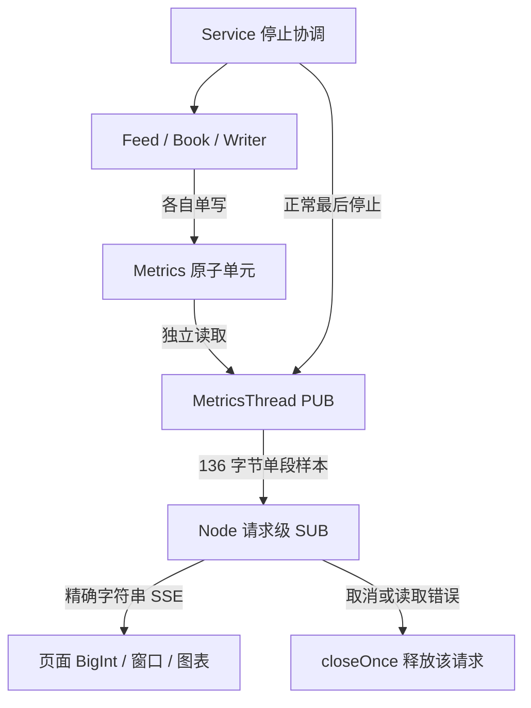

# qbook Implementation Plan（V4 实现计划）

文档版本：0.2｜日期：2026-10-26｜对应版本：V4 指标发布与监控页面

状态：**V4-01～V4-04 已实现并完成本版验收。** 本轮先重跑 V0～V3 基线 154/154；最终完整 CTest 167/167（4.75 秒）、核心隔离分支 75/75、关闭测试的完整生产构建通过。UI 类型检查、153/153 单元测试（26.89 秒）通过；分别重建 UI 后，100 ms 与 2000 ms 配套的真实浏览器验收各 3/3 通过，并完成正常关闭后的 Parquet 读回。

实际文件为 `docs/Implementation_Plan(V4).md`。本文保留原七章结构；第三章按指标发布、SSE 桥接、页面计算和集成支撑展开，并同步本轮落地的文件与依赖。验收步骤和预期仍是约束；实际完成状态见第 5.5 节及本地 `docs/releases/V4.md`，不把未运行步骤写成通过。

## 1. Implementation Overview（实现概述）

### 1.1 本次实现目标与范围

V4 要让操作者打开浏览器，就能看清 qbook 最近接收、处理和追加了多少数据，以及监控链路是否还在更新。C++ 增加独立的第四个工作线程，读取已有原子指标并发布；Node 服务把二进制样本变成浏览器可以接收的文本；页面显示累计值、近期速率、抽样耗时、状态估计与最近 60 秒趋势。

| 任务 | 本版实现内容 | 完成时应提供的证据 |
|---|---|---|
| V4-01 指标线程与计数口径闭环 | MetricsThread、固定布局、计数审计、四线程生命周期。 | 后续有效样本可被真实 SUB 接收；16 项指标和时间戳映射准确；端口失败传播，正常停机保持保存边界。 |
| V4-02 Node 与 SSE 指标桥接 | 精确解码、DTO 校验、只读 GET、有限待发样本和请求清理。 | C++ 固定字节到 JSON 字符串逐字段相等；大整数不丢精度；慢读者及取消测试通过。 |
| V4-03 页面、窗口与连接状态 | BigInt 差分、SlidingRate、四种状态、指标卡片、真实时间趋势。 | 虚拟时间与浏览器结果一致；首次、断档、重连和计数下降不产生假速率。 |
| V4-04 监控链路与界面验收 | 真实服务、Node、浏览器连通；观察端断开后的业务与文件回归。 | AC-13/14 有实际证据；V3 正常保存、故障退出未退步；记录环境、配置及未验证内容。 |

SSE（Server-Sent Events）是服务端向浏览器持续发送文本事件的 HTTP 通道。本项目只需要向页面提供指标，因此每个页面建立一条只读 SSE 连接。ZMQ PUB/SUB 仍是 C++ 与 Node 之间的通道；这两个通道都不能当成可靠的历史记录库。

本版不增加订单修改、交易、撮合、长期指标数据库、历史补发、跨重启运行 ID、账户系统或公网部署。抽样平均耗时只覆盖选中的 Book Apply 调用，不包括网络、队列等待和文件写入，也不是 P99 或完整端到端性能成绩。正式性能实验留给 V5。

### 1.2 参考的 Requirement 与 Spec

| 依据 | 本版必须保持的约定 | 本文落点 |
|---|---|---|
| `AGENTS.md` | 项目名/命名空间 qbook；基础类型 qlib；阶段所有权、停止、资源和交付规则。 | 第 1、2、3.1、5 章。 |
| `requirement.md` FR-13～FR-15、BR-13/15、EXT-04 | 计数口径、抽样、单独发布与消费者离线边界。 | 第 3.1、3.4 节。 |
| FR-16/17、UC-04、EXT-05、AC-14 | 只读页面、正确名称和单位、趋势、连接状态。 | 第 3.2、3.3、5 节。 |
| FR-01/02、FR-11/12、AC-11/12 | 正常有序停止、异常非零退出、显式关闭文件。 | 第 3.1/3.4 节和 V3 回归。 |
| AC-13、AC-16 的本版范围；NFR-03/05/06/07/08 | 准确解释指标、可验证运行、依赖可追溯、资源可回收。 | 第 5、6 章；不能据本版勾选尚未执行的 V5 验收。 |
| `specs.md` 4.5.2.1～4.5.3 | Metric/Metrics、SnapshotMetrics、MetricsThread。 | 第 3.1 节。 |
| `specs.md` 4.6.2.1 | 136 字节小端布局、字符串 DTO、GET 和 closeOnce。 | 第 3.2 节。 |
| `specs.md` 4.6.2.2/3、4.6.3、SP-05 | SlidingRate、实际覆盖时间、采样周期匹配、状态和真实 60 秒历史。 | 第 3.3 节。 |
| `Sprint_Backlog.md` 3.5；V0–V3 实现计划 | 本版四项任务、前置依赖、已有目标和测试支撑。 | 第 2、4、5 章。 |

文档引用使用已有实际文件名 `requirement.md`、`specs.md`。AGENTS 的工程事实随本轮代码同步，不另建两份不同内容的需求文档。若真实前置实现与本计划引用不符，先记录差异并修正对应实现或明确调整方案，不能默默改变业务契约。

### 1.3 现有代码与可复用组件

本计划初版核对了规格、V0～V3 计划、qlib 指标布局及参考 nqbook UI；本轮另核对当前 V0～V3 源码、V3 最新验收记录、固定依赖和实际构建。参考 UI 将所有 64 位数转成 JavaScript `number`，且接收循环每次直接入响应队列；qbook 按已冻结规格改为精确整数传输和明确的流背压处理。背压在这里指“HTTP 下游暂时不读取时，桥接不能无限堆积待发事件”。

| 来源 | 可复用部分 | V4 的具体处理 |
|---|---|---|
| V0 基础 | Config、Metric/Metrics、SnapshotMetrics、RunControl、受检时间转换。 | 复核 16 项映射，不再增加另一组全局计数；保持独立原子读取语义。 |
| V1/V2 | Orderbook、Feed/Book、1024 间隔抽样、业务期望与网络输入工具。 | 只审计计数调用位置；监控不遍历簿、不读取队列内部。 |
| V3 | Writer、Service.cpp、SignalScope、ProcessHarness、WriterGoalObserver、ParquetReadback。 | 增加第四线程；复用真实文件核对与失败传播，不重写一套服务给 UI 测试。 |
| qlib | `qlib::metrics`、记录类型与布局。 | 编译期核对时间戳、16 个字段偏移、136 字节尺寸与小端 ABI；不发送原子对象。 |
| nqbook Metrics/UI 思路 | PUB、每请求 SUB、Next/React、按阶段展示与滑动窗口。 | 保留简洁结构，重新落实生命周期、BigInt、校验、真实时间和连接语义。 |
| C++ 固定输入 | UC-02、UC-03 和文件 schema 期望。 | 增加指标期望和浏览器检查，不以发送数或截图替代读回结果。 |

本轮源码审阅和前置 154 项基线已确认 V3 的四个前提：所有阶段都有异常边界；满队列等待能看到失败状态；正常停止先停止生产者再排空消费者；所有潜在 Fail 写者 join 后才读取首错的阶段名和异常对象。V4 沿用这些前提。

### 1.4 开发环境、依赖与工具链

C++ 沿用当前 Linux 开发容器的 x86-64、小端、C++23、CMake 3.28 或以上、Ninja 和固定 Catch2 v3；复用已有 qlib、fkYAML、spdlog、libzmq 4.3.5、cppzmq 4.10.0。Arrow/Parquet 使用容器 `/usr` 提供的 26.0.0-1 包及 26.0.0 EXACT 官方共享库目标 `Arrow::arrow_shared`、`Parquet::parquet_shared`。CMake 包目录分别为 `/usr/lib/x86_64-linux-gnu/cmake/Arrow`、`/usr/lib/x86_64-linux-gnu/cmake/Parquet`；不恢复 `.deps`，不注入旧的绝对 RPATH 或 `LD_LIBRARY_PATH`。历史安装脚本与包锁文件仍保留，但不是当前容器构建步骤。V4 不为监控引入新的 C++ 网络框架。原生 ABI 是双方约定的本机二进制结构布局，并非跨任意平台的标准消息协议。

UI 已建立 Next.js App Router 工程 `qbook-ui`，使用 npm 和唯一 `ui/package-lock.json`。本轮实际固定 Node.js 24.22.1 LTS、npm 11.19.1、Next.js 16.4.3、React/React DOM 19.3.1、TypeScript 7.0.2、zeromq 6.8.0；直接依赖采用精确版本，按锁执行 `npm ci`。版本选择与官方安全维护核对的来源见 `ui/README.md`，不沿用参考 nqbook 的旧版本范围。

UI 单元与流测试采用 Vitest 5.0.5/Vite 8.3.5，组件清理使用 Testing Library，真实浏览器采用 Playwright 1.64.1 的 Chromium 156.0.8078.4。本轮类型检查、153 项单元测试通过；100 ms、2000 ms 分别生产构建并通过真实浏览器 3/3（约 1.1 分钟）、3/3（约 1.7 分钟），验证原生 zeromq 的生产加载和文件回归。容器原先未安装 Node/npm；本轮校验官方 SHA-256 后将固定版本安装到 `/opt/node-v24.22.1-linux-x64`，由 `/usr/local/bin/node`、`npm`、`npx`、`corepack` 链接提供命令，`build/v4-tools` 仅为可清理下载/探测目录。`cpp-dev:latest` 仍没有仓库内 Dockerfile 或固定 digest，这些容器内安装不能单独复现完整环境。

| 配置 | 默认值与作用 | 校验和生效边界 |
|---|---|---|
| C++ YAML `metrics_endpoint` | `tcp://127.0.0.1:5556`，MetricsThread 绑定。 | 沿用 Config 校验；必要绑定失败是服务失败。 |
| C++ YAML `sample_period` | `100` 毫秒，指标采样间隔。 | 正整数、受检 chrono 转换；启动后不热更新。 |
| UI 服务端 `QBOOK_METRICS_ENDPOINT` | 默认同上，Node SUB 连接。 | 只从服务端环境读取；空值/非法端点明确失败；不从 query/body 接受浏览器指定地址。 |
| UI `NEXT_PUBLIC_METRICS_SAMPLE_PERIOD_MS` | 默认 `100`，浏览器预期周期。 | 构建时固定；必须与 C++ 配套；非法值显示配置错误，不回退为 100。 |
| UI 派生时长 | window=`max(1000, 2×period)`；stall=`max(1500, 3×period)`。 | 输入及乘法结果均为正安全整数毫秒；每 500 ms 检查连接。 |
| 页面历史 | 60000 ms、至多 2000 个绘图点。 | 按真实单调到达时间淘汰；点数只是显示限制，不能解释成固定分钟数。 |

Next 路由明确使用 Node runtime，禁用缓存，V4 不启用 Cache Components；相应维护版支持时保留 `dynamic = "force-dynamic"`。`next.config.ts` 把 zeromq 列为 `serverExternalPackages`，避免原生模块被错误打包。`metrics.ts` 的浏览器可达部分不导入 zeromq 或其他服务端运行时；具体拆分见第 3.2 节。是否可加载必须用生产 `build` 和 `start` 检查，单元测试的 mock 不能证明原生加载成功。

实施时核对所锁版本的官方接口：[Next Route Handlers](https://nextjs.org/docs/app/api-reference/file-conventions/route)、[路由运行时与缓存选项](https://nextjs.org/docs/app/api-reference/file-conventions/route-segment-config)、[原生服务端依赖](https://nextjs.org/docs/app/api-reference/config/next-config-js/serverExternalPackages)、[zeromq Subscriber](https://zeromq.github.io/zeromq.js/classes/Subscriber.html)、[WHATWG Streams](https://streams.spec.whatwg.org/)。在线文档帮助核对 API，不替代锁文件和目标环境验证。

### 1.5 实现约束与完成条件

**数字与口径。** 时间戳是有符号 int64 Unix epoch 纳秒；其余 16 项为 uint64。二进制到 JSON 全部使用十进制字符串，浏览器恢复 BigInt，先相减再决定是否安全转为绘图 number。13 项累计量与 3 项状态量分开处理。接收、有效解码、完成 Apply、成功 Add、显式 Close 成功是不同边界，不能要求它们运行中恒等。

**所有权与失败。** 业务阶段各自唯一写指标，MetricsThread 只读。PUB 和 context 在 Metrics Run 线程内创建和销毁；每个 SSE 请求拥有自己的 SUB。没有订阅者、页面关闭、允许丢弃监控中间样本不使订单簿失败；指标端口无法绑定等本地致命错误仍进入全局失败。运行中不能只靠监控消息报告错误。

**页面真实性。** 首个样本只建立基线。没有指标不是零业务量；业务累计量不变但样本持续到达仍是 live。样本断档、SSE 错误、重连和重启迹象分别处理。页面固定说明本地逐笔挂单数在 L2 为 0，不据零值推断模式；抽样均值标为近似值，不假设独立原子读组成全局事务快照。

**完成条件。** V4-01～V4-04 有实际实现及测试，AC-13/14 通过，四线程加入后的 V3 保存与故障回归通过，UI 与 C++ 周期配置一致，依赖/浏览器/命令/结果有记录。任务状态只依据已取得的证据更新，浏览器验收未结束时不宣布 V4 整体完成。清理本任务新建的可再生成产物，保留已有目录、源码、手写期望、锁文件、用户改动与必要失败证据。

## 2. Implementation Structure（实现结构）

### 2.1 技术模块与代码文件的对应关系

| 模块 | 新增或修改文件 | 实现责任 |
|---|---|---|
| 指标基础与发布 | `include/Threads/MetricsThread.h`、新增 `src/Metrics.cpp`、`src/Threads/MetricsThread.cpp` | 原头文件保留 Metric/Metrics/SnapshotMetrics 声明并增加阶段类；基础实现移至 Metrics.cpp，线程源文件只负责网络发布。 |
| 布局与发送结果 | `src/detail/MetricsLayout.h`、`src/detail/MetricsSend.h` | 前者共享 size/offset/endian 断言；后者区分空发送结果与异常长度。均为内部实现，不增加业务或测试控制接口。 |
| 四线程运行 | `src/Service.cpp`，必要时同步 `src/detail/ServiceInternal.h` | 增加阶段对象、异常边界、完成位、正常最后停监控和失败全停。 |
| 指标计数复核 | V0 Metric/Metrics/SnapshotMetrics 文件，Feed/Book/Writer 的既有调用处 | 保持字段和单写者定义，修复发现的口径偏差并回归，不另增队列窥探。 |
| 协议与桥接 | `ui/lib/metrics.ts`、`ui/lib/server/metrics-stream.ts`、`ui/app/api/metrics/route.ts` | DTO/BigInt 校验、精确解码、请求资源、有限队列和错误传播。 |
| 页面计算 | `ui/lib/rate.ts`、`ui/lib/monitor.ts` | SlidingRate、基线、状态、历史和安全数值转换；纯逻辑便于虚拟时间测试。 |
| 页面展示 | `ui/app/page.tsx`、`ui/app/layout.tsx`、`ui/app/globals.css`、`ui/components/MetricTrend.tsx` | 分组卡片、SVG 曲线、单位、连接状态、解释文字及挂载清理。 |
| UI 工程 | `ui/package.json`、`ui/package-lock.json`、`ui/tsconfig.json`、`ui/next.config.ts`、`ui/vitest.config.ts`、`ui/playwright.config.ts` | 实际依赖、Node runtime、别名、单元/端到端脚本和 Chromium 设置。 |
| C++ 验证 | `tests/metrics_tests.cpp`、`tests/metrics_integration_tests.cpp`、既有 service 测试 | 全字段映射、真实订阅、第四线程启停、端口失败及业务保存回归。 |
| 固定样本 | `tests/fixtures/metrics/`、`tests/metrics_fixture_generator.cpp`、`tests/support/MetricsFixtures.h` | C++ 生成的二进制、独立手写字符串期望及来源/hash 说明。 |
| 集成支撑 | `tests/monitoring_fixture_publisher.cpp`、`tests/parquet_verify.cpp`、扩展 `tests/service_test_driver.cpp` | 真实 feed/metrics 发布、受控阶段完成、只读文件验收。 |
| UI 验证与编排 | `ui/tests/metrics.test.ts`、`rate.test.ts`、`monitor.test.ts`、`metrics-stream.test.ts`、`page.test.tsx`、`monitoring.spec.ts`、`e2e-support.ts`；`scripts/run-monitoring-tests.mjs` | 精确计算与资源测试、真实生产服务浏览器场景、子进程和独占临时目录。 |
| 文档与构建 | `CMakeLists.txt`、`README.md`、`ui/README.md`、`docs/releases/V4.md` | 实际目标、配置配对、命令、结果与限制。 |

路径相对 qbook 仓库根；表中代码、测试和工程文件已按 V4 职责建立。`docs/releases/V4.md` 集中维护实际验收及两组浏览器结果；不预建 V5 空类或占位目标。

### 2.2 各模块需要实现的类与组件

| 组件 | 持有或借用的数据 | 主要行为 |
|---|---|---|
| Metric / Metrics / SnapshotMetrics | 16 个原子单元，主线程持有；各阶段单写。 | 原口径更新和独立采样；V4 复核，不复制另一份指标。 |
| MetricsThread | endpoint_、sample_period_；Run 借用 Metrics/RunControl。 | 本线程创建 PUB，周期发布，停止后不再读取共享指标。 |
| RunServiceImpl | 四阶段、四个 jthread、完成位、两队列和共享对象。 | 创建顺序、退出协调、异常收集及最终 join。 |
| decode / parseSample | 一条完整帧或未知 DTO。 | 固定字段精确转换；非法输入不生成假零值。 |
| GET / 请求级流函数 | 一个 SUB、controller、closed 标记、至多一份 latestPending。 | 订阅、编码、背压、取消、幂等清理。 |
| SlidingRate | 时间窗条目、head、bigint sum、lastNow。 | 增量入窗、到期剔除和清空；不了解业务字段。 |
| monitor 纯协调函数 | 最近准确样本、基线时间、连接代次、各窗口、曲线点。 | 决定差分/重建基线、连接状态和历史范围。 |
| React 页面与 SVG 组件 | 稳定逻辑引用、可展示状态；一个 EventSource 和一个检查定时器。 | 展示数值和限制；卸载释放；曲线不自行订阅网络。 |
| 测试工具 | 固定场景、进度信号、独占进程/路径、只读期望。 | 连接真实实现、制造可观察阶段、核对协议和文件。 |

“状态量”或 gauge 是当前估计，例如本地挂单数，下降可以完全正常；“累计量”是本次运行以来不断增加的计数，下降意味着需要重建页面基线。二者不能使用同一重启判断。

### 2.3 类与源文件、头文件的对应关系

保持 V3 的轻量基础和可选持久化目标。新增网络发布目标不让 qbook_support 或 qbook_core 被迫链接 ZMQ；Node 依赖由 UI 自己管理，不加入 C++ 的 find_package。

| 构建目标 | 源码与依赖 | 创建条件/用途 |
|---|---|---|
| `qbook_support / qbook_core / qbook_protocol` | 原基础、业务、纯协议源码；support 的指标基础实现改用 `src/Metrics.cpp`。 | 保持既有条件；不因 V4 获得 Arrow、ZMQ 或 Node 依赖。 |
| `qbook_pipeline` | 原 Feed/Book 与网络依赖。 | `QBOOK_BUILD_PIPELINE=ON`，默认 ON。 |
| `qbook_metrics`（STATIC） | MetricsThread.cpp；公开 support/必要头依赖，PRIVATE cppzmq、Threads、qbook_logging。 | 与 PIPELINE 开关一致；可单独验证，不要求持久化。 |
| `qbook_storage / qbook_writer` | V3 文件和 Writer 目标。 | `QBOOK_BUILD_PERSISTENCE=ON`，默认 OFF。 |
| `qbook_service` / `qbook` | Service.cpp / main.cpp；service 新增链接 qbook_metrics。 | SERVICE=ON 仍要求显式 PIPELINE=ON 且 PERSISTENCE=ON；默认 OFF。 |
| `qbook_metrics_tests` | metrics 单元/集成文件及必要测试辅助，链接 support/metrics/Catch2/实际 cppzmq。 | BUILD_TESTING 且 PIPELINE；CTest 前缀 `metrics::`。 |
| 原 unit/allocation/pipeline/storage/service 测试 | 保留目标与前缀；service 补第四线程路径。 | 按既有开关；分配测试不混入 Arrow/网络进程。 |
| `qbook_metrics_fixture_generator` | 固定样本源码、布局断言、qlib。 | BUILD_TESTING；无 ZMQ/Arrow 依赖。 |
| `qbook_monitoring_fixture_publisher` | 固定 feed/metrics 场景发布与受控命令。 | BUILD_TESTING 且 PIPELINE；使用 cppzmq/qlib，不链接 UI。 |
| `qbook_service_test_driver` | 复用同一 RunServiceImpl、WriterGoalObserver、私有 hooks。 | BUILD_TESTING 且 SERVICE；仅测试可执行文件。 |
| `qbook_parquet_verify` | ParquetReadback 和独立场景期望。 | BUILD_TESTING 且 PERSISTENCE；显式 Arrow/Parquet，不从 UI 解释文件。 |

`QBOOK_BUILD_BENCHMARKS` 仍为 OFF，V5 未实现前不能把 ON 静默忽略。`BUILD_TESTING=OFF` 不创建测试工具、不接入 Catch2。默认完整构建由第 5.2 节显式开启所需能力；无需新增独立的“UI 打开才编指标”开关。

公共 MetricsThread 头文件用适当前向声明隔离 zmq 完整类型；具体 socket/context 类型只在实现出现。布局头为项目内部契约，供指标实现和固定样本工具共享。UI 服务端 stream 文件禁止被客户端组件导入；测试可依赖受限内部函数，不为浏览器公开调试 API。

CMake 为完整测试配置生成 `build/debug/tests/runtime-paths.json`，通过 `$<TARGET_FILE:...>` 写入实际 `qbook`、`serviceTestDriver`、`fixtureGenerator`、`fixturePublisher`、`parquetVerify` 路径，并以 `metricsFixtures` 传递 `tests/fixtures/metrics` 的绝对位置。编排器校验文件存在且可执行；生成路径文件不等于相关目标已经构建。`cmake --build build/debug` 必须先成功，不能使用上次遗留二进制冒充本次产物。

### 2.4 模块与类之间的实现依赖



图中业务数据仍通过 V3 两条 SPSC 队列流动，这里只画监控依赖。页面和 Node 没有返回业务线程的修改路径；释放一个请求不停止 MetricsThread。Metrics、RunControl 和阶段对象必须活到全部工作线程 join 以后。

| 资源 | 唯一操作方/写者 | 可跨边界观察什么 | 释放前提 |
|---|---|---|---|
| FeedQueue / RecordQueue / Orderbook | 保持 Feed→Book→Writer 与 Book 所有权。 | 监控仅看约定原子指标。 | 对应生产者、消费者已 join。 |
| 16 项指标 | Feed 6、Book 6、Writer 4 各自单写；其中 Book 3 项为 gauge。 | MetricsThread 逐个 relaxed 读取。 | 四阶段和测试读者已结束。 |
| PUB/context | Metrics Run 线程。 | 外部仅接收普通记录副本。 | 在 Run 返回或展开异常前本线程销毁。 |
| SUB / HTTP stream | 该 GET 请求的事件循环与清理函数。 | 浏览器只收到 DTO；不共享给其他请求。 | closeOnce 已触发，接收任务已结束且监听移除。 |
| 浏览器窗口与历史 | 页面当前挂载代次的事件循环。 | React 得到显示值，SVG 得到可绘点。 | 卸载关闭 EventSource、定时器和监听。 |
| 测试 hook / 进度观察器 | 启动前冻结，指定线程回调。 | 用 release/acquire 进度，不窥业务容器。 | 最后可能调用者 join 后销毁。 |

### 2.5 整体编码顺序及其原因

1. 核对真实 V0–V3、模板、版本依赖和工作区，记录已有生成目录；固定 17 字段布局与计数口径。
2. 实现 MetricsThread 和四线程协调，先用真实 SUB 验证正常采样、无订阅者和端口失败，再保留原保存回归。
3. 生成独立跨语言固定样本，先完成 decode/parseSample 的整数测试，再实现请求级 SSE 生命周期和背压。
4. 实现 SlidingRate 与 monitor 的纯逻辑，使用虚拟时间核对重置、覆盖时长和状态；随后连接 React 展示。
5. 完成测试编排、两种匹配采样周期、真实浏览器和观察端断开后的文件核对，记录实际结果并清理本次生成产物。

## 3. Module Implementation（模块实现方案）

每个模块按模板说明目标、类或函数组件、成员与接口、关键执行步骤、并发、错误、编码顺序及测试。TypeScript 部分保留函数和组件组织，不为了模仿 C++ 而增加没有职责的工作类。

### 3.1 T-05 指标发布与四线程生命周期

#### 3.1.1 模块实现概述

1. **实现目标。** 完成 V4-01：让独立的 MetricsThread 定时读取业务计数并发布 136 字节指标帧；把它加入 V3 的真实服务，保证正常保存完成后再结束监控，监控本地致命错误也能使整个服务明确失败。监控只观察，既不消费业务队列，也不改变订单簿。
2. **对应规格。** requirement.md 的 FR-13～FR-15、AC-13，以及 specs.md §4.5、§5.2、§5.5；UI 消费契约与 §4.6 联合核对。V0 的 Metric/Metrics、V2 的计数和抽样边界、V3 的服务收尾规则仍然有效。
3. **类与文件。** 扩展 `include/Threads/MetricsThread.h`、`src/Threads/MetricsThread.cpp`；新增 `src/Metrics.cpp`、内部 `src/detail/MetricsLayout.h` 和 `src/detail/MetricsSend.h`，调整 `src/Service.cpp` 和 CMake。测试进入 `tests/metrics_tests.cpp`、`tests/metrics_integration_tests.cpp`，私有观察器位于 `tests/support/MetricsThreadInspector.h`；既有 Feed/Book/Writer 计数调用点只在发现与已定口径不符时修正，不在监控线程另算一套业务计数。
4. **依赖与复用。** 复用 Config、Metric/Metrics、SnapshotMetrics、RunControl、受检时钟运算、cppzmq、同步日志及 V3 ServiceHooks/ProcessHarness。新增 `qbook_metrics` 静态库，随 `QBOOK_BUILD_PIPELINE=ON` 建立，链接 support、cppzmq、Threads 及所需日志目标；service 链接该库。关闭 pipeline 时不因纯指标单元测试把 ZMQ 引入 support；Arrow/Parquet 仍仅由存储和服务路径要求。

#### 3.1.2 Class Implementation（类实现）

##### 3.1.2.1 Metric、Metrics 与 SnapshotMetrics：复用并审计口径

**1. 实现目标。** 保持单个整数的更新简单，把“在哪里加一”与“网络何时读到”区分开。Metric/Metrics 的公开声明沿用 V0，不为 V4 增加动态注册、聚合锁或清零接口。

**2. 声明与文件组织。** `include/Threads/MetricsThread.h` 保留单元、集合及 `SnapshotMetrics(const Metrics&, std::int64_t) noexcept`；将这些既有基础函数实现从原 `src/Threads/MetricsThread.cpp` 移到 `src/Metrics.cpp`，后者仍仅属于 qbook_support。原源文件用于新的网络发布实现，避免同一个编译单元强制支持库依赖 ZMQ，也避免重复编译同一组函数。内部 `MetricsLayout.h` 仅定义当前指标传输布局断言，供发布代码、C++ 样本生成器和布局测试包含；它不让业务模块依赖 JavaScript 或网络类型。`MetricsSend.h` 中的 `MetricsSendAccepted` 是 Publish 共用的结果分类：空 optional 返回 false，只有完整 136 字节返回 true，异常长度明确抛错。

**3. 成员、初始化与所有权。** 每个 `Metric` 仍为按 `QLIB_CACHE_LINE` 对齐的 `std::atomic<std::uint64_t>{0}`；当前宏为 64，所有翻译单元必须一致。Metrics 按值含 16 个不可复制、不可移动的单元，主线程创建后借给各阶段，所有读写线程 join 后才销毁。累计量使用 Add，状态量使用 Set，监控仅 Read。relaxed 原子读取不承担队列发布、对象生存或错误载荷同步。

| 字段 | 唯一写者与更新时刻 | V4 必须保留的解释 |
|---|---|---|
| feed_messages、feed_bytes | Feed 收到完整消息后累加。 | 包含随后拒绝的输入；bytes 是内容字节，不含网络封装。 |
| feed_orders、feed_trades、feed_levels | Feed 完成格式、字段和模式筛选后、尝试入队前累加。 | orders 包含撤单；停止时尚未入队的事件可能已经计入，不能等同成功接纳数。 |
| feed_dropped | Feed 在格式、字段或模式拒绝处累加。 | 不含 Book 业务忽略，也不含停止时尚未接纳的事件。 |
| book_events | Book 的 Apply 正常完成后累加。 | 包含合法无变化和业务忽略；异常中断的 Apply 不算完成。 |
| book_apply_ns、book_samples | Book 的被抽样 Apply 完成后分别累加。 | 处理位置为第 1、1025、2049……次；耗时不含队列等待、快照和文件写入。 |
| book_instruments、book_resting_orders、book_memory_bytes | Book 完成一次快照观察轮次时 Set。 | 分别是本运行已建立品种、本地逐笔挂单、订单簿存储估计；L2 挂单数为 0，内存不是进程 RSS。 |
| writer_orders、writer_trades、writer_levels、writer_books | Writer 相应 Add 成功后累加。 | orders 含撤单；表示追加成功，不表示 fsync 或断电安全落盘。 |

上述表中共有 13 个累计字段、3 个状态字段。两个抽样累计值不是一笔原子事务；运行中读者可能看到耗时和样本数先后更新，因此 UI 均值只是近期监控估计。精确阶段计数应在已知完成边界或线程停止后比较；不建立 `feed_messages == book_events == writer_orders` 这样的错误等式。

**4. 重要函数的实现。**

| 实现维度 | `SnapshotMetrics(const Metrics& source, std::int64_t sample_ns) noexcept` |
|---|---|
| 声明与职责 | 沿用 V0 的自由函数，生成可传输的普通 `qlib::metrics` 值。 |
| 输入、输出与契约 | source 存活且只有既定写者；sample_ns 为本机 Unix epoch 纳秒；返回值的 17 个字段全部显式赋值。 |
| 算法与数据结构 | 按字段名做 16 次 Read，加一份传入时间戳；不复制原子对象的内存。 |
| 执行步骤 | 值初始化结果 → 写 ts_ns → 逐个读取并赋给同名 qlib 字段 → 按值返回。 |
| 状态读写 | 只读 Metrics，不写计数，也不访问队列、Book 或 Writer。 |
| 调用关系 | 仅调用 Metric::Read；时钟读取留给 Publish，便于固定时间戳测试。 |
| 边界与错误 | 全零集合合法；uint64 最大值按原值携带；不能从跨字段差异推出丢事件。 |
| 异常安全 | 固定整数读写，无动态分配、网络或异常；返回后副本不依赖源对象。 |
| 复杂度 | 固定 16 次读取，时间和额外空间均 O(1)。 |
| 并发与同步 | 各字段独立 relaxed load；不是跨字段一致快照，不作为停止完成的信号。 |
| 验证 | 给每个字段不同的可辨认值并逐项核对，固定正、负和大时间戳；保留 V0 Add 溢出保持旧值的测试。 |

**5. 构造、初始化与释放。** 本版不改变 Metrics 的零初始化。测试若直接设置 16 个字段，应在工作线程启动前完成，或按三个写者的真实归属分别更新；不得让测试主线程与真实业务线程同时写同一 Metric。

**6. 内部关键流程。** 以 UC-02 六条有效输入为例，完成边界之后 feed_orders 为 5、feed_trades 为 1、book_events 为 6、book_samples 为 1；writer_orders 为 5 而文件分别含 4 条 order、1 条 cancel。是否存在快照及 writer_books 的值要看实际已完成快照，不因六条输入而编造固定快照条数。

**7. 实现顺序。** 先核对旧调用点和字段映射，再固定布局与样本，最后接入周期发送。若发现计数边界冲突，先修正对应阶段及回归测试，再用 UI 展示该字段；不靠改页面名称掩盖错误计数。

##### 3.1.2.2 MetricsThread：本线程采样、本线程发送

**1. 实现目标。** 接收端点和正采样周期，周期发布最新状态，不等待浏览器追赶，不积累历史。没有订阅者是正常运行；绑定失败或不可恢复发送错误是服务失败。

**2. 声明与文件组织。** 保留 specs 规定的接口；`include/Threads/MetricsThread.h` 增加标准头依赖及全局命名空间中的 `namespace zmq { class socket_t; }` 前置声明，不包含 zmq.hpp。`src/Threads/MetricsThread.cpp` 才包含 cppzmq 并承担网络、时钟和日志实现；其定义只进入 qbook_metrics，不将网络资源变成主线程成员。

```cpp
class MetricsThread {
public:
  MetricsThread(std::string endpoint,
                std::chrono::milliseconds sample_period);
  void Run(const Metrics& metrics, std::stop_token stop,
           const RunControl& control);

private:
  void Bind(zmq::socket_t& pub);
  bool Publish(zmq::socket_t& pub, const Metrics& metrics);
  std::string endpoint_;
  std::chrono::milliseconds sample_period_;
};
```

需要测试私有绑定/发送时，可沿用已有测试观察器方式，声明 `testing::MetricsThreadInspector` 为友元：观察器只在调用线程拥有 socket 时执行 Bind/Publish，不跨线程关闭实际 Run 的 socket，也不增加生产控制接口。测试观察器定义只进入测试目标，声明在各构建中一致。

**3. 成员及局部状态。**

| 数据 | 类型、初值 | 生存与不变量 |
|---|---|---|
| endpoint_ | 拥有副本的 std::string | 构造后不再修改；不用临时字符串的 string_view 保存地址。 |
| sample_period_ | 正 milliseconds | 来源为已验证 Config；直接构造测试也须满足受检时间转换前提。 |
| context、pub | Run 的局部 ZMQ 对象 | 在指标线程创建、使用和销毁；先 context 后 pub 声明，退出时先关闭 pub 再结束 context。 |
| period、next_due | steady duration/time_point | 到期安排均使用受检加法；系统墙钟调整不改变调度。 |
| sample | 单个 qlib::metrics | 一次发送的普通值；无历史数组，也不保存 Metrics 的原始字节视图供异步使用。 |
| 本地诊断状态 | 有界计数/上次诊断时间，如需要 | 仅用来限频报告跳帧，不新增或复用业务计数；避免每次暂不可发送都输出一条日志。 |

**4. 重要函数的实现。**

###### A. 构造与 Bind

| 实现维度 | 构造函数及 `void Bind(zmq::socket_t& pub)` |
|---|---|
| 声明与职责 | 构造保存配置；Bind 在指标线程建立本地 PUB 端点。 |
| 输入、输出与契约 | 合法端点、正周期；Bind 收到本线程拥有且尚未连接/绑定的 PUB，成功后返回 void。 |
| 算法与数据结构 | std::string 拥有地址；使用 Run 的局部网络对象，不建立共享 socket 管理器。 |
| 执行步骤 | 构造保存参数并检查调用前提 → Run 创建 context/PUB → 设置 conflate 和 linger=0 → bind → 记录 `metrics_bound` 及实际端点。 |
| 状态读写 | 构造写两个成员；Bind 只读取 endpoint_，修改借用的本线程 PUB 配置。 |
| 调用关系 | 复用受检周期转换；cppzmq set/bind；成功点记录同步日志。 |
| 边界与错误 | 非正/不可表示周期拒绝；端口占用、无效地址或选项失败向外传播。没有订阅者不报错。 |
| 异常安全 | 构造抛错时未创建网络；Bind 失败由 Run 局部析构回收已创建对象，不留下仍引用 Metrics 的后台业务线程。 |
| 复杂度 | 固定本地操作；网络初始化是冷路径，不给出固定耗时承诺。 |
| 并发与同步 | 全部 socket 操作由指标线程完成；协调主线程仅请求 stop，不代替线程 close。 |
| 验证 | 有效本机绑定、真实已占用端口、非法端点及无订阅运行；线程结束后重新绑定同一测试端点。 |

conflate 是只保留近期消息的 ZMQ 队列策略；必须在 bind 前设置，且本项目只发送单段消息。linger=0 表示退出时可以丢弃未送出的监控帧，不使业务收尾等待观察者。它们不能证明接收方收到数据，也不约束后续 HTTP 流的积压。实现时以锁定版本的 [libzmq socket 选项说明](https://zeromq.github.io/libzmq/zmq_setsockopt.html) 核对行为。

###### B. Publish

| 实现维度 | `bool Publish(zmq::socket_t& pub, const Metrics& metrics)` |
|---|---|
| 声明与职责 | 形成当前指标副本，尝试发送一条完整单段帧。 |
| 输入、输出与契约 | 本线程可用 PUB 和存活 Metrics；本地发送接受返回 true，暂不可发送返回 false；不是客户端收货确认。 |
| 算法与数据结构 | 系统时间转 Unix epoch int64 纳秒 → SnapshotMetrics → 固定 136 字节单段复制发送；不发送 Metric/Metrics 对象。 |
| 执行步骤 | 检查时间转换可表示 → 生成 sample → 使用 dontwait 发送 `buffer(&sample, sizeof sample)` → 空发送结果视为 EAGAIN 跳帧 → 非空结果核对完整长度后返回 true。 |
| 状态读写 | 读取 Metrics 和本地时钟，不修改业务计数；使用同步的复制发送接口，不把栈地址注册为无复制的异步缓冲。 |
| 调用关系 | system_clock、SnapshotMetrics、cppzmq send；发送结果分类依据实际锁定 cppzmq 的返回类型。 |
| 边界与错误 | EAGAIN/空结果允许跳过；其他 socket 错误抛出。EINTR 保持可识别，由 Run 检查停止/失败后跳过这次采样，不原地无限重试。时间超出 int64 纳秒范围或异常短发送明确失败。 |
| 异常安全 | 失败不回滚已更新业务计数，不重复应用事件；局部 sample 在复制发送返回后可销毁。致命错误交给阶段包装器处理。 |
| 复杂度 | 固定 16 次读取和 136 字节发送准备，O(1)；网络库内部成本及分配不宣传为零或完全无锁。 |
| 并发与同步 | 仅指标线程调用；多个字段可能来自略有不同的业务时刻，不能用网络帧协调队列销毁。 |
| 验证 | 真 PUB/SUB 收到后逐字段核对；用 C++ 固定样本核对全部偏移。暂不可发送分支按返回值判定单测/代码审查覆盖，不假定慢 PUB 订阅者一定制造 EAGAIN。 |

已核对固定 cppzmq 4.10.0：`send(const_buffer, dontwait)` 的空 optional 表达 EAGAIN，其他错误抛异常；不能把所有失败统一当作 false。空结果和异常长度已由生产共用的 `MetricsSendAccepted` 单测覆盖。真实无/慢订阅 PUB 未自然产生 EAGAIN，不能把其丢样本当作该分支的现场证据。测试致命发送错误时，由观察器在同一拥有线程创建 context/PUB、设置 linger=0，再调用非阻塞的 `zmq_ctx_shutdown(context.handle())`（或锁定 cppzmq 的对应 shutdown 接口），确认随后 Publish 的真实 ETERM 向外传播；最后先关闭 PUB，再销毁 context。不能先调用会等待所有 socket 关闭的 `zmq_ctx_term`/context.close，否则同线程会在到达 Publish 前卡住。也不要从另一个线程关闭 Run 的 socket。相关契约见 [context shutdown](https://zeromq.github.io/libzmq/zmq_ctx_shutdown.html)、[context term](https://zeromq.github.io/libzmq/zmq_ctx_term.html)；发送成功只说明本地接收了消息，参见 [libzmq send](https://zeromq.github.io/libzmq/zmq_msg_send.html)。

###### C. Run

| 实现维度 | `void Run(const Metrics&, std::stop_token, const RunControl&)` |
|---|---|
| 声明与职责 | 在专属线程绑定网络、按周期采样，普通停止或全局失败时退出。 |
| 输入、输出与契约 | 三个借用对象有效至返回；同一对象只运行一次，不允许并发调用；返回后不再读取指标。 |
| 算法与数据结构 | 单个 steady deadline、一个样本及局部 context/PUB；无补发历史队列。 |
| 执行步骤 | 检查已请求停止/失败 → 创建网络并 Bind → 受检计算首个 now+period → 分段等到期限 → 再检查 stop/Failed → 调 Publish → 以完成后当前 steady 时间安排下一次期限 → 循环；退出依次释放 pub/context。 |
| 状态读写 | 只读成员、Metrics、stop 和 Failed；next_due 等只属于本线程。 |
| 调用关系 | Bind、Publish、CheckedSteadyPeriod/受检到期加法、steady_clock、sleep_until；不访问 FeedQueue/RecordQueue/Book。 |
| 边界与错误 | 每段等待最多 100ms；超期只发当前样本。Publish 的 EINTR 导致检查停止并跳过本轮，其余致命异常传播；每次加法越界都报错而不回绕。 |
| 异常安全 | RAII 释放本线程网络；异常不穿过 jthread 入口，外层包装器捕获并调用 Fail("metrics", current_exception())。 |
| 复杂度 | 每个发布周期固定工作；等待不忙循环。停止响应受调度和系统调用影响，100ms 是检查片段上限而非退出 SLA。 |
| 并发与同步 | 与业务写者只通过 Metrics 原子读交互；Failed 仅用于决定退出，不在此读取 Stage/Error 载荷。 |
| 验证 | 默认及 2000ms 周期、初始 stop、等待中 stop、全局 Failed、无/慢订阅者、真实绑定错误；以期限断言退出，不能用无限 join 充当测试。 |

**5. 构造、初始化与释放。** 构造没有网络副作用，Run 才绑定。Run 内 context 的生命周期包住 pub，PUB 设置零 linger；退出时不额外补发“最终完整指标”。即使正常业务均已完成，订阅端也不被保证收到最后一次状态，因此文件完整性仍靠 V3 的正常 Close、join 和独立读回验证。

**6. 内部关键流程。** 假设周期 100ms，某次调度拖到 350ms 才获得执行机会，线程此时读取一次当前状态并发送，再从这次处理结束的 steady 时间安排下一周期，不补发原本 100/200/300ms 的三个旧时刻。对外 ts_ns 记录真实采样系统时间；浏览器不用它计算速率窗口，避免系统时间调整影响到达时间差。

等待前计算 `remaining = next_due - now`，只在 now<next_due 时使用；实际休眠到 `min(next_due, CheckedAdd(now, 100ms))`，100ms 片段的加法也要受检，或通过已知剩余期限选择安全的短段。V0 已检查毫秒到 steady duration 可表示；V4 每次计算 now+period 仍先检查 `now.count() > max_count - period.count()`，通过后才相加。不允许极大配置绕过检查并形成忙循环。

**7. 实现顺序。** 先绑定和一帧发送，再做精确字段测试，然后加入周期/停止逻辑，最后进入四线程装配。纯布局和 SnapshotMetrics 测试不启动服务；真实订阅测试允许丢失建立连接期间的首帧，等待后续有效帧，不能先 sleep 固定时长就假定订阅已经就绪。

##### 3.1.2.3 RunServiceImpl：在 V3 生命周期中加入第四阶段

**1. 实现目标。** 正式程序创建 MetricsThread，沿用同一套信号处理、首错保留及线程收尾逻辑，不另写一份仅供 V4 测试的“等价服务”。

**2. 声明与文件组织。** `include/Runtime.h` 的 `int RunService(const Config&)` 不变；`src/Service.cpp` 中 `detail::RunServiceImpl(const Config&, const ServiceHooks*)` 扩展为四阶段。main 仍只加载配置、调用服务并返回退出码；不存在新的 C++ 命令行、环境变量或 UI 控制开关。

**3. 局部数据与所有权。** 新增一个 MetricsThread 对象、初始不可 join 的 jthread 和 `std::atomic<bool>{false}` 完成位。四个阶段对象、两个队列、Metrics/RunControl 都由主线程持有至所有阶段结束。保留 V3 的 before_start、writer_hooks 和 coordinator_poll；本版无需为暂停发布或页面观测增加生产 hooks。

**4. 重要函数的实现。**

| 实现维度 | `RunService` / `detail::RunServiceImpl` 与阶段包装器 |
|---|---|
| 声明与职责 | 复用 V3 入口，仅把第四个真实阶段加入创建、完成等待、失败广播和 join。 |
| 输入、输出与契约 | 已验证 Config；主线程单实例调用。正常保存及四阶段清理均成功才返回 0，任意阶段致命错误返回非零。 |
| 算法与数据结构 | 固定四个阶段、四个 done 位；无第五个协调线程，无指标读队列。 |
| 执行步骤 | SignalScope 屏蔽并安装 → 创建共享对象/清理守卫 → 依次创建 Metrics、Writer、Book、Feed → 协调主线程解除信号屏蔽 → 等停止/Failed → 正常依次停止并 join Feed、Book、Writer、Metrics；故障则全体请求停止并 join → 恢复信号配置 → 读取首错载荷、返回。 |
| 状态读写 | 工作包装器只写各自 done 和 RunControl；主线程管理句柄、停止和 join，coordinator_poll 仍只读 Metrics。 |
| 调用关系 | MetricsThread::Run、新增静态阶段名 "metrics"、既有 Stage wrapper/StopAndJoinStage、SignalScope；不由主线程调用 socket close。 |
| 边界与错误 | 每次创建前调用 before_start 并检查 Failed；部分创建失败只处理实际句柄。普通收尾等 Writer 时若 Metrics 失败，立即转故障收尾，最终非零。 |
| 异常安全 | 第一线程创建前已建立清理守卫；任何异常先进入首错，再停止并 join 全部已创建者；不 detach，也不提前销毁 Metrics。 |
| 复杂度 | 固定四阶段协调成本；业务排空仍随已接纳积压增加，文件系统等待没有硬上限保证。 |
| 并发与同步 | 各 done 为 release/acquire，之后仍 join；所有潜在 Fail 调用者 join 前不得读取 Stage/Error。ZMQ 内部线程继承指标工作线程的信号屏蔽。 |
| 验证 | 第 1～4 个阶段创建前注入失败、真实指标端口占用、SIGINT/SIGTERM 正常排空、Writer 失败时 Metrics 退出、Metrics 失败时业务取消；均复用实际 ServiceImpl。 |

**5. 初始化与资源释放。** Metrics→Writer→Book→Feed 是句柄创建顺序，不是四个初始化成功的严格屏障。每次继续创建前检查 Failed，仍可能在后台 bind 失败尚未被观察前创建下一阶段；这种情况由统一清理处理，不能承诺指标绑定失败时绝不建立输出目录。`metrics_bound` 仅在真实 bind 成功后打印，`service_control_ready` 仍只说明协调信号路径已就绪，不代表接收方已有订阅。

**6. 内部关键流程。** 包装器在 Run 正常返回但本阶段既无 stop 又无 Failed 时，仍报告“阶段意外提前结束”；最后总是 release 写 done。主线程等任一正常阶段完成时持续检查 Failed，如出现故障便向所有已创建线程请求停止；不能阻塞在 Writer join 中而永远不处理已失败的 Metrics。原 SignalScope 保持不变：处理器只写 sig_atomic_t，所有工作线程及其 ZMQ 辅助线程继承 SIGINT/SIGTERM 屏蔽，只有协调主线程解除屏蔽和执行收尾。

**7. 实现顺序。** 先把完成位和包装器扩展到四个，再接入创建和正常停止顺序，然后覆盖所有部分启动位置及双向故障传播。V3 的三阶段测试驱动继续调用同一内层服务实现，新增预期第四阶段，而不保留一条绕过监控的正式运行路径。

#### 3.1.3 模块内部协作与调用流程

Feed、Book、Writer 在各自真实完成边界更新整数；MetricsThread 到期调用 SnapshotMetrics 获得独立值，随后发布单段帧。发布完成不会触发业务阶段继续或停止，Node/浏览器只能从外部消费该帧。

正常停止时，Feed 先结束，随后 Book 排空已接纳事件并结束，Writer 排空记录并 Close；主线程确认 Writer join 后才请求 Metrics 停止并 join。任何阶段失败都打断这一正常排空承诺，改为全局取消。指标最后停止可让观察期间覆盖业务收尾，但不意味着可靠发送最终计数。

#### 3.1.4 模块关键算法的实现方案

**固定布局检查。** 在 `MetricsLayout.h` 中检查 `CHAR_BIT == 8`、int64/uint64 宽度、`std::endian::native == std::endian::little`，以及 `qlib::metrics` 为 standard-layout、trivially-copyable、`sizeof == 136`；对下表每个字段逐项 `static_assert(offsetof(...))`。不满足则拒绝构建当前传输路径，不能改 JavaScript 偏移猜测兼容。

| 字段 | 字节偏移 | 字段 | 字节偏移 |
|---|---:|---|---:|
| ts_ns | 0 | book_samples | 72 |
| feed_messages | 8 | book_instruments | 80 |
| feed_bytes | 16 | book_resting_orders | 88 |
| feed_orders | 24 | book_memory_bytes | 96 |
| feed_trades | 32 | writer_orders | 104 |
| feed_levels | 40 | writer_trades | 112 |
| feed_dropped | 48 | writer_levels | 120 |
| book_events | 56 | writer_books | 128 |
| book_apply_ns | 64 | — | — |

当前结构没有协议版本字段。将该布局及 qlib 来源摘要写入 fixture 清单和部署说明；“收到 136 字节”不能证明任意第三方服务兼容。不得临时增加 topic 前缀或 multipart，否则 Node 的单帧检查和 conflate 约定都会被破坏。

**跳过过期计划。** 每次发送后从当前 steady 时间计算下一期限，防止负载暂停后连续补发过时状态。EAGAIN 和被中断的一次采样也消耗本轮机会，下一轮重新读取最新值。不能为保证指标条数而在 Publish 外无限重试同一旧帧。

#### 3.1.5 模块并发与同步实现

本地 Metric 遵守单写者，MetricsThread 是独立读者；对齐不能替代所有权约束。SnapshotMetrics 的结果是普通整数副本，复制发送后 socket 拥有其消息存储；网络库不持有 Metrics 成员或局部 sample 的悬空引用。

RunControl::Failed 可能先于获胜错误的阶段/异常载荷可见。因此任何线程都只能凭 Failed 决定停止；协调者把全部潜在 Fail 写者 join 完再读取诊断。done 的 release/acquire 仅证明对应包装器已经发布完成，不允许仍有其他 Fail 写者时读取全局载荷。

#### 3.1.6 模块错误处理与恢复方案

| 情况 | 处理 | 恢复与结果 |
|---|---|---|
| 无订阅者、连接建立时遗漏首帧 | 照常采样发送，不计为 feed_dropped。 | 后续订阅可接收新样本；不补发历史。 |
| 一次发送暂不可用或 EINTR | 跳过本轮；EINTR 后检查停止/失败。 | 下一周期读取新值；诊断限频，不改变业务计数。 |
| bind 失败、不可恢复 socket 错误、时间运算不可表示 | 异常交给阶段包装器，Fail("metrics", error)。 | 整个服务失败收尾；本次不自动重新绑定或重启。 |
| Writer/Feed/Book 已失败 | 指标循环观察 Failed 并结束。 | 全体 join 后报告首错；监控不掩盖失败。 |
| 用户普通停止 | 业务正常收尾后再停止 Metrics。 | 正常完成不保证最终帧送达；文件验收独立进行。 |

关闭网络过程中若库暴露可报告的错误，在普通上下文保留附加诊断，不覆盖已经确定的首错；不能让日志抛错或二次清理异常越过线程入口。未实现自动重试、可靠历史、最终帧确认和跨运行 ID，保持与 V4 范围一致。

#### 3.1.7 模块实现顺序

1. 核对 16 个字段的写者、更新位置及 1/1025/2049 抽样序列，保留 V0/V2/V3 回归。
2. 增加全部布局断言、不同字段值的映射测试及 C++ 固定帧，先使协议可独立核对。
3. 实现局部网络创建、Bind、Publish 和错误分类；先通过真实一帧接收测试。
4. 实现受检周期、分段等待、跳过过期计划及 stop/Failed 退出。
5. 将服务扩展为四阶段，覆盖部分启动、正常停止和错误传播，然后连接 Node 桥接。

#### 3.1.8 模块测试与完成条件

| 测试组 | 具体检查与成功标准 |
|---|---|
| 映射与口径 | 17 字段逐项对照，超过 2^53 的数仍逐位相等；撤单合并计数但分文件；Book 忽略计处理、异常未完成不计；样本位置准确。 |
| 真实 PUB/SUB | 在有限期限内收到至少一个后续完整帧，单段、136 字节、正确字段；允许漏首帧，不断言收到次数等于发布次数。 |
| 等待与停止 | 默认 100ms 与 2000ms 周期均能停止；提前停止不留资源，Failed 触发退出；期限用作测试防挂起，不作为生产 SLA。 |
| 无/慢观察端 | 服务仍完成有限输入与正常文件关闭；不以 PUB 是否返回 false 作为慢客户端测试的必然结果。 |
| 本地错误 | 已占用真实端口导致服务非零，全部已创建阶段结束；发送致命错误向外传播，不统一吞成跳帧。 |
| 生命周期回归 | 普通顺序为 Feed→Book→Writer→Metrics；故障时全停；第 1～4 次创建前失败均无悬空工作者；SIGINT/SIGTERM 和 V3 文件读回通过。 |

本轮已实现指标发布、单写者口径审计与四阶段协调，11 项 `metrics::` 和扩展后的 23 项 `service::` 均实际通过，计入完整 167/167；真实 ETERM、端口占用、Writer/Metrics 双向故障和四个部分启动位置均有覆盖。固定帧由实际 C++ 生成器产生，跨语言逐字段检查纳入 UI 单元验证；浏览器闭环单独按第 5 章验收。

### 3.2 指标解码与 Node/SSE 桥接（V4-02）

#### 3.2.1 模块实现概述

**1. 模块实现目标。** 把 MetricsThread 发布的二进制样本转换成浏览器能够接收的文本事件。桥接必须准确保留全部 64 位整数，并在浏览器停止读取、关闭页面或连接失败时释放这个请求的资源。它不读取订单簿，也不向业务服务发送控制命令。

**2. 对应的 Spec 章节。** 对应 specs.md §4.6.1、§4.6.2.1、§4.6.3 和 §5.5，落实 FR-15/16、EXT-04/05、AC-13/14，以及 Backlog V4-02。SSE 是一个持续返回文本的 HTTP 响应；这里的数据只从服务器流向浏览器，使用它已经足够。

**3. 需要实现的组件与文件。** `ui/lib/metrics.ts` 定义字段、DTO、`decode` 和 `parseSample`；`ui/app/api/metrics/route.ts` 只保留 Next.js 允许的路由导出与 `GET`；新增 `ui/lib/server/metrics-stream.ts` 承担每请求的订阅、接收循环、背压和关闭状态。后一个文件是对规格文件组织的细化，使生命周期测试能直接检查真实流函数，不必在路由文件导出额外测试入口。新增 `ui/tests/metrics.test.ts`、`ui/tests/metrics-stream.test.ts`，复用 `tests/fixtures/metrics/` 的跨语言样本。

**4. 依赖与复用组件。** 复用 Next.js App Router、React、TypeScript 与 Node 版 `zeromq`；使用 npm 和 `package-lock.json` 固定依赖，Vitest 检查纯计算和响应流，Playwright 在 V4-04 检查真实页面。实际固定版本见第 1.4 节；生产原生模块加载与浏览器链路仍由第 5 章的真实运行验证，不能只依据依赖声明推断成功。`ui/README.md` 记录 Node/npm、锁文件、启动命令和协议布局。

#### 3.2.2 Class Implementation（组件实现）

本模块按函数组织，不额外包装工作类。以下七项仍分别说明目标、声明、状态、函数、生命周期、关键流程和实现依赖。

**1. 组件的实现目标。** 解码函数只转换一个值；流组件只管理一个请求。浏览器消费 `MetricsDto`，不会接触 `Buffer`、ZMQ socket 或 C++ 内存地址。每个客户端的暂存状态彼此独立，关闭一个页面不会关闭其他页面的订阅。

**2. 声明与文件组织。** 保留规格公开边界；新增的服务器内部函数只供路由和测试使用，不构成新的 HTTP 接口。

```typescript
// ui/lib/metrics.ts：允许浏览器导入，不引入 zeromq。
import type { Buffer } from 'node:buffer';
export type MetricsDto = { [K in MetricField]: string };
export type MetricsSample = { [K in MetricField]: bigint };
export declare function decode(frame: Buffer): MetricsDto;
export declare function parseSample(dto: unknown): MetricsSample;

// ui/app/api/metrics/route.ts：只有服务器执行。
export const runtime = 'nodejs';
export const dynamic = 'force-dynamic';
export declare function GET(request: NextRequest): Promise<Response>;
```

`MetricField` 是下表 17 个 DTO 字段名的联合类型，并由固定只读字段表约束，不能写成任意字符串索引。`metrics.ts` 中的 Buffer 引用只用于类型；`decode` 对传入实例调用读取方法，不在模块顶层执行 Node API。`parseSample` 及其导入链不得带入 `zeromq` 或原生模块。`metrics-stream.ts` 使用服务器专属导入边界，并在 `next.config.ts` 中按所选版本配置 `serverExternalPackages: ['zeromq']`，验证构建后能在 Node 中加载原生包。

若采用 `import 'server-only'` 标记服务器模块，Vitest 的 Node 单测只在测试配置中将该标记解析为空模块，让测试能导入真实桥接函数；生产构建仍保留标记并检查客户端不能导入。这个处理不替代真实 zeromq/HTTP 集成测试，也不能把服务器文件整个 mock 掉。

本版不启用 Cache Components。实际锁定 Next.js 后，按对应版本核对 `force-dynamic` 和 Node runtime 的配置；不得把启用新缓存模型后的不兼容选项强行复制进工程。无论所选版本如何表达，接口必须在每个请求中建立自己的订阅，响应不能成为静态缓存。参考官方 [Route Handler](https://nextjs.org/docs/app/api-reference/file-conventions/route)、[路由运行配置](https://nextjs.org/docs/app/api-reference/file-conventions/route-segment-config) 和 [原生包外部加载配置](https://nextjs.org/docs/app/api-reference/config/next-config-js/serverExternalPackages)。

**3. 内部数据、初始化和所有权。** 每次创建响应时建立下列局部状态，不放在跨请求的模块全局变量中。

| 状态 | 具体类型与初始值 | 所有权与不变量 |
|---|---|---|
| `endpoint` | 非空字符串；默认 `tcp://127.0.0.1:5556` | 仅服务器读取 `QBOOK_METRICS_ENDPOINT`；请求 URL、查询参数和请求体均不能覆盖。 |
| `sub` | 一个 `Subscriber`，初始尚未创建 | 请求独占；设置 `conflate: true`、`linger: 0`，订阅空前缀后连接配置端点。 |
| `controller` | `ReadableStreamDefaultController<Uint8Array>` 或空 | 只属于本响应；终止后不再 enqueue。 |
| `phase`、`closed` | `connecting`、`false` | phase 只向 open、closing、closed 前进；closed 是关闭操作的首道判断。 |
| `latestPending` | `MetricsDto \| undefined`，初始空 | 无下游空间时覆盖旧值；不保存待发数组。 |
| `receiveTask` | 已挂接拒绝处理的 `Promise<void>` 或空 | 同一请求只有一个接收循环，不并行调用同一 socket 的 receive。 |
| `onAbort` | 命名回调 | 注册后由 closeOnce 删除；不能用无法移除的临时匿名函数。 |
| 流队列 | `highWaterMark: 1`，`size: () => 1` | 每个 chunk 是一条完整 SSE 事件；最多一条已入队事件，外加一份 latestPending。 |
| 日志节流状态 | 本请求的最近诊断时间和计数 | 错帧可跳过，但不能每帧无限打印；终止记录原因，不记录完整业务流。 |

`conflate` 只约束 ZMQ 自身的消息队列，HTTP 层仍需要明确的背压规则。背压是“接收者暂时没有继续读取空间”的信号，本版采用覆盖旧监控样本的处理方式。上述上限是应用自建队列的上限；Node、HTTP 和操作系统仍有自己的缓冲，不能由两项局部变量推出整个进程只占两条消息的内存。

**4. 重要函数的具体实现。** 各函数按照同一组 11 项约束实现。

##### （1）`decode(frame)`：按冻结布局读取全部字段

| 维度 | 实现方案 |
|---|---|
| 函数声明与职责 | `decode(frame: Buffer): MetricsDto`；从一个完整二进制帧构造完整字符串对象。 |
| 输入、输出与契约 | 输入必须是受支持小端 ABI 的 136 字节记录；成功返回所有 17 字段，输入不被修改。 |
| 核心算法与容器 | 使用固定偏移表；时间戳调用 `readBigInt64LE`，其余调用 `readBigUInt64LE`，每项立即 `.toString(10)`。 |
| 具体执行步骤 | 先检查 `frame.length === METRICS_SIZE`；再建立局部 DTO 并逐字段读取；全部成功后一次返回。 |
| 成员或局部状态 | 只读常量布局表和传入 Buffer；没有 socket、历史或共享缓存。 |
| 对其他函数的调用 | 只调用 Buffer 的大整数读取及 BigInt 字符串转换；不得经 `readDoubleLE`、`parseInt` 或 `Number` 中转。 |
| 边界与错误处理 | 长度 0、135、137 等直接抛协议解析错误；不截断长帧，不给短帧补零；同长度错误协议仍依赖部署版本检查。 |
| 异常安全与一致性 | 半成品 DTO 不交给调用者；解析失败不产生新样本，不改变最近有效值。 |
| 时间与空间复杂度 | 固定 17 字段、每项最多 20 个十进制字符，合法输入的时间和额外空间均为 O(1)。 |
| 并发与同步 | 纯同步转换；接收循环串行调用，不使用共享可变 Buffer。 |
| 单元测试与验证 | 读取 C++ 生成的固定二进制文件，逐字段对照人工审阅的 expected JSON；覆盖不同字段值、大整数、负时间戳及长度错误。 |

固定布局如下。表中 i64 表示有符号 64 位整数，u64 表示无符号 64 位整数；这是一项明确的部署契约，不能推广为任意机器上 C++ struct 的通用编码。

| 偏移 | qlib 字段 | DTO 字段 | 解析类型 |
|---:|---|---|---|
| 0 | `ts_ns` | `tsNs` | i64 |
| 8 | `feed_messages` | `feedMessages` | u64 |
| 16 | `feed_bytes` | `feedBytes` | u64 |
| 24 | `feed_orders` | `feedOrders` | u64 |
| 32 | `feed_trades` | `feedTrades` | u64 |
| 40 | `feed_levels` | `feedLevels` | u64 |
| 48 | `feed_dropped` | `feedDropped` | u64 |
| 56 | `book_events` | `bookEvents` | u64 |
| 64 | `book_apply_ns` | `bookApplyNs` | u64 |
| 72 | `book_samples` | `bookSamples` | u64 |
| 80 | `book_instruments` | `bookInstruments` | u64 |
| 88 | `book_resting_orders` | `bookRestingOrders` | u64 |
| 96 | `book_memory_bytes` | `bookMemoryBytes` | u64 |
| 104 | `writer_orders` | `writerOrders` | u64 |
| 112 | `writer_trades` | `writerTrades` | u64 |
| 120 | `writer_levels` | `writerLevels` | u64 |
| 128 | `writer_books` | `writerBooks` | u64 |

Node 的上述方法返回 BigInt，适合在转换 JSON 字符串之前保留整数值；接口用法以 [Node Buffer 官方文档](https://nodejs.org/api/buffer.html) 为依据。不能用 `JSON.stringify(bigint)` 直接发送，因为标准 JSON 没有 BigInt 数值类型。

##### （2）`parseSample(dto)`：在浏览器边界恢复准确整数

| 维度 | 实现方案 |
|---|---|
| 函数声明与职责 | `parseSample(dto: unknown): MetricsSample`；验证未知 JSON 并恢复 17 项 bigint。 |
| 输入、输出与契约 | 输入是非 null、非数组对象；全部规定字段必须存在且为字符串；完整合法时才返回新样本。 |
| 核心算法与容器 | 用固定字段表和范围表校验。tsNs 范围为 `[-2^63, 2^63-1]`；其余范围为 `[0, 2^64-1]`。 |
| 具体执行步骤 | 验证对象与字段；限制字符串长度至 20；验证规范十进制字符；转 BigInt；检查上下界；全部通过后返回。 |
| 成员或局部状态 | 只写局部 `MetricsSample`；不修改页面 previousSample、lastArrivalMs 或窗口。 |
| 对其他函数的调用 | 通过 `BigInt(value)` 转换；调用者先执行 JSON.parse 并统一处理两类解析错误。 |
| 边界与错误处理 | 拒绝缺项、number 值、空白、加号、指数、小数、十六进制、前导零及负零；时间戳允许真正负数；累计值拒绝负数。 |
| 异常安全与一致性 | 任一字段错误即整条丢弃；显示诊断但不更新时间与基线，不能用 `value ?? '0'` 掩盖缺项。 |
| 时间与空间复杂度 | 固定字段数和字符串上限下 O(1)；先限制长度再调用 BigInt，避免解析不必要的长整数。 |
| 并发与同步 | 在页面事件循环同步执行；不持有 EventSource，不处理重连。 |
| 单元测试与验证 | 覆盖 int64/uint64 最小最大值及上下越界、大于 `2^53`、缺少任一字段、错误类型和格式；失败前后页面有效样本不变。 |

规范字符串的无符号格式为 `0` 或非零数字开头的十进制数；有符号格式另外允许负号后跟非零十进制数。本版按固定字段表构建结果，额外字段不进入 `MetricsSample`；额外字段不能代替缺失字段，也不意味着接收端已理解新协议。

##### （3）`GET` 与响应建立：先把所有资源纳入清理范围

| 维度 | 实现方案 |
|---|---|
| 函数声明与职责 | `GET(request: NextRequest): Promise<Response>`；读服务器配置，委托内部函数创建只读 SSE 响应。 |
| 输入、输出与契约 | 使用 request.signal；输出 `Content-Type: text/event-stream; charset=utf-8`，`Cache-Control: no-cache, no-store, no-transform`，以及本机自托管可用的 `X-Accel-Buffering: no`。 |
| 核心算法与容器 | 每请求创建一个 Subscriber 和一个普通 `ReadableStream<Uint8Array>`；使用按 chunk 计数的高水位 1。 |
| 具体执行步骤 | 初始化关闭状态；注册 onAbort 并立即复查 signal.aborted；在未关闭时创建 socket、设选项、订阅和连接；创建响应流，在 start 中登记 controller、写一条说明注释并启动接收任务；返回 Response。 |
| 成员或局部状态 | 建立 sub、controller、receiveTask；所有对象一旦创建就立即写入本请求可清理的局部状态。 |
| 对其他函数的调用 | 调用服务器内部响应函数、Subscriber 构造/subscribe/connect、receiveLoop、closeOnce；测试可在内部函数传入工厂，生产 GET 固定使用真实工厂。 |
| 边界与错误处理 | 已取消请求不建立长期订阅；注册后再检查 aborted 封闭检查与注册间的空隙。配置或本地初始化在响应建立前失败，清理后返回明确非 2xx；不等待首个指标才返回响应。 |
| 异常安全与一致性 | socket 创建后任何 setup/Response 构造异常都进入统一清理；不留下仅靠垃圾回收关闭的 pending receive。 |
| 时间与空间复杂度 | 每请求固定应用状态；连接后台建立，GET 不阻塞等待行情或发布者在线。 |
| 并发与同步 | 多请求相互独立；一个请求的异步接收任务必须立即挂接 catch/finally，不产生未处理 Promise 拒绝。 |
| 单元测试与验证 | 检查响应头、首条注释、无首帧时仍可取消、每个 setup 阶段失败后的关闭次数、两个请求互不影响，以及真实 build/start 下的 GET。 |

注释采用 `: qbook metrics; latest samples only\n\n`，不会触发浏览器业务样本处理器。后续业务事件采用 `data: <JSON>\n\n`，由页面 `onmessage` 读取；不设置用于可靠回放的 `id`，也不根据 `Last-Event-ID` 补发历史。本地 Subscriber.connect 返回只表示连接请求已配置，不证明发布者存在或已收到第一帧。

##### （4）`receiveLoop` 与 `drainLatest`：持续接收，只提交下游能容纳的最新样本

| 维度 | 实现方案 |
|---|---|
| 函数声明与职责 | 服务器内部 `receiveLoop(): Promise<void>` 和同步 `drainLatest(): void`；前者收样本，后者在有空间时入队一条事件。 |
| 输入、输出与契约 | receiveLoop 使用本请求 Subscriber 的唯一异步迭代器；drainLatest 使用 controller、closed 和 latestPending，均不向业务服务返回确认。 |
| 核心算法与容器 | 接收循环持续消费；有效新样本覆盖 latestPending；当 `controller.desiredSize > 0` 时编码并 enqueue，成功后清空 pending。 |
| 具体执行步骤 | 每次得到帧先检查 closed；检查观察到的 parts 数量为 1；decode 成功后替换 pending 并 drain；stream.pull 同样调用 drain；没有 pending 时 pull 直接返回。 |
| 成员或局部状态 | 只更新 pending 和有限诊断状态；不保留已发样本数组，不按客户端速度等待每个历史样本。 |
| 对其他函数的调用 | decode → JSON.stringify → TextEncoder.encode → controller.enqueue；receiveLoop 的异常/结束进入 closeOnce。 |
| 边界与错误处理 | desiredSize 为 0、负数或 null 时不清空 pending；坏帧只丢这一帧并限频记录；不可恢复接收或入队异常终止响应。 |
| 异常安全与一致性 | 构造 chunk 和 enqueue 都成功后才清空 pending；若编码/入队失败则关闭，不反复重试半条 SSE；每个 chunk 包含完整事件分隔符。 |
| 时间与空间复杂度 | 每样本固定工作量；应用暂存 O(1)。慢客户端允许丢弃旧中间样本，不会使待发对象数随时间增长。 |
| 并发与同步 | drainLatest 无 await；一次 JS 执行片段内完成判断、入队、清空，不能在其中插入跨事件循环等待。pull 不再发起第二个 receive。 |
| 单元测试与验证 | 暂停 reader，连续送大量不同值，断言队列至多 1 条、pending 至多 1 份；恢复时允许先读已入队旧值，随后读最近 pending；检查无待发时 pull 不忙循环、取消后的晚到结果不 enqueue。 |

当 reader 再次需要数据时，ReadableStream 会调用 pull；当新样本到达而队列空闲时，接收循环也会主动 drain，因此不会因为之前一次空 pull 而永久漏发。使用普通流而非 `type: 'bytes'`，避免把按“条数”设置的高水位误当作字节数。`desiredSize` 与排队策略的定义见 [WHATWG Streams 标准](https://streams.spec.whatwg.org/)；Next/Node 的实际 HTTP 适配行为仍需真实慢客户端验收。

##### （5）`closeOnce`：区分取消与失败，关闭一次并收束接收任务

| 维度 | 实现方案 |
|---|---|
| 函数声明与职责 | 内部 `closeOnce(reason, error?): void`；reason 区分 request-abort、stream-cancel、receive-error、unexpected-end、setup-error 和 server-stop。 |
| 输入、输出与契约 | 可由多个异步路径重复调用；第一次调用负责清理，后续调用立即返回；不返回监控样本。 |
| 核心算法与容器 | 首先设置 closed；删除 abort 监听和本请求的进程停止回调，清空 pending，关闭 sub；按原因结束或错误化 controller。 |
| 具体执行步骤 | 检查 closed；夺取关闭职责；移除监听；逐项清理；stream.cancel 已使流进入取消状态时不再次调用 controller.close/error；request-abort 关闭流，意外异常或 server-stop 让流 error，解除 HTTP 写入等待。 |
| 成员或局部状态 | 清空 pending 和对可释放资源的引用；保留必要关闭原因供诊断；接收任务完成后不再持有请求资源。 |
| 对其他函数的调用 | signal.removeEventListener、请求的 unregisterServerStop、sub.close、controller.close/error；预期 socket 关闭会使迭代结束。 |
| 边界与错误处理 | sub/controller 尚未创建也能清理；关闭中的次生异常单独记录并继续释放其他资源，不覆盖第一原因。 |
| 异常安全与一致性 | 清理函数不抛回事件处理器；closed 在所有外部操作之前置位，阻止重入和晚到帧复活连接。 |
| 时间与空间复杂度 | 固定数量资源 O(1)；不等待全部历史样本发送完成。 |
| 并发与同步 | 同一事件循环内幂等；不在 receiveLoop 内等待自身 receiveTask。stream.cancel 可返回 receiveTask 以便测试等待真正退出；onAbort 同步触发清理并由已处理 Promise 收尾。 |
| 单元测试与验证 | 请求取消和流取消交错、重复取消、receive 正在等待时关闭、接收抛错、setup 部分失败及 server-stop；断言 close 一次、监听移除、任务退出且无 unhandled rejection，并验证多请求只注册一组进程停止监听。 |

使用 `for await` 时，官方 zeromq.js 明确说明 socket.close 会使迭代器返回；提前退出迭代器本身并不等于释放仍被引用的 socket。因此计划显式 close，真实模块测试在有限截止时间内验证接收任务退出，不只检查一个布尔值。连接、conflate 和关闭语义参见 [Subscriber 官方 API](https://zeromq.github.io/zeromq.js/classes/Subscriber.html)。关闭后的预期迭代结束可以忽略；意外正常结束在 closed 仍为 false 时属于故障，不能默默留下一个永不更新的“成功”流。

**5. 创建、初始化与资源释放。** GET 每次建立独立状态，响应存活期间唯一接收任务拥有订阅使用权。请求取消、流取消和 Node 进程停止均进入幂等清理。模块级 `activeClosers` 只登记各请求的清理回调；首个活动请求注册一组 SIGINT/SIGTERM 监听，最后一个请求释放后卸载。停止通知遍历清理回调，先关闭各自 SUB 并使 SSE 流失败，解除 Next 等待 HTTP 响应结束的阻塞；不为每个请求新增进程监听，不共享 SUB、接收任务或样本。设置 linger 为零避免为监控残留消息等待发送；已安装拒绝处理的接收任务在 socket 关闭后结束。页面 EventSource 自动重连形成新 GET，新请求从空 pending 开始。

**6. 内部关键流程。** 例如客户端暂停读取时，事件 A 已在流队列中；B、C、D 依次到达，pending 最终只保存 D。客户端恢复后可能先读到 A，随后读到 D，不要求把 B、C 补回。这正是近期状态的用途。若期间取消请求，A 所在流被取消、pending 被清空、socket 被关闭；接收循环随后退出，不能再将 D 写入已关闭流。

**7. 实现顺序与依赖关系。** 先固定 17 字段与 C++ fixture，再写 decode/parseSample；然后实现可独立测试的流组件，最后接入 GET、环境配置和 Next 构建。这样“数值解错”和“响应不再更新”分别有独立验证入口。

#### 3.2.3 模块内部协作与调用流程

1. Node 路由读取 `QBOOK_METRICS_ENDPOINT`，将 request.signal 交给响应组件；这个变量只配置 UI 服务，不改变 qbook 的 YAML。
2. 响应组件创建自己的 Subscriber 并订阅全部单段指标消息。C++ 已确认兼容布局后，真实样本经 decode 转换为 17 项字符串。
3. 有响应空间时写入完整 `data:` 事件；无空间时覆盖 pending。浏览器只在完整 SSE 事件到达后解析 JSON 并调用 parseSample。
4. 页面把成功恢复的 BigInt 样本交给 §3.3；服务器异常结束响应时，EventSource 进入错误/重连流程。UI 订阅取消不传播到 C++ RunControl。

#### 3.2.4 模块关键算法的实现方案

**跨语言整数路径。** 以 `feedMessages = 9007199254740993` 为例，C++ 的 uint64 位型经 LE Buffer 读取为 BigInt，再转换为字符串 `"9007199254740993"`；浏览器用 BigInt 恢复。下一样本为 `"9007199254741003"` 时先相减得到 `10n`，然后才进行受控绘图转换。纳秒时间戳也走字符串，不先压成毫秒浮点数作为协议值。

**协议与消息边界。** 接收循环对实际得到的 parts 数组检查单段，并对单帧检查 136 字节；C++ 侧同时静态检查大小、全部偏移和小端。由于 ZMQ conflate 不支持 multipart，它可能在应用看到消息之前只保留其中一段，所以不能声称该检查能识别所有错误 multipart，尤其是恰好 136 字节的一段。部署必须配对支持同一布局的发布端；协议没有版本字段，长度相同也不能证明语义相同。

**有界响应路径。** 一条完整 SSE 为一个 chunk；除了队列中的至多一个 chunk，仅保存一份 DTO。pull 和新样本到达共用同步 drainLatest。不能在一个定时器里反复 enqueue 心跳绕过背压；本版只发开始说明，不额外引入周期心跳。停滞判断依靠最近有效指标到达时间，不把注释当指标样本。

#### 3.2.5 模块并发与同步实现

Node 异步事件虽然在同一 JS 线程执行，`await` 前后仍可能穿插取消。每次 await 返回后先检查 closed；所有设置 pending、检查 desiredSize、enqueue 和清空 pending 的操作在同一同步片段内完成。每个 socket 只使用一个异步迭代器，不能让 pull 和接收循环各读一次。真实底层库可能使用工作线程，这不改变 JS 层资源只由一个请求组件管理的约束，也不构成“链路完全无锁”的保证。

#### 3.2.6 模块错误处理与恢复方案

| 情况 | 当前请求的处理 | 页面与业务影响 |
|---|---|---|
| 发布者尚未运行、暂时无指标 | 保持订阅和可取消的 SSE，不伪造样本。 | 页面进入 connecting/stalled；业务服务不受 UI 控制。 |
| 长度错误或解码失败 | 跳过该帧，限频记录原因；最近有效样本不变。 | 最后有效样本过期后转 stalled。 |
| 浏览器 DTO 校验失败 | 页面丢整条样本并显示诊断。 | 不更新基线、最后到达时间或曲线。 |
| 浏览器关闭/请求取消 | 幂等清理资源，使唯一接收任务退出。 | 不改变其他客户端和 C++ 服务。 |
| Node 收到 SIGINT/SIGTERM | 一组模块级停止监听广播到活动请求，关闭各自 SUB 并使 SSE 流失败，最后卸载监听。 | 全部观察连接断开，C++ 服务继续运行；不让慢长连接阻止 Next 退出。 |
| 订阅不可恢复异常 | 服务端记录错误并使响应流失败。 | EventSource 错误进入 offline；后续新请求可重新连接。 |
| 响应建立前配置/原生模块错误 | 释放已创建资源并返回非 2xx，启动日志说明具体原因。 | 不以空 SSE 冒充成功。 |
| 同长度异版本布局 | 不能仅靠解析可靠检测；配对部署、fixture 和版本记录阻止混用。 | 列为协议限制，不推导自动兼容。 |

#### 3.2.7 模块实现顺序

1. 根据实际 Node/Next/React/zeromq 兼容性生成锁文件，验证原生包能加载，记录版本而不预填成功。
2. 增加固定字段表、两端范围校验和 C++ fixture 对照；先通过大整数与坏输入测试。
3. 增加流组件和假的可控 Subscriber 工厂，仅用于测试；完成背压、取消和异常交错测试。
4. 将生产 GET 固定接入真实 Subscriber，完成 npm build/start 下的真实 GET 和取消检查。
5. 写明端点配置、Node 运行限制、无历史补发、少量本机观察者范围，再交给页面和 V4-04。

#### 3.2.8 模块测试与完成条件

| 检查组 | 必须得到的证据 |
|---|---|
| C++ → Buffer → DTO → BigInt | 每字段与独立期望一致，`2^53` 以上计数、int64 边界及纳秒时间不变；不能仅由 TS 自己编码再自己解码。 |
| 坏输入 | 错误长度、缺字段、错误类型、越界和非法十进制被识别；没有全零替代样本。 |
| 背压 | 暂停 reader 后局部队列和 pending 有界；恢复取得近期 pending；慢客户端不要求无损接收每条指标。 |
| 生命周期 | 无首帧、接收等待、重复取消、晚到帧、初始化失败和订阅异常均正确清理；检查关闭次数、活动订阅数和任务实际退出。 |
| 原生与 HTTP | 真正 Next build/start 可加载 zeromq、GET 返回正确 SSE、断开真实 HTTP 客户端后本请求订阅退出；mock 不能替代。 |
| 交付记录 | 提交源代码、package-lock、fixture、测试和 README；记录实际版本与命令，所有尚未运行项目明确标注未执行。 |

桥接、精确解码及请求清理已验收，相关单元测试计入本轮 UI 153/153。真实生产 GET 核对全部 17 字段，8 轮请求取消后 XPUB 订阅数回到 0，4 条活跃 SSE 下的 Node SIGINT/SIGTERM 均释放订阅并退出；两组周期的真实浏览器各 3/3 通过。慢流有界状态由单元测试直接检查，HTTP/浏览器结果另证真实模块与生命周期，不把两者混为相同覆盖。

### 3.3 监控页面、滑动窗口与连接状态（V4-03）

#### 3.3.1 模块实现概述

1. **实现目标。** 页面同时回答“累计处理多少”“最近处理多快”“这组数据是否仍在更新”。累计量准确显示，近期速率按真实到达间隔估计；没有数据、业务空闲和连接断开分别呈现。
2. **设计依据。** requirement.md 的 FR-16、FR-17、UC-04、AC-14；specs.md §4.6.2.2、§4.6.2.3、§4.6.3 和 SP-05。保持只读，不增加订单修改入口。
3. **类、函数和文件。** `ui/lib/rate.ts` 实现 `SlidingRate`；新增 `ui/lib/monitor.ts` 放置配置解析、窗口协调、连接状态和历史裁剪；`ui/app/page.tsx` 负责订阅及 React 生命周期；必要的 `ui/components/MetricCard.tsx`、`MetricTrend.tsx` 只接收显示数据。测试对应 `rate.test.ts`、`monitor.test.ts` 和 `page.test.tsx`。
4. **依赖与复用。** 复用 §3.2 的 `MetricsSample`、`parseSample` 和 `/api/metrics`。计算组件通过参数接收单调时间，不自行读取网络和真实时钟；页面在回调开始时读取一次 `performance.now()`，把相同时间传给本轮全部计算。

#### 3.3.2 Class Implementation（类与组件实现）

##### A. `SlidingRate`

**1. 实现目标。** 窗口保存“两个累计样本相减后的增量”，以 `bigint` 维护总量。它不了解订单含义，也不把启动累计值当作当前一秒的流量。

**2. 声明与文件组织。** 在 `ui/lib/rate.ts` 导出以下接口，供生产页面和虚拟时间测试使用。`evict` 保持私有。

```typescript
export declare class SlidingRate {
  constructor(windowMs?: number);
  push(t: number, increment: bigint): void;
  total(now: number): bigint;
  reset(): void;
  private evict(now: number): void;
}
```

**3. 成员变量、所有权与不变量。**

| 成员 | 实现及初值 | 约束与生命周期 |
|---|---|---|
| `windowMs` | 构造参数，正有限 `number` | 构造后不变；页面传入已验证的派生窗口。 |
| `entries` | `{ t: number; v: bigint }[] = []` | 对象独占；时间不递减、增量非负，允许零增量。 |
| `head` | `0` | `[0, head)` 是已过期前缀，不再计入总量。 |
| `sum` | `0n` | 等于所有未过期条目的 `v` 之和。 |
| `lastNow` | `number \| null = null` | 记录本对象最近一次操作时间；`push` 和 `total` 均不得倒退。 |

有效时间范围固定为 `(now - windowMs, now]`，因此恰好位于左边界的条目应移除。数组前缀足够大时用 `slice(head)` 压缩，重置 `head=0`；可以固定为 `head >= 1024 && head * 2 >= entries.length`，不每次 `shift()`。压缩只改变存储，不改变总和或窗口边界。窗口空间为 O(窗口内有效到达数)，还包含受压缩阈值约束的过期前缀；输入频率越高，同一时间范围内也可能有更多条目，因此不承诺与输入频率无关的固定项数上限，也不暗中丢增量来满足图点上限。验收记录正常配置和受控高频输入下的条目数变化。

**4. 重要函数的具体实现。**

| 维度 | `push(t, increment)` |
|---|---|
| 函数声明与职责 | `push(t: number, increment: bigint): void`，加入一个到达时刻的非负增量。 |
| 输入、输出与契约 | `t` 有限且不小于 `lastNow`；`increment >= 0n`；返回 `void`。允许相同时间的多次操作。 |
| 核心算法 | 先验证输入，再淘汰过期前缀，追加 `{t,v}` 并累加 `sum`；不将 `bigint` 转为浮点。 |
| 具体步骤 | 检查时间和增量→`evict(t)`→追加条目→`sum += increment`→保存 `lastNow=t`。 |
| 成员读写 | 读取 `windowMs/lastNow`；修改 `entries/head/sum/lastNow`。 |
| 调用关系 | 调用内部 `evict`；不调用页面、网络、计时器。 |
| 边界与错误 | 零增量、同时间合法；负增量、非有限时间、时间倒退抛参数错误，不改成绝对值或零。 |
| 异常安全与一致性 | 参数校验在修改前完成；对象在每次成功操作后满足总和不变量。内存分配失败不能伪装为有效零速率，交由页面报告计算失败。 |
| 时间与空间 | 摊销 O(1)，淘汰或压缩单次最坏 O(m)；m 为窗口条目及尚未压缩的前缀数。 |
| 并发与同步 | 浏览器同一事件循环调用；不共享到 Web Worker，不在 React 渲染过程中修改。 |
| 单元验证 | 同时间、边界刚好到期、多个过期项、零增量、大 `bigint`、压缩前后总和、非法输入后原状态。 |

| 维度 | `total(now)` / 内部 `evict(now)` |
|---|---|
| 函数声明与职责 | `total(now: number): bigint` 清理窗口并返回总和；`evict` 实现前缀清理和压缩。 |
| 输入、输出与契约 | 时间有限且不倒退；空窗口返回 `0n`。查询会修改内部状态，不作为无副作用的 getter 使用。 |
| 核心算法 | 循环扣除所有 `entries[head].t <= now-windowMs` 的值，再按阈值压缩。 |
| 具体步骤 | 验证时间→调用 `evict`→保存 `lastNow`→返回准确 `sum`。 |
| 成员读写 | 读取边界和条目；更新 `head/sum/entries/lastNow`。 |
| 调用关系 | `total` 与 `push` 复用同一淘汰逻辑，避免左右边界不一致。 |
| 边界与错误 | `now` 等于上次时间合法；全部到期返回零；不允许查询过去来恢复已删除历史。 |
| 异常安全与一致性 | 输入错误前置拒绝；扣除只针对原来计入总和的条目，不产生负和。 |
| 时间与空间 | 摊销 O(1)，单次最坏 O(m)；压缩临时复制活动条目，不能宣称单次零分配。 |
| 并发与同步 | 与 `push` 在同一事件循环串行；一次样本处理使用同一个 `arrivalMs`。 |
| 单元验证 | `t=0`、`t=1000` 的精确边界；空窗口；连续同时间查询；压缩后再次写入。 |

| 维度 | `reset()` |
|---|---|
| 函数声明与职责 | `reset(): void`，移除旧连接或旧累计基线的全部窗口增量。 |
| 输入、输出与契约 | 无参数；返回后等价于刚构造的空窗口，但保留配置的 `windowMs`。 |
| 核心算法 | 释放旧数组引用，将 `head=0`、`sum=0n`、`lastNow=null`。 |
| 具体步骤 | 替换 `entries=[]`→重置三个标量→返回。 |
| 成员读写 | 修改全部可变成员，不改 `windowMs`。 |
| 调用关系 | 由页面协调器的 `resetBaseline` 或连接代次切换调用。 |
| 边界与错误 | 空窗口重复重置合法；重置后允许从新的单调时间起点开始测试。 |
| 异常安全与一致性 | 不调用用户回调；旧 `bigint` 不再参与任何新差值。 |
| 时间与空间 | 移除 O(m) 条目的引用；具体垃圾回收时机由运行时决定，不承诺立即归还操作系统内存。 |
| 并发与同步 | 仍只在页面事件循环中执行。 |
| 单元验证 | 写入后重置、重复重置、重置后首条增量、新时间起点和总和。 |

**5. 构造、初始化和释放。** 构造时拒绝非法窗口，建立空数组。每个页面模型拥有 13 个累计字段窗口；卸载页面后释放整个模型，无需独立计时器或外部连接。

**6. 关键流程。** 累计数从 `9007199254740993n` 变为 `9007199254741003n` 时，调用方先得到 `10n`，然后调用 `push(arrivalMs, 10n)`。窗口从未接收两个巨大累计值的浮点近似。

**7. 实现顺序。** 先完成构造及输入校验，再完成无压缩的淘汰与求和，最后加入压缩和重置测试。业务基线逻辑在下一组件实现，不混入这个通用窗口。

##### B. 页面模型与 React 页面

**1. 实现目标。** 将准确样本转为可解释的显示模型。`ui/lib/monitor.ts` 管理数值和状态；`page.tsx` 只负责连接、调用和渲染，避免把可独立验证的算法藏在 React effect 中。

**2. 声明与文件组织。** 导出配置解析和 `createMonitorModel(config)` 工厂；工厂返回由闭包独占状态的方法，不额外设计继承层。`onSample`、`resetBaseline`、`pruneHistory`、`evaluateConnection` 保留 specs 中的职责；`getView()` 返回只读显示快照。页面接收到 JSON 后先 `parseSample`，再交给模型。`MetricTrend` 使用 SVG 绘制有限点集。

**3. 状态、所有权和配置。**

| 状态或常量 | 具体实现 | 作用与不变量 |
|---|---|---|
| `expectedSamplePeriodMs` | 构建时 `NEXT_PUBLIC_METRICS_SAMPLE_PERIOD_MS`，未设置默认 100 | 只接受正安全整数十进制字符串；空字符串、零、负数、小数、科学计数写法和越界值均报告配置错误。 |
| `rateWindowMs` / `stallAfterMs` | `max(1000, 2*period)` / `max(1500, 3*period)` | 派生结果也必须是安全整数；配置错误停止速率估计并显示说明，不静默使用默认值。 |
| 观察常量 | `historyMs=60000`、`checkPeriodMs=500`、`maxHistoryPoints=2000` | 页面与 README 公开这些值；图点数不是“最近一分钟”的定义。 |
| `previousSample` | 上个用于差分的完整 `MetricsSample` 或空 | 仅累计字段相减；首次或重置样本不产生流量。 |
| `lastArrivalMs` / `baselineStartMs` | `number \| null` | 前者记录最近有效样本，后者决定本轮实际已覆盖时长。 |
| `latestDisplaySample` | 最后一次完整有效样本或空 | 断连时仍可显示，但明确标为旧值；不用于证明当前连接已收到样本。 |
| 连接记录 | `transportError`、`hasValidSampleInConnection`、连接代次 | 新的 SSE `open` 开始新代次；旧连接的到达时间不能直接使新连接显示 live。 |
| `windows` | 按累计字段名持有 13 个 `SlidingRate` | 不为时间戳和 gauge 建差分窗口；重置时一起清空。 |
| `history` | `{arrivalMs, segmentId, values}[]` | `values` 可含 `null`，表示无均值、无覆盖或不可绘制；不同段不连线。 |
| `segmentId`、诊断 | 整数段号及简短原因 | 重连、计数下降和长间隔增加段号；不把断档连接为连续趋势。 |

累计字段精确列为 `feedMessages/feedBytes/feedOrders/feedTrades/feedLevels/feedDropped`、`bookEvents/bookApplyNs/bookSamples`、`writerOrders/writerTrades/writerLevels/writerBooks`。`bookInstruments/bookRestingOrders/bookMemoryBytes` 是可以正常下降的状态值，`tsNs` 是服务采样时间；这四项均不参与“累计数下降”的检测。

**4. 重要函数的具体实现。**

| 维度 | `onSample(sample, arrivalMs)` |
|---|---|
| 函数声明与职责 | `onSample(sample: MetricsSample, arrivalMs: number): void`，接收一个已经通过完整校验的有效样本。 |
| 输入、输出与契约 | 时间有限且不倒退；所有字段已通过 int64/uint64 校验。成功后更新模型，页面从 `getView()` 获取显示内容。 |
| 核心算法 | 首次、待重连基线、任一累计项下降或 `arrivalMs-lastArrivalMs > rateWindowMs` 时重建基线；否则对 13 项先做 BigInt 差分，再更新窗口。 |
| 具体步骤 | 检查时间→预计算全部差值或重置原因→统一更新窗口→计算覆盖、速率和抽样均值→更新原始样本及有效到达时间→置当前代次有样本→追加历史并裁剪。 |
| 成员读写 | 读上个样本、连接代次、配置；写窗口、最新样本、时间、状态、历史和诊断。 |
| 调用关系 | 调用 `resetBaseline`、`SlidingRate.push/total`、安全绘图转换及 `pruneHistory`；不发网络请求。 |
| 边界与错误 | 同时刻的新样本可更新累计值；覆盖为零时没有速率。合法零增量保持 live；gauge 下降正常；非法 DTO 在本函数外拒绝，不更新有效到达时间。 |
| 异常安全与一致性 | 先完成整组差值和条件检查再修改窗口，避免处理到一半才发现另一累计项下降。意外计算错误显示诊断、重建整组基线，本次不发布部分计算结果。 |
| 时间与空间 | 字段数量固定；窗口摊销 O(1)，历史裁剪/降采样最坏 O(H)，H 的显示上限为 2000。 |
| 并发与同步 | 一次事件回调同步完成；先更新模型，再一次性触发 React 状态更新，避免卡片各用不同样本。 |
| 单元验证 | 大整数差 10、实际 200 ms 覆盖得 50/s、同时间、gauge 下降、任一累计项下降、恰好一个窗口与超过窗口、字段更新先后造成的抽样分子分母暂不同步。 |

| 维度 | `resetBaseline(sample, arrivalMs)` |
|---|---|
| 函数声明与职责 | `resetBaseline(sample: MetricsSample, arrivalMs: number): void`，以本次有效样本建立新的差分起点。 |
| 输入、输出与契约 | 完整有效样本及合法到达时间；不输出该样本启动以来的累计值作为速率。 |
| 核心算法 | 清空所有窗口；保存 `previousSample`、`baselineStartMs` 和 `lastArrivalMs`；把本段初始速率、均值标为无数据。 |
| 具体步骤 | 重置 13 个窗口→保存样本及时间→推进段号→保存重置原因→允许下一有效样本计算差值。 |
| 成员读写 | 修改窗口和基线；历史保留尚在 60 秒内的旧段，并插入分段标记。 |
| 调用关系 | 调用每个窗口的 `reset`；重连 `open` 尚无新样本时先清空差分基线，随后首条有效样本再调用本函数。 |
| 边界与错误 | 重置不修改服务端计数；计数下降仅说明基线失效，不声称已准确检测到所有重启。 |
| 异常安全与一致性 | 整组重置，不让 Feed 用新基线而 Writer 仍用旧基线。 |
| 时间与空间 | 固定数量窗口，释放其条目；保留历史仍受时间和点数限制。 |
| 并发与同步 | 同一事件回调中完成；旧挂载实例的回调由 disposed/实例标识忽略。同一 EventSource 自动重连按 open/error/message 事件顺序推进模型代次，不能识别消息所属的任意旧网络连接。 |
| 单元验证 | 首样本、重连首样本、下降、长间隔四条入口均无负速率；图线不跨段连接。 |

| 维度 | `pruneHistory(nowMs)` |
|---|---|
| 函数声明与职责 | `pruneHistory(nowMs: number): void`，保留真实最近 60 秒的有限绘图点。 |
| 输入、输出与契约 | 合法单调时间；返回后没有 `arrivalMs < nowMs-60000` 的点，点数不超过 2000。 |
| 核心算法 | 先按时间删除，再按公布策略减少显示点；绝不删减窗口输入或原始累计样本。 |
| 具体步骤 | 淘汰过期前缀→若超过 2000，保留首尾并按原下标均匀选择其余点→保留每个点的 `segmentId`→生成新图点集。 |
| 成员读写 | 只修改 `history` 及“绘图已降采样”的提示，不修改累计值、差分窗口和连接判断。 |
| 调用关系 | 由 `onSample` 和 500 ms 检查回调调用，数据暂停时也会裁剪。 |
| 边界与错误 | 恰好 60000 ms 的点仍可保留；被减采样后相邻点段号不同就不连线，不补造中间点。 |
| 异常安全与一致性 | 新点集构造完成后替换；降采样只影响视觉密度，页面注明可能省略短时变化。 |
| 时间与空间 | O(H)，单次追加后最多处理 2001 个显示点；不保存被淘汰点的隐藏副本。 |
| 并发与同步 | 与样本回调串行；检查回调不为当前时间新增假零点。 |
| 单元验证 | 59999/60000/60001 ms 边界、无新数据仍清空、超过 2000、单调横轴、跨段不连线及原始总量不变。 |

| 维度 | `evaluateConnection(nowMs)` 与连接事件处理 |
|---|---|
| 函数声明与职责 | `evaluateConnection(nowMs: number): ConnectionState`，返回 connecting/live/stalled/offline 中之一。 |
| 输入、输出与契约 | 单调时间、当前代次的传输状态及最近有效样本；不把业务累计数是否增长当作连接信号。 |
| 核心算法 | 最近 SSE 错误且尚未重新 open→offline；本代次无有效样本→connecting；有样本且间隔 `> stallAfterMs`→stalled；其余→live。 |
| 具体步骤 | 初始 connecting；`error` 标 offline 并使基线失效；`open` 清传输错误、开始新代次和 connecting；合法样本更新到达时间后变 live；每 500 ms 再评估。 |
| 成员读写 | 读取时间和连接记录；事件处理更新连接代次、错误和基线；定时评估不改有效样本到达时间。 |
| 调用关系 | EventSource 的 open/error、有效 message 和检查定时器调用；连接说明或 SSE 注释不算指标。 |
| 边界与错误 | 无首帧持续 connecting 并显示“等待首个有效样本”；非法帧不恢复 live；SSE 自动重连期间仍展示错误状态，直到实际 open。 |
| 异常安全与一致性 | 保留最后原始样本并标旧值；没有新样本时不生成新业务零值。 |
| 时间与空间 | O(1)；浏览器后台调度可能延后检查，500 ms 是检查周期，不是严格故障发现期限。 |
| 并发与同步 | 单事件循环，无并发锁；清理后回调不得更新已卸载页面。 |
| 单元验证 | 四状态迁移、首帧缺失、合法零业务仍 live、阈值边界、错误优先、重连不能沿用旧样本、非法帧不刷新计时。 |

**5. 构造、初始化和资源释放。** `page.tsx` 为客户端组件；首次渲染展示 connecting 和无数据占位。effect 创建一个模型、一个 `EventSource('/api/metrics')` 和一个 500 ms 定时器；所有卡片共享它。cleanup 先设置 `disposed=true`，再移除监听、`EventSource.close()`、`clearInterval()`，释放模型引用。开发模式重复 setup→cleanup→setup 也只留下当前连接；不把 EventSource 放在模块全局。回调触发 React 更新前检查 disposed，不依赖已经关闭的连接绝不会有排队回调这一假设。

**6. 关键计算流程。** 设 `coveredMs = min(rateWindowMs, arrivalMs-baselineStartMs)`，只在 `coveredMs>0` 时计算 `windowTotal * 1000 / coveredMs`。首样本只建立基线；第二样本距其 200 ms 且差值 10，则得到 50/s。以后每次收到有效样本都推进窗口；计数一直不变时旧增量自然到期，速率成为零，连接仍为 live。定时器只更新连接提示和裁剪历史，不因缺样本把最后显示速率改成“新测得的零”。

抽样均值使用同一窗口的 `bookApplyNs` 增量总和除以 `bookSamples` 增量总和。分母为零显示“无抽样数据”；分母大于零、分子为零时可以显示 0，并固定注明这是独立原子字段给出的近期估计，不据此宣布处理耗时严格为零。图表不是性能验收依据。

所有累计原值用 `bigint.toString()` 显示。速率只有当窗口增量不大于 `Number.MAX_SAFE_INTEGER`，且除以覆盖后的结果有限并在支持范围内时才转 `number` 绘图；否则显示“超出绘图安全范围”，图值用 `null` 留断点，原始累计值继续准确显示。均值可先用 BigInt 整数除法生成最多三位小数的 ns 文本，明确这只是显示精度，再仅在缩放整数仍安全时转数值绘图；禁止先把巨大分子或分母转成 `number`。需要显示 MiB 时同样先用整数商和余数格式化，原始 bytes 可在详情显示。

**7. 实现顺序。** 先冻结字段分类、配置解析和 `getView` 类型，再实现四个纯计算函数；通过虚拟时间测试后接入 EventSource effect，最后增加卡片、图形、解释文字和卸载测试。

#### 3.3.3 模块内部协作与调用流程

每个有效 SSE 事件只触发一轮 `JSON.parse → parseSample → onSample → getView → React 更新`。解析失败只记录可见诊断，不调用 `onSample`。open/error 是连接事件，500 ms 回调只执行状态评估和历史裁剪。SVG 使用点的真实 `arrivalMs`，服务端 `tsNs` 只作准确的采样时间展示，不用于浏览器窗口长度。

页面按下面口径展示全部 16 项，不用含糊的“吞吐”和“延迟”取代字段含义。

| 分组 | 字段与建议名称 | 单位及固定说明 |
|---|---|---|
| Feed | `feedMessages` 已收消息；`feedBytes` 已收内容字节 | 条、字节及相应每秒速率；包含后来被拒绝的消息，不含网络协议开销。 |
| Feed | `feedOrders` 已解码订单类；`feedTrades` 已解码成交；`feedLevels` 已解码价位 | 条及条/s；订单类包含撤单，计数发生在成功入业务队列之前。 |
| Feed | `feedDropped` 输入拒绝 | 条及条/s；指格式、字段或模式拒绝，不把业务忽略和普通停止时未入队记录混入。 |
| Book | `bookEvents` 已完成 Apply；`bookApplyNs` 累计抽样耗时；`bookSamples` 抽样次数 | 条及条/s、ns、次；处理数包含业务忽略，抽样均值不是端到端延迟或 P99。 |
| Book | `bookInstruments` 已知品种；`bookRestingOrders` 本地逐笔挂单数；`bookMemoryBytes` 订单簿内存估计 | 个、笔、bytes/MiB；在快照轮次完成时更新，内存不等于进程 RSS。固定注明“L2 为 0，不代表真实委托数”，不由零值判断模式。 |
| Writer | `writerOrders` 已追加订单类；`writerTrades` 已追加成交；`writerLevels` 已追加价位；`writerBooks` 已追加快照 | 条及条/s；订单类包含撤单，Add 成功不是 fsync 或断电安全落盘证明。 |

#### 3.3.4 模块关键算法的实现方案

1. **配置先检查。** UI 参数通过构建时固定；100 ms 对应 1000 ms 窗口、1500 ms 停滞阈值，2000 ms 对应 4000 ms 窗口、6000 ms 阈值，两者检查周期均 500 ms。页面显示期望采样周期和实际使用窗口；README 要求重新构建 UI 后才切换该参数。参数不会修改 C++ YAML。
2. **整组判断重置。** 先检查全部 13 个累计项，再决定整组重建还是差分；gauge 变小和系统时间戳回拨均不直接触发重启推断。协议没有运行 ID，极短重启后累计值已经超过旧值时可能无法识别，这一限制保留。
3. **窗口与曲线分开。** 每个有效样本都参与差分，显示图点可以降采样。窗口采用到达时间，PUB/SSE 丢过的中间样本没有被补造；速率是观测估计，长于窗口的断档一律重新建立基线。
4. **分段避免误解。** 首次、重连、下降、长间隔之后显示“积累数据中”；长间隔附“样本间隔超出当前窗口，正在重建基线”。旧点可保留到 60 秒期限，但不跨段画线。

#### 3.3.5 模块并发与同步实现

模型只由一个页面的事件循环持有。13 个窗口的更新、连接评估和本轮显示快照在同一回调内完成；React 更新的是显示数据，窗口本身保存在稳定引用中。不要在 render 或卡片自己的 effect 中新建连接、推进窗口。不同页面各有独立模型和服务端订阅，关闭页面仅影响自己的观察资源。

#### 3.3.6 模块错误处理与恢复方案

| 情况 | 页面处理 | 恢复条件 |
|---|---|---|
| UI 周期非法或派生值溢出 | 显示配置错误，暂停速率计算，不改用默认值掩盖错误。 | 修正构建参数并重新构建、加载。 |
| DTO 无效、JSON 无效 | 丢弃该样本、显示受控诊断，不刷新有效到达时间。 | 后续完整有效样本可恢复计算；连续坏帧最终表现为 connecting 或 stalled。 |
| SSE 连接错误 | offline；保留旧值及其到达时间，清差分基线。 | 自动重连 open 后 connecting；首个有效样本建立新基线。 |
| 样本间隔过长或累计下降 | 有效样本仍可使连接 live，但速率重新积累，并显示原因。 | 后续有效样本提供新覆盖区间。 |
| 数值超出安全绘图范围 | 原始值准确显示，受影响曲线留断点并提示。 | 后续窗口数值进入支持范围后恢复绘图。 |
| 窗口内部调用错误 | 报告计算诊断，不发布半组或负数结果。 | 重建整组基线；测试必须定位调用错误，不能靠不停重置掩盖缺陷。 |

#### 3.3.7 模块实现顺序

1. 确认 §3.2 的字段类型与十进制校验，固化 13 个累计字段和 3 个 gauge 的列表。
2. 实现并测试 SlidingRate、配置派生、覆盖时长和数值转换。
3. 实现页面模型的基线、四状态、历史分段及裁剪；用虚拟时间把边界跑完整。
4. 接入单个 EventSource、500 ms 检查与 cleanup，再完成只读卡片和 SVG。
5. 将配置配套方法、标签及限制写入 `ui/README.md`，交 §3.4 进行真实链路验收。

#### 3.3.8 模块测试与完成条件

| 测试组 | 必须核对的结果 |
|---|---|
| 窗口 | 正负输入、同时间、左边界排除、过期扣除、压缩、重置、大整数总量。 |
| 基线与算术 | `9007199254740993 → 9007199254741003` 精确增量 10；200 ms 得 50/s；首次无速率；重连、下降、超窗无负值。 |
| 口径 | 13 个累计项参与下降检测；3 个 gauge 下降正常；抽样分母零为无数据；不同字段先后更新不被当作协议坏帧或确定丢包。 |
| 配置 | 100 ms/2000 ms 的窗口和阈值准确；非法原值、派生溢出均失败并显示原因。 |
| 历史与状态 | 真实 60 秒淘汰、2000 点限制、降采样不改总量、无跨段连线；业务空闲 live、缺样本 stalled、SSE 错误 offline、首帧前 connecting。 |
| React 生命周期 | 挂载、卸载、开发模式重复挂载、连接异常后卸载；所有监听、EventSource 和定时器被释放，旧回调不更新新模型。 |
| 显示 | 全部字段、单位和限制可读；旧值明确标示；没有 NaN、Infinity、负速率或交易按钮；桌面 Chromium 下实际核对。 |

页面、窗口和状态模型已验收，虚拟时间及组件生命周期测试计入 UI 153/153。类型检查通过；100/2000 ms 分别重建生产 UI 后，Chromium 156.0.8078.4 各 3/3 通过，包含精确累计值、live/stalled/offline/connecting 与观察端关闭后的文件回归。

### 3.4 跨语言固定样本与完整监控链路验收支撑

本模块对应 V4-04，同时给 V4-01～V4-03 提供共同的输入和独立答案。它要证明“C++ 真正发布的值经过 Node 后仍然准确，页面的解释符合约定”，并证明关闭观察页面不会改变业务处理和文件保存。以下均为待实现的测试工具，不增加正式服务的查询、暂停或控制接口。

#### 3.4.1 模块实现概述

1. **模块目标。** 把布局检查、真实指标发布、真实四线程服务、浏览器验证和关闭后的文件读回连起来；分别保留协议、计算和业务保存证据，避免页面能打开就被当作全链路通过。
2. **规格依据。** `specs.md` 4.5.3、4.6.3、5.2、5.5 和第 6 章；FR-13～FR-17、UC-04、AC-13/14，以及 AC-16 在本版范围内的回归。
3. **文件与组件。** 新增 `tests/metrics_fixture_generator.cpp`、`tests/monitoring_fixture_publisher.cpp`、`tests/parquet_verify.cpp`、`tests/fixtures/metrics/`、`scripts/run-monitoring-tests.mjs` 和 `ui/tests/monitoring.spec.ts`；扩展 V3 的 `tests/service_test_driver.cpp`、`WriterGoalObserver` 使用方式与相关集成测试。`build/debug/tests/runtime-paths.json` 是 CMake 生成的路径清单，不是手写源文件。
4. **复用关系。** 布局断言复用 `src/detail/MetricsLayout.h`；行情编码和真实 PUB/XPUB 操作复用 V2 的测试支持；driver 调用 V3 同一个 `detail::RunServiceImpl`，文件核对复用 `ParquetReadback`。生产程序不链接测试发布器、浏览器控制器或文件核对入口。

#### 3.4.2 Class Implementation（测试组件实现）

##### 3.4.2.1 C++ 指标样本生成器与独立预期

**1. 实现目标。** 用真正的 `qlib::metrics` 对象生成固定字节，捕捉发送布局、TypeScript 偏移和大整数类型之间的错误。预期 JSON 由逐字段契约独立写定，不调用待测 `decode` 产生答案。

**2. 声明与文件组织。** 测试可执行目标名为 `qbook_metrics_fixture_generator`。在文件内部使用 `BuildFixture(FixtureId)` 返回普通 `qlib::metrics`，以及 `WriteFixture(const std::filesystem::path&, const qlib::metrics&)` 写入一个完整样本。它不是业务 API；首次建立固定样本时人工审阅并保存，之后生成到本次临时目录，与已保存版本比较。

**3. 数据与所有权。** `FixtureId` 是有限枚举，样本值是明确的整数常量；每个对象先值初始化，再按字段名赋值，避免未初始化内容。生成器引用同一份大小、偏移、平凡可复制类型和小端检查，通过后才按对象表示复制 136 字节。固定 `.bin` 与对应 `.expected.json` 是测试输入，应随源码保留；临时再生副本可清理。

**4. 重要函数的具体实现。**

| 实现维度 | `BuildFixture`、`WriteFixture` 与固定样本比较 |
|---|---|
| 函数声明与职责 | 根据有限样本编号构造 C++ 记录，写出精确字节；比较器确认本次生成值与版本化固定样本一致。 |
| 输入、输出与契约 | 输入仅为已登记编号和本次拥有的输出路径；成功文件恰好 136 字节。覆盖已有固定样本需要显式更新流程，测试不能自动重写答案。 |
| 核心算法与数据结构 | 具名字段赋值后复制 trivially-copyable 对象表示；逐字节比较二进制，另逐字段比较独立十进制字符串。 |
| 具体执行步骤 | 编译期检查布局；构造值；排他建立临时文件；检查完整写入与关闭结果；读回并比较长度和所有字节；由 UI 测试核对全部 17 个 DTO 字段。 |
| 数据读取与修改 | 只读取冻结常量，写本次输出；不读取生产 `Metrics` 来反推固定答案，不修改源 `.expected.json`。 |
| 对其他函数的调用 | 复用布局断言和标准文件操作；对类型边界使用标准整数极值，不经 double 中转。 |
| 边界情况与错误处理 | 未知编号、路径碰撞、短写和关闭失败均失败；不支持 ABI 时构建此路径失败；不能截掉多出的字节来“适配”。 |
| 异常安全与状态一致性 | 失败不宣布样本可用；保留必要失败路径信息，关闭局部句柄；不留下被后续测试误认为成功的半成品清单。 |
| 时间与空间复杂度 | 每份固定 136 字节，O(1)；样本总数固定，生成与比较空间有限。 |
| 并发、同步与线程安全 | 单进程顺序生成，无生产工作线程；不同用例使用不同临时目录，不同时重写同一份固定样本。 |
| 单元测试与验证方法 | 改动任一固定偏移或字节后比较必须失败；每项 DTO 与手写预期相等；大整数和时间戳均保持字符串原值。 |

固定样本至少包含以下组，具体常量在实现时一次写定到源代码、样本说明和独立预期中。

| 样本组 | 内容与检查目的 |
|---|---|
| `layout` | 17 个字段使用可区分的值，包含纳秒时间戳和大于 `2^53` 的计数；检查字段交换、符号和偏移错误。 |
| `bounds-min` / `bounds-max` | 分别包含 `INT64_MIN`、`INT64_MAX` 时间戳；无符号字段覆盖 `0`、`UINT64_MAX`。这组用于编码边界，不把不现实的数值解释为业务性能。 |
| `large-a` / `large-b` | `bookEvents` 分别为 `9007199254740993` 与 `9007199254741003`，其余累计项不下降；虚拟时间相隔 200 ms 时，差值必须为 10，初始覆盖期速率为 50/s。 |
| `zero-samples` | `bookSamples=0`，用于无抽样数据展示；不能把均值补成 `0 ns`。 |
| 故意损坏的帧 | 从固定合法字节生成 135、137 字节等明确错误输入；与“缺 DTO 字段、错误十进制、越界字符串”客户端校验用例分开。 |

**5. 初始化与释放。** 生成器先检查输出目录属于本次运行；打开的文件在函数内关闭。JSON 预期包含全部 17 个字段，而不是只保存一个关键计数。测试记录可保存样本摘要，但不重复归档一套可重新生成的临时文件。

**6. 关键流程。** C++ `layout.bin` → Node `decode` → 全部字符串 DTO → 浏览器 `parseSample` → 全部 bigint，四处对应同一组已知值；即使页面只突出显示部分指标，也要测试其余字段。

**7. 实现顺序。** 先固定字段常量和独立答案，再生成并审阅字节，最后接入 C++ 布局测试与 UI 解码测试。不能用 TypeScript 自己编码再自己解码作为唯一协议证据。

##### 3.4.2.2 受控发布器：真实套接字，有限测试指令

**1. 实现目标。** 让测试决定何时发送已知行情，或何时暂停指标样本，而不改动生产 `MetricsThread`。指标暂停和连接中断是不同操作，应能分别重现。

**2. 声明与文件组织。** `qbook_monitoring_fixture_publisher` 由 `tests/monitoring_fixture_publisher.cpp` 构建，只有 `feed`、`metrics` 两种测试模式。内部 `RunPublisher(const PublisherPlan&)` 使用冻结的场景计划；标准输入仅接收有限指令，如 `send_phase 1`、`pause`、`resume`、`send_fixture large-a`、`quit`，不接受任意路径或任意代码。

**3. 数据与所有权。** 每个进程只有所属模式的一组网络对象，均在发布循环所在的同一线程创建、使用和关闭。输入事件、字节帧、发送次数和阶段序号事先冻结；控制行、输出行及等待期限均有上限。Node 拥有管道和子 PID，发布器只操作自己的套接字，不调用服务内部方法。

**4. 重要函数的具体实现。**

| 实现维度 | `RunPublisher` 与测试指令处理 |
|---|---|
| 函数声明与职责 | 按冻结计划发送真实行情或指标消息，并报告已绑定、已发送及退出结果；通过暂停发送制造无新样本。 |
| 输入、输出与契约 | 模式、场景和端点来自测试启动参数；报告“发送”仅表示本地操作完成，不能当作 Feed 接纳或浏览器收到。 |
| 核心算法与数据结构 | 单线程有期限的 poll/接收控制循环；有限帧数组和单调时间调度。feed 模式复用既有编码；metrics 模式直接发送 C++ 固定帧。 |
| 具体执行步骤 | 创建套接字并绑定；报告实际端点；等待需要的订阅建立证据；接受合法阶段命令；依次发送有限输入；持续排空控制与检查期限；quit、EOF 或失败时关闭。 |
| 数据读取与修改 | 只推进自己的阶段和发送游标；不访问 qbook 队列、订单簿或指标原子，不因未观察到结果而偷偷重放业务事件。 |
| 对其他函数的调用 | feed 使用 V2 FeedEncoder/发布支持；metrics 读取固定二进制；日志和控制消息按有限格式输出。 |
| 边界情况与错误处理 | 重复阶段命令、未知样本、过长控制行和超时均失败；EOF 表示协调者退出，发布器自行结束；断开的 PUB/SUB 不自动补齐历史。 |
| 异常安全与状态一致性 | 发到一半失败时报告已发送阶段和首错，但整个用例失败；资源按作用域释放，不能把半个输入场景标为完成。 |
| 时间与空间复杂度 | 空间受固定场景与行长度限制；暂停时有限等待，不忙轮询或积累历史帧。 |
| 并发、同步与线程安全 | 网络对象不跨线程关闭；父进程发控制行，发布循环自己执行；真实进程和管道边界不共享 C++ 对象。 |
| 单元测试与验证方法 | 真实 SUB 收到已知字节；暂停期间确实不发送；resume 后收到新样本；EOF、非法命令和期限触发都能退出并回收。 |

feed 模式优先直接绑定 `tcp://127.0.0.1:*`，读取 `last_endpoint` 后向协调者报告，并保持该 socket 存活。协调者把这个实际已绑定的地址写入子服务配置。不能先探测一个空闲 TCP 端口、释放后再假定它仍属于本测试。订阅建立的观测仍不等于业务事件已经处理；最终以 driver 的真实追加目标和文件读回判定，不通过重复发送来掩盖丢帧。

四线程浏览器场景可将指标端点设为本次短路径临时目录中的 `ipc://.../metrics.sock`，C++ 与 Node 指向同一端点，避免固定端口冲突。独立的真实 TCP 发布/绑定占用测试仍覆盖默认部署方式。IPC 路径长度需满足实际平台限制；只清理本次创建的路径，不删除他人的 socket 文件。Next 的 HTTP 服务直接尝试启动并处理 `EADDRINUSE`，必要时对有限候选端口重启本次进程；不把短暂端口探测当作预订。所选启动命令和就绪判据随锁定版本实际核对。

**5. 初始化与释放。** 发布器在服务启动前完成 feed 绑定，服务配置随后建立。各阶段结束前保持发布端存活；退出后父方回收 PID。标准输入关闭或父方失败时，发布器有自己的退出期限，避免孤立常驻。

**6. 关键流程。** 指标专项使用 `large-a`、`large-b`，随后周期发送相同计数，使页面保持 live；执行 pause 后 HTTP/SSE 仍打开，页面转 stalled；终止 Node/SSE 后才验证 offline。业务闲置专项则运行真正的四线程服务，不以这个受控发布器代替服务本身。

**7. 实现顺序。** 先完成有限发布与退出，再加入阶段控制，最后增加暂停/恢复和非法帧。无需开发通用脚本语言、远程测试服务器或可靠补发协议。

##### 3.4.2.3 服务驱动与独立文件核对入口

**1. 实现目标。** 在真实业务处理到一个可证明的边界后让服务继续运行，给浏览器观察时间；观察端关闭后继续发送业务输入，最后按正常信号关闭并读取真实 Parquet 文件。

**2. 声明与文件组织。** 扩展已有 `tests/service_test_driver.cpp` 的测试场景，目标仍为 `qbook_service_test_driver`。增加测试专用 `monitor-goal` 模式和两个冻结阶段目标（第二目标为第一目标追加一条 order，最优档保持不变），仍通过 `detail::RunServiceImpl`、`ServiceHooks::coordinator_poll`、`WriterHooks::after_add` 接入。新增薄入口 `qbook_parquet_verify`，由 `tests/parquet_verify.cpp` 读取场景名与本次输出目录，调用已有 `ReadRunDirectory` / `CheckExpectedFiles`，成功返回 0，差异返回非零。

**3. 数据与所有权。** 每个阶段使用一个启动前构造的 `WriterGoalObserver`，或等价的固定阶段组合；Writer 只在真实 Add 和计数更新成功后喂入实际记录。各阶段完成位 release 发布，主协调者 acquire 读取。第一目标只输出一次 `driver_goal_reached`；后续 `driver_progress records_added=N records_snapshotted=N` 只在进度变化时打印，其中 `records_snapshotted=7` 必须由第二个冻结观察器匹配最新事件时间与正确盘口后发布。Node 不直接读取观察器的普通字段；观察器和 hooks 生存到全部服务线程 join。

**4. 重要函数的具体实现。**

| 实现维度 | 阶段观察、`coordinator_poll` 与 `qbook_parquet_verify` |
|---|---|
| 函数声明与职责 | 观察实际追加记录，报告业务阶段完成；继续运行等待父方信号；退出后独立核对五类文件。 |
| 输入、输出与契约 | 原事件目标、后续快照条件和文件预期在启动前冻结；阶段标记不保证 Close 已成功，也不保证指标最后一帧已送达。 |
| 核心算法与数据结构 | 复用 V3 单写者观察器及 release/acquire 完成位；薄 Reader 入口复用独立 schema、逐行整数和元数据比较。 |
| 具体执行步骤 | Writer 逐条观察；目标原事件全部到齐后再检查随后正确快照；主线程见到目标输出一次标记；保持服务运行；父方 SIGINT；正式协调逻辑排空、Close、join；父方确认 exit 0 后启动 Reader。 |
| 数据读取与修改 | Writer 修改观察器普通计数；主线程只读取完成位及允许读取的原子指标；Reader 只读已关闭文件。 |
| 对其他函数的调用 | 同一个 RunServiceImpl、真实四阶段 Run、V3 WriterGoalObserver 和 ParquetReadback；不在 driver 重写业务或停止顺序。 |
| 边界情况与错误处理 | 目标前快照、错误品种或错误状态不能满足目标；目标后任一故障仍失败；没有标记、异常退出和文件差异分别保留证据。 |
| 异常安全与状态一致性 | hook 不在工作线程调用测试断言，不覆盖首错；部分启动失败按生产清理；Reader 不把缺文件或读取错误变成空表。 |
| 时间与空间复杂度 | 两个冻结目标为固定空间，观察每条记录 O(1)；文件读取受场景行数上限约束；等待均有测试期限。 |
| 并发、同步与线程安全 | 子驱动 exec 后先进入既有 Service 信号屏蔽流程，不预先创建发布线程；父方只向本次活 PID 发信号；首错载荷在所有可能写者 join 后读取。 |
| 单元测试与验证方法 | 先验证两阶段目标不会提前完成，再执行真实网络输入和浏览器场景；分别验证正式 qbook 与 driver，不能把 driver 结果冒充正式入口的全部实测。 |

完整场景的固定业务输入如下；B1/B2/S1 延用 UC-02 的唯一标识，B3 选该品种中未使用的正 ID。

| 阶段 | 输入与完成条件 | 可独立核对的结果 |
|---|---|---|
| 第一阶段 | UC-02 六条：B1 买 100/10、B2 买 100/5、B1 改为 6、B2 撤 2、S1 卖 101/8、B1/S1 成交 2；真实追加六条后再出现正确快照。 | 买一 100/7、卖一 101/6；feedMessages=6、feedOrders=5、feedTrades=1；bookEvents=6、bookSamples=1；writerOrders=5、writerTrades=1；本地逐笔挂单数 3。 |
| 第二阶段 | 页面关闭后，再新增 B3 买 99/4；真实追加累计七条后再出现对应最新事件时间的正确快照。 | 最优买卖不变；feedMessages=7、feedOrders=6、feedTrades=1；bookEvents=7、bookSamples=1；writerOrders=6、writerTrades=1；本地逐笔挂单数 4。 |
| 正常结束后的文件 | 重新打开页面观察第二阶段，再发送 SIGINT 并等待 exit 0；独立读取五文件。 | orders 5 行、cancels 1 行、trades 1 行、levels 0 行；books 包含阶段目标之后的正确快照，原始事件字段和同类型顺序与输入一致。 |

上表沿用 V3 UC-02 的原始定点整数测试向量：100、10 等直接写入 price/qty 字段，不在测试编码器中再次乘倍率。字段的经济含义仍分别为整数除以 `price_scale=10^10`、`qty_scale=10^8`，协议和文件元数据中的倍率不变。耗时 `bookApplyNs` 不预填确定纳秒数；`feedBytes` 按真实编码帧的内容字节求和；`feedDropped=0`。指标多个字段不是同时采样的事务，因此浏览器在目标后等待后续有效样本分别满足这些稳定字段，不要求中途每帧各阶段绝对相等。

没有新行情时，已知品种仍会生成周期快照，`writerBooks` 因而可以继续增加。空闲验证要求 Feed 业务接收、`bookEvents` 和 Writer 原事件速率最终为零且状态仍 live，不能要求快照速率也为零。浏览器只检查 `writerBooks` 至少覆盖已确认快照，不预设运行时的精确总数；关闭后的实际 books 行数与可取得的 join 后最终内部计数再作文件级核对，不假设存在强制发布的最终指标帧。

**5. 初始化与释放。** 两个观察器、hooks 与场景期望在 driver 启动前固定，主线程回调只做有界检查和阶段标记。监控模式使用生产输出流而不挂载有 8192 条轨迹上限的 V3 故障流；故障模式仍保留原夹具。监控驱动整体期限为 180 秒，完成后由父方准确 PID 的 SIGINT/SIGTERM 触发同一服务停止逻辑。父方持续排空 stdout/stderr，不能因无人读管道使正常日志阻塞服务。测试完成或异常后只回收自己启动的进程；强制结束的用例记为失败，不用于证明保存完整。

**6. 关键流程。** 第一阶段目标 → 页面显示对应近期指标 → 关闭页面 → 第二阶段输入与真实追加目标 → 重新打开页面建立新基线并显示新累计量 → 正常停止 → 独立 Reader 比较原始文件。这条流程证明观察端的退出不构成业务停止条件。

**7. 实现顺序。** 先让 driver 能完成两个真实追加目标并保持运行，再接 Node 编排与浏览器，最后接文件核对入口。旧有自动在目标后发信号的 V3 场景保留，用来做四线程加入后的正常保存回归。

##### 3.4.2.4 Node 编排脚本与真实浏览器场景

**1. 实现目标。** 让一条测试命令启动确定的生产 UI、测试发布器和服务驱动，并在成功与失败时都清理本次资源。浏览器测试使用真实 `GET /api/metrics`，不能用 `page.route` 的伪造 JSON 替代完整链路。

**2. 声明与文件组织。** `scripts/run-monitoring-tests.mjs` 是 `npm run test:e2e` 的受控入口；`ui/tests/monitoring.spec.ts` 使用 Playwright，单 worker 执行。CMake 用 `$<TARGET_FILE:...>` 生成 `tests/runtime-paths.json`，可执行路径键固定为 `qbook`、`serviceTestDriver`、`fixtureGenerator`、`fixturePublisher`、`parquetVerify`，另用 `metricsFixtures` 保存 `tests/fixtures/metrics` 的绝对路径。脚本从选定 `build/debug` 读取清单，不能猜可执行文件相对位置或误运行旧版本。`QBOOK_E2E_SAMPLE_PERIOD_MS` 仅供测试脚本选择本次周期、写入临时 YAML 并核对页面公开的构建期望值；它不是 qbook 生产环境变量。

**3. 数据与所有权。** 每个场景对象拥有独占临时目录、端点、冻结配置、子进程句柄、有限日志摘要、浏览器上下文和统一绝对期限。启动前记录 `build/debug`、`ui/node_modules`、`ui/.next` 等目录是否预存。长驻服务通过 Node `spawn` 的参数数组直接启动，关闭 shell 插值；实际 Next 启动入口从安装包声明解析并记录，不把 npm 父进程退出误认成 Next 子进程已结束。

**4. 重要函数的具体实现。**

| 实现维度 | 场景启动、执行与 `finally` 收尾 |
|---|---|
| 函数声明与职责 | 准备场景并启动必要进程，运行真实浏览器步骤，收集结果，最后关闭本次连接和进程。 |
| 输入、输出与契约 | 输入为实际路径清单与冻结场景；输出实际测试数量、结果和必要环境信息；任何步骤未执行都不能写成通过。 |
| 核心算法与数据结构 | 显式阶段状态与拥有的资源列表；每次等待检查真实就绪信号、进程退出和期限，不依赖固定 sleep 猜完成。 |
| 具体执行步骤 | 校验工具；生成临时 YAML；启动并取得已绑定 feed 地址；启动 driver 和 Next；等待各自真实条件；运行页面阶段；正常停止和读文件；finally 关闭页面、管道及未结束子进程。 |
| 数据读取与修改 | 只修改本次配置和生成产物；读取固定 fixture 与实际结果；不改仓库用户配置，不为取得通过结果调整输入期望。 |
| 对其他函数的调用 | CMake 路径清单、Node child_process、Playwright 和薄 Reader 入口；模型计算的虚拟时钟测试另在 unit suite。 |
| 边界情况与错误处理 | 缺清单、不可执行路径、构建失败、端口占用、进程提前退出、无有效指标或浏览器断言失败均停止当前场景；报告实际失败阶段。 |
| 异常安全与状态一致性 | 注册资源后再进入下一步；finally 幂等执行；先关闭浏览器和 SSE，再停止发布与服务，尽力结束 Next；超时后对本次子进程升级终止并等待回收，始终记失败。 |
| 时间与空间复杂度 | 场景和进程数量固定；日志有长度上限但持续排空；慢读测试不收集无限响应体，历史证据只保留必要失败片段。 |
| 并发、同步与线程安全 | 同一 `.next` 只允许一个构建/运行场景；通过真实进程事件和阶段标记同步；所有网络和文件资源保持各自实现的所有权。 |
| 单元测试与验证方法 | 先验证提前失败也能结束全部已启动资源，再跑 100 ms 与 2000 ms 配套场景；记录真实 Chromium 版本，并验证无残留的重复订阅增长。 |

**5. 初始化与释放。** 100 ms 与 2000 ms 场景按第 5.2 节命令顺序重用同一个 `ui/.next`：停止前一 Node 服务后，以对应 `NEXT_PUBLIC_METRICS_SAMPLE_PERIOD_MS` 显式重新构建，再运行相同周期的 e2e 命令；runner 使用已构建产物，不在内部隐式重复 build。该周期同时写入本次 C++ YAML 的 `sample_period`。不能仅重启服务器却沿用旧浏览器构建值。测试结束后恢复文档约定的默认构建配置；目录清理由第 5.2 节按是否本次新建决定，不删除预存目录。

**6. 关键流程。** 先执行纯计算和流生命周期测试，确保错误可定位；再执行真实 C++ fixture → ZMQ → Node → 浏览器；最后执行上述两阶段真实业务服务并读文件。合法的输入与预期来自独立 fixture，不从 DOM 当前显示值反向生成。

**7. 实现顺序。** 先实现工具清单与资源收尾，再执行一个协议样本，随后加入真实业务两阶段与慢周期。自动化验证后人工检查桌面页面的标签、单位、可读性和断档显示，并如实记录；截图不能代替数值和生命周期断言。

#### 3.4.3 模块内部协作与调用流程

固定样本生成器供 C++ 和 TypeScript 测试共用字节；受控发布器负责网络场景的输入时机；driver 用真实 Writer 观察阶段完成；Node 脚本负责进程、构建参数和浏览器；Reader 在正常退出后核对文件。每个组件只提供自己能证明的事实：发送完成、收到有效样本、真实追加目标、成功退出、文件内容相符分别记录。

正常链路不需要逐条保存所有指标。浏览器可以错过中间样本，只要后续帧和差分规则正确；原事件文件则按 V3 的接纳与正常排空约定核对，两种保证不能混用。

#### 3.4.4 模块关键算法的实现方案

测试使用“已知目标＋绝对期限”的等待方式。比如收到第一阶段 `driver_goal_reached` 后，等待后续页面有效样本显示 `bookEvents=6` 和对应原事件累计值；这是一段业务不再变化时的有界观察，不是把一般情况下独立原子读当作同步屏障。随后用真实页面关闭和第二阶段输入检查业务继续推进。

精确 200 ms 覆盖时长、窗口边界和 50/s 结果由虚拟单调时间单测断言；真实浏览器的到达间隔受调度影响，只验证准确差值和合理状态，不硬断言网络恰好 200 ms。停滞显示允许阈值后的下一次 500 ms 检查及记录的调度容差，但不以任意长等待掩盖失败。

#### 3.4.5 模块并发与同步实现

所有工作线程仍由生产 Service 管理。测试发布器是独立进程，driver 在进入 Service 之前没有自建网络线程，延续 V3 信号屏蔽要求。Writer 的非原子观察数据只有 Writer 读取/修改，父方不借用它；主协调者只通过 release/acquire 阶段位获得通知。

慢 SSE 的严格缓冲上界在可观测 `ReadableStream` 单测中检查，实际浏览器另检查恢复后获得近期样本及连接释放。实际资源观察可在预热后重复打开/关闭页面，等待对应清理，再检查本次 Node 进程句柄/订阅是否持续增长；进程 RSS 短期未下降不能单独判定泄漏，也不能凭一次正常截图证明没有泄漏。

#### 3.4.6 模块错误处理与恢复方案

错误分为测试准备失败、协议拒绝、业务服务失败和断言不符。准备失败不继续运行剩余阶段；故意损坏的单帧按桥接错误策略处理，不生成零样本；真实服务失败立即取消页面等待并收集首错；断言不符保留最小输入与相关日志。任何强制终止都使本次用例失败，必要时重新运行完整场景，不能续接半个输出目录。

收尾只针对本次登记且尚未回收的 PID、连接和目录。正常完成的数据目录可在记录摘要后清理；失败目录和必要诊断按第 5 章保留。固定二进制样本、手写预期、测试源码与版本锁均属于交付物，不按临时文件删除。

#### 3.4.7 模块实现顺序

1. 建立 C++ 布局样本和独立预期，接入跨语言全字段测试。
2. 实现受控发布器的有限模式、就绪消息和可靠退出；先验证测试工具自身不会留下进程。
3. 扩展 driver 的两阶段观察及 hold 行为，复用 Reader 完成无浏览器的真实业务闭环。
4. 建立路径清单、Node 编排和单 worker 浏览器场景，验证默认周期。
5. 加入 2000 ms 配套构建、缺样本与 SSE 错误、慢读及重复挂载，完成必要 V3 回归与版本记录。

#### 3.4.8 模块测试与完成条件

- 固定 C++ 样本逐字段通过 Node 和浏览器，包含 64 位边界与大于 `2^53` 的精确差分；错误输入不伪造业务零值。
- 真正四线程服务经过真实桥接到达页面，业务空闲、指标停滞和连接错误三类现象各有独立证据；两种周期配置与显示规则一致。
- 页面关闭后第二阶段业务仍真实完成，正常停止后的五类文件与独立预期一致；不得以某一帧指标替代成功 Close 与文件读回。
- 请求取消、慢读和重复挂载没有已知无界应用缓冲或持续增长的订阅；所有本次子进程已结束，资源清理结果被记录。
- `docs/releases/V4.md` 记录实际命令、环境、用例数、结果与未验证项。测试工具与两组真实浏览器验收已完成，V4-04 按实际通过证据标记完成。

## 4. Implementation Sequence（编码顺序）

### 4.1 模块实现先后顺序

| 阶段 | 具体实施动作 | 继续下一阶段前应确认 |
|---|---|---|
| A：前置与布局 | 读实际仓库；核对 V3 保存/失败记录；拆分 Metrics 基础实现；加 size、offset、endian 断言与固定样本。 | support 仍独立；17 字段映射与手写期望相符；没有重复定义。 |
| B：真实发布 | 实现 Bind/Publish/Run、检查时钟运算、接入四线程服务。 | 真 SUB 收到后续样本；端口占用非零；正常保存与部分启动失败测试通过。 |
| C：精确桥接 | 固定 UI 依赖；先 decode/parseSample，再 GET、receiveLoop、drainLatest、closeOnce。 | 大整数逐字段相等；取消和慢读者不留下无界队列；生产构建加载原生 zeromq。 |
| D：页面计算 | 实现配置、SlidingRate、monitor；虚拟时间覆盖边界后接 React。 | 初次和重连不显示启动累计速率；业务空闲、停滞、离线不同；所有字段和单位可读。 |
| E：端到端验收 | 实现受控发布者/测试驱动与编排器，依次运行 100ms、2000ms 场景。 | 真实四线程→Node→浏览器可复现；关闭观察端后原业务及文件仍正确。 |
| F：复核与交付 | 执行必要 V3 回归、资源检查，更新真实运行说明与 V4 记录。 | 无未解释失败；结果与代码一致；清理本次新建产物，保留必要证据。 |

字段表和 C++ 样本先完成，是为了让 C++ 发布端与 Node 解码可以独立核对。页面纯逻辑可在桥接的生命周期测试期间并行开发，但连接真实页面之前必须使用同一 DTO、字段分类、周期配置和事件名称。不能为了先出现曲线，把未定义字段临时当作零。

### 4.2 类与关键函数的实现依赖

1. `Metric/Metrics` 单写者语义与 `SnapshotMetrics` 是发布、固定样本和口径验证的前提；基础实现迁移只改文件归属，不改字段类型。
2. `MetricsLayout.h` 约束发送和 fixture；`Bind/Publish` 可用后实现 `Run`，再由 Service 的已有包装器处理首错。
3. `decode` 依赖冻结布局；`parseSample` 依赖固定字段和范围；SSE 只传完整 DTO，页面只接受完整 Sample。
4. `drainLatest` 与 `closeOnce` 先明确状态转移，再把真正 Subscriber 接入唯一 receiveLoop，避免取消和晚到帧各自写一套收尾逻辑。
5. `SlidingRate` 只处理时间及增量；`onSample` 先整体判断重置，再更新 13 个窗口；页面在纯计算测试通过后负责连接与显示。
6. 独立文件读取器和冻结业务期望来自 V3；集成编排在真实阶段完成边界后观察指标，再发送停止信号并读回文件。浏览器中一个正确数字不替代阶段完成信号。

### 4.3 分阶段可运行结果

| 到达节点 | 可以运行和检查的结果 | 此时仍未证明什么 |
|---|---|---|
| 完成 A | 纯 C++ 映射测试；固定二进制及独立期望一致。 | 网络、UI 和线程退出尚未验收。 |
| 完成 B | 正式 qbook 有第四线程；真实 SUB 可看样本；正常/失败生命周期可测。 | 136 字节能接收不代表 Node 数值精确或浏览器显示正确。 |
| 完成 C | Node 生产服务的 GET 连通，准确返回字符串样本，支持取消和有限待发值。 | 接口可用不代表窗口、连接标签和图形正确。 |
| 完成 D | 页面能接入样本；纯逻辑、组件清理、名称和单位可检查。 | mock 或固定样本页面不代表真实业务保存未受影响。 |
| 完成 E/F | 固定业务输入、真实页面、两周期配置、观察端关闭及最终文件都能核对。 | 不宣称可靠行情完整性、所有浏览器兼容或 V5 性能目标已通过。 |

上述节点对应本轮实施顺序；C++ 完整回归、UI 单元、类型检查、两组生产构建与浏览器节点均取得通过结果。V5、跨浏览器及长期负载不在本版通过范围内。

### 4.4 实现中的主要风险与处理方案

| 风险 | 为什么会发生 | 实现与验证措施 |
|---|---|---|
| 大整数精度丢失 | number 不能保存所有 uint64。 | Buffer BigInt→字符串→BigInt；先减再做受检绘图；固定大整数跨语言样本。 |
| 长度对但协议错 | 当前帧没有版本字段。 | 全字段 offset 断言、固定 qlib 来源/布局清单；部署两端一致；不声称长度可识别所有错误协议。 |
| HTTP 无限积压 | ZMQ conflate 不管理 SSE 队列。 | HWM=1、pending=1、持续消费 SUB；慢 reader 和真实 HTTP 测试分别验收。 |
| 请求取消漏资源 | request abort、stream cancel、receive 错误相互交错。 | 首先置 closed、统一 closeOnce、收束唯一接收任务；循环开关页面观察订阅回落。 |
| 无数据被画成零 | 定时器把过期窗口自动变成新业务值。 | 只在有效样本上计算新速率；定时器只更新连接和历史；旧值标注时间。 |
| 错误停机变成正常保存 | 等待某个阶段时忽略另一阶段 Failed。 | 等 done 时检查全局失败；故障全停；join 全部写者后读取错误载荷。 |
| 采样与 UI 参数不匹配 | public 环境变量在 UI 构建时固定。 | 两端配置成对记录；2000ms 必须重建 UI，不能只在 start 时换变量。 |
| 测试等待首帧/最终帧挂住 | PUB/SUB 允许启动丢帧，停机不保证最后消息。 | 等后续样本并设期限；稳定观察窗口之后主动停机；保存由 Close+读回证明。 |
| 原生模块开发可用、生产失败 | bundler 与运行时加载路径不同。 | zeromq 只服务端加载；实际 npm build/start 和真实 GET 验证。 |
| 高输入频率资源变化 | 窗口按时间保留，浏览器可能成批收到事件。 | 窗口按时间淘汰和前缀压缩；图点2000上限；记录条目/资源趋势，不虚构绝对内存门槛。 |
| 空闲被误判 | 没有新行情时周期快照仍可能追加。 | 事件类速率归零并保持 live；writerBooks 按实际快照看，不强行要求全指标静止。 |
| 测试准备造成端口竞态 | 探测空闲端口后关闭再启动，端口可能被占用。 | 发布者直接绑定动态端口并保持持有；完整链路指标可用独占 IPC 路径；HTTP 启动冲突明确重试或失败。 |

## 5. Verification（验证与验收）

### 5.1 单元测试

本章保留验收检查和判定标准。最终完整 C++ 167/167、核心 75/75、无测试生产构建、UI 153/153 与类型检查通过；100 ms、2000 ms 分别生产构建，真实浏览器各 3/3 通过。表中编号是行为检查组，实际测试数量和覆盖边界以第 5.5 节及本地验收记录为准。

| 编号 | 任务与计划测试文件 | 输入或操作 | 必须确认的结果 |
|---|---|---|---|
| V4-UT-01 | V4-01；`tests/metrics_tests.cpp` | 16 个指标各填不同值，并传入独立时间戳。 | `SnapshotMetrics` 的 17 个字段逐项正确；字段次序不靠全部相同值蒙混通过；不读取队列或订单簿。 |
| V4-UT-02 | V4-01；同上 | 编译实际 qlib 布局检查；生成固定 136 字节样本。 | 小端、整数宽度、结构体大小和全部字段偏移满足当前 profile；不支持的 ABI 明确拒绝此协议路径。 |
| V4-UT-03 | V4-01；既有阶段测试 | 固定合法、拒绝和业务忽略事件，订单与撤单混合。 | feed_orders 含撤单；feed_dropped 只统计入站拒绝；book_events 包含已完成的业务忽略；writer 指标只在 Add 成功后增加。 |
| V4-UT-04 | V4-01；既有 Book 测试 | 分别处理 0、1、1024、1025、2048、2049 条事件。 | 样本数分别为 0、1、1、2、2、3；采样位置是第 1、1025、2049 条，而不是等到第 1024 条才开始。耗时值不设虚构的正数下限。 |
| V4-UT-05 | V4-01；`tests/metrics_integration_tests.cpp` | 真正 SUB 接收 MetricsThread 后续帧。 | 单段 136 字节、完整字段、可解释系统时间戳；允许初始订阅尚未建立时错过首帧；有期限地等待后续有效帧。 |
| V4-UT-06 | V4-01；同上 | 普通停止、预先失败、运行时全局失败、无订阅者。 | 等待可被停止/失败条件结束；无消费者不变成业务失败；所有局部网络资源在线程返回前释放。 |
| V4-UT-07 | V4-02；`ui/tests/metrics.test.ts` | C++ 固定帧，包含超过 `2^53` 的值、int64 边界和 uint64 最大值。 | Node 解码、JSON 字符串、浏览器 BigInt 与独立期望逐字段相等；时间戳按有符号解析，其他字段按无符号解析。 |
| V4-UT-08 | V4-02；同上 | 长度 0/135/137、缺字段、null、数组、错误字段类型、空串、小数、指数格式、越界整数。 | 拒绝非法样本，说明错误；不能补零、截断、先转 number 或更新最近有效样本时间。 |
| V4-UT-09 | V4-02；`ui/tests/metrics-stream.test.ts` | 正常帧、损坏帧后正常帧、未知额外 DTO 字段。 | 必填字段和范围严格；额外字段不进入解析结果、不能代替缺失字段；坏帧不生成业务零值，后续有效帧仍按约定处理。 |
| V4-UT-10 | V4-02；同上 | 人工暂停流读取，再持续提供大量有效帧。 | highWaterMark=1，latestPending 最多一份且持续被最新值覆盖；恢复读取可以先出现一条已排队旧值，随后得到近期值，未积累无限历史。 |
| V4-UT-11 | V4-02；同上 | abort、stream cancel、订阅异常、迭代结束及重复清理。 | closeOnce 幂等，订阅只释放一次，监听移除，后台读取退出；预期关闭异常与真实错误分开记录。 |
| V4-UT-12 | V4-02；同上 | 请求到达前已 aborted、连接配置失败、首帧前取消、发送流关闭与新帧同时到达。 | 初始化失败不泄漏资源；已取消请求不能稍后重新创建活跃订阅；已关闭流不再 enqueue。 |
| V4-UT-13 | V4-03；`ui/tests/rate.test.ts` | 空窗口、同一时间多个增量、恰好位于 `now-windowMs` 的项、数组压缩。 | 左边界项被淘汰，sum 始终等于有效项总和；压缩不改变结果；reset 清除条目、总和和时间基准。 |
| V4-UT-14 | V4-03；同上 | 非正/非有限窗口、负增量、时间倒退、非有限时间。 | 在修改有效状态前拒绝错误；不取绝对值、不把非法时间变成零。 |
| V4-UT-15 | V4-03；页面计算测试 | `9007199254740993` 到 `9007199254741003`，相隔 200 ms。 | 精确增量是 10；首次只建基线，第二次按实际覆盖 0.2 秒得到 50/s，不先对累计量做浮点转换。 |
| V4-UT-16 | V4-03；页面计算测试 | 初次、重连、任一累计项下降、间隔大于窗口，以及三个 gauge 正常下降。 | 前四类重建基线并分段显示；gauge 下降正常，不误判重启；断档累计量不被挤进最后一秒。 |
| V4-UT-17 | V4-03；页面计算测试 | 零耗时样本、耗时/样本字段先后变化、超过绘图安全范围的增量。 | 均值分母为零显示无数据；独立采样的暂时差异不造成除零、无穷大或确定丢包告警；不能安全绘图时保留精确文字并提示限制。 |
| V4-UT-18 | V4-03；页面状态测试 | 单调虚拟时间推进；业务计数不变但有效帧继续、帧暂停、SSE error/open/恢复帧。 | 分别得到 live、stalled、offline、connecting、live；只有有效帧更新 lastArrivalMs，定时检查不伪造新零值。 |
| V4-UT-19 | V4-03；页面状态测试 | 100 ms/2000 ms 两个期望周期、非法字符串及派生值溢出。 | 对应窗口 1000/4000 ms、停滞阈值 1500/6000 ms；非法显式配置报错，不能静默回退；检查周期为 500 ms。 |
| V4-UT-20 | V4-03；页面状态测试 | 不规则到达时间、超过 60 秒、超过公布绘图点数上限、无新帧时继续检查。 | 按实际时间清理旧点；点数有界；绘图降采样不跳过累计差分；断档不连成确定的连续曲线。 |
| V4-UT-21 | V4-03；组件测试 | 挂载、卸载、再次挂载，包含开发模式重复 setup/cleanup。 | 每次挂载最多一个 EventSource 和检查定时器；卸载关闭连接、清定时器和监听，旧回调不再更新新实例。 |
| V4-UT-22 | V4-03；组件测试 | 检查 16 个字段、单位、初始占位和说明文字。 | writerOrders 标明含撤单；内存标明估计；耗时是抽样 Apply 均值；本地逐笔挂单数固定注明“L2 为 0，不代表真实委托数”。 |

**跨语言证据从 C++ 开始。** 固定 fixture 由实际 qlib::metrics 构造并输出，保留小端 ABI 检查。预期 JSON 逐字段独立列出并人工复核，不调用 TS 的 decode 生成预期。测试至少使用一份字段互不相同的映射样本和一组边界样本；C++ 读取/布局检查与 TS 逐字段对照共同证明兼容性，不能只用 TypeScript 自己编码再自己解码。固定样本及预期是版本化测试输入，不作为临时文件清理。更新布局时必须一起更新协议说明、fixture 和双方检查，长度相同不等于协议兼容。

**单元测试分别控制自己的时间与资源。** SlidingRate 和页面计算传入虚拟单调时间，既不等待真实一分钟，也不修改全局系统时间。流测试通过测试构造器观察当前 pending 数、关闭次数和接收任务完成情况，不能为此在生产 HTTP 响应加入调试控制字段。C++ 工作线程内不直接抛 Catch2 断言；先记录受同步保护的结果，清理并 join 后由测试线程断言。

### 5.2 集成测试

**常规 C++ 构建只使用 `build/debug`。** 下列命令从 qbook 仓库根执行。本轮已确认 V0～V3 实现和基线、接入本版目标及固定依赖，并实际执行完整构建与测试；开始时 build/debug 不存在，按当前容器配置重建。

```bash
c++ --version
cmake --version
ninja --version

cmake -S . -B build/debug -G Ninja \
  -DCMAKE_BUILD_TYPE=Debug \
  -DBUILD_TESTING=ON \
  -DQBOOK_BUILD_PIPELINE=ON \
  -DQBOOK_BUILD_PERSISTENCE=ON \
  -DQBOOK_BUILD_SERVICE=ON \
  -DQBOOK_BUILD_BENCHMARKS=OFF \
  -DQLIB_BUILD_TESTS=OFF \
  -DArrow_DIR=/usr/lib/x86_64-linux-gnu/cmake/Arrow \
  -DParquet_DIR=/usr/lib/x86_64-linux-gnu/cmake/Parquet
cmake --build build/debug --parallel 4
ctest --test-dir build/debug --show-only
ctest --test-dir build/debug --output-on-failure --no-tests=error
```

CTest 发现列表应包括已有 unit、allocation、pipeline、storage、service 回归及本版 `metrics::`。`qbook_metrics_tests` 包含指标发布相关测试；原 service 测试扩展为四线程生命周期。辅助 driver、fixture 生成/发布工具和读取工具是测试依赖，不把“成功编译了工具”计成已执行场景。CMake 生成 `build/debug/tests/runtime-paths.json`，向 Node 测试协调器提供实际可执行文件的绝对路径及 fixture 根目录；不能猜测多配置构建器的输出位置，或误用其他目录遗留的程序。

对含真实线程或网络的 metrics/service 用例，通过 Catch2 的 CTest 注册属性设置外层 `TIMEOUT`（当前 metrics 为 20 秒、service 为 60 秒）；内部仍设置更短的具体等待期限。内部超时后先请求停止和记录上下文；不能以“超时断言抛出”证明一定能退出，因为 jthread 析构仍可能卡在 join。涉及故障注入的场景优先置于 ProcessHarness 子进程，由父测试按准确 PID 做有期限的回收；最外层 CTest 超时是防挂起兜底，触发即失败，不能视为正常关闭。

**UI 安装、计算测试和生产构建。** 只采用 npm 与 `package-lock.json` 这一套锁文件。首次实施先确定与所选 Node/Next/React 兼容的具体依赖，生成锁并记录实际版本；下面 `npm ci` 是锁文件建立后的复现命令，不把无锁初次安装描述成已经完成。`typecheck` 对应 `next typegen && tsc --noEmit`，`test:unit` 对应非 watch 的 Vitest，`build` 对应 Next 生产构建，`test:e2e` 在 ui/package.json 中设置为 `node ../scripts/run-monitoring-tests.mjs`，通过第 3.4 节的协调脚本运行真实服务与 Playwright。

```bash
cd ui
node --version
npm --version
npm ci
npm run typecheck
npm run test:unit
npx playwright --version
npx playwright install chromium

NEXT_PUBLIC_METRICS_SAMPLE_PERIOD_MS=100 npm run build
QBOOK_E2E_SAMPLE_PERIOD_MS=100 npm run test:e2e

NEXT_PUBLIC_METRICS_SAMPLE_PERIOD_MS=2000 npm run build
QBOOK_E2E_SAMPLE_PERIOD_MS=2000 npm run test:e2e

NEXT_PUBLIC_METRICS_SAMPLE_PERIOD_MS=100 npm run build
```

`QBOOK_E2E_SAMPLE_PERIOD_MS` 仅由测试协调脚本读取：它生成本次独占 C++ 配置的 sample_period，并核对页面公开显示的构建期望周期，不作为生产 C++ 的环境覆盖参数。第二轮需要重新构建 `.next`，因为浏览器中的 `NEXT_PUBLIC_` 配置在构建时固定；单改启动进程环境不算完成 2000 ms 场景。两轮顺序复用同一 UI 输出目录并停止上一轮进程，不另建两套仓库或依赖目录。最后恢复本计划默认 100 ms 构建；若实施前已有明确的用户构建配置，收尾恢复该配置并记录，而不是擅自覆盖其约定。

Playwright 的 Chromium 安装若受网络、系统库或权限阻塞，明确记为浏览器验收未执行，不用单元测试替代。记录 Playwright 实际使用的浏览器版本；不是把用户机器另一个 Chrome 的版本当作测试浏览器版本。各脚本须以失败退出码传播依赖安装、启动、测试和清理错误；不能用 `|| true` 掩盖失败。

**真实链路和受控状态分开证明。**

| 层次 | 实际路径 | 验证重点 |
|---|---|---|
| 发布协议 | MetricsThread → 真正 ZMQ SUB。 | 136 字节、完整映射、无消费者/慢消费者、停止及发布故障。 |
| 桥接协议 | C++ 固定指标发布者 → 真正 Node GET → HTTP/SSE 读取器。 | 精确字符串、响应头、取消、后台读取结束及有界 pending。 |
| 页面状态专项 | 可暂停的 C++ 指标发布者 → 真正 Node → Chromium。 | 业务零增量、样本暂停、SSE 错误、恢复、重基线与两种周期。 |
| 四线程完整链路 | 有限行情 XPUB → 真实 Feed/Book/Writer/Metrics → Node → Chromium。 | 已知业务计数和标签、正常关闭文件，以及观察端关闭不影响业务。 |
| 生命周期回归 | 正式 qbook 与私有 service driver 的独立子进程。 | SIGINT/SIGTERM、部分启动、端口占用、文件故障、退出码及线程/进程回收。 |

页面数值函数可使用纯数据测试；真实链路验收不得通过 `page.route()`、假 EventSource 或预填 React 状态替代 ZMQ→Node→浏览器。状态专项的可暂停发布者是测试工具，不为生产 MetricsThread 增加暂停命令、调试端口或测试环境变量。

**协调完整浏览器场景。** `scripts/run-monitoring-tests.mjs` 读取构建系统提供的路径，创建本次唯一工作目录及 config/config.yaml，启动本次行情发布辅助进程并取得动态测试端点，再通过 exec 启动 driver。私有 driver 复用 ServiceImpl、WriterGoalObserver 和 coordinator_poll；`monitor-goal` 场景在目标到达后输出受控完成通知并继续运行，等父测试确认浏览器已见到稳定值，再向该 driver 的准确 PID 发送 SIGINT，由既有主线程停止逻辑结束。不能沿用 V3“目标一到立即停止”的模式，然后假设浏览器一定来得及收到最后样本。测试控制只存在于独立工具和本次控制通道，正式 qbook 接口不变。

1. 父测试先冻结唯一输入及独立预期，启动 `qbook_monitoring_fixture_publisher` 的 feed 模式，由该辅助进程绑定 XPUB，再写入服务子进程工作目录配置；服务子进程 exec 后按正式 SignalScope 建立信号处理，再创建四个工作线程。
2. 等待实际 `service_control_ready`、`writer_opened`、`feed_connected`、`metrics_bound` 条件，并等行情 XPUB 的订阅通知；指标 PUB 不承诺首帧握手，Node 和浏览器等待之后的有效帧。
3. 启动 Next 生产服务并访问真实页面；确认构建期望周期和本次 YAML 相同，页面收到有效样本后为 live，再发送有限业务输入。
4. 目标观察器以真实 Writer Add 完成及随后匹配快照为依据发布完成信号。父测试在服务仍运行时等待浏览器累计值满足固定条件，检查标签、速率/均值可解释性与连接状态；不要求某一次采样的全部阶段值同时对齐。
5. 停止新增行情，但让 MetricsThread 继续发布；在窗口覆盖足够的零增量后确认 Feed、bookEvents 和 Writer 原事件的业务速率归零且状态仍为 live。Book 的周期快照仍会产生，writerBooks 及其速率不要求为零。保存的是按断言产生的简短结果，不以截图替代数值检查。
6. 由父测试向该 driver 的精确 PID 发送 SIGINT/SIGTERM，等待所有工作线程结束及进程正常退出；然后调用 `qbook_parquet_verify` 复用独立读取器核对关闭文件。超时场景先记录失败，再只对本次子进程执行有限的退出与回收流程。

父进程持续排空有长度上限的 stdout/stderr 管道，避免日志反过来阻塞服务。各等待都有完成条件、绝对截止时间和异常退出检查；不靠一次固定 sleep 猜测订阅、浏览器状态或文件完成。真实网络允许样本遗漏，因此只要求期限内收到足以验证条件的后续帧，不要求指标序号连续或每周期恰好到达一帧。

**UC-02 的独立业务预期。** 六条固定事件依次为：买 B1 100/10、买 B2 100/5、B1 同价修改 new_qty=6、B2 撤 2、卖 S1 101/8、B1/S1 成交 2。每条原事件只发一次；使用实际序列化帧长度求 feed_bytes，不凭六条事件猜一个固定总字节数。

| 比较对象 | 预期与允许变化 |
|---|---|
| Feed | feed_messages=6、feed_orders=5、feed_trades=1、feed_levels=0、feed_dropped=0；feed_bytes 为这六帧实际内容字节总和。 |
| Book | book_events=6、book_samples=1；目标快照轮完成后 book_instruments=1、book_resting_orders=3。book_apply_ns 为实际抽样累计值，不填固定耗时；book_memory_bytes 按明确估算口径解释。 |
| Writer | writer_orders=5、writer_trades=1、writer_levels=0；writer_books 随实际周期推进，不能硬编码等于 1。 |
| 关闭后的原事件文件 | orders 4 行、cancels 1 行、trades 1 行、levels 0 行；modify/cancel/trade 的原数量分别保持 6/2/2。 |
| 关闭后的快照文件 | 含六条原事件之后被目标观察器确认的买一 100/7、卖一 101/6；快照时间仍是最后处理事件的时间。 |
| 比较边界 | 页面运行中验证已稳定的累计字段；最终 writer_books 与文件行数只在可靠的服务结束后检查。正常停止不保证额外发布最终指标帧，不拿浏览器最后一帧断言所有最终文件行数。 |

另复跑 V3 的 L2、拒绝输入及业务忽略用例。L2 的本地逐笔挂单数固定为 0，但页面必须保留限定说明；不能因这一数值就自动切换成“当前一定为 L2”。L2 成交不二次扣减价位总量，原事件文件和快照核对继续采用 V3 的独立有限运行方式，避免依赖某两个快速输入之间恰好触发定时器。

**观察端关闭不影响业务。** 在独立有限场景中，先完成 UC-02 的六条输入并确认页面可观察，然后关闭页面或整个 Node 服务，再发送同品种 B3 买单 99/4 这一条唯一事件。服务保持运行；第二阶段目标为累计 7 条原事件，买一仍为 100/7、卖一仍为 101/6，本地逐笔挂单数变为 4。最后正常停止，读回的原事件集合与两段输入一致，orders 5 行、cancels 1 行、trades 1 行。测试不要求关闭 UI 后还有消费者收到指标，也不以 PUB send 成功证明浏览器收到。重复打开/关闭页面检查每次请求资源都结束；生产路径不添加订阅计数查询 API，必要计数只由测试接缝与进程资源观察取得。

**三种“没有增长”分别测试。** 受控发布者继续发送相同累计值时页面应 live 且速率归零；发布者停止发帧但保持 Node/SSE 通道时，超过阈值及下一次检查后应 stalled；令 Node/SSE 连接真正出错时应 offline。随后恢复通道，open 后先 connecting，第一条有效样本建立新基线并转 live。定时检查允许有 500 ms 的检查延后及记录的测试调度裕量，不把普通桌面浏览器当作硬实时系统。测试使用等待条件和明确总期限，不能设置无限宽容差使任何延迟都算通过。

**成功标准与最小记录。** `docs/releases/V4.md` 记录实际代码/qlib 标识、C++ 和 Node 依赖/锁文件标识、浏览器版本、两组周期配置、完整命令、实际用例数与结果、固定输入/fixture 标识、关键计数与读回摘要、退出/清理结果、未执行项。成功编译日志、下载包副本、重复 HTML 报告和无判定价值的截图不长期保存。失败保留触发命令、配置、用例名、实际/期望值、必要的有限日志、相关错误帧及 Playwright trace；若问题表现为布局或标签错误，再保留对应截图，不能把所有成功场景都导出一套重复材料。

**额外构建只针对实际配置风险。** V4 新增的 qbook_metrics 应受 PIPELINE 开关控制，UI 依赖不进入 C++ 核心目标。常规开发不重复 V3 的完整隔离矩阵。只有修改依赖开关分支、怀疑关闭 PIPELINE 后仍查找 cppzmq，或出现仅优化构建可复现的问题时，才建立一个说明用途的临时配置目录；记录触发原因、具体配置和检查目标，验证后清理本次新建目录。不能仅为多运行一次同一测试而另建 Debug 副本。

**清理范围必须可追溯。** 开始前记录 `build/debug`、`ui/node_modules`、`ui/.next`、浏览器缓存和测试输出目录是否已经存在；测试协调器记录本次创建的具体工作目录、子 PID 和端口。结束时先关闭页面/HTTP 请求，再正常停止 Node、测试发布者和核心子进程，等待回收，最后删除本次新建且可重建的临时工作目录、构建目录及测试输出。已有目录由用户管理，保留目录，不自动清空；已有源码、锁文件、fixture、手写文档和用户修改不属于清理对象。禁止通配符删除、`git clean` 或按进程名结束用户已有服务。失败排查材料按实际需要保留，并在记录中说明哪些临时产物尚未清理。

### 5.3 边界与异常测试

| 场景 | 触发方式 | 预期结果与判定边界 |
|---|---|---|
| 指标端口占用 | 本次测试的独立 socket 先真实 bind 目标端点。 | Metrics 失败进入 RunControl；其余已启动阶段退出，所有线程 join，服务非零；不假装只是“暂无指标”。 |
| 部分启动失败 | 复用 before_start，在四个阶段的各创建边界受控抛错。 | 仅停止/join 已创建线程，局部和共享资源按寿命清理，不能在仍有 Fail 写者时读取错误详情。 |
| 无订阅者/慢 SUB | 不建立消费者；另用真实 SUB 延迟读取。 | 业务继续；监控允许丢样本；生产线程不因等待消费者而无限阻塞。SUB 专项测试也明确何时持续 recv，不能认为 conflate 能替代所有读取。 |
| 非阻塞发送暂不可用 | 优先采用可控制的低层发送结果测试接缝；真实网络是否出现此结果另记录。 | EAGAIN 只跳过指标样本；不可恢复错误失败。真实 PUB 未自然出现 EAGAIN 时，不把其他丢样本现象冒充该分支证据。 |
| 调度延后 | 受控调度/时间测试让一次发布晚于多个周期。 | 只发布当前样本，再安排下一次；不补发一串伪造历史。墙钟时间跳变不改变 steady_clock 等待规则。 |
| 非法二进制/DTO | 错长、接收接口实际返回多段、字段类型或范围错误。 | 丢弃并给受控诊断；不更新有效样本时间、不伪造零值；conflate 可能已截取错误 multipart，不能识别全部错误多段输入。同长度错误协议也依赖配对部署检查。 |
| HTTP 慢读与取消 | 小流高水位、暂停 reader，再 abort/cancel；另做真实 HTTP 慢读。 | 应用层待发送有明确上限，持续消费 ZMQ 并覆盖最新值；取消后后台接收退出。OS/TCP 缓冲有自己的上限，不宣称整个网络栈只占一帧。 |
| 指标重置和极短重启 | 一个累计项下降；另输入重启后已超过旧值的序列。 | 下降重建基线，不产生负值；后一种没有 run ID 时可能不可识别，应记录协议限制，不能要求无法实现的保证。 |
| 极慢/非法周期 | 2000 ms 匹配配置；0、负数、非整数、溢出值。 | 合法慢周期正常工作；非法 C++ 配置在线程前失败，非法 UI 配置显示明确错误，不伪造默认速率。 |
| 最后样本停滞 | 首帧前一直无数据；已有帧后暂停超过阈值。 | 前者 connecting，后者 stalled；保留最近值及其时间，未收到新帧不能显示新的零业务点。 |
| Writer 失败与普通停止交叉 | 复用 V3 真实 Open/Write/Close 故障流。 | 第四线程也退出；错误仍使服务非零，首错保留；不因收到停止信号或其他文件可读而宣布成功。 |
| 测试自身超时 | 挂起的阶段或子进程超出场景期限。 | 结果失败，保留有限诊断；先请求正常结束，再只针对本次 PID 强制回收。强制结束后的文件不进入正常关闭通过证据。 |

正常停止仍复跑 Feed→Book→Writer→Metrics 的顺序：Feed 结束后才允许 Book 以停止且空为结束条件，Book 结束后 Writer 排空并显式 Close，最后停止指标并 join。指标没有义务在 Writer Close 后再发布一帧，因此“最终完整性”继续由退出结果和读回文件证明，而不是监控页面证明。

### 5.4 性能测试与测量方法

V4 检查监控是否存在无界积压和明显资源泄漏，不设新的吞吐或尾延迟合格线，也不替代 V5 的性能实验。先在正确性场景通过后做有限资源观察，记录实际运行时长、采样周期、客户端数量、输入模式与机器环境；不引用 nqbook 的成绩作为 qbook 的结果。

| 观察对象 | 方法 | 可作出的结论 |
|---|---|---|
| MetricsThread 等待 | 无业务、正常消费者及无消费者分别观察；审阅分段等待和实际退出。 | 没有忙循环和等待消费者的路径；实测退出时间只是该环境记录，不是所有机器的硬保证。 |
| Node 慢客户端 | 固定数量请求；测试暂停读取并持续收帧，记录应用队列/pending 上限、关闭后接收任务及资源状态。 | 应用层保留量有界、取消可清理；不以一次 RSS 值承诺永久无泄漏。 |
| 重复页面开关 | 在同一 Node 进程重复有限轮打开/关闭，记录活跃请求、完成清理与必要的文件描述符/内存趋势。 | 资源数量不随已结束请求持续单调积累；GC 噪声和运行时缓存单独解释。 |
| 页面窗口与历史 | 固定高频输入，检查窗口存储/压缩、60 秒淘汰与公布点数上限。 | 绘图历史有界，降采样不改变准确累计值；不把点数少误认为没有处理全部有效样本。 |
| 业务隔离 | 对同一有限输入分别无 UI、有 UI、UI 中途关闭，最后读回文件。 | 监控观察方式不改变预期业务结果；这不是吞吐相同或“零成本监控”的证明。 |

UI 的抽样 Apply 均值来自 `ΔbookApplyNs / ΔbookSamples`，不是每条事件精确计时、队列等待、磁盘写入、网络往返或端到端延迟；更不是 P99。需要性能比较时，应进入 V5 固定负载、计时边界、编译选项和重复测量方法后再给出结论。V4 的必要资源观察只保留数值摘要和异常证据，不默认录制大体积 CPU profile 或完整堆快照。

### 5.5 模块实现验收

| 任务 | 实际完成后必须具备的证据 | 当前状态 |
|---|---|---|
| V4-01 指标线程与口径 | 17 字段映射、抽样位置、真实 PUB/SUB、无消费者、端口失败、四线程退出；依赖目标和运行说明一致。 | 已实现；11 项 metrics 与扩展 service 回归通过，完整 C++ 为 167/167。 |
| V4-02 Node 与 SSE | C++ fixture 跨语言精确值，完整 DTO 校验，真实 GET，慢流有界，abort/cancel/error 幂等清理；实际 npm 锁和版本。 | 已完成；协议/流单元、真实 HTTP、活跃 SSE 下的进程信号退出及两组浏览器链路通过。 |
| V4-03 页面与窗口 | BigInt 差分、实际覆盖时长、均值零分母、60 秒历史、四状态和挂载清理；100/2000 ms 配套配置；真实浏览器标签与显示。 | 已完成；模型/组件测试、类型检查、100/2000 ms 独立生产构建及各 3/3 浏览器验收通过。 |
| V4-04 完整验收 | 四线程→Node→浏览器真实闭环，UC-02 和 V3 读回，UI 关闭后继续业务，异常和清理结果；AC-13/14 有明确证据。 | 已完成；Chromium 156.0.8078.4 两组各 3/3 通过，页面或 Node 关闭后继续业务，正常停止后文件读回通过。 |

版本完成需要以上任务都满足各自证据，正常保存和失败退出回归没有未说明的问题，并完成 `docs/releases/V4.md` 的实际记录。某项被环境阻塞时，应写明阻塞条件及未验证范围；“页面能打开”“收到一条帧”“单元测试通过”都不能单独代替完整验收。本轮按实际代码、测试与文件证据将 V4 标记为验收完成，保留未覆盖的环境与长期负载限制。

### 5.6 与 Spec 的一致性检查

| 冻结约定 | 实施后逐项核对 | 依据 |
|---|---|---|
| 单写者指标、逐字段快照 | 写者归属不变；监控不读取活队列或订单簿；跨字段不宣称事务一致。 | specs §4.5、§5.2 |
| 固定指标协议 | 单段 136 字节、小端 profile、17 个偏移、signed ts 和 unsigned counters；C++/TS fixture 一致。 | specs §4.5.2、§4.6.2.1 |
| 正常/失败停止 | 正常指标最后结束，失败解除等待并 join；错误详情读取晚于所有 Fail 写者结束。 | specs §4.5.2、§5.1/5.2；V3 生命周期计划 |
| SSE 资源边界 | 每请求一个 SUB，服务端端点；conflate 加应用层 latestPending；所有关闭路径幂等。 | specs §4.6.2.1 |
| 64 位精度 | 全字段字符串→BigInt；累计先差分；原累计值不先转 number；超界绘图有说明。 | specs §4.6.2.1/2/3 |
| 窗口与连接 | 单调到达时间、实际覆盖时长、四种状态；首次/重连/累计下降/长间隔重建基线。 | specs §4.6.2.2/3；SP-05 |
| 周期配套 | build-time UI 参数与 YAML 一致；100/2000 ms 对应正确窗口/阈值；检查 500 ms。 | specs §4.6.2.3 |
| 趋势与标签 | 真实 60000 ms 历史、公布点数上限；空数据不当零；挂单数、内存、Writer、抽样均值口径准确。 | FR-13～17；specs §4.6 |
| 观察与完整性 | UI 故障不修改业务；正常文件完整性用 Close/退出/读回证明；不要求最终指标帧。 | AC-13/14；specs §4.4/4.5/4.6 |
| 本版范围 | 不增加交易入口、历史监控库、跨重启 run ID、可靠补发或公网认证；不产出虚构性能成绩。 | Sprint §3.5；specs §6.5 |

如果依赖 API 与计划示例有差异，实施者先调整适配和测试并记录实际版本；若改动字段口径、周期公式、生命周期或对外保证，则需同步 Requirement/Spec/Backlog 的相应约定，不能只改测试预期让不一致消失。这张表是持续复核清单，已验证范围与仍在执行的浏览器场景分别记录，不能把清单本身当作通过证据。

## 6. Plan Review（实现方案复核）

### 6.1 是否覆盖 Spec 中的设计

| Spec/任务 | 已在计划中落实的设计 | 实施后必须补的证据 |
|---|---|---|
| 4.5.2.1，Metric/Metrics | 16 项、13 累计/3 状态、单写者、独立读取；基础实现与网络实现分离。 | 口径审计、不同字段值映射、计数边界回归。 |
| 4.5.2.2/4.5.3，MetricsThread | 固定 136 字节、单段、真实绑定、定时当前样本、普通/失败退出。 | 真 SUB、无订阅、端口占用、两周期和第四线程停止证据。 |
| 4.6.2.1，桥接 | 有符号/无符号读取、全字符串 DTO、BigInt 校验、每请求资源、有限待发值。 | C++ fixture 跨语言相等、慢流、取消、原生生产加载结果。 |
| 4.6.2.2，SlidingRate | 精确增量、左开右闭窗口、单调时间、头下标/压缩、重置。 | 虚拟时间边界、同时间、压缩、大数和无效输入测试。 |
| 4.6.2.3/4.6.3，页面 | 实际覆盖、四状态、真实60秒、2000点、分段、口径和生命周期。 | 组件/真实 Chromium、两套周期、零分母和重连证据。 |
| 5.1/5.2/6，整体质量 | 全阶段异常边界、停止保序、独立文件核对、只读观察。 | V3 回归、阶段启动失败、UI离线继续业务和明确退出码。 |

第 3 章中的 `src/Metrics.cpp`、`MetricsLayout.h`、`MetricsSend.h`、`metrics-stream.ts`、`monitor.ts` 和测试工具是文件组织与可验证性细化；不新增业务字段或线上控制接口。落地后同步规格的文件对应关系及 README，公共接口和行为仍遵守已冻结需求。

### 6.2 算法与数据结构是否可行

**指标发布可行。** 一次采样只有固定16次原子读取及136字节准备，不随订单数扫描。受检时间转换和每次deadline加法可防止极大周期回绕；延迟后只采当前值，不建立历史补发队列。PUB的成功含义限制为本地接受。

**桥接可行。** 每个请求只有一个Subscriber和一个接收任务。同步drain检查流需求后提交一条完整事件，没有await造成的pending覆盖竞态；持续接收并覆盖latestPending可让慢客户端后来看到近期值。它不保证读者恢复后第一条就是最新，因为已进入HTTP缓冲的旧事件不能撤回。

**窗口可行。** 每个条目只入一次、出一次，头下标避免反复移动数组；一次压缩可能复制多个条目，所以摊销O(1)不等于每次操作常数耗时。窗口存储量与一个时间窗内的有效到达数相关，绘图点的2000上限不限制计算输入。整组累计下降检查在窗口写入前完成，避免部分字段沿旧基线计算。

**精度可行。** 原始值始终保留BigInt，速率分子在安全转换后再除以实际覆盖；抽样均值和单位缩放先用整数商/余数。不能绘制的值用文字及断点说明，不用浮点近似伪装精确。指标独立原子读取造成的短时均值误差属于本版监控限制。

**验收可行。** C++固定字节与独立人工期望防止编码、解码共享同一个错误；真实阶段完成进度与Close后的读回避免依赖PUB最终送达。测试发布者的控制输入只存在于测试可执行文件，不侵入正式服务配置。

### 6.3 依赖与编码顺序是否合理

1. 先有前置服务和指标口径，再有固定布局；不把未知业务值直接接到页面。
2. 指标基础函数迁到support自己的源码，网络类进入qbook_metrics；保留不安装Arrow也能验证指标网络的边界。
3. 先纯协议与纯计算，再订阅/流生命周期和React；发生差异时能定位是字节、整数、窗口还是显示问题。
4. 先单项测试再真实链路；后者必须运行同一ServiceImpl与生产Next服务，不用测试副本替代。
5. 100ms与2000ms顺序运行并重建相同UI目录，记录参数变更；避免无目的增加C++构建矩阵。

### 6.4 性能、资源与线程安全风险

MetricsThread不会读取业务容器，但原子采样、系统调用和网络库仍有实际成本；本计划不把“独立线程”解释为零开销。Book每1024事件抽样也只覆盖已定义计时范围，页面均值不能替代V5的测量。

主线程必须等所有工作者join后再销毁共享状态。MetricsThread的context/pub始终由自己线程操作；Node的SUB只属于一个请求；页面每个挂载代次只建立一个EventSource。第三方内部线程与锁的存在意味着不能宣传完整链路“完全无锁”。

内存控制按层验证：ZMQ近期消息策略、SSE应用队列与pending各一份、页面时间窗淘汰、曲线点数限制。操作系统/HTTP原生缓冲和JavaScript垃圾回收不由这些变量完全决定，因此资源验收观察多轮稳定运行的趋势，不能要求每次GC后RSS立即回到同一字节数。跨浏览器、长时间压力及公网大量客户端容量尚未验收。

### 6.5 待确认的实现问题

下表是进入实际编码时需要补齐的环境或证据，不是要求用户重新批准已经确定的V4范围。普通实现细节按本计划推进；真正改变协议、业务规则或交付范围时再单独记录决定。

| 项目 | 当前结论 | 实施时的完成动作/阻塞范围 |
|---|---|---|
| 实际V0～V3状态 | 当前源码与 V3 追加记录已核对，本轮基线 154/154 通过。 | V4 加入后完整 167/167 通过；浏览器演示不替代文件读回。 |
| C++/qlib依赖锁 | 沿用 third_party 固定内容和 SHA-256，qlib 无 Git SHA；Arrow/Parquet 从 `/usr` 官方共享目标接入。 | 不更新固定依赖、不恢复 `.deps`；实际 ABI 和完整回归已通过。 |
| UI具体版本 | Node 24.22.1/npm 11.19.1，Next 16.4.3、React 19.3.1、TypeScript 7.0.2、zeromq 6.8.0 已锁定。 | npm ci、类型检查、153 项单元通过；100/2000 ms 独立生产构建及真实浏览器链路通过。 |
| 首轮浏览器 | Playwright 1.64.1 的 Chromium 156.0.8078.4。 | 100 ms 为 3/3（约 1.1 分钟），2000 ms 为 3/3（约 1.7 分钟）；其他浏览器不宣称已验收。 |
| 配置配对 | 规则已定：100→1000/1500；2000→4000/6000，检查500ms。 | 编排和README记录YAML与UI构建变量；不再把数值规则列作未定。 |
| 部署端点 | 默认本机5556；UI服务端读取QBOOK_METRICS_ENDPOINT。 | 确认目标环境互通；容器/WSL不能盲抄host.docker.internal。 |
| Next测试HTTP端口 | 必须实际启动并持有；未预设任意版本支持CLI端口0。 | 依据锁定版本核对；否则用有限候选直接启动，冲突明确重试且回收旧进程。 |
| 故障和慢流测试期限 | 作为测试防挂起保护，不是生产SLA。 | 为实际环境设置宽裕有限deadline，记录超时上下文，禁止无限等待。 |
| 绝对性能与容量门槛 | 本版未定且不预填数字。 | V4记录资源趋势和功能结论；V5按OI-04建立正式实验和门槛。 |
| 协议演进/跨重启识别 | 当前无version/runId、无模式/周期字段。 | 本版固定部署匹配和限制说明；将来协议修改需两端同步，不能本版私加字段。 |

## 7. Change Log（变更记录）

| 文档版本 | 日期 | 变更内容 | 状态 |
|---|---|---|---|
| 0.1 | 2026-10-20 | 按本次Implementation_Plan模板编写qbook V4：指标发布、四线程生命周期、精确Node/SSE桥接、窗口与页面、固定样本及真实链路验收；承接V0–V3约定。 | 计划完成；V4代码、依赖安装、构建、测试和验收均未执行。 |
| 0.2 | 2026-10-26 | 同步实际指标库、四阶段生命周期、内部发送结果分类、UI 文件与锁定版本、runtime-paths 键名及容器 `/usr` Arrow 接入；保留业务契约。 | C++ 167/167、核心 75/75、无测试生产构建、UI 153/153 和类型检查通过；100/2000 ms 各自生产构建，Chromium 156.0.8078.4 各 3/3 通过，V4 验收完成。 |

本轮持续根据真实改动维护版本记录和 Sprint 状态。通过项写实际命令、用例数量、环境及结果；失败项写原因、证据和未执行检查。V0～V3 的历史验收记录保留；V5 状态不因 V4 实施提前修改。
