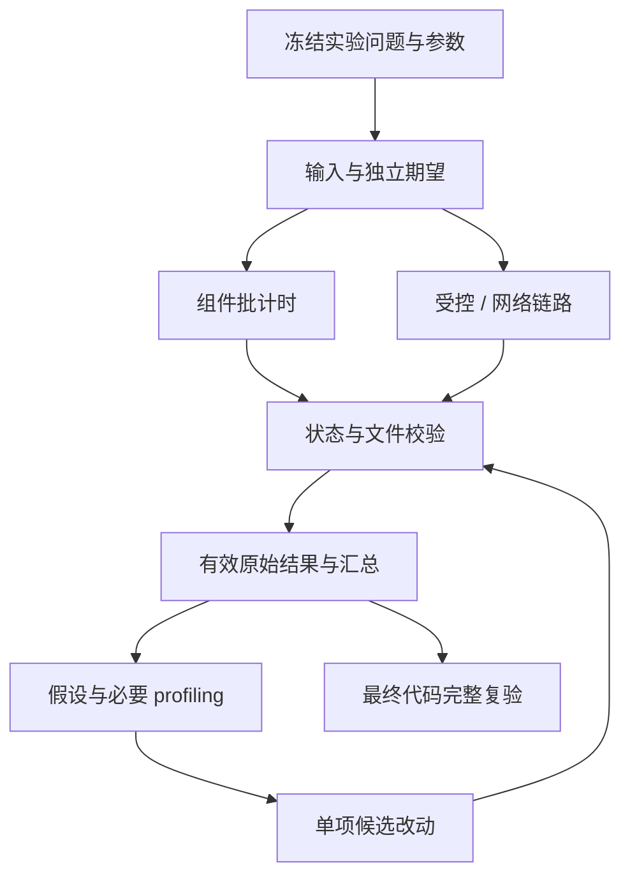

# qbook Implementation Plan（V5 实现计划）

文档版本：0.1｜日期：2026-10-20｜对应版本：V5 性能实验与完整复验

状态：**实现计划已编写；V5 代码、实验、profiling、优化和完整验收均未执行。** V0–V4 已有规划文档，不代表真实仓库已经完成这些版本。开始本版编码前，应核对实际源码、依赖和前置验收记录。

建议保存为 `Implementation_Plan(V5).md`。本文遵循本次模板的七章结构；第三章分别展开实验支撑、分组件测量、链路测量和分析交付。接口、命令、参数示例和预期结果都是后续实施要求，不是已经取得的性能成绩。

## 1. Implementation Overview（实现概述）

### 1.1 本次实现目标与范围

V5 要回答三个问题：qbook 在明确负载下完成工作需要多少时间，主要成本出在哪里，以及最终交付是否能按文档重现。先测正确实现，再调查原因，最后决定是否修改代码；本版允许得到“现有实现值得保留”的结论，但需要数据和分析支撑。

| 任务 | 要实现的能力 | 实施后的交付物 |
|---|---|---|
| V5-01 固定性能实验设计与验收口径 | 每项实验说明问题、输入、初始状态、计时边界、工作量和正确答案。 | `docs/benchmarks/V5-experiment.md`、冻结配置、负载生成与测量支撑、环境和目标待定记录。 |
| V5-02 建立分组件和完整链路基线 | 分别测核心操作、解码、快照、文件写入以及内部/网络链路。 | 四个 benchmark 程序、各轮原始数值、独立状态/文件校验、`V5-results.md`。 |
| V5-03 分析瓶颈并验证必要优化 | 根据基线调查少量热点，比较单项改动的收益和代价。 | 原因假设、必要 perf 证据、同条件前后结果、正确性回归、保留或放弃结论。 |
| V5-04 完整复验与交付整理 | 对最终代码重新核对功能、文件、监控、依赖和测量。 | AC-01～AC-16 覆盖记录、UC-01～UC-07 结果、一次干净构建复验、README 与 `docs/releases/V5.md`。 |

Benchmark 是在受控条件下反复测量工作的实验；profiling 是观察程序运行时主要把资源花在哪里；优化是在正确性不变的前提下减少已证实的成本。这三项按顺序协作，不能用一张热点图代替前后测量。

本版不重做 qlib 所有容器的性能项目，不增加撮合、交易、真实行情恢复、跨文件全局回放、长期指标数据库或公网部署。不会为了更快而删除校验、改变 FIFO、丢弃已接纳记录，或取消正常关闭。云服务器、CPU 调频和系统权限变更都不是开展本版的默认前提。

**性能门槛仍待确定。** requirement.md 的 OI-04 尚未给出验收机器、代表性负载和绝对吞吐/延迟/内存阈值。本版可以先完成基线和分析；只有目标确定并在相应条件下实际测量，才可宣布性能门槛通过。文档或 benchmark 能运行，并不等于所有验收已经通过。

### 1.2 参考的 Requirement 与 Spec

| 依据 | 本版必须保持的内容 | 实现与验证落点 |
|---|---|---|
| `AGENTS.md` | 阶段所有权、代码边界、功能先正确、按证据优化、测试和清理规则。 | 全文；不自动提交、推送或发布。 |
| `requirement.md` NFR-01/02/03 | 相同输入的业务结果、正常停止完整性、失败可识别。 | 每次实验的独立校验，受影响回归和最终完整复验。 |
| NFR-04、NFR-07、AC-15、OI-04 | 环境/负载/方法可复现；目标未定不虚构达标结论。 | 第 3.1、3.4、5、6 章。 |
| FR-01～FR-17、NFR-01～NFR-08、AC-01～AC-16 | 最终交付仍满足全部已声明能力。 | 第 5 章完整覆盖；不只复跑性能测试。 |
| UC-01～UC-07、BR-01～BR-15 | 启动、Mbo/L2、监控、停止、拒绝与离线核对规则。 | 复用 V1～V4 独立期望和真实链路。 |
| `specs.md` 3.3、5.2/5.3 | 业务数据结构成本、线程所有权、性能取舍及资源限制。 | 核心、快照和链路实验；不能假定 hive 删除严格 O(1)。 |
| `specs.md` 5.4、6.3/6.4 | 可选 benchmark、Release 测量、接纳边界、正常与失败退出。 | 构建目标、完整链路和证据结构。 |
| `Sprint_Backlog.md` 3.6、跨版本依赖表 | V5 四任务顺序及完成声明范围。 | 第 4、5 章；当前状态继续为未开始。 |
| V0–V4 实现计划 | 已冻结接口、固定样本、测试接入、构建开关和 UI 规则。 | 复用实现，不另写一套“近似 qbook”来取得性能数据。 |

文件名以当前 `requirement.md`、`specs.md` 为准。发生设计与实际代码不一致时，记录原因并修正相关内容，不能只放宽预期使实验看起来成功。真实市场适配 OI-02/OI-03 与本地功能验证仍分别记录。

### 1.3 现有代码与可复用组件

本计划核对了前置文档与上传 nqbook 的构建组织。该参考归档没有提供可直接沿用的 qbook 四类性能实验；本版实验需要根据实际接口和已定规则建立，不能引用参考项目宣传的耗时作为本项目成绩。

| 前置能力 | V5 复用方式 | 必须保持的边界 |
|---|---|---|
| V0 Config / Metrics / RunControl | 实验配置沿用现有 YAML 解析依赖；业务运行仍使用原 Config；失败仍通过同一控制路径。 | 实验配置独立于生产 YAML；不把 feed 有效解码计数当接纳计数。 |
| V1 Orderbook 与测试观察器 | 直接调用生产 OnOrder/OnTrade/OnCancel/OnLevel/OnSnapshot；复用只读状态、FIFO 和不变量检查能力。 | 不新增不存在的 reserve API；检查工具不能变成另一份待测业务实现。 |
| V2 Protocol、FeedEncoder、FeedPublisher、成功 push 账本 | 生成合法/拒绝帧，复用实际编码和有期限的网络准备；受控生产者记下真实接纳集合。 | 发布端发送成功不是入队成功；受控队列实验必须明确没有真实 Feed。 |
| V3 ParquetWriter、ServiceImpl、ProcessHarness、WriterHooks、ParquetReadback | 写入实验使用真实五文件；链路实验运行真实阶段和独立读回。 | Add 不是 fsync；只在正常 Close 和线程结束后核对完整文件。 |
| V4 MetricsThread、Node/UI 与浏览器编排 | 正式链路保留第四线程；完整复验继续验证 136 字节、BigInt、SSE 和两周期页面。 | 页面均值不能当 P99；没有订阅者不关闭监控线程来伪装正式服务基线。 |
| qlib | 复用实际 map/hive/queue/公共记录类型。 | 若根因属于 qlib，先独立修复验证，再更新依赖；不复制改版容器藏在 qbook 中。 |

本版复用测试辅助的纯读取/控制部分时，先检查它是否夹带 Catch2 断言。需要共享的函数返回结果或抛明确异常，把框架断言留在测试源码；`BUILD_TESTING=OFF` 时 benchmark 仍应能够构建。源码位于 tests/support 并不自动意味着它适合进入生产可执行文件，正式 qbook 继续不链接这些工具。

### 1.4 开发环境、依赖与工具链

C++ 基线沿用 Linux / WSL2、x86-64、小端、C++23、CMake 3.28 或以上、Ninja，复用已固定的 qlib、fkYAML、spdlog、cppzmq/libzmq 和 Arrow/Parquet。所有具体版本、编译器与标准库、依赖提交、动态库来源以及 UI 锁文件仍以实施机器的实际记录为准。本次没有安装、构建或测量这些组件。

本版先采用最小自写批量测量程序：用 `std::chrono::steady_clock` 测一批操作的时间，使用共享的负载、结果和校验工具。steady_clock 是不会因系统校时倒退的时钟；它的纳秒表示单位不保证硬件有一纳秒精度。当前不强制引入 Google Benchmark；如果实施时确有其统计或自适应功能需求，需明确替换理由、固定依赖，并保持本计划的计时与校验契约。

| 工具/条件 | 用途 | 记录和使用要求 |
|---|---|---|
| Debug + `build/debug` | 常规正确性和异常测试。 | 保留 V0–V4 已有目标；不拿 Debug 数字作为正式性能基线。 |
| Release + `build/release` | 性能实验和受影响的优化构建验证。 | 与 Debug 分开是配置差异所需；固定实际优化选项、符号及 LTO 策略。 |
| 无 LTO 的首轮基线 | 便于保留生产跨编译单元调用并检查被测工作。 | `CMAKE_INTERPROCEDURAL_OPTIMIZATION=OFF`，同时核对实际编译/链接命令；不能只看一个缓存变量。 |
| 调试符号 | 让 perf 结果可以定位函数和源码。 | 可在实际 GCC/Clang Release 中保留 `-g`；A/B 使用同一组选项。 |
| perf | 按证据需要收集计数、采样调用栈和热点。 | 先检查 perf 版本、事件支持与权限；缺失数据写 N/A，不自动改 sysctl 或提权。 |
| Python 3 标准库 | 读取 CSV、检查完整性、汇总与比较结果。 | 仅分析脚本需要，不让 C++ 服务依赖 Python；记录版本。 |
| Node/npm、Playwright/Chromium | 复用 V4 的完整 UI 验收。 | 使用已固定锁文件和实际浏览器版本；不因本版主要测 C++ 而跳过页面回归。 |
| 独立一次干净构建 | V5-04 验证没有依赖未说明的旧产物。 | 使用本次新建且明确登记的目录；与日常反复建 Debug 副本不同。 |

先记录 CPU 型号、逻辑核/物理核关系、内存、内核/WSL、容器或虚拟化、CPU 亲和性和输出文件系统。单线程固定到某核和四线程分配到多个核是不同实验；不能把整条链路绑到一个核后称为默认多核能力。未控制的频率、温度、后台负载和存储缓存应如实记录，不默认它们恒定。

perf API 参考上游手册：[perf stat](https://man7.org/linux/man-pages/man1/perf-stat.1.html)、[perf record](https://man7.org/linux/man-pages/man1/perf-record.1.html)、[perf_event_open](https://man7.org/linux/man-pages/man2/perf_event_open.2.html) 和 [Linux perf 权限说明](https://www.kernel.org/doc/html/latest/admin-guide/perf-security.html)。命令是否受当前 WSL/内核/PMU 支持仍需实际检查，在线说明不等于目标环境已经具备这些能力。

### 1.5 实现约束与完成条件

**实验先有问题和正确答案。** 例如“完整撤销在活跃订单增多时成本怎样变化”应准备不同规模的真实活订单，每个目标只删一次，再检查订单、价位和 FIFO；不能反复撤销已经不存在的 ID 后把忽略路径当成删除性能。Mbo、L2、正常更新和业务忽略分开列名。

**计时先划清范围。** 输入生成、预热、状态准备、业务执行、检查和销毁分别说明。组件内核的批均值、一次有限链路吞吐、排空关闭耗时及整进程 perf 计数不能混成一个“延迟”。实时每 1024 次 Apply 的抽样均值不是专用分布；本版默认不从批次平均数推算事件 P99。

**正确性是结果有效的前提。** 每轮重新建立规定初始状态，测量后独立核对。异常、数量不符、读取失败或未完成阶段不进入正常统计；零时长不产生有效速率，纯耗时阶段按第3.1节保留低于分辨率的观测。不能把只做了一半的快速运行当作优化收益。输入/结果摘要帮助关联数据，但不替代字段和状态检查。

**范围与资源。** 基线先固定少量代表性场景，再按证据扩展；不建立没有问题驱动的庞大参数笛卡尔积。每轮文件独占创建，磁盘容量预算先检查；预分配账本和校验数据也计入实验机器资源记录，不声称它们属于订单簿自身内存。

**完成声明分层。** 四任务有实现、数据和复验记录之后，可说明哪些功能、实验与分析已完成。OI-04 未关闭时仍保留性能门槛待定；某些平台或真实行情未验证时保留相应限制。当前只交付计划，不修改 Sprint 状态，不创建虚构测量结果，不改写 V0–V4 历史记录。

## 2. Implementation Structure（实现结构）

### 2.1 技术模块与代码文件的对应关系

| 模块 | 计划文件 | 负责的工作 |
|---|---|---|
| 实验说明和参数 | `docs/benchmarks/V5-experiment.md`、`benchmarks/README.md`、`benchmarks/config/V5-baseline.yaml`及诊断用`V5-profile.yaml` | 记录问题、场景矩阵、边界、参数、环境和OI-04状态；profile独立标记。 |
| 公共类型/配置/负载 | `benchmarks/support/BenchmarkCase.h`、`Workloads.h/.cpp` | ExperimentSpec、PreparedCase、配置检查、确定性输入和独立期望。 |
| 公共测量/结果 | `benchmarks/support/Measure.h/.cpp`、`Results.h/.cpp` | 批计时、计数与校验元数据、CSV、运行清单、失败记录。 |
| 核心实验 | `benchmarks/core_bench.cpp` | 新增、修改、扣减、L2、快照及相关规模变化。 |
| 协议实验 | `benchmarks/protocol_bench.cpp` | 四类有效帧、模式筛选和各类拒绝路径，逐字段核对解码。 |
| 写入实验 | `benchmarks/writer_bench.cpp` | Open、Add/触发刷新、尾批 Close 和完整文件输出时间。 |
| 链路实验 | `benchmarks/pipeline_bench.cpp`、`benchmarks/support/PipelineTrial.h/.cpp` | 受控入队、有限网络与网络稳态系列，阶段计时、收尾和文件核对。 |
| 冷路径观察 | `src/detail/ServiceInternal.h`、`src/Service.cpp` 的最小扩展 | 在既有私有 ServiceHooks 中观察停止/各阶段 join，不新增产品命令或 Feed 热路径回调。 |
| 复用验证支撑 | 既有 OrderbookInspector、FeedEncoder/Publisher、WriterThreadInspector、ProcessHarness、ParquetReadback | 共享无 Catch 依赖的读取/控制能力；测试断言留在 tests。 |
| 分析和测试 | `scripts/analyse-benchmarks.py`、`tests/test_analyse_benchmarks.py`、`tests/benchmark_checks.cpp` | 检查原始记录、分组汇总、比较可比结果，验证工具不会制造错误统计。 |
| 完整复验 | `scripts/run-monitoring-tests.mjs`、既有 C++/UI 测试及 fixture | 支持明确的测试构建路径，复用完整链路而不复制页面模拟。 |
| 报告与交付 | `docs/benchmarks/V5-results.md`、`docs/releases/V5.md`、README、ui/README、相关规划文档 | 实际数据、分析、验收覆盖、构建步骤和已知限制。 |

所有路径相对 qbook 仓库根。表格描述后续新增或修改范围，不代表这些源码和报告目前已经存在。原始实验数值由独占运行目录保存，报告引用其位置和标识；生成的大批 Parquet 试验文件与必须保留的数值证据分开管理。

### 2.2 各模块需要实现的类与组件

| 组件 | 持有的数据与责任 | 生命周期 |
|---|---|---|
| ExperimentSpec / CaseSpec | 参数、模式、规模、重复次数、计时阶段、输入与验证规则。 | 启动时校验并冻结；不在计时中修改配置。 |
| PreparedCase<Payload, Expected> | 已准备的只读输入及独立预期、负载标识。 | 可跨轮复用输入；不跨轮复用已经被改变的业务状态。 |
| 各组件 Trial | 本轮 Orderbook、writer、目录或局部解码结果。 | 每轮建立、测量、核对、销毁；预热实例与正式实例分开。 |
| MeasureBatch / BatchObservation | 一次内核的起止时刻、有效操作数和可观察摘要。 | 不在每条事件外额外套一次时钟；批次结果先等待校验。 |
| MeasurementResult / 运行清单 | 时间整数、分母含义、结果类型、配置/代码/构建标识。 | 先标未核对，校验后才进入有效汇总；失败保留原因。 |
| 受控生产者与接纳账本 | 成功 try_push 的有限事件标识和值。 | 唯一生产者写；线程结束后读取；预留容量避免记录阶段新分配。 |
| 网络 benchmark worker | 同一 ServiceImpl、真实四阶段、已冻结 Writer 观察器。 | 自 exec 后正常装配，父进程拥有发布端；正常和失败均回收。 |
| 生命周期观察器 | 主线程上的固定时间点数组。 | 冷路径记录 StopObserved、各阶段 Joined；正式服务默认空。 |
| 分析脚本 | 读入原始 CSV、清单、各 case 的有效行与差异。 | 整数准确解析；不调用业务实现；不修改原始数据来得到结论。 |

“一轮”或 trial 是在规定初始状态下完成一次有独立校验的实验，不等于循环里某次订单操作。多轮批均值的离散程度描述重复实验的波动，不是业务事件的延迟分布。

### 2.3 类与源文件、头文件的对应关系

`QBOOK_BUILD_BENCHMARKS` 默认仍 OFF；V5 将“开启尚未实现则报错”的早期占位行为替换为真实目标。它不自动打开网络、持久化或服务开关，也不使普通 Debug 功能验证强制运行性能测量。

| CMake 目标 | 源码与依赖 | 创建条件 |
|---|---|---|
| 既有 support/core/protocol/pipeline/storage/writer/metrics/service/qbook | 保持 V4 组织，Service 增加默认空的冷路径观察。 | 保持原开关；SERVICE 仍要求显式 PIPELINE 与 PERSISTENCE。 |
| `qbook_bench_support`（STATIC） | Workloads.cpp、Measure.cpp、Results.cpp，qlib/必要标准库/现有 YAML 依赖。 | BENCHMARKS；不依赖 ZMQ、Arrow、Node 或 Catch2。 |
| `qbook_core_bench` | core_bench.cpp、纯只读核心验证辅助；qbook_core 与 bench_support。 | BENCHMARKS。 |
| `qbook_protocol_bench` | protocol_bench.cpp、测试编码/固定样本支持；qbook_protocol 与 bench_support。 | BENCHMARKS。 |
| `qbook_writer_bench` | writer_bench.cpp、无断言框架的 ParquetReadback；storage、bench_support、实际 Arrow/Parquet。 | BENCHMARKS 且 PERSISTENCE。 |
| `qbook_pipeline_bench` | pipeline_bench.cpp、PipelineTrial.cpp、ProcessHarness、发布/文件验证辅助；真实service/pipeline/writer/metrics及直接网络/文件依赖。 | BENCHMARKS且SERVICE；因此PIPELINE/PERSISTENCE也必须开启。 |
| `qbook_benchmark_checks` | tests/benchmark_checks.cpp；配置、计数、计时异常、CSV 等小规模正确性检查。 | BUILD_TESTING 且 BENCHMARKS；CTest 前缀 `benchmark::`，不设速度合格线。 |
| 既有功能测试与 UI 测试 | 原业务、管线、文件、指标、服务与浏览器测试。 | 仍由原有开关和 npm 脚本控制；不因新增 benchmark 减少覆盖。 |

配置阶段列出实际创建的 benchmark 目标。仅开启 BENCHMARKS 的轻量配置可以测核心/协议；正式 V5 完整命令显式打开全部能力。调用者请求不存在的特定目标应得到清楚错误，不能伪造一个打印“跳过”却返回成功的程序。

Benchmark 公共 CLI 统一为 `--config`、`--case`、`--output`、`--list-cases` 和 `--smoke`，只属于实验可执行文件。每个程序的 `--case all` 只运行自己登记的有限场景集。真实 qbook 入口继续读原 YAML，不接收这些实验参数。链路程序的内部 worker 模式只由父协调器调用，不成为产品控制接口。

Release 是否保留符号、是否启用 LTO 必须从实际编译命令确认；用同一种构建策略比较前后版本。与性能无关的正确性辅助在计时外执行，但它们对缓存和后续轮次的影响仍通过统一准备/预热流程控制。不能以“校验在计时外”为理由不记录它产生的 I/O 和资源条件。

V4 的浏览器编排增加测试专用 `QBOOK_TEST_BUILD_DIR`，默认定位仓库的 `build/debug`，显式设置时读取该构建目录中的 runtime-paths.json，供最终干净构建复验使用。这个环境变量只影响测试工具选程序，不覆盖生产配置。

### 2.4 模块与类之间的实现依赖



图中的回路表示候选改动必须重新经过同条件测量和正确性核对。无效实验只保留失败证据，不流入性能收益统计。最终完整复验针对最后保留的代码及依赖，而不是某个曾经更快但已被放弃的候选。

| 边界 | 可以证明什么 | 不能替代什么 |
|---|---|---|
| 调用生产 On* 并检查状态 | 某类业务操作在规定状态下正确执行。 | 不能代表网络接入和文件写入成本。 |
| 受控生产者成功 push 账本 | 内部链路确切接纳了哪些事件。 | 不能代表真实 Feed 的网络交付能力。 |
| 网络有限输入与最终文件逐条相符 | 本次已知输入在记录环境下完成了预期链路。 | 不把发送数或解码数推广为任意负载下接纳数，不保证真实市场无缺口。 |
| Writer after_add 完成时间 | 带观察开销的追加完成边界。 | 不是磁盘同步、交易所到达或无探针性能。 |
| 主线程 StopObserved/Joined 时间点 | 协调收尾各区间所经历的时间。 | 不等同其中某个函数的独占 CPU 时间或纯 Close 时间。 |
| perf 整进程计数/样本 | 所声明进程和阶段范围的资源使用与热点线索。 | 不是应用内部计时区间的直接替代，也不是每条调用的延迟分布。 |

### 2.5 整体编码顺序及其原因

1. 核对前置代码和真实依赖，确定实验问题、默认代表场景、计时口径、结果格式及 OI-04 状态。
2. 先实现负载和独立答案，用小输入证明每轮确实执行指定路径，再实现批计时和数据输出。
3. 依次建立 core、protocol、writer 基线；先分清局部成本，再接受控队列及真实网络场景。
4. 保存所有有效轮的原始数据，调查有依据的热点；对单项候选做同条件比较与必要回归，保留或放弃都有记录。
5. 对最终代码做一次干净构建和全部功能复验，更新实际说明、待定事项和交付记录，清理本次新建的可再生成产物。

## 3. Module Implementation（模块实现方案）

以下四个模块按模板分别说明概述、类或函数组件、成员和重要接口、协作、算法、并发、错误、实现顺序及完成条件。所有函数和脚本均为待实施方案；不为套用“类实现”标题而把简单测量函数包装成复杂继承框架。

### 3.1 实验规格、负载生成与公共测量支撑（V5-01）

这一模块先说明“想回答什么问题，以及怎样才算测到了这个问题”。例如，测同价改单时，输入必须一直命中存在的订单；如果第二轮仍重复新增相同 ID，测到的就会变成重复订单的忽略路径。实验配置、状态准备和结果核对因此与计时器同样重要。

#### 3.1.1 模块实现概述

1. **实现目标。** 建立四个 benchmark 共用的实验描述、冻结输入、批计时和结果格式，让每条数值都能对应具体代码、负载、计时范围、有效工作量和正确性结论。
2. **规格依据。** requirement.md 的 NFR-04、NFR-07、AC-15、OI-04；specs.md §5.3、§5.4、§6.4；Sprint V5-01。绝对性能门槛尚未确定，允许先交付可信基线，不能把“程序运行完”写成“达到性能目标”。
3. **类、组件与文件。** 新增 `benchmarks/support/BenchmarkCase.h`、`Workloads.h/.cpp`、`Measure.h/.cpp`、`Results.h/.cpp`，以及 `benchmarks/config/V5-baseline.yaml`、`benchmarks/README.md`、`docs/benchmarks/V5-experiment.md`。这些文件只服务实验，不进入生产请求路径。
4. **依赖与复用。** 复用实际 qlib 类型、前置业务期望和已有 fkYAML；默认使用 `std::chrono::steady_clock` 做最小批计时，不强制引入 Google Benchmark。四个可执行文件共享基础支撑，各自直接调用真实核心、协议、Writer 或链路实现；实验脚本与产品 YAML 分开。

#### 3.1.2 Class Implementation（实验数据与函数组件）

##### 3.1.2.1 ExperimentSpec 与 PreparedCase：冻结问题、输入和答案

**1. 实现目标。** `ExperimentSpec` 描述本次实验的共同规则，`CaseSpec` 描述一个场景，`PreparedCase` 持有该场景的输入和独立答案。它们保存实验资料，不代替被测的 Orderbook、队列或文件写入器。

**2. 声明与文件组织。** `BenchmarkCase.h` 定义共用值类型；`Workloads.h/.cpp` 负责读取配置、校验参数和按场景生成输入。各可执行文件定义自己的 Payload 和 Expected 类型，避免用一个庞大变体同时装入网络、Arrow 和全部业务状态。

```cpp
namespace qbook::bench {
struct ExperimentSpec;
struct CaseSpec;
template<class Payload, class Expected>
struct PreparedCase {
  CaseSpec spec;
  Payload input;
  Expected expected;
  std::string workload_hash;
};

ExperimentSpec LoadExperiment(const std::filesystem::path& file);
void ValidateExperiment(const ExperimentSpec& spec);
// PrepareCoreCase / PrepareProtocolCase / PrepareWriterCase /
// PreparePipelineCase 由对应可执行文件提供具体 Payload 与 Expected。
}
```

上面的顺序用于说明接口；实现头文件须先完整定义 `CaseSpec`，再定义按值持有它的模板。不建立没有必要的虚函数继承框架。CLI 统一为 `--config`、`--case`、`--output`、`--list-cases`、`--smoke`；它们只属于四个 benchmark，不给正式 qbook 新增参数覆盖机制。未知选项和不存在的 case 都明确失败。

**3. 成员、初始化与所有权。**

| 数据 | 具体表示与初始化 | 不变量与生命周期 |
|---|---|---|
| 实验身份 | schema 版本、实验名称、冻结配置标识、代码/依赖/构建标识。 | 配置读取后固定；实际运行前补齐环境信息，不填虚构版本。 |
| 共同测量规则 | `warmup_rounds`、`repetitions`、种子、计时口径、结果目录。 | 次数和目录均显式校验；正式重复次数为正；预热轮不混入正式统计。 |
| 场景规模 | 品种数、初始活订单数、价位数、每轮事件数、事件类别及顺序。 | Mbo 与 L2 分开；数量乘积、ID、时间和定点换算均先检查可表示性。 |
| 场景运行参数 | 队列请求容量、实际容量、批量、快照/指标周期、输入节奏、输出介质说明。 | 只对相关 case 生效；无意义的字段组合拒绝，不能静默忽略。 |
| 输入 Payload | 拥有事件、字节帧或记录序列的有限容器。 | 启动计时前准备完毕；引用不指向临时值；不在测量期间修改冻结输入。 |
| 独立 Expected | 小规模逐项答案、完整有限输入的期望状态/记录与业务数量。 | 来源为已定语义及独立生成逻辑，不从被测结果反推答案。 |
| 初始状态说明 | 空簿、预装订单、L2 价位、增长起点或可重复循环的明确描述。 | 每轮建立新的业务实例或按已验证方式恢复同一状态；不复用上一轮已变异状态。 |
| workload_hash | 规范化输入及初始状态、期望说明的内容标识。 | 排除指针、padding 和临时路径；记录生成器版本，不用种子替代完整身份。 |

工作负载摘要在 C++ 准备阶段直接计算，固定为 `fnv1a64:<16位十六进制>`：使用 FNV-1a 64 位的初值 14695981039346656037 和乘数 1099511628211，以无符号 64 位回绕运算逐字节处理。规范输入采用固定字段顺序、整数固定宽度小端编码、字符串 UTF-8 加长度，覆盖生成器版本、有效业务参数、初始状态与完整事件字段；不直接读取含指针或 padding 的对象表示。它只是非安全摘要，可能碰撞，不能独自证明两个负载相同。清单同时保存完整规范参数和固定 fixture 标识，比较时核对这些内容；业务正确性仍逐字段、逐状态核对。代码与二进制身份另记录实际构建摘要，不与 workload_hash 混用。

**4. 重要函数的具体实现。**

| 实现维度 | `LoadExperiment` / `ValidateExperiment` |
|---|---|
| 声明与职责 | 读取独立实验 YAML，返回完整且可执行的 ExperimentSpec；非法配置不进入测量。 |
| 输入、输出与契约 | 输入存在的配置路径及选定 case；返回已校验值对象；缺文件、未知 case 或字段类型错误返回非零退出。 |
| 核心算法与容器 | 复用 fkYAML；按固定 schema 逐字段读取，有限 case 列表，不把任意字符串变成可执行代码。 |
| 具体执行步骤 | 解析选项→读文件→验证 schema/字段→校验数值及组合→解析 case→冻结参数→输出实际参数摘要。 |
| 成员读写 | 只构造本次配置对象；不修改生产 config/config.yaml，不改变用户全局亲和性或系统设置。 |
| 对其他函数的调用 | 受检整数、容量、周期与固定点转换；CLI 层调用目录排他创建辅助。 |
| 边界与错误 | 零工作量不得生成 ns/op；负值、溢出、模式冲突、重复 case ID、超过容器最大尺寸均拒绝；内存不足属于失败而非自动缩小实验。 |
| 异常安全与一致性 | 完整校验成功才返回；失败前未启动业务线程和文件测量，不把半份配置保存成有效 run。 |
| 时间与空间 | 与配置和有限 case 数成正比，位于计时之外；对配置文件大小和场景数设明确上限。 |
| 并发与同步 | 协调线程在工作线程创建前执行；运行期间只读。 |
| 验证方法 | 错字段、未知选项、非法模式、边界乘法、重复 case 和缺文件；核对生成参数与显式配置相等，没有隐式默认改变实验。 |

| 实现维度 | `Prepare*Case` 与冻结输入生成 |
|---|---|
| 声明与职责 | 从一个 CaseSpec 生成对应 `PreparedCase<Payload, Expected>`，准备输入和独立核对依据。 |
| 输入、输出与契约 | 已校验的 case 和种子；输出有限且拥有存储的输入、初始状态描述、期望和内容标识；不返回临时 span。 |
| 核心算法与容器 | 按固定场景规则维护独立 ID/数量状态，产生能够实际触发目标路径的事件；随机顺序只改变选取，不改变合法性前提。 |
| 具体执行步骤 | 受检计算规模→reserve 输入和期望空间→生成预装状态→生成目标事件→独立计算期望→检查类别和数量→冻结摘要。 |
| 成员读写 | 只写准备对象和本地参考状态；没有正式 Orderbook/Writer 的跨轮状态。 |
| 对其他函数的调用 | 已验证的测试编码辅助或独立字节 fixture、受检固定点换算、内容摘要工具；不调用待测实现来生成唯一答案。 |
| 边界与错误 | ID 重复、删除后再次误用、成交双侧相同正 ID、L2 混入逐笔订单等生成缺陷必须失败；需要忽略路径时另设明确 case。 |
| 异常安全与一致性 | 构造失败不发布半份 workload；不会在测量失败后偷偷换种子或减少规模重跑并沿用旧标识。 |
| 时间与空间 | 准备通常为 O(N) 时间/存储，独立参考模型可更贵；准备成本明确排除或作为单独 phase 报告。 |
| 并发与同步 | 在测量线程/进程开始前完成；若输入提供给独立进程，通过固定文件或明确协议传递，不共享悬空地址。 |
| 验证方法 | 同配置、生成器版本和种子得到相同规范输入；小规模逐事件核对分类、最终状态及原记录；改一字段应改变比较结果/内容标识。 |

随机数引擎可以采用 `std::mt19937_64`，有界索引转换也必须固定算法；不假定不同标准库的 `std::shuffle` 或 distribution 映射相同。比如使用显式拒绝采样把 uint64 随机值映射到 `[0,n)`，校验 n>0，并记录该算法版本。最终以输入内容标识确认负载一致，而不是只写“seed=42”。

**5. 创建、初始化与释放。** 配置和输入在计时前建立，可供多轮只读使用；每轮业务状态由对应 Trial 独占，验证后销毁。预热使用独立 Trial，正式轮重新建立规定起点。Writer 的预热输出使用独占临时目录；即使被清理，其带来的系统缓存状态也应说明，不能因此称正式轮是冷盘。

**6. 关键流程。** 测同价改单可预装一组订单，让每个目标订单数量按 100→101→100 的两步循环回到初始值；循环包含两次真实修改，分母也计两次。测增长则从明确初始规模连续新增唯一 ID，每轮重建起点，测完才能销毁；不能把第二轮的重复新增作为“增长更快”的结果。

**7. 实现顺序。** 先定义场景和独立期望，再落实配置校验和生成器；小规模正确性通过后才冻结正式规模。输入规模若超出机器能力，修改实验版本和摘要后重新测，不能悄悄减量。

##### 3.1.2.2 批计时与 MeasurementResult：保留原始事实再计算速率

**1. 实现目标。** 默认一次围住一批已准备好的操作，只读两次单调时钟，记录实际完成数量与持续时间。批持续时间除以工作量得到批均值，不能由此得到单次操作分布或 P99。

**2. 声明与文件组织。** `Measure.h/.cpp` 提供批计时、受检时长转换和显示统计；`Results.h/.cpp` 提供 CSV 与运行清单。`MeasureBatch` 在一批之外只调用 kernel 一次，操作循环在各组件自己的 Run 函数中，避免为了框架在每条事件增加虚调用。

```cpp
struct BatchObservation {
  std::uint64_t work_count;
  std::uint64_t checksum;
};
struct MeasurementResult; // 含下表逐次结果字段。
// kernel() 执行一批工作并返回 BatchObservation。
template<class Kernel>
MeasurementResult MeasureBatch(const TrialMetadata& meta, Kernel&& kernel);
void WriteResult(const MeasurementResult& result, std::ostream& csv);
```

Writer 的 Open/Add/Close 和流水线的跨阶段边界允许自行取时间点，再构造同一 MeasurementResult；公共计时器不强迫所有场景成为单线程函数。kernel 可抛异常，异常试次标为失败，不返回看似有效的零耗时结果。

**3. 结果数据与状态。**

| 字段 | 表示与作用 | 必须保留的语义 |
|---|---|---|
| `schema_version/run_id/case_id/trial_index` | 版本、运行标识、场景和轮次。 | 一行对应一个明确试次的一个 phase；不同运行不混在同一不可追溯文件。 |
| `measurement_kind` | 固定为 `smoke`、`baseline`、`candidate`、`profile`。 | 配置给出正式类型；--smoke显式覆盖为smoke。smoke和profile不混进正式基线。 |
| `phase/count_kind` | 如 apply、decode、add、close；事件/帧/记录/完成批次等分母名称。 | 每个 phase 自己定义时间和分母；关闭阶段可以只报告耗时，不强造每事件速率。 |
| `work_count/duration_ns` | 精确 uint64，输出十进制整数。 | duration 来自同一时钟差值；work_count 是该 phase 实际完成量，不自动等于发送尝试数。 |
| `sample_mode` | 默认 `batch-average`；分布专项另记 `operation-sampled`。 | 抽样方法和样本数另在清单记录；多个批均值的分位数不是事件延迟分位数。 |
| `checksum/validation_status` | 可观察结果摘要、pending/valid/invalid。 | checksum 用于消费结果和辅助发现差异，不代替完整业务核对。 |
| `code_id/build_id/workload_hash` | 实际源码身份、构建产物/配置身份、输入内容身份。 | dirty 工作区还须记录补丁摘要；只有 Git HEAD 不足以说明实际测了什么。 |
| 可选链路数量 | offered、accepted、processed、appended、file_rows 等。 | 未观测到的 accepted 为空并标未知，不能用 0 或其他计数代填。 |

完整环境与输入说明放在该 run 的清单中，CSV 重复关键身份供分析器拒绝误合并。CSV 整数按十进制完整输出；分析脚本以整数/Decimal 读取，不让电子表格或 JavaScript number 自动损失 64 位精度。派生速率允许有说明的显示舍入，原始时间和工作量不能先被舍入。

**结果格式在此统一。** 每个独占 run 目录包含 `manifest.json` 与 `measurements.csv`。CSV 固定列序为 `schema_version,run_id,case_id,trial_index,measurement_kind,phase,count_kind,work_count,duration_ns,sample_mode,checksum,validation_status,code_id,build_id,workload_hash`；唯一键为 `(run_id,case_id,trial_index,phase)`。同一 case 的不同规模用明确后缀登记成不同 case_id；不重复使用同一键。可选链路计数及诊断放入清单中以该键关联的有限记录，未知 accepted 使用 JSON null。

`count_kind=none` 专用于 Open、Close、排空、准备等只报告耗时的阶段，固定 `work_count=0`，这是“没有速率分母”，不是失败或未观测接纳数。该分支保存并汇总 duration_ns 本身；不计算 ns/op、吞吐或从零基线算改善率。其他 count_kind 必须有正 work_count 和正 duration_ns 才能计算比值。纯耗时阶段若差值为0，保留并标“低于当前计时分辨率”，不称零成本；负值或时点顺序错误一律失败。

`manifest.json` 采用版本化的固定结构：schema_version、run_id、measurement_kind、complete、command、code/build/environment、规范case参数、生成器版本、预热与重复次数、每case预期phase、CSV文件列表、逐试次验证与已知计数。运行中 complete=false，所有结果显式写入关闭后才以同目录临时文件替换成本次 complete=true 清单；异常保留 incomplete 及原因。`Results.cpp` 只实现这个固定 JSON 写出器，正确转义引号、反斜杠和控制字符并保留合法 UTF-8，不自建通用JSON框架；分析器使用 Python 标准库 json 读取。配置仍用 fkYAML，不能要求标准库 Python 直接解析 YAML。完整清单缺失或与CSV冲突时，分析器拒绝该run。

稳态链路的trial还包含有限 `pipeline_samples` 数组，字段保存parent/worker时钟域、相对纳秒时间、采样开始/结束、原子计数、发送节奏、阶段及失败/边界原因；数量由冻结总时长和采样周期受检确定。它用于复核第3.3节的稳定条件，不增加CSV列，也不把低频原子样本冒充逐事件接纳账本。

| 实现维度 | `MeasureBatch` 与计时边界 |
|---|---|
| 声明与职责 | 对一个已准备 kernel 测一次批持续时间，形成尚待正确性确认的 MeasurementResult。 |
| 输入、输出与契约 | TrialMetadata 已冻结，kernel 只执行声明的 phase；返回 work_count、checksum、整数时长和 pending 状态。 |
| 核心算法与容器 | `steady_clock` 两次读数；受检转纳秒；不为每条操作分配结果对象，不在计时内格式化输出。 |
| 具体执行步骤 | 编译器边界→t0→执行 kernel→消费其返回值/状态边界→t1→受检计算差值→计时外验证→最后设置 valid 并写结果。 |
| 成员读写 | 时间点和观察值是本轮局部变量；不从墙钟、UI 指标均值或其他进程时钟拼接同一时长。 |
| 对其他函数的调用 | 各组件 RunBatch、编译器适配的结果消费/边界辅助、CheckedDurationNs；完整 Validate 在计时外。 |
| 边界与错误 | 空工作量、零/不可表示时间、kernel 抛错或实际类别数量不符，不产生有效吞吐；超时或失败试次不补进正常样本。 |
| 异常安全与一致性 | 失败保留阶段和已知计数，按组件规则清理；未通过独立核对的结果不能进入“有效基线”汇总。 |
| 时间与空间 | 公共包围部分固定成本；kernel 随事件数增长；计时准备与两次读时钟的成本不能称为零。 |
| 并发与同步 | 单组件由拥有状态的同一线程测量；链路按自己的完成同步记录边界，不用主线程偷读容器。 |
| 验证方法 | 用受控 kernel 验证执行次数、异常不产出有效结果、零分母拒绝和时长转换；优化构建检查确实保留目标循环和调用。 |

`steady_clock` 提供不倒退的持续时间基准，不代表每次读数都有 1 ns 精度；纳秒是保存单位。其接口依据 [C++ 时间库规格](https://eel.is/c++draft/time.clock.steady)，实际分辨率与读取成本要在目标机器试跑并记录。

防止工作被编译器删除采用三层措施：输入在运行时准备并有变化；计时循环调用真实独立编译单元的业务接口且消费结果；在计时边界使用经过目标编译器核对的辅助，并抽查优化后的指令。默认实验关闭 LTO/IPO 且记录该构建政策，使独立编译单元的边界可解释；A/B 比较必须相同政策。若以后研究 LTO，单列实验并重新审查工作保留，不能把 LTO 开/关差异混成业务代码收益。

GCC/Clang 支撑可用带 `memory` clobber 的编译器屏障配合输入/输出依赖及外部结果消费；它约束编译器，不是 CPU fence，不会清空缓存，也不能单凭一个空 asm 保证任何表达式都不会常量折叠。不要把整个业务对象改成 volatile，或把“最后写一次 volatile checksum”当作充分证明。关键限制参见 [GCC Extended Asm](https://gcc.gnu.org/onlinedocs/gcc/Extended-Asm.html)。编译器不受支持时先实现并验证适配，不能偷偷用空函数当屏障。

| 实现维度 | `WriteResult` / `WriteRunManifest` 与有效试次汇总 |
|---|---|
| 声明与职责 | 保存每轮原始时间、工作量、身份和校验结论；派生每操作批均值/吞吐及跨轮汇总。 |
| 输入、输出与契约 | 输入完整结果与本次独占输出流；成功输出可按 schema 重新解析，输出失败使本次实验失败。 |
| 核心算法与容器 | 整数先保留；有分母时均值为 duration/work_count，吞吐为 work_count×1e9/duration，避免整数乘法溢出；count_kind=none只汇总时长。清单按固定JSON结构写出。 |
| 具体执行步骤 | 核对身份和状态→按固定列转义/写一行→检查流状态→保留全部轮次→仅对同组有效轮次求中位数、最小/最大及规定离散度。 |
| 成员读写 | 只写结果和清单；不修改被测对象或为了让平均数好看删除慢轮。 |
| 对其他函数的调用 | 格式化、CSV/JSON转义、显式流检查与分析脚本；比较工具先校验case/计时范围/工作量口径与环境。 |
| 边界与错误 | count=0、duration=0 不除；失败轮单列，不变成0；分母单位不同或构建政策不同不能直接合并。 |
| 异常安全与一致性 | 文件创建排他；未完成文件标明 incomplete，不自动覆盖旧结果；写成功不替代业务正确性验证。 |
| 时间与空间 | 每结果固定列输出；汇总与轮次数成正比；都在被测 phase 之外。 |
| 并发与同步 | 协调者统一写结果，工作者只发布约定观测；不让多个线程混写一条 CSV。 |
| 验证方法 | 固定整数验证巨大数值、纯耗时与非法零分母、失败排除、分组及手算汇总；用Python json核对引号/反斜杠/中文/控制字符往返，故意截断输出须失败。 |

**5. 初始化与释放。** 每个 run 使用排他目录，记录配置、结果和小型环境清单。结果句柄由协调者管理并显式检查写入/关闭；性能原始结果是后续比较的证据，不能像编译产物一样全部删除。文件数据和临时输入副本则按验证后保留策略清理。

**6. 关键流程。** `准备输入→独立预热→建立本轮初始状态→批计时→独立验证→记录该轮→销毁本轮状态`。重复的是完整流程，不能只重复计时循环而保留已经变异的业务对象。先用短小负载验证路径，再试跑确定足以分辨计时噪声的批长度，正式测量前冻结批长度与次数。

**7. 实现顺序。** 先完成结果字段与受检时长，再实现一个可验证的小批次；确认目标工作没有消失后增加多轮汇总。每次都通过验证的5轮可作为首次基线设计起点，但不是普遍充分的统计保证；噪声大时先找环境原因，再记录新的固定重复计划。

#### 3.1.3 模块内部协作与调用流程

协调入口读取 ExperimentSpec，选择一个 CaseSpec 并准备只读输入。每一轮创建自己的 Trial，执行准备和可观察的计时 kernel；独立检查通过后，结果写为 valid。三种状态必须分开：实验有效且已有基线、试次失败、绝对性能目标待定。只要 OI-04 还没有明确机器、代表负载和阈值，就不能把前一种改名为“性能达标”。

四个 benchmark 共用配置与结果基础，但不共享运行中业务对象。单簿更新、帧解码、文件追加、内部流水和真实网络服务各有自己的 phase/count_kind；汇总不会把这些不同时间范围相加后称为同一种操作延迟。

#### 3.1.4 模块关键算法的实现方案

**先选代表场景，再扩展规模。** 下表是本计划建议的起始实验组，不是产品性能门槛，也不是要求把所有参数做笛卡尔组合。正式运行前在 V5-experiment.md 冻结实际值、原因和输出预算。

| 场景家族 | 起始关注点 | 负载变化与核对 |
|---|---|---|
| Mbo 稳态修改 | 预装订单后同价/改价修改。 | 小、中两种活订单规模，另改变价位数；核对操作真的改变目标状态及 FIFO。 |
| Mbo 增长/删除 | 空簿或明确已有规模起步新增；部分扣减与全部移除分开。 | 覆盖容量增长和多个 hive 块；每轮重新准备，分清新增已有价位与新价位。 |
| L2 | 已有价位替换、新价位插入、删除。 | 按绝对总量输入，成交不再次扣深度；不虚构逐笔订单。 |
| 快照 | 单簿 OnSnapshot 与多品种快照轮分别测。 | 品种数、空/非空及输出路径单列，不能用单簿成本代表全轮。 |
| 协议 | 有效类型、明确拒绝原因、混合顺序。 | 冻结各类实际数量和字节总量，不能只测同一缓存地址的一条帧。 |
| Writer | 每类记录、混合记录和批量边界。 | 固定总记录与输出介质，少于/等于/超过批量分别观察；Add 与 Close 分开。 |
| 内部/网络链路 | 受控成功入队账本；真实网络有限输入与必需的稳态系列。 | 固定输入节奏、队列、预热/稳定条件及窗口；稳态处理与排空关闭单列，按可证明数量选择分母。 |

规模可以先从小型 smoke（几十至几百事件）开始，再选择例如千级/万级活订单和足够长的有限操作序列；这些只是选择起点，不预填机器承载能力。增长或文件实验尤其要估计峰值内存、输出字节与可用空间，不能为追求长计时把有限测试变成无限积累。

下面是 `V5-baseline.yaml` 的起始片段，用于明确配置写法；实施时按第3.2/3.3节补齐完整登记表后才执行第5章的all命令。数字是建议的试跑起点，不是OI-04已经批准的负载或性能阈值。每个配置项都进入实际参数清单；调整后重新冻结，不能沿用旧workload身份。

```yaml
schema_version: 1
measurement_kind: baseline
seed: 20261020
warmup_rounds: 1
repetitions: 5
cases:
  - case_id: core.modify.same_price
    mode: Mbo
    instruments: 1
    initial_orders: 1024
    levels: 16
    events_per_trial: 65536
  - case_id: protocol.mixed
    mode: Mbo
    working_set_frames: 256
    events_per_trial: 65536
    frame_mix:
      valid_order: 128
      valid_trade: 64
      invalid_field: 32
      wrong_size: 32
  - case_id: writer.mixed
    events_per_trial: 4096
    batch_rows: 1024
    record_mix:
      order: 1024
      trade: 1024
      cancel: 512
      level: 512
      book: 1024
```

frame_mix在这里表示拥有帧集合的类别数量，总和必须等于working_set_frames；实际调用数按冻结访问序列展开并另记录类别计数。record_mix是本轮直接写入的各类型行数，总和等于events_per_trial。同价修改的65536次按各目标订单100→101→100配对循环；模式字段只适用于核心、解码和链路，纯Writer记录实验不附加无意义的业务模式。部分/完整扣减、增长、新价位和快照分别依其路径约束生成，不能机械套用同一事件数导致未知ID或零工作。

`--smoke`使用单轮、小规模的确定性派生参数：组件目标最多512次调用、初态最多64订单/价位，保持配对、合法扣减预算及必要边界；需要B+1行时采用小批量如B=16，不能保留B=1024却只测几十行后声称覆盖flush。派生参数完整保存，并形成自己的workload_hash。链路smoke仍检查协议、线程、边界和文件；缩短稳态时间的smoke只检查流程，不能认证正式稳定性。正式稳态参数和规则见第3.3节。

**明确环境状态。** 记录 CPU 型号/核数、内存、内核和 WSL 情况、编译器/标准库、Release 实际选项、依赖标识、亲和性、频率策略、后台负载及输出文件系统/介质。没有控制的项目写“未控制”，不能写“固定”。从 WSL Linux 文件系统测出的文件结果不能直接代表 Windows 挂载盘，热缓存结果不能称为冷盘；不默认执行系统级 drop_caches 或改电源策略。

**分布单独设计。** 默认批计时只报告批均值与批之间波动。需要操作延迟分布时先说明从什么位置到什么位置、采全量还是抽样、抽样间隔与样本数，并预分配有限时间数组或明确的直方图桶；分别记录计时开销及被测状态。不能从五个批均值或 V4 的1/1024抽样均值计算并宣称全事件 P99，也不默认扣除空循环时间来“还原真值”。

#### 3.1.5 模块并发与同步实现

配置和输入在启动前冻结，单组件状态由该轮执行线程独占。公共统计器不并发读取 Orderbook 或队列；链路线程只通过既有原子完成信号和 join 发布观测结果。接纳账本、输出记录和失败结果由相应唯一写者维护，全部可能写者结束后才进行完整比较和汇总。

不要为了每条事件记录延迟给生产路径增加共享互斥锁或无界 vector。需要测量接缝时只在独立实验入口使用有限预分配数据，报告这项观测成本；未插桩与插桩结果分别标记。

#### 3.1.6 模块错误处理与恢复方案

| 情况 | 处理与结果 |
|---|---|
| 配置/环境信息缺失 | 对影响口径的缺失拒绝开始；仅无法读取某个可选环境项时写 unknown，不编造值。 |
| 输入生成错误或工作类别不符 | 本 case 失败，保留最小参数和差异，修复后从完整试次重跑。 |
| 时间/计数不可表示或零分母 | 不生成有效速率，明确错误/不足分辨率；调整并冻结批长度后重新建立基线。 |
| 被测代码或文件操作失败 | 原始失败记录保留；清理本轮资源，不把部分时间算入正常分布。 |
| 异常噪声或缺少分析权限 | 原测量不悄悄删除；说明环境问题与未取得数据，必要时按新的固定方案完整复测。 |
| 输出目录碰撞、结果写失败 | 明确失败，不覆盖以前数据，不宣称结果已完整保存。 |

#### 3.1.7 模块实现顺序

1. 在实验说明中逐项写出问题、负载、计时起止、分母和独立答案。
2. 实现配置与参数校验，固化 CaseSpec、PreparedCase 和结果 schema。
3. 先生成小输入，核对目标路径及期望；再实现批计时、状态重建和结果消费。
4. 抽查优化构建保留的工作，试跑观察计时粒度与资源预算，冻结正式批长度和重复次数。
5. 接入四个具体 benchmark、统一记录与比较工具；补齐环境和 OI-04 当前状态。

#### 3.1.8 模块测试与完成条件

- 配置错误、数值边界和未知场景都明确失败，正式服务配置不被实验选项覆盖。
- 固定输入可按配置/生成器版本重现，小规模独立答案确认实际路径；每轮从规定初始状态出发。
- 批工作确实执行，结果被消费且独立核对；准备、计时、验证和销毁边界可复查。
- 原始整数结果、失败状态和身份可准确读回；零分母不产生 Infinity，批均值不被标为事件 P99。
- 实验矩阵、环境、试跑及正式计划有记录；OI-04 未定时明确“基线实验设计完成，绝对目标待定”。当前上述实现、试跑与测量均未执行，V5-01 不因本文编写而完成。

### 3.2 分组件基准：订单簿、协议与文件写入

这一模块对应 V5-02 的组件部分。它分别回答“一个已准备好的订单簿处理业务需要多少时间”“解释一帧消息需要多少时间”“把一批记录追加并正常关闭文件需要多少时间”。三个答案使用不同计时边界，不能合并成一个没有说明的“每条延迟”。

#### 3.2.1 模块实现概述

1. **实现目标。** 新增 `qbook_core_bench`、`qbook_protocol_bench`、`qbook_writer_bench`，使用同一实验配置、结果格式和批计时工具，分别调用真实 Orderbook、Protocol 和 ParquetWriter。每轮先建立规定状态，结束后核对实际有效工作，再允许结果进入统计。
2. **规格依据。** specs.md §5.3、§5.4、§6.4，NFR-01/02/04/07、AC-15、Backlog V5-02；Orderbook 行为沿用 V1，解码沿用 V2，文件语义沿用 V3。V4 每 1024 条事件的抽样指标不作为本模块计时器。
3. **类、组件与文件。** 新增 `benchmarks/core_bench.cpp`、`protocol_bench.cpp`、`writer_bench.cpp`；复用 §3.1 的 `ExperimentSpec`、`CaseSpec`、`PreparedCase<Payload, Expected>`、`MeasureBatch`、`BatchObservation` 和 `MeasurementResult`。组件本身采用小型值对象和自由函数，不建立通用插件框架。
4. **依赖与复用。** core 只链接真实 `qbook_core` 及公共实验支撑；protocol 只链接 `qbook_protocol` 与所需编码/固定样本；writer 链接 `qbook_storage` 和独立 Parquet 读取支撑。正确性检查复用既有 `OrderbookInspector`、`ParquetReadback` 中不依赖 Catch2 的只读部分；Catch2 断言留在功能测试目标，不能为运行 benchmark 强制打开 BUILD_TESTING。

#### 3.2.2 Class Implementation（实验组件实现）

##### 3.2.2.1 CoreTrial 与订单簿工作内核

**1. 实现目标。** 每一轮执行的确是名称所说的操作。例如“新增”必须加入不存在的 ID，不能第一轮新增成功，后面重复测同一 ID 而变成快速忽略。工作内核只负责一次冻结事件序列；创建初态和检查答案另放在计时区间外。

**2. 声明与文件组织。** `core_bench.cpp` 内定义 `CorePayload`、`CoreExpected` 和 `CoreTrial`，使用 `PreparedCase<CorePayload, CoreExpected>` 保存只读输入及独立期望。内部入口如下；这些名称只属于实验程序，不增加 Orderbook 公共 API。

```cpp
CoreTrial PrepareCoreTrial(const PreparedCase<CorePayload, CoreExpected>&);
BatchObservation RunCoreBatch(CoreTrial&,
    const PreparedCase<CorePayload, CoreExpected>&);
void ValidateCoreTrial(const CoreTrial&,
    const PreparedCase<CorePayload, CoreExpected>&,
    const BatchObservation&);
```

生产调用只使用实际存在的 `Orderbook(instrument_id, mode)`、`OnOrder`、`OnTrade`、`OnCancel`、`OnLevel`、`OnSnapshot`、`size` 和 `MemoryBytes`。不假设存在 `Orderbook::reserve()`、批量 Apply 或直接修改内部数量的实验捷径。Mbo 与 L2 使用不同的实验实例。

**3. 数据、初始化与所有权。**

| 数据 | 实现与生命周期 | 约束 |
|---|---|---|
| `CorePayload` | 已生成的初态事件、被测事件、品种选择序列；PreparedCase 独占。 | 输入生成、随机数与编码均不在核心操作计时内；记录 seed 和工作负载摘要。 |
| `CoreExpected` | 独立计算的 Applied/Ignored 数、忽略原因、最终订单/价位/FIFO 与快照期望。 | 不调用被测 Orderbook 生成“正确答案”；浮点数不参与价格和数量期望。 |
| `CoreTrial::books` | `std::vector<std::unique_ptr<Orderbook>>`，每轮新建、单线程拥有。 | 计时前建立全部品种及索引；不要求Orderbook可复制/移动，簿地址稳定。确需测外层品种分发时另列完整链路。 |
| 批观察值 | `BatchObservation` 的工作数、有限 checksum，加所需分类计数。 | 不保存每次事件的日志，不在每个操作后读取系统时钟；分类/摘要开销计入并披露。 |
| 校验读取对象 | 计时结束后临时创建的只读视图。 | 不跨轮保存节点指针或迭代器；检查完再销毁 CoreTrial。 |

完整订单和 FIFO 检查使用已有只读观察器。若现有观察器直接依赖测试断言，先将“读取并返回差异”的纯函数部分分离给测试与实验共用；不在生产 Orderbook 添加可变检查接口，也不通过宏改变库与实验看到的类布局。

**4. 重要函数的具体实现。**

| 实现维度 | `PrepareCoreTrial` |
|---|---|
| 函数声明与职责 | 根据冻结 PreparedCase 创建一轮独立订单簿状态。 |
| 输入、输出与契约 | 输入已通过规模、模式、ID、数量与总量溢出校验；返回拥有全部实验簿的 CoreTrial。 |
| 核心算法与结构 | 按品种建立簿，按冻结初始化事件调用真实 On*；准备动作不计入 operation 时间。 |
| 具体步骤 | 建立品种集合→应用初态→检查实际订单/价位/FIFO与期望→完成必要的读触达→将状态交给测量器。 |
| 数据读写 | 只读 PreparedCase；修改本轮 books，不修改下一轮输入或全局种子。 |
| 调用关系 | 真实 Orderbook 构造及 On*、独立初态校验；不调用被测循环或测量结束后的汇总写入。 |
| 边界与错误 | 初始化返回非预期 Ignored、错误品种、溢出或分配失败时整轮无效，不进入正式计时。 |
| 异常安全与一致性 | 局部拥有对象自然释放；失败不复用半初始化簿继续下一轮。 |
| 时间与空间 | 准备随初态事件和存储规模增长；这一成本另记录为准备阶段，不从被测时间中减去。 |
| 并发与同步 | 本组件单线程使用每本簿，不与监控或其他实验线程共享。 |
| 单元测试与验证 | 小规模已知初态、两个品种同 ID、Mbo/L2 分离；相同输入的多次准备产生相同业务状态。 |

| 实现维度 | `RunCoreBatch` 与 `ValidateCoreTrial` |
|---|---|
| 函数声明与职责 | 前者顺序执行冻结操作并返回 BatchObservation；后者在计时外验证实际工作及最终状态。 |
| 输入、输出与契约 | Run 只接受初态已核对的本轮对象；work_count 按被测调用次数计，不按最终剩余订单数计。 |
| 核心算法与结构 | 同类场景在循环外选定内核，循环中直接调用相应 On*；混合场景的 variant 分派成本明确计入。 |
| 具体步骤 | 测量器开始→遍历被测事件→调用真实函数→累计结果分类和轻量摘要→测量器结束→核对计数、订单、价位、FIFO、时间与快照。 |
| 数据读写 | 修改 CoreTrial 的簿；只读事件；局部观察值不进入生产 Metrics。 |
| 调用关系 | `MeasureBatch(meta, kernel)` 只包住一轮 Run；校验调用已有只读观察器，必要 Snapshot 校验在计时外。 |
| 边界与错误 | Applied/Ignored 分类不符、工作数不足、状态差异或异常都使该轮 invalid；不把提前退出的小分母当作更快成绩。 |
| 异常安全与一致性 | 异常后停止本轮、保留错误与输入标识，安全销毁状态；不能继续执行余下操作并标为完整批次。 |
| 时间与空间 | 循环成本随事件数及真实容器规模变化；批观察为固定空间。完整校验可为 O(N+L)，不计入 operation。 |
| 并发与同步 | 无并发修改；使用 §3.1 的编译器边界与可观察结果，不在每条事件加原子或锁。 |
| 单元测试与验证 | 小序列逐步核对，重复运行不退化为重复 ID/未知删除；有意破坏预期时必须失败，不能只比较 checksum。 |

**5. 构造、预热与释放。** 预热使用独立 CoreTrial，结束后销毁；正式每轮重新准备相同初态。暖缓存只表示已执行指定预热和触达，不能声称所有数据都常驻 CPU cache。初始化、校验和析构的成本在相应阶段另记；测量结束前不能顺手把整本簿清空。

**6. 关键工作负载。** 下面先定义操作语义，再由 V5-baseline.yaml 填入冻结规模。N 表示初始活跃订单数，L 表示价位数，I 表示品种数；改变规模要记录实际 N/L/I，不把它们自动组成巨大的全组合矩阵。

| case 家族 | 状态及输入安排 | 计时工作与独立核对 |
|---|---|---|
| `core.add.growth` | 从规定空簿或已填充簿开始，M 个全新 ID，按冻结价位分布插入。 | 测 N→N+M 的增长，包含真实 hive/map/价位分配与扩容；所有 M 次结果应为 Applied。 |
| `core.modify.same_price` | 固定活跃订单；new_qty 在两个合法值之间交替。 | 测同价改量并保留 FIFO；不能连续设置同一值变成 Unchanged。 |
| `core.modify.existing_price` | 准备不会消失的锚定订单，让两个目标价位持续存在。 | 工作订单在两价间移动，测解链/接尾及查找；核对新价位尾部顺序和总量。 |
| `core.modify.new_price` | 每轮准备有限订单与尚不存在的目标价位。 | 测包含新价位创建的改单；与已有价位场景分开，不能据此宣称稳定无分配。 |
| `core.cancel.partial` | 冻结每张订单被扣次数，初量严格大于该轮总撤量。 | 每次仍为部分扣减；最终量精确核对，避免后半轮悄悄变成完整删除或 UnknownOrder。 |
| `core.cancel.full` | 每张待删除订单只消费一次；初始覆盖多个 hive 块和位置。 | 测 N→0 或规定 N→N−M 的删除批次；明确簿随测量缩小，并非固定 N 稳态。 |
| `core.trade.partial/full` | 买卖两侧有效 ID 不同；独立准备部分扣减和完全移除序列。 | 每个 trade 算一次输入，同时核对两侧均执行；单侧缺失、双侧缺失另列合法忽略/部分更新场景。 |
| `core.l2.replace/delete` | 已有聚合价位在两绝对量之间交替；删除场景每价位只消费一次。 | replacement 不是增量累加；删除批次报告价位数变化，Mbo 订单数恒为0。 |
| `core.l2.trade` | 固定 L2 簿输入合法成交。 | 预期 L2Trade 忽略且深度不扣减，事件时间更新；不得与 Mbo 成交成本混合。 |
| `core.ignored.*` | 分开生成重复新增、未知 ID、方向冲突等预定业务忽略。 | 预期 IgnoreReason 准确；计时结果名为合法忽略处理，不标作正常更新或错误输入解码。 |
| `core.snapshot` | 分别准备空簿、单品种不同 N/L，以及固定 I 本簿。 | 单次 OnSnapshot 每侧一档；轮询 I 本簿是 I 次调用，另报每轮时间和每调用时间，不混入 BookThread 定时遍历、统计或入队。 |

数量全部用固定点整数，并先检查初量、累计扣量与价位合计可表示。核心新增的分配属于被测工作，不能为了降低数字在计时外偷偷调用不存在的 reserve。删除、改价和增长均应保存路径分类的工作量；只报最终快照无法证明 FIFO，因此使用完整独立校验。

**7. 实现顺序。** 先做小规模新增与快照，确认计时及校验链；再做同价修改、已有价位改价和部分扣减；随后加入增长/完整删除/新价位及 L2；最后做少量有明确事件比例的混合场景，不以混合平均数掩盖各条路径。

##### 3.2.2.2 协议解码实验组件

**1. 实现目标。** 测真实 `DecodeFrame` 将完整字节转换为记录或拒绝原因的成本。网络接收、系统取时和 FeedQueue 等待不在这个函数的范围内，留给完整链路。

**2. 声明与文件组织。** `protocol_bench.cpp` 内使用 `PreparedCase<ProtocolPayload, ProtocolExpected>`，内部 `RunProtocolBatch` 返回 BatchObservation，`ValidateProtocolBatch` 在计时外逐字段检查。生产签名保持 `DecodeResult DecodeFrame(std::span<const std::byte>, std::int64_t recv_ns, BookMode) noexcept`，不新增批量解码业务 API。

**3. 数据与所有权。** Payload 保存拥有字节的帧集合、固定的接收时间参数和访问序列；span 仅在调用期间借用。Expected 独立记录每帧应有的事件字段或 DecodeError，以及订单链接应为空、recv_ns 应被调用参数覆盖的规则。输入包含多个值、ID 和价格，不只反复解码一个常量字节块。

**4. 重要函数的具体实现。**

| 实现维度 | `RunProtocolBatch` / `ValidateProtocolBatch` |
|---|---|
| 函数声明与职责 | 对冻结帧集合重复规定次数的 DecodeFrame 调用，随后核对结果及有效工作量。 |
| 输入、输出与契约 | 每个 frame 的拥有者覆盖完整调用；mode 和 recv_ns 已冻结；每次尝试解码算一项工作。 |
| 核心算法与结构 | 按冻结访问顺序调用 DecodeFrame；分类计数并消费返回的业务标量摘要，拒绝帧消费具体 DecodeError。 |
| 具体步骤 | 计时外准备帧和期望→批计时遍历→返回 work_count/checksum及分类数→计时外再次逐帧逐字段核对→结果标valid。 |
| 数据读写 | 只读帧，修改批观察标量；不更新生产Feed计数，不写业务文件。 |
| 调用关系 | 真实DecodeFrame及其内部ValidateEvent；复用V2固定协议样本，编码器不作为唯一答案来源。 |
| 边界与错误 | 错长、tag、mode、枚举、非法字段分别成case；得到预期DecodeError是正确执行，得到错误原因或意外成功才令轮次无效。 |
| 异常安全与一致性 | noexcept生产契约不改；实验输入准备/输出错误明确失败，不能以空成功记录代替缺少结果。 |
| 时间与空间 | 每帧协议工作有界；遍历与摘要成本明确包含在批耗时；逐字段完整验证在计时外。 |
| 并发与同步 | 默认单线程，独占输入且无共享缓存写；不能在读取期间改帧制造未定义行为。 |
| 单元测试与验证 | 固定字节与独立字段相符；非对齐起始地址仍正确；有事件当且仅当error=None；输入缓冲销毁后结果仍有效。 |

**5. 初始化与释放。** 单轮无需可变订单簿，但每轮仍使用相同冻结访问序列。允许重复只读帧；必须公布工作集字节数与重复策略，区分“小工作集热解码”与“较大帧集遍历”。随机生成或洗牌发生在计时外，并且不因不同代码版本重新抽取不同输入。

**6. 关键流程与case。** 稳定case名为 `protocol.valid.order/trade/cancel/level`（四个完整名字分别以对应类型结尾）、`protocol.reject.empty/unknown_tag/wrong_size/mode_mismatch/invalid_field` 和 `protocol.mixed`。分别测合法类型、主要拒绝原因，以及一份冻结比例的合法/拒绝混合输入；混合case报告每类帧数，不能把更容易快速拒绝的比例提高后宣称解码优化。`working_set_frames` 指拥有的帧数，`events_per_trial` 指实际DecodeFrame调用数，两者均记录；multipart整体拒绝属于Feed接收逻辑，本组件只能给DecodeFrame一个完整span，不假装验证ZMQ多段处理。

**7. 实现顺序。** 先合法单类，再拒绝单类，最后混合访问；每一步先小规模验证，再进入正式规模。ValidateEvent独立测量只有出现需要隔离字段验证成本的问题时添加，不默认把每个私有函数都做成benchmark。

##### 3.2.2.3 文件写入实验组件

**1. 实现目标。** 测五种记录通过真实ParquetWriter写入的成本，分清构造打开、Add循环、显式Close以及整次写入。文件系统缓存、压缩和实际介质影响必须进入环境说明；Add成功不等于fsync或断电安全持久化。

**2. 声明与文件组织。** `writer_bench.cpp` 内使用 `PreparedCase<WriterPayload, WriterExpected>`；`RunWriterTrial` 调用真实 `ParquetWriter(run_dir, batch_rows)`、五个const Add重载和Close，随后调用独立读取器。公开接口不增加“benchmark flush”或绕过正常关闭的方法。

**3. 数据、初始化与所有权。** Payload拥有冻结的五类记录；Expected拥有每类独立行序和字段。每轮先取得全新排他目录，再构造一个Writer；所有写入动作由当前实验线程执行。目录准备、输入生成、读回和清理在声明的文件写入计时外。每轮输出只属于该轮，不能重写上一轮路径来省略文件创建成本。

**4. 重要函数的具体实现。**

| 实现维度 | `RunWriterTrial` |
|---|---|
| 函数声明与职责 | 写一轮真实记录，正常Close后返回分阶段MeasurementResult；完整读回通过后才标valid。 |
| 输入、输出与契约 | 正批量、有限输入和独占目录；成功必须有五个可读文件，包括本轮零行类型。 |
| 核心算法与结构 | 同一轮取四个steady时点t0/t1/t2/t3，分别包围构造、Add循环和Close；不把不同轮的三个最小耗时拼成一次写入。 |
| 具体步骤 | t0→构造Writer→t1→逐条Add→t2→显式Close成功→t3→释放Writer→独立读回五文件→检查后写结果。 |
| 数据读写 | Add修改本轮列缓冲和文件；输入记录不变；阶段计数按各类型真实成功调用保存。 |
| 调用关系 | ParquetWriter公开接口、同一计时工具与Results、V3 ReadRunDirectory/CheckExpectedFiles纯校验部分。 |
| 边界与错误 | Open/Add/Close/Reader任一步失败整轮invalid；禁止自动重试未知状态的批次，禁止析构成功就视为Close成功。 |
| 异常安全与一致性 | 保留第一错误和阶段；依V3失败状态释放，异常输出不混入成功吞吐；新轮必须用新目录和新对象。 |
| 时间与空间 | 内存随五类批次及固定输入增加；真实压缩/I/O可能长等待。验证读取受配置行数上限限制，不创建无界表。 |
| 并发与同步 | Writer单线程；不并发读取仍在写的文件，不把异步观察器带入每条Add计时。 |
| 单元测试与验证 | 单类/混合、空文件、B−1/B/B+1和非整批尾部；schema、整数、同类型顺序、元数据及Close后可读全部核对。 |

**5. 初始化与释放。** 每轮构造和Close都是测量的一部分；对象析构和测试目录移除另记为收尾，不提前归入纯Add。正常Close后释放对象再读回，读取完成后释放Arrow表与句柄。预热也写独立文件并正常关闭；不通过同一Writer反复Add而省略本应出现的尾批成本。

**6. 关键计时与case安排。** `open_ns=t1−t0`、`add_ns=t2−t1`、`close_ns=t3−t2`、`total_ns=t3−t0`，同一轮保留整数duration后再换算显示。Add的计时含循环、必要类型分发、列追加和由本次Add触发的Flush；Close包括各类型未满尾批及文件结束信息。报告Add吞吐时使用成功追加记录数，报告整次写入吞吐时使用同一输入总量/total时间；零行case只报阶段时长，不制造每行除零结果。

Open/Close固定使用count_kind=none、work_count=0；非空Add/total使用written_records及实际成功记录数。零行Writer是明确的初始化/关闭正确性或耗时case，四阶段均按none编码，不与非空写入吞吐合并；不能让任意空输入误通过普通非空case的配置校验。

稳定case名为 `writer.orders`、`writer.trades`、`writer.cancels`、`writer.levels`、`writer.books` 和 `writer.mixed`。先做五个单类场景，再做冻结比例的混合场景；批量先覆盖默认1024与一个明确的小/大对照值，依据试跑固定，不遍历无意义的大矩阵。不同类型各自到B才flush，混合N条不能推断恰好产生N/B个批次；文件内部row group数量也不是Add调用数量的替代证据。

写出压缩后字节数和每类行数可作为解释资料，bytes/s明确分母是实际文件大小或逻辑输入大小。普通文件写入和读回可能命中操作系统页缓存，报告为该缓存条件下的结果；不使用全局drop_caches命令伪装通用基线，也不从Close耗时推导物理磁盘同步速度。读回会改变缓存状态，重复顺序及处理方法必须记录。

**7. 实现顺序。** 先零行/少量数据与真实读回，再记录三阶段时间；随后单类不同批量和混合尾批；确认空间预算、失败路径和清理后才运行正式规模。纯列追加、内存流或禁压缩专项只有具体瓶颈假设需要时添加，并明确与正常Parquet文件场景不同。

#### 3.2.3 模块内部协作与调用流程

三个可执行程序共用配置和结果规则，但各自负责真实状态与独立答案。流程为“读取已冻结case→准备输入及初态→独立预热→每轮新状态→批计时→计时外校验→记录该轮结果→释放资源”。正式测量前的小规模验证确认所选内核确实触发目标路径；正式测量后的校验确认这一次运行没有少做或做错。

同类实验把case选择放到循环外，避免把每次字符串匹配或动态分派当作生产函数成本。混合实验则如实包含真实记录类型分派。结果里的phase、count_kind、工作数和workload_hash必须一致，不能把不同输入、不同计时边界混入同一汇总。

#### 3.2.4 模块关键算法的实现方案

1. **先确认操作没有退化。** PrepareCoreTrial在每轮重建状态；部分扣减预算保证本轮不意外删除；完整删除是有限单程；L2替换交替两个绝对值。运行结果的Applied/Ignored分类与独立期望不符就停止统计。
2. **防止编译器删除工作。** 按§3.1在计时边界使用已支持编译器的屏障并消费真实结果；基线记录非LTO构建，生产On*/DecodeFrame等位于独立编译单元。重要case检查生成机器码仍执行预期调用/循环。只写volatile变量、读取时钟或检查最终常量都不足以独立证明工作存在。
3. **明确摘要成本。** 返回状态、快照和解码字段形成有限摘要，完整结构校验在计时外。摘要和循环成本仍属于所报告内核，不把测得值宣传为剥离一切调用开销的“纯函数纳秒”。必要的空框架/摘要对照只解释仪器量级，不自动从每轮结果相减。
4. **不要把批均值当延迟分布。** 一批M次调用总时间/M是该批平均每次成本；跨轮平均值的分位数仍是“批均值的分布”。若另测逐次耗时，必须单列计时方法、样本数量和每次读时钟的扰动，不能据此回填未测的P99。

#### 3.2.5 模块并发与同步实现

本节三个组件基准默认一个执行线程。Orderbook和ParquetWriter遵守原来的唯一所有者约定；协议输入只读。多线程队列、磁盘与业务重叠、指标线程成本由完整链路模块测量，不通过在这里盲目增加线程数得到不明含义的数字。

输出报告在计时结束且校验通过后统一写入；热循环不打印日志、不写CSV、不生成随机数、不做逐条堆分配的测量记录。生产路径本身必要的分配或错误诊断仍保留，不能为了性能结果关闭业务校验或改掉原行为。

#### 3.2.6 模块错误处理与恢复方案

| 情况 | 处理与结果归属 |
|---|---|
| 输入规模或整数运算不合法 | 正式计时前拒绝，记录配置错误；不缩小到另一个规模却沿用原case名。 |
| 初始化/路径分类不符 | 本轮无效，输出实际与期望，停止该case；先修负载或实现，再重跑完整轮次。 |
| 生产函数异常或文件错误 | 整轮失败并安全释放；不把已完成的快速前缀混入正常成绩。 |
| 结果校验失败 | 即使计时很快也不计入有效样本；保留最小重放输入和必要差异。 |
| duration为0或样本太短 | 不除零、不输出无限吞吐；返回试跑阶段调整批量并重新冻结，不在A/B比较中只调整一方。 |
| 输出空间不足或清理失败 | 停止后续写入实验并明确失败阶段；仅清理本次具体路径，保留必要错误文件。 |

#### 3.2.7 模块实现顺序

1. 先接入共用配置/Measure/Results和最小case，保证程序失败能以非零退出码表达。
2. 完成CoreTrial准备与独立状态检查，加入真实业务路径，再测快照和必要规模变化。
3. 完成协议合法/拒绝路径和独立字段核对，建立小/大工作集的清楚命名。
4. 接通Writer真实输出与读回，冻结open/add/close/total边界，再比较批量和记录组合。
5. 对所有正式case进行小规模验证、机器码/工作量核对和试跑；冻结参数后按同条件重复，交给完整链路与分析模块。

#### 3.2.8 模块测试与完成条件

- 三个目标能独立列出case和运行smoke，未匹配case、零有效工作或未执行任何实验必须失败。
- 新增、同价/改价、部分/完整扣减、L2、快照及有效/拒绝解码覆盖冻结矩阵；每轮工作分类与独立状态符合预期，重复轮次不改变case含义。
- Writer五类文件、不同批量与尾批均真实Close并读回；阶段时间、输入量和结果文件对应同一轮，未把Add或Close宣传为fsync。
- 每条有效结果携带实际代码/构建/负载标识、计时边界、工作数和校验状态；批均值、吞吐与任何另测分布明确分开。
- 不存在为了成绩删校验、改FIFO、减少保存记录或隐藏准备/关闭成本的路径。当前仅形成实现方案，三个benchmark尚未实现、构建或测量；绝对性能门槛仍按OI-04另行确认。

### 3.3 受控队列、有限网络输入与真实网络稳态测量

#### 3.3.1 模块实现概述

1. **实现目标。** 完成 V5-02 的链路部分：分别测清楚内部流水线处理已接纳事件的能力、真实网络接入后的有限输入完成表现，以及固定工作集在规定输入速率下的持续稳定处理；另外记录正常停止时各阶段的等待区间和文件关闭结果。有限 burst、稳态工作窗和排空关闭分别报告。
2. **规格依据。** `specs.md` §5.2、§5.3、§6.3、§6.4；NFR-04、AC-11/12/15，以及 V2 的成功入队账本、V3 的 Writer 观察器与同一 ServiceImpl、V4 的四线程生命周期。真实 PUB 发送完成不证明 Feed 已接纳。
3. **类与文件。** `benchmarks/pipeline_bench.cpp` 提供 `qbook_pipeline_bench`；`benchmarks/support/PipelineTrial.h/.cpp` 定义受控队列、有限网络和稳态网络试验、原事件观察器和结果核对；复用无 Catch2 依赖的 ProcessHarness、ParquetReadback、FeedEncoder 及 WriterThreadInspector。必要时扩展私有 `src/detail/ServiceInternal.h` 的冷路径生命周期观察入口，正式 qbook 参数不变。
4. **复用与依赖。** 复用 §3.1 的 `ExperimentSpec`、`PreparedCase`、`MeasurementResult` 和统一 CLI。受控实验运行真正的 Book、Writer、Metrics；网络实验运行同一个 `detail::RunServiceImpl` 的 Feed、Book、Writer、Metrics。两者都使用真实 Parquet 输出，默认 UI 不连接、Metrics 保持运行；不能关闭必要阶段后仍称“完整服务”。

| 实验系列与初始 case ID | 实际路径 | 可以据此报告的结果 |
|---|---|---|
| `pipeline/controlled-queue/mbo`、`pipeline/controlled-queue/l2` | 唯一受控生产者 → FeedQueue → 真 Book → RecordQueue → 真 Writer；另有真 Metrics。 | 成功入队账本明确已接纳集合；内部完成速率、有限完成周期、正常排空与关闭。此系列没有网络 Feed。 |
| `pipeline/network-finite/mbo`、`pipeline/network-finite/l2` | 父进程 XPUB → 真 Feed → Book → Writer；另有真 Metrics。 | 经文件核对的有限输入完成量、Writer 观察窗口速率、发送控制至完成通知的批次耗时、四线程停止区间。 |
| `pipeline/network-steady/mbo`、`pipeline/network-steady/l2` | 同一真实四线程服务；固定有界工作集，持续按冻结速率发送。 | 通过稳定性检查的实际发送工作窗、对应 Writer 完成区间、阶段计数速率及积压估计的变化；排空关闭另列。 |

这六个名字是本版必需实验入口；每个 case 的规模、事件配比、队列实际容量、批量、输入节奏和周期来自已冻结配置，不能在不同轮次悄悄改变。稳态结果仅说明本工作集、本输入速率及本次有限时长内符合规定稳定条件，不等于最大容量或无限期无积压。`--smoke` 可缩小工作量验证机制，但不能代替正式稳态结果。

稳态 case 在共同 `CaseSpec` 中增加以下显式字段；不提供未经机器试跑确认的性能默认值。配置冻结后，各轮不得自适应改变速率、延长窗口直到出现好成绩，或只挑选运行中的最佳时间段。

| 字段 | 约束与用途 |
|---|---|
| `input_rate` | 正整数，单位事件/秒；父进程按绝对发送计划调度，记录实际每个采样窗的成功发送数、首末发送偏移和最大调度迟到。 |
| `warmup_sec`、`window_sec`、`guard_sec` | 正的整秒：本轮持续负载预热、正式发送窗、同速率尾部保护窗。准备建簿先完成；三个连续阶段之间不暂停等待完成通知。预热/保护不进入正式工作量。 |
| `sample_period_ms`、`stable_windows` | 正整数：主协调者的低频采样周期及要求连续通过的最少窗口数；预热和正式阶段各有足够完整样本，正式窗覆盖多个快照、指标发布和完整 Writer 批次周期。 |
| `rate_tolerance`、`lag_drift_tolerance` | 明确单位：前者为相对速率偏差比例，后者为每采样窗可容忍的阶段积压估计净变化条数；所有边界含等号还是不含等号在配置 schema 固定。 |
| `feed_book_lag_limit`、`book_writer_lag_limit` | 两段阶段积压估计的上界，单位原事件；说明与实际队列容量、线程在途工作和采样偏差的关系，不解释为精确队列占用。 |
| `send_lateness_tolerance_ms`、`sample_lateness_tolerance_ms` | 调度/采样迟到上限；超过即该轮不满足实验条件，不靠追赶式突发或补造样本掩盖。 |
| `trial_timeout_sec` | 大于全部计划阶段及允许收尾的绝对期限；超时退出为 invalid，不伪称正常排空时间。 |

事件数按受检整数计算 `input_rate × 阶段秒数`，输入和采样数组均在启动前有有限上限。`sample_period_ms`为正整数，各阶段毫秒数须是它的整数倍；warmup和measure各至少预留 `(stable_windows+2)` 个周期，以容纳边界裁切。`0≤rate_tolerance<1`，其余容差/上限非负，需说明整数计数最小步进和采样偏差。`warmup_sec` 是每个正式网络轮内部的持续负载预热，区别于 §3.1 的独立 `warmup_rounds`；两者都保留记录并排除于正式工作量。`guard_sec` 须覆盖计划允许的最大阶段滞后和至少一个采样周期；最终还须实际确认正式区间尾部在保护窗内完成，不能只按配置假定已经追平。

#### 3.3.2 Class Implementation（实验组件实现）

##### 3.3.2.1 `PipelinePreparedCase` 与原事件完成观察器

**1. 实现目标。** 让实验知道哪些记录属于准备阶段、哪些属于计时阶段，以及真正成功追加的测量事件何时开始和结束。每次都从明确初始状态启动，不能上一轮已建好的订单被下一轮当作新增再次发送。

**2. 声明与文件组织。** `PipelinePreparedCase` 是 `PreparedCase<PipelineInput, ExpectedRun>` 的本模块别名，保存冻结的各阶段事件、对应帧、独立期望和 workload hash，不持有跨轮复用的服务对象。内部 `RawCompletionObserver` 提供 `Observe(const qlib::record&)`、`PreparedReached() const noexcept`、`MeasuredReached() const noexcept`、`AllInputReached() const noexcept`；普通计数和时间只在 Writer 使用，结果在 join 后读取。稳态使用固定的 prepare/warmup/measure/guard 四个阶段枚举与区间，不建立通用调度框架。

**3. 数据、初始化与所有权。**

| 数据 | 实现与所有者 | 不变量 |
|---|---|---|
| 准备输入与阶段输入 | 启动前生成的有限数组，随 PreparedCase 存活。 | Mbo/L2 不混用；以现有合法字段组成可逆的测试序号/阶段标识，固定各阶段半开序号区间；不扩展产品协议。 |
| 独立 ExpectedRun | 按输入规则预先计算或手写的小场景答案。 | 原事件字段与同类型顺序、最终业务状态都有独立期望；不能从待测输出反向生成答案。 |
| 原事件观察计数 | Writer 独占的 uint64 与固定类型计数。 | book 快照不计入测量原事件数；撤单仍独立识别，不能因 writer_orders 合并统计而遗漏。 |
| 阶段首末完成时间 | Writer 记录的固定数组，元素为 steady_clock::time_point 或空。 | 每个已声明阶段只在首条和末条原事件的真实 Add 与 Metric::Add 成功后取时；`first_measured/last_measured` 为其中两个值，不增加逐事件计时。 |
| 准备/测量/全部输入完成位 | atomic<bool>，初始 false。 | Writer release 发布；协调者 acquire 观察；不会在已有读者时重置并复用同一对象。 |
| 生命周期时间表 | 主协调线程独占的固定数组。 | 仅记录规定冷路径事件；没有每事件动态日志或不断增长的时间向量。 |
| 稳态阶段样本 | worker 主协调线程独占、预分配的有限数组。 | 以该线程 steady_clock 记录采样前后时间和既有原子计数；计时和采样均不放入 Feed/Book/Writer 生产热路径。 |

准备阶段指使订单簿到达规定初始状态的真实输入；它不等于性能预热的全部内容。§3.1 的预热轮是另一次独立运行，其成绩不进入正式统计。正式轮仍新建服务、目录和指标，从空状态执行自己的准备输入；有限试验随后发送测量输入，稳态试验则连续发送 warmup→measure→guard。最终文件核对所有实际发送阶段，但正式吞吐分母只使用声明的测量部分。

稳态 Mbo 先建立固定品种、价位和活跃订单，之后只对现有订单同价交替设置两个合法数量；每张订单的访问次数与交替状态跨阶段连续，不因阶段切换出现重复新增或 Unchanged。L2 使用固定品种/价位，交替设置两个合法正绝对量，不冒充逐笔 modify。输入既不增长也不删除工作集；周期快照、真实写入批次、Metrics 与文件系统工作仍正常发生。这里的稳态指业务工作集、流量与阶段积压的既定条件；文件体积仍持续增长，不保证系统缓存状态恒定。固定输入描述与原始序号区间一同进入 manifest；FNV-1a64 只是非安全摘要，比较时还核对完整规范描述。

**4. 重要函数的具体实现。**

| 实现维度 | `RawCompletionObserver::Observe` 与完成查询 |
|---|---|
| 声明与职责 | Observe在既有 `WriterHooks::after_add` 中观察真实记录，记录各阶段首末完成时间并发布有限目标；查询只返回同步完成位。 |
| 输入、输出与契约 | 输入引用仅在回调内有效；不得缓存指向 Writer 循环局部值的指针。目标在启动前冻结，只有 Writer 调用 Observe。 |
| 核心算法与数据结构 | 按 variant 类型排除快照，再将测试序号映射到冻结阶段；核对严格预期的下一个原事件序号并增加受检计数；仅在各阶段首末记录读时钟；完成位只发布一次。 |
| 具体步骤 | 识别类型和阶段 → 检查是否超出计划 → 更新类型计数 → 需要时记首/末时间 → 达到本阶段原事件目标后 release 置位。需要最终快照校验时，另等随后正确快照，不能把等待快照的时间混入原事件完成窗口。 |
| 状态读取与修改 | Writer 修改自己的计数和时间；主协调者只读完成位；全部线程 join 后才读取完整普通结果。 |
| 对其他函数的调用 | 复用 V3 after_add 成功调用点及目标观察思路；不读取队列、不调用 Orderbook 生成“期望”，不修改生产计数。 |
| 边界与错误 | 零测量记录是配置错误；仅一条记录可核对完成但没有完成间隔速率；重复、乱序、额外或无法归类的记录使该轮无效，不能截断后宣布通过。稳定性指标不替代最终字段、阶段归属和同类型顺序核对。 |
| 异常安全与一致性 | 正常路径不分配、不写文件、不调用测试断言；意外异常传播到 Writer 的已有失败边界。已发完成位不保证之后 Close 成功，最终有效性仍等待文件核对。 |
| 时间与空间复杂度 | 每条固定分类/计数，O(1)；计时只在固定阶段首、末记录执行，观察器固定空间。回调及分类仍有测量扰动，需要在报告中标明。 |
| 并发、同步与线程安全 | release/acquire 只发布对应观察器的数据；不能据其他 relaxed 指标推导这些普通字段已安全可读；不存在跨进程直接共享该对象。 |
| 单元测试与验证 | 准备记录不进入测量分母、快照不进入原事件分母、首/末边界正确、单记录无区间率、额外记录失败、完成后 Close 失败仍整轮失败。 |

**5. 构造、初始化与释放。** 每轮先创建输入、期望、观察器和 hooks，再创建工作者；所有借用者结束后才销毁它们。将 after_add 回调固定一次，不在运行中替换函数对象。生产 qbook 的 hooks 仍为空；有观察器的成绩应标明 `instrumentation=writer-completion-observer`，不能声称测得完全无探针的路径。

**6. 关键流程。** 例如准备阶段先建立 1000 个订单，测量阶段执行 10000 次保持合法状态的同价修改。Writer 观察器忽略准备记录对测量计数的贡献，记录第1和第10000条测量原事件的完成时间；文件读取器最后仍比较全部11000条原事件。下一轮重新创建服务，不把这轮最后的订单状态直接沿用。

**7. 实现顺序。** 先用同步记录序列核对阶段识别和计数，再接真实 Writer，最后接网络和进程控制。单元测试中的虚拟时间只验证算术，真实成绩必须来自实际 steady_clock。

##### 3.3.2.2 `RunControlledQueueTrial`：以成功入队账本测内部链路

**1. 实现目标。** 用一个已知、可回查的输入边界测量内部排队、业务处理和写入。它直接复用 V2 的成功 try_push 账本，避免通过多个不同口径的指标推测接纳数。

**2. 声明与文件组织。** 在 PipelineTrial 中实现 `RunControlledQueueTrial(const PipelinePreparedCase&, const TrialContext&)`，返回本轮的阶段测量和校验状态。装配仅属于 benchmark；它明确没有真实 Feed，不能替代正式四线程服务验收。使用既有 `WriterThreadInspector` 的受限友元工厂创建带观察器的 Writer，保持公开构造不变；友元工厂直接取得拥有指针，不假定 std::make_unique 会继承访问权限。

**3. 状态与所有权。** 每轮有两条真正的 qlib 队列、Metrics/RunControl、Book/Writer/Metrics 对象及相应线程。受控生产者是 FeedQueue 唯一生产者；Book 是唯一消费者和 RecordQueue 唯一生产者；Writer 是唯一消费者。`accepted` 预分配到冻结输入上限，保存成功输入的索引或完整值，只有生产者写，join 后才读取。

**4. 重要函数的具体实现。**

| 实现维度 | `RunControlledQueueTrial` 与唯一生产者 |
|---|---|
| 声明与职责 | 运行真实内部阶段，记录成功入队、完成与停止区间，正常结束后读回文件。 |
| 输入、输出与契约 | 输入已满足协议与模式契约；本系列跳过网络和 DecodeFrame。输出同时包含 accepted 集合、测量阶段时间及明确验证结果。 |
| 核心算法与数据结构 | 固定输入数组、预分配索引账本、SPSC 和已有阶段包装器；成功 push 才推进一次游标并记录一次接纳。 |
| 具体步骤 | 新建独占目录与资源 → 安装异常清理 → 启动消费者和 Metrics → 完成准备阶段及真实初始化条件 → 释放测量起点 → 生产者有限重试推送 → 成功结束/停止生产者并 join → Book 排空并 join → Writer 排空、Close 并 join → Metrics 停止并 join → 读文件核对账本。 |
| 状态读取与修改 | 生产者写 accepted 和自己的起止时间；Writer 写完成观察器；协调者只查原子进度/Failed，不并发访问 accepted、队列 size/empty 或簿内容。 |
| 对其他函数的调用 | qlib::single_queue 的真实 try_push；BookThread::Run、WriterThread::Run、MetricsThread::Run；ParquetReadback；异常转已有 RunControl。 |
| 边界与错误 | 满队列重试同一事件且检查 stop/Failed；普通停止前未成功 push 的事件不进账本。准备和测量阶段边界明确；失败路径不继续要求正常完整性。 |
| 异常安全与一致性 | 第一条线程前设置清理守卫；任何异常先发布失败，再对实际句柄请求停止并 join；不会同时创建 Feed 写相同队列。共享资源活到全部潜在使用者结束。 |
| 时间与空间复杂度 | 输入/账本 O(N)，工作队列按实际容量固定；账本在测量区间不分配。账本写入有成本，结果标为受控接纳仪器路径，不伪称零开销。 |
| 并发、同步与线程安全 | 生产者自己的时间与账本在 join 后读取；完成观察器按 release/acquire；主线程不偷取事件。正常停止仍先确认上游停止，再确认下游队列空。 |
| 单元测试与验证 | 小规模逐条账本与五类文件对照；容量2的满队列、普通停止只保留成功项、Writer失败解除重试、部分线程创建失败、真实Metric仍运行及所有资源回收。 |

**5. 初始化与释放。** 准备输入和测量输入使用不同区间；测量在准备的真实追加目标已经完成后开始。工作者只在本次独占输出根下创建文件。为使初始化不混入计时，父协调器先观察实际 `writer_opened`、`metrics_bound` 等就绪点，再经有限控制管道允许测量；“已创建线程”不替代文件打开或端点绑定。

**6. 关键流程。** 生产者在第一次测量 try_push 前记录 `producer_begin`，最后一次成功 push 后记录 `producer_end`。成功推送完毕后不必等全部 Writer 原事件完成才开始正常排空，所以收尾区间能包含实际剩余工作；若本轮恰好没有剩余积压，就如实记录，不把它解释成重载排空成本。刻意暂停 Writer 的故障/背压夹具用于正确性验证，不混入正常性能基线。

**7. 实现顺序。** 先以极小输入证明账本和正常文件一致，再加入阶段时间，随后扩展冻结规模及输入节奏。接纳和输出不一致时先修正或诊断，禁止先发布该轮的漂亮速度。

##### 3.3.2.3 `RunNetworkTrial`：同一生产服务的有限与稳态网络输入

**1. 实现目标。** 测量真正 XPUB、Feed、两条队列、Book、Writer、Metrics 组合后的有限完成窗口和规定输入速率下的稳态表现。保留完整的配置、发送节奏、稳定性与文件核对证据，不把内部队列模型的成绩冒充网络成绩。

**2. 声明与进程组织。** 公开 `qbook_pipeline_bench` 作为父协调程序，复用 ProcessHarness，自 exec 同一可执行文件的私有 `--worker network` 模式。该模式只是 benchmark 内部入口，不加入正式 qbook 的 CLI。父进程持有 XPUB，预生成输入帧；worker 主线程构造观察器与 hooks 后直接调用同一 `RunServiceImpl`，不在 SignalScope 前创建 ZMQ context、发布线程或其他后台执行者。

父进程在创建子进程前冻结 argv/env、工作目录及所有管道设置；若已经有 ZMQ 内部线程，fork 后的 child 仍只做 V3 已约定的异步信号安全设置并立即 exec，不执行任意 C++ 初始化。可执行路径由实际构建路径解析并验证，不能猜测其他目录中的旧产物。

**3. 状态、输入与生命周期。** 每轮 worker 使用独占配置和输出目录；父方绑定真实动态 TCP 地址并保持 socket，随后把已绑定端点写入 YAML。指标端点使用本次独占 IPC 路径或记录的可用本机地址。观察器按冻结测试标识区分阶段；计数及有限采样结果随 worker 的结果文件返回，父方只在正常退出后读取。父进程拥有发送计划、实际发送偏移与本地控制时间；worker 主协调线程通过已有 coordinator_poll 低频采样原子 Metrics，不能并发遍历业务容器或读活队列 size/empty。

**4. 重要函数的具体实现。**

| 实现维度 | `RunNetworkTrial` 与内部 network worker |
|---|---|
| 声明与职责 | 父方按 finite 或 steady case 控制有限输入计划；worker 运行同一四线程服务，收尾后核对实际文件、稳定条件和各阶段结果。 |
| 输入、输出与契约 | 使用冻结的合法帧计划；每个业务事件最多发送一次。父方“发送成功”只记 sent，不作为 accepted_count；计划不足、超时或不满足发送节奏均使正式稳态结果 invalid。 |
| 核心算法与数据结构 | XPUB真实订阅通知、独占子进程、已有 after_add/coordinator_poll、有限绝对时间计划与预分配样本；不新增 Feed 成功入队回调或生产逐事件取时。 |
| 具体步骤 | 绑定/配置/exec → 等真实初始化与订阅 → 准备建簿并等目标 → finite发送一组测量输入，或steady连续发送预热/正式/保护区间 → 停止发送，等全部原事件目标（steady另计尾部完成时间）→ 正常SIGINT/SIGTERM → 等四阶段结束 → 读全部文件 → 校验时间、节奏、稳定性和结果。 |
| 状态读取与修改 | 父方单写发送游标及本地时间；Writer单写完成观察器；worker主线程单写自己的低频采样数组、只查同步目标与原子Metrics；父方不直接访问worker内存。 |
| 对其他函数的调用 | V2 FeedEncoder、ProcessHarness、同一ServiceImpl、V3/4私有Writer观察与ParquetReadback。正式 qbook 仍另行做黑盒启动/停止回归。 |
| 边界与错误 | 订阅通知不是消息处理确认；输入缺失、重复、额外、目标超时、服务/Close失败均使整轮无效。稳态采样不足、速率不符、积压增长或调度迟到也标invalid；不重发丢失业务、不推迟窗口挑选好成绩。 |
| 异常安全与一致性 | 父方持续排空有界日志管道；超时先标失败并请求结束，再只回收本次PID。强制结束留下的文件不能作为正常完成证据。 |
| 时间与空间复杂度 | 输入与帧O(N)，阶段样本O(总时长/采样周期)，启动前检查上限并预分配；网络发送、排队、压缩、文件系统及观察探针均在实际路径中。 |
| 并发、同步与线程安全 | worker按生产SignalScope建立四阶段；父方不在子进程内运行发布者；结果普通内存仅在对应线程join后序列化，首错载荷同样等全部Fail写者结束。 |
| 单元测试与验证 | 小规模Mbo/L2完整输入；阶段首末边界、同价/绝对量跨阶段连续、发送迟到、样本不足和持续积压；无订阅、尾部缺消息、目标后Close失败及真实信号停止，确认所有无效轮不进正式统计。 |

**5. 初始化与释放。** 每个正式试验创建新worker和新输出目录；准备阶段完整到达真实追加目标后，再开始有限测量或稳态连续输入。父方等待目标时检查worker是否提前退出，设置绝对期限，不只sleep固定时间。finite模式完成测量目标后停止；steady模式保护窗结束后停止输入，再等待全部原事件完成通知并独立记录尾部完成时间，避免立即停止Feed使尚在网络中的计划尾部失去被接收的机会。随后正常信号关闭及Close另计，不能把这段等待隐去后只展示很短的shutdown。全部阶段原事件都在正常收尾后完整读回；最后关闭XPUB并回收管道，不留下孤立worker。

**6. 关键流程与稳态判定。** finite模式沿用父方发送第一帧前至收到测量完成通知的区间，它包括控制、网络、流水线和通知调度。steady模式先在父进程冻结本地 `t0`：warmup为 `[t0,t1)`、measure为 `[t1,t2)`、guard为 `[t2,t3)`；以绝对计划 `t0 + i/input_rate` 安排发送，除法使用受检整数/有理数转换，避免逐次sleep累积漂移。每个事件预先有固定阶段和序号，不以迟到后的发送时间将它改归下一阶段。

发送方在每个调度点已有时钟读取，用于记录实际节奏；这是实验发布者的成本，不增加生产 Feed/Book/Writer 的逐事件取时。发送计划错过阶段边界、迟到超过容差、发送调用失败或实际每采样窗速率不合格时标invalid，不能在后面以突发追赶补足后宣称均匀输入。正式父方发送窗记录同一父时钟实际边界采样 `p_begin/p_end`、相对计划的偏差、实际发送N及每窗计数；分母仅为该阶段实际成功发送数。最终必须证明其与冻结计划和读回记录一致，才能将它描述为已验证输入速率，仍不称为接纳速率。

worker在主协调线程按绝对采样时限读取既有指标，保存采样开始/结束时间、`feed_messages`、`feed_dropped`、`book_events` 和 `writer_orders+writer_trades+writer_levels`；快照行不加到原事件完成数。采样只用于稳态检查，不用于逐条接纳证明。全部线程join后，以观察器在同一worker时钟记录的各阶段首末完成时间，将完整位于相应区间内的相邻采样窗归入warmup或measure；跨边界样本保留为boundary并不进入稳定性判定。完整窗口太少时invalid，不能补造或扩大统计区间。

稳定性公式固定如下。记worker第i次读取的结束时刻为 `s_i`，计数为 `F_i=feed_messages`、`B_i=book_events`、`W_i=writer_orders+writer_trades+writer_levels`，`Δt_i=s_i-s_(i-1)>0`，`R=input_rate`、`ε=rate_tolerance`、`D=lag_drift_tolerance`。父方自己的相邻采样边界和sent计数采用同样速率公式，但绝不和worker时刻相减。

- 阶段归属：一个worker采样窗仅在前一采样开始时刻和本次采样结束时刻都位于观察器该阶段首末完成时刻之间时，才完整归属该阶段；否则标boundary。所有实际样本保留，boundary不参与稳定判定。父方按本地冻结发送阶段边界归属相邻发送采样窗。两种采样窗不要求编号一一对应。
- 速率：对 `C∈{F,B,W}`，`r_i(C)=(C_i-C_(i-1))/Δt_i`，统一为事件/秒，必须 `abs(r_i(C)-R)≤ε×R`；父方sent速率同样检查。`feed_dropped` 增量必须为0，单个累计计数不允许回退。
- 积压估计：`L_FB_i=F_i-B_i`、`L_BW_i=B_i-W_i`，分别要求 `-D≤L_i≤对应lag_limit`；每窗要求 `abs(L_i-L_(i-1))≤D`；整个正式区间还要求 `L_last-L_first≤D`。这排除了每窗增长不大但逐窗累积的情况。
- 判定范围：预热最后连续 `stable_windows` 个完整窗口、正式阶段的全部完整窗口都通过；正式阶段也至少有 `stable_windows` 个完整窗口。各次读取跨度和采样迟到、父方发送迟到分别不超过冻结容差；正式原事件数至少覆盖本类型两个完整批量，正式时长覆盖多个配置的快照和指标周期。

存在持续增长、供给不足、样本不足或迟到时，该轮不具备稳态结果；不能选中间最好的一段、调整ε/D或延长窗口直至通过。这个判定只描述固定工作集在规定R下的观察，不构成OI-04绝对性能门槛通过。

这些指标是独立原子，没有跨字段事务快照。两项差值还包含解码/推送/转发中的在途工作，不等于两条队列的准确长度；读取偏差用冻结容差及采样前后时长公开处理，不能拿它证明队列为空。先读下游再读上游以减少偏差，但仍保存受检有符号差值；允许范围下界为 `-lag_drift_tolerance`，不得截负数为0。超出该范围、单个计数回退、读取跨度或调度迟到超限均使观察不合格；同一 `sample_lateness_tolerance_ms` 同时约束单次读取跨度。稳定性仅是按此观察方法在规定窗口内未见超限或增长，最终零丢失和字段正确性仍由全量文件核对决定。

父方继续按同速率发送保护输入，并要求测量原事件完成通知在父方保护结束前到达；否则说明测量尾部未在持续输入条件下完成或通知超出允许范围，该轮invalid。保护记录本身在最终关闭后核对，不能混入测量N。保护结束后等待AllInputReached的时间是尾部完成阶段，包含网络尾部、剩余业务、追加以及通知调度；即使此前已达标也保留检查所耗区间并注明没有观察到剩余等待。Writer首末测量完成另形成同一worker时钟的N−1个完成间隔；父方发送窗与worker完成窗均按同一组序号界定，但时间点只在各自时钟域相减，不把两个区间伪装成逐事件延迟。

**7. 实现顺序。** 先以六条UC-02及L2固定输入接通真实服务与Reader；再加有限输入和阶段计时；随后接固定工作集、绝对发送计划与低频稳定性判定。先用手写小计数表和受控迟到/积压检查规则，再按冻结正式时长运行。网络高速输入未完整送达或不稳定时保留全部无效轮和实际边界，不通过只统计幸存轮隐藏能力限制。

##### 3.3.2.4 冷路径生命周期记录与结果封装

**1. 实现目标。** 单独记录停止协调实际等待了多久，同时保持热路径和产品接口的边界。仅有“整个程序用了多少时间”无法区分正常输入窗口和收尾等待。

**2. 声明与文件组织。** 私有 `ServiceHooks` 增加一个空默认的无抛函数指针及借用上下文，例如 `void (*on_lifecycle)(void*, ServicePhase) noexcept = nullptr` 与 `void* lifecycle_context = nullptr`。`ServicePhase` 为有限枚举：`StopObserved`、`FeedJoined`、`BookJoined`、`WriterJoined`、`MetricsJoined`。正式 RunService 仍传 nullptr；内部头不安装为公共接口。函数指针比新增通用事件框架更直接，且只能在主协调线程的这些冷路径点调用。

**3. 数据、初始化与所有权。** 回调把当前steady_clock值写入预先分配的固定数组，不分配、不日志、不抛异常、不改变停止顺序。原事件完成观察由Writer独占；生命周期数组由主协调者独占，两者在全部join后合并。缺失、重复或倒序的正常阶段标记使对应正常阶段结果无效；失败路径记录错误，不伪造完整的正常时间表。

**4. 重要函数的具体实现。**

| 实现维度 | `RecordLifecycle` 与 `FinalizePipelineResult` |
|---|---|
| 声明与职责 | RecordLifecycle在规定冷路径记时；Finalize在正常退出及独立核对后生成每个phase的MeasurementResult。 |
| 输入、输出与契约 | 每个时间差均来自本轮同一进程的steady_clock，parent/worker观察区间分开标域。所有有效结果要求完整文件校验通过；未知accepted_count只在manifest关联记录中为null。 |
| 核心算法与数据结构 | 固定枚举数组与presence位；受检相减得到uint64纳秒；按照phase/count_kind填同一CSV结构。 |
| 具体步骤 | 正常停止决定被主线程观察时记StopObserved → 各真实join之后记对应阶段 → RunServiceImpl返回后记worker返回时间 → 检查顺序/有效持续时间 → 读文件 → 构建结果或无效诊断行。 |
| 状态读取与修改 | 冷路径只写自己的数组；最终封装读取已结束观察器、账本、父区间和Reader结果，不读取仍在运行的文件或队列。 |
| 对其他函数的调用 | steady_clock::now、§3.1受检时间/比率计算、Results写出；writer_bench的纯Close计时另测，不从这些区间推算。 |
| 边界与错误 | 时间不可表示、倒序区间、N<2的完成间隔率、缺阶段或验证失败均明确不可计算/无效。纯耗时区间若时钟分辨率内为0，保留0并标低于分辨率，不计算比率；不能填0掩盖缺测。 |
| 异常安全与一致性 | 记录回调noexcept，有限状态错误先置本地invalid；最终报告写入失败使命令失败，不发布部分“有效”汇总。 |
| 时间与空间复杂度 | 常数次冷路径记录；最终文件核对随有限文件量增长，排除于性能区间之外并另记录成本。 |
| 并发、同步与线程安全 | 服务主线程单写生命周期；Writer普通数据等join后读；所有潜在Fail写者已结束后才读取首错。 |
| 单元测试与验证 | 正常枚举顺序、缺失/重复标记、N=1、负差值拒绝及纯耗时零差值保留、跨域时间禁止相减、Close失败不产生有效速度、CSV原始整数可回算。 |

**5. 初始化与释放。** 对应观察上下文先于ServiceImpl建立，后于其返回销毁；不把指向栈上临时数组的上下文交给更长寿命线程。受控队列实验在自己的协调代码记录同样角色的时间，将 FeedJoined 明确标为“受控生产者已join”，不得伪造不存在的Feed线程。

**6. 关键口径。**

| `phase` / `count_kind` | 时间范围与分母 | 解释与限制 |
|---|---|---|
| `input-admission` / `accepted_events` | 仅受控队列：producer_begin至producer_end；分母为测量阶段成功push数。 | 包含生产者本地账本和满队列等待；不是网络接收速率。 |
| `completed-window` / `completed_raw_intervals` | Writer测量首条完成至末条完成；分母为N−1个完成间隔。 | N≥2才计算；含真实阶段工作、输出与当前输入节奏；不是每事件独立延迟分布。 |
| `completed-cycle` / `validated_raw_records` | 受控队列：首次测量push尝试前至最后一条测量Add完成；分母N。 | 同一进程steady时间；准备阶段除外，含流水线填充和排队。 |
| `finite-completion` / `validated_raw_records` | 网络：父方开始测量发送至父方收到完成通知；分母为最终独立核对的测量原事件数N。 | 包含控制/通知及调度；不能叫纯业务CPU耗时或单条端到端延迟。 |
| `steady-input-window` / `sent_events` | 稳态网络：父方实际进入正式发送阶段至实际结束该阶段的 `p_begin→p_end`；分母为其中实际成功发送N。 | 显示实际发送速率及与计划 `window_sec` 的差异；仅在完整读回及稳定性通过后有效，仍不是接纳速率。 |
| `steady-completed-window` / `completed_raw_intervals` | 稳态网络：worker中归属正式序号区间的首条至末条Add完成；分母N−1。 | 与父方工作窗使用同一事件集合；N≥2且稳定性通过才报告，无法由此得到逐事件延迟。 |
| `steady-tail-completion` / `none` | 稳态网络：父方保护发送窗实际结束，至确认全部原事件完成通知；全程父方steady时钟。 | 包含剩余网络/链路处理及通知等待；不等于文件Close，更不代表精确队列为空。须与后续shutdown一并呈现。 |
| `drain-book` / `none` | 正常FeedJoined（受控为producer joined）至BookJoined。 | 协调等待区间，含调度和此时剩余处理；不是Book全部工作时间。 |
| `drain-writer-close` / `none` | BookJoined至WriterJoined。 | 包含剩余记录、尾批次/Close和调度；Writer之前已在并行工作，不是纯Close成本。 |
| `shutdown-total` / `none` | StopObserved至本轮服务/装配返回。 | 正常停止协调总时间；Metrics最后结束。真实文件系统可能长等待，不构成硬时限承诺。 |

`count_kind=none` 固定编码为 `work_count=0`，只保存和汇总duration_ns，不计算吞吐或ns/op；它是合法的纯耗时记录，不是失败或缺测。纯耗时duration为0时明确注明低于时钟分辨率，不据此宣称无需关闭或排空。可选计数只放在manifest.json中关联run/case/trial/phase的记录，不扩充固定16列CSV；网络系列 `accepted_count=null` 并标不可用，不能用这里的0代替未知。发送量、有效解码量、成功追加量分别命名。仅当所有计划输入及正常保存都核对成功，才报告对应 `validated_raw_records`；这证明本次输入的结果，不保证任意网络负载无丢失。

finite使用 `completed-window/finite-completion`，steady使用 `steady-input-window/steady-completed-window`，避免同一case同一phase重复表达同一观察。稳态各采样窗的原始相对时间与阶段计数，保存在manifest.json对应trial的有限 `pipeline_samples` 数组中，分别标注parent/worker时钟域、阶段归属和有效/边界/失败原因；不增加第二套MeasurementResult CSV列。两类网络试验都单列正常关闭各phase；稳定性失败保留完整诊断，但本轮全部性能记录为invalid，不能只取好看的发送或关闭数字进入正式汇总。

**7. 实现顺序。** 先确定名字和边界，再加空默认冷路径观察，验证正常/失败分支不改变行为；最后填measurements.csv及manifest.json，并根据独立核对与适用的稳定条件赋valid/invalid。每个完成间隔仅在首末取时，不从V4每1024条抽样均值推导P99。

#### 3.3.3 模块内部协作与调用流程

统一公开命令读取冻结case，父协调器负责独占目录、发布端和子进程；worker负责真正的阶段对象与记录观察；Reader在正常退出后独立核对文件；Results最后写出原始阶段结果。内部 `--worker` 是同一benchmark可执行文件的受限子模式，不给正式qbook增加调试参数，也不允许加载任意代码。

受控队列系列的账本直接证明哪些事件成功进入内部链路；两种网络系列通过完整有限计划和文件核对证明本次记录的完成。稳态网络还须通过预热、正式窗、实际发送节奏和阶段积压估计的全部条件，有限burst结果不代替它。所有系列都验证原事件类型、字段、同类型顺序与最终业务状态，不能只核对总数。快照按实际周期产生，单独核对，不把其行数加到原事件吞吐分母里。

#### 3.3.4 模块关键算法的实现方案

1. **先固定输入，再运行。** 准备、测量、期望和唯一测试标识在计时前完成；记录种子、hash和配置。每轮新建状态，完整删除、重复ID、未知ID等路径各按既定case意图出现，不因上一轮残留而变成另一种工作。
2. **每个数字有自己的边界。** sent、decoded、accepted、processed、appended、closed/validated分别表示不同事实；只把有直接证据的数量填进对应字段。未知接纳量用缺测表示，不能填0或拿别的数替代。
3. **只比较可比区间。** 网络父方时间不与worker steady时间相减；行情event_ns、recv_ns是业务/系统时钟字段，不拿来减steady_clock。批次完成均值和跨轮分布都不能命名为单事件P99。
4. **测完仍要正常关闭。** Writer Add目标达成后Close仍可能失败；所有结果先暂存为未验证，服务正常结束并读回一致才成为有效性能样本。失败轮保留原因和实际做到的步骤，汇总同时报告无效轮数量。
5. **单独解释收尾。** 正常窗口测量和停止协调分别列出；周期快照和监控保持配置一致，不为缩短某一数字临时取消。停止阶段的相邻区间可以分解协调总时间，但不能相加解释为各线程纯CPU成本。
6. **稳态必须实际成立。** 固定工作集和输入速率是实验条件；发送迟到、丢失、速率下降、观测积压超限或增长都会使该轮invalid。完整保存是必要条件，不能以“最终都保存完了”掩盖工作窗内处理持续落后。尾部完成等待与信号关闭分列，不能挪入未计时准备区。

#### 3.3.5 模块并发与同步实现

两条业务队列的SPSC所有权不变，监控只读原子值。受控生产者与真实Feed互斥存在，不向同一队列增加第二个生产者。测试账本和观察器普通字段各有唯一写者；运行中只用独立原子完成位协调，join后才读取全部结果。

网络worker沿用生产SignalScope：所有工作线程及ZMQ辅助线程继承SIGINT/SIGTERM屏蔽，只有主协调线程处理普通停止。父进程只向登记的活跃worker PID发信号；日志管道持续排空且只保留有限诊断。任何Fail写者仍存活时不读取Stage/Error载荷。

稳态低频样本仅由worker主协调者写，最终等待Writer及全部线程join后，才用观察器普通时间字段分类样本；运行中不得提前读取这些普通字段。父方发送样本与worker样本分别保存各自时钟域；采样进度不改变生产队列所有权，也不为监测积压新增每事件原子、锁或时钟调用。

#### 3.3.6 模块错误处理与恢复方案

| 情况 | 本轮处理 | 统计结果 |
|---|---|---|
| 计划/目录/依赖/端点准备失败 | 不开始计时，清理已取得资源，明确失败阶段。 | 未执行或invalid，不记零耗时成功。 |
| 有限输入未全部到达、重复或内容不符 | 取消等待并结束本次进程，保留最小差异与发送/观察边界。 | invalid；不自动重发，也不把部分完成除以全部发送量。 |
| 稳态发送/采样迟到、预热不足、速率或积压条件不符 | 保留原始计划、实际节奏、各窗口计数及首次失败条件；按正常或失败路径回收。 | 本轮全部性能行invalid；不能转标成finite好成绩，或只截取最好窗口。 |
| 保护结束前未收到测量完成、尾部全部完成超时 | 保存到达边界，按本次PID受限终止/回收；不修改阶段归属或补发。 | invalid；没有正常尾部/关闭成绩，不能将超时写成0。 |
| Writer或Metrics等阶段失败 | 走生产全局失败路径，结束全部已创建阶段。 | invalid；不能因部分文件可读而标保存完成。 |
| Stop期间Close失败 | 保留首错和已记录阶段，按失败退出。 | 之前完成目标和计时仅作诊断，不进入有效吞吐统计。 |
| 超时或回收失败 | 父方先标失败，再按本次PID有限终止、回收；外层进程超时兜底。 | 不把强杀后的时间称正常shutdown；保留必要上下文。 |
| 指标无订阅者或UI关闭 | 按既有行为继续业务和采样；不因此重试业务。 | 只要全轮其他条件成立，可正常有效；报告UI/消费者配置。 |

恢复以新进程、新目录、同一冻结输入重新运行完整试验。不能复用失败输出目录、补写半个Parquet文件或只挑某一轮最快结果作为修复后的成绩。

#### 3.3.7 模块实现顺序

1. 从无Catch2依赖的既有辅助中整理输入编码、子进程和文件核对，固定公共类型和case列表。
2. 实现阶段观察器的同步小场景，证明准备/测量/快照不会混计，计时边界可独立核对。
3. 实现受控队列试验及成功push账本，先逐条读回，再加入阶段测量。
4. 接入同一ServiceImpl的network worker与父XPUB，先跑完整有限小输入，再接固定工作集、warmup/measure/guard发送计划与低频稳态检查。
5. 加入冷路径时间表、尾部完成与正常关闭分段，验证失稳、丢失、迟到和失败状态；最后生成measurements.csv、manifest.json、阶段样本与报告摘要，回归V3/V4保存和生命周期。

#### 3.3.8 模块测试与完成条件

- 受控系列每条成功push均在正常关闭文件中匹配，未成功push的输入不混入接纳数；两条队列保持唯一生产者/消费者。
- 网络系列使用真实四线程ServiceImpl、真实XPUB与文件；完整输入缺失、重复、异常或超时的轮次全部标invalid，accepted_count没有被发送或解码量冒充。
- 两个network-steady case均为本版必需：Mbo同价交替改量、L2固定价位绝对量交替；工作集不增长，阶段切换不引入Unchanged。正式结果具备冻结input_rate、预热/正式/保护时长、采样周期和容差，且稳态公式逐窗通过；smoke只验证机制。
- 通过手写小计数表核对速率、带符号积压估计、逐窗及全窗净增长规则；跨边界样本、非事务读取偏差、负差超容差、样本不足、迟到、尾部缺消息均有明确失败行为。正式/预热区间不能靠事后挑选。
- 准备与测量计数、首/末完成区间、父方完成区间及停止阶段都有清楚边界；没有跨时钟域相减、零分母、假P99或把Add当fsync。
- 稳态父方发送窗、worker完成窗、父方尾部完成等待和worker信号关闭分别计时；同一测量序号区间可从原始文件核对。纯耗时使用count_kind=none/work_count=0，未知accepted只在manifest为null，分辨率内零耗时不变成无限吞吐。
- 每轮保持实际快照/指标周期、批量、容量和输出介质可追溯；观察器扰动、UI关闭的基线条件和正常/失败结果均公开。
- 所有真实文件在Close及join/退出后核对；子进程、管道、端点和本次临时产物被回收，保留最小原始测量与失败证据。

本模块当前仅为实现方案，没有运行任何链路benchmark，也没有完整链路吞吐、延迟或停止时间成绩。

### 3.4 性能分析、优化比较与交付证据（V5-03、V5-04）

这一模块回答“为什么慢，改动是否值得保留，最后可以交付什么结论”。Benchmark 是在规定输入和计时范围下测出结果；profiling 是观察程序把执行时间或硬件事件花在哪里。两者配合使用，但热点占比不等于一条订单的延迟，运行了 perf 也不等于已经证明优化有效。

#### 3.4.1 模块实现概述

1. **实现目标。** 对第 3.2、3.3 节的有效基线做可追溯汇总，选择少量有依据的原因假设；必要时用 perf 定位，再用相同实验比较单项改动。最后把功能、文件、UI、性能及未决条件对应到同一个最终代码版本。
2. **规格依据。** specs.md 5.3、5.4、6.4、6.5；NFR-01～04、NFR-07、AC-15/16；Backlog V5-03/04。若 OI-04 的机器、代表性负载或绝对目标仍未确定，只能交付基线质量与功能结论，不能宣布完整性能门槛通过。
3. **组件与文件。** 新增 `scripts/analyse-benchmarks.py`，实现结果读取、分组、汇总和 A/B 对照；维护 `docs/benchmarks/V5-results.md`、`docs/releases/V5.md`，引用第 3.1 节的实验规格、原始 CSV 和 manifest。A/B 是基线 A 与候选 B 的同条件比较，不是两个不同输入中挑一个更快的结果。
4. **依赖与复用。** 分析脚本只使用 Python 3 标准库的 csv、json、pathlib、statistics、fractions/decimal 等；Python 属于报告工具，不进入 C++ 运行依赖。perf 是 Linux 的可选诊断工具，其不可用不阻止已经定义的 steady_clock 基线，但会限制能够声称的原因解释。

#### 3.4.2 Class Implementation（分析与证据组件实现）

本模块用小型函数和只读记录组织，不引入性能分析服务、数据库或通用工作流框架。以下按模板说明组件目标、声明、状态、函数、资源、流程和实现顺序。

##### A. 原始结果读取与比较组件

**1. 实现目标。** 让报告中的每个数字能回到一行原始测量，防止把准备时间、追加时间、排空时间或不同计数分母混成一个“耗时”。校验失败的实验不能混入正常成绩，也不能从报告中悄悄消失。

**2. 声明与文件组织。** `scripts/analyse-benchmarks.py` 提供 `ReadValidatedRuns(root)`、`AnalyseRuns(runs)`、`CompareCandidate(baseline, candidate)` 和 `WriteEvidenceIndex(result, output)`。它们是脚本内部函数，不构成新的产品 API。命令行分为两种互斥形式：`--input <run-root> --output <new-summary.md>`，或 `--baseline <root-A> --candidate <root-B> --output <new-comparison.md>`。未知选项、两种形式混用或目标已存在均明确失败。

root可直接是一个含 `manifest.json` 的run，也可为第5章那样包含多个run的结果根。后一种只检查一级子目录的 `manifest.json`，不任意递归，不跟随越界符号链接；根下summary等普通文件不当作run。带结果CSV而缺清单的子目录报错，空根失败。每个清单列出的文件必须在自己的run目录内；smoke/profile子run仍列入排除清单，不参与baseline/candidate汇总。case数、预期phase和正式重复次数取自清单，不能把少了一半的结果默认为完整。

**3. 数据、初始化与所有权。**

| 数据 | 表示与作用 | 必须保持的约束 |
|---|---|---|
| 原始记录 | 对第3.1节CSV的只读映射。 | 保留schema_version、run_id、case_id、trial_index、measurement_kind、phase、count_kind、work_count、duration_ns、sample_mode、checksum、validation_status、code_id、build_id、workload_hash。 |
| 运行清单 | 每次运行的 manifest。 | 记录 measurement_kind、命令、计时边界、输入/生成规则、环境、构建政策与关联结果文件；缺失不能猜补。 |
| 精确计数与时间 | Python int。 | 正确解析 uint64 范围及十进制内容；整数从文件到汇总前不经 float。 |
| 派生比值 | Fraction 或明确精度的 Decimal。 | ns/op、op/s 的展示可以舍入，但原始分子分母不被替换。 |
| 分组键 | case、phase、count_kind、sample_mode、负载/边界/环境/构建政策。 | 同名 case 不足以证明可比；必须同时核对输入规模、模式、种子和计时范围。 |
| 排除项清单 | 失败、受阻、不相容与缺失记录的有限列表。 | 不以最快值覆盖失败轮；说明每项没有进入哪种统计及其原因。 |
| 比较记录 | A/B 的代码与二进制标识、每轮结果、判断及理由。 | 代码标识允许不同；工具链、参数和测量政策应相同，差异必须显式列出。 |

`accepted_count` 等可选数量未知时保留为null/未知，不填0。`measurement_kind=smoke` 或 `profile` 的记录不加入正式基线；`sample_mode=batch-average` 只能描述一批操作的平均值，不能被脚本改名为逐操作P99。基线与候选可以比较，但同时有perf附着的一组不能直接与没有附着的一组比较。

**4. 重要函数的具体实现。**

| 实现维度 | `ReadValidatedRuns(root)` |
|---|---|
| 函数声明与职责 | 读取指定运行目录的 manifest 和其列出的 CSV，返回带来源位置的记录以及明确的错误清单。 |
| 输入、输出与契约 | 输入必须是已完成写入的结果目录；不遍历任意外部路径，不修改原始证据；缺失关键字段或不支持 schema 直接报告。 |
| 核心算法与数据结构 | 先解析 manifest，再按其有限文件列表读取 CSV；整数严格解析，关联 code/build/workload 标识后建立只读记录。 |
| 具体执行步骤 | 核对路径和schema→检查清单完整性→读取各行→校验范围、(run_id,case_id,trial_index,phase)唯一性和关联标识→分类有效/无效/受阻记录。 |
| 状态读取与修改 | 只读原始文件，写内存中的解析结果和诊断；不重写 CSV 来修复不合法数值。 |
| 对其他函数的调用 | 标准库 CSV/JSON、整数解析和路径校验；不调用 benchmark 重新生成缺失答案。 |
| 边界与错误处理 | 空文件、截断行、重复完整唯一键、未知schema、缺清单、异常大文件均明确处理；不同case复用trial/phase是合法的，未知计数不能当0。 |
| 异常安全与一致性 | 单行解析出错仍保留其来源与原因；结构错误阻止该运行进入汇总，不能返回“零次且通过”。 |
| 时间与空间复杂度 | O(R)，R 为有限实验行数；输入上限来自已冻结轮数/阶段数，不在脚本中接受无限流。 |
| 并发与同步 | 单进程顺序分析已经关闭的文件；不读取仍在追加的 CSV，避免把半条结果当成完整样本。 |
| 单元测试与验证 | 用手写小 CSV 验证大整数、缺项、重复键、未知 count、未完成校验和混合 measurement_kind 均被正确分类。 |

| 实现维度 | `AnalyseRuns(runs)` |
|---|---|
| 函数声明与职责 | 对相同测量定义的有效轮次计算每轮比值、中位数与离散范围，保留全部原始轮次引用。 |
| 输入、输出与契约 | 仅接收已解析且正确性通过的指定类型；有分母的记录要求正工作量/时长；count_kind=none要求work_count=0并仅汇总时长。 |
| 核心算法与数据结构 | 按完整分组键分组；有分母计算duration_ns/work_count与反向吞吐，none分支直接用duration_ns；分别求同口径中位数、最小/最大及必要四分位范围。 |
| 具体执行步骤 | 建组 → 列出有效与排除数量 → 逐轮受检比值 → 排序/中位数/离散度 → 写明该统计是批均值分布，而非每事件延迟分布。 |
| 状态读取与修改 | 不改变原始时间和工作量；新建汇总值、单位、舍入精度及来源列表。 |
| 对其他函数的调用 | Fraction/Decimal、statistics；不能从一个平均值反推 P50/P99。 |
| 边界与错误处理 | 无分母阶段不求比值；其他分支的零分母/零时长不输出吞吐。纯耗时为0按低于分辨率保留，不算零成本。无有效轮或次数不足明确失败/不足，不能补造。 |
| 异常安全与一致性 | 一组失败不污染另一组，但总体记录保留全部失败；不静默删除慢轮或只保存最快值。 |
| 时间与空间复杂度 | 分组 O(R)，每组排序 O(n log n)，规模由实验轮数限制。 |
| 并发与同步 | 离线计算；分析期间不同时运行性能实验或写原始结果。 |
| 单元测试与验证 | 手算有分母与纯耗时两分支；覆盖非法零分母、奇偶轮数、大整数、不同工作量、跨case合法重复轮次、同case真实重复键及不相容phase不合并。 |

| 实现维度 | `CompareCandidate(baseline, candidate)` |
|---|---|
| 函数声明与职责 | 检查 A/B 是否可比，计算同口径的差异并生成保留/放弃决策所需证据。 |
| 输入、输出与契约 | 两侧均有正确性通过的正式结果及清单；输出可比性、每轮与汇总差异、限制，不自动宣判代码应该合并。 |
| 核心算法与数据结构 | 允许code_id、二进制身份、run_id及baseline/candidate标签不同；逐项核对实际编译政策、规范业务参数、输入和边界，再按相同case/phase配对求差异，不比较包含运行标签的整份配置hash。 |
| 具体执行步骤 | 核对政策 → 列不相容项 → 匹配实验单元 → 显示 A/B 轮次和差异 → 核对内存、准备、关闭及正确性代价 → 交由明确决策记录。 |
| 状态读取与修改 | 只读 A/B 原始记录；新建 comparison，不覆盖旧基线，也不把候选代码标识写回 A。 |
| 对其他函数的调用 | 复用 AnalyseRuns；吞吐升高和耗时降低分别标方向，避免“变化正数”被统一理解成改善。 |
| 边界与错误处理 | 编译优化、CPU/亲和性、负载种子、文件介质、分母或时间边界不同则不可直接比较；基线为零时变化率不可计算。 |
| 异常安全与一致性 | 无法匹配的组明确标缺失，不降级为只比较有利的交集后宣称整体获益。 |
| 时间与空间复杂度 | 对有限组建立索引，O(R) 匹配，排序成本沿用汇总。 |
| 并发与同步 | A/B 运行按预定顺序串行；分析读取冻结结果，不允许正在运行的候选覆盖输入。 |
| 单元测试与验证 | A/B 代码标识不同但政策相同时可比；相同代码配不同flags/负载时拒绝；候选更快但Close/内存变差时仍列出代价。 |

**5. 初始化与释放。** 脚本不启动生产服务、不改变 CPU 设置；文件句柄按作用域关闭。输出使用新文件排他创建，失败时保留原始数据及必要诊断，不覆写已有报告。汇总是可重算的，但不能因此删除产生结论的每轮原始数值和关键环境清单。

**6. 关键流程。** 例如相同规模删除实验随 hive 块数增加而变慢，这是现象；“由指针定位迭代器时扫描块”是结合当前代码提出的原因假设。先查看对应路径的实际热点和规模变化，再考虑是否值得改变定位方式；若根因属于 qlib，应在 qlib 独立修复和验证后更新依赖，而不是在 qbook 放另一份容器实现。

**7. 实现顺序。** 先严格解析与身份核对，再计算单组汇总，最后加入 A/B 政策检查和人工决策表。分析器自身用小型手算数据验证，不能只把它处理真实大文件且未崩溃当作算法正确。

##### B. 诊断记录与最终证据索引

**1. 实现目标。** 把“猜测”“采样观察”“同条件改后结果”和“最终验收”分开记录，避免一张热点截图被解释为项目已经达到性能目标。

**2. 声明与文件组织。** `WriteEvidenceIndex(result, output)` 写分析结果；`V5-results.md` 记录每个候选的假设与决定；`V5.md` 链接最终验收矩阵。无需增加自动提交、自动发布或自动修改需求门槛的脚本。

**3. 状态与所有权。** 每个候选记录具有唯一编号、基线标识、变更摘要、原因假设、分析命令、实际证据、受影响正确性场景、A/B结果、代价和最终决定。证据路径属于本项目实验目录；报告保留相对引用及必要摘要，不把临时绝对路径当成长期可复现位置。

**4. 重要函数的具体实现。**

| 实现维度 | `WriteEvidenceIndex(result, output)` 与版本验收索引 |
|---|---|
| 函数声明与职责 | 将已验证统计及来源写成可读报告，连接需求、最终代码、命令和结果。 |
| 输入、输出与契约 | 输入有完整来源的分析结果；输出明确区分通过、失败、受阻和未验证；不把缺失证据转换为通过。 |
| 核心算法与数据结构 | 有限结果表和候选决策表；性能条件与功能条件分别列出。 |
| 具体执行步骤 | 核对引用 → 输出每组定义和结果 → 输出无效/不相容项 → 输出候选结论 → 标记 OI-04 状态及下一步。 |
| 状态读取与修改 | 只写新报告；需求/规格/Sprint 状态由实施者依据实际结果同步，不由脚本无条件打勾。 |
| 对其他函数的调用 | ReadValidatedRuns、AnalyseRuns、CompareCandidate 的结果；复用第 5 章已有功能验收记录，不复制一套业务判断。 |
| 边界与错误处理 | 引用文件缺失、最终代码与测试代码不同、只剩汇总而缺原始轮次时标为证据不完整。 |
| 异常安全与一致性 | 输出失败不改原始数据或已有版本记录；不把半成品文件标为已发布报告。 |
| 时间与空间复杂度 | 与有限证据行数成正比；不嵌入完整成功编译日志或全部 Parquet 数据。 |
| 并发与同步 | 在实验和最终回归结束后执行；不分析仍变化的工作树结果。 |
| 单元测试与验证 | 缺失引用、版本不匹配、OI-04未关闭、零代码优化和部分验证受阻均生成准确状态；另一人能沿引用找到原始参数与结果。 |

**5. 初始化与释放。** 先确定可追溯的结果目录，再开始实验；保留每轮 CSV、运行清单、实验参数及支持结论的必要诊断。大体积 perf.data 仅在尚需定位或它是不可替代证据时保留；已提取充分摘要且可重做的诊断产物可按记录清理。编译目录和下载副本属于另一类可再生成产物，不能与原始测量数据混为一谈。

**6. 关键流程。** 基线正确 → 提出候选 → 诊断 → 单项改动 → 受影响回归 → 相同条件复测 → 保留/放弃 → 对最终代码执行全项目复验。没有值得保留的改动时，可以零生产代码变更完成 V5-03，但仍需说明调查对象、证据和放弃理由。

**7. 实现顺序。** 先固定报告所需字段，再落地汇总工具；诊断从确有现象的路径开始。最终记录在代码和依赖确定后补齐，不用优化前的通过记录证明优化后的版本。

#### 3.4.3 模块内部协作与调用流程

第 3.1 节提供实验定义和身份信息，第 3.2/3.3 节产生原始结果及正确性结论，分析器只汇总可比数据。perf 产生另外一组诊断证据，用于解释或否定原因假设；正式 A/B 再回到同一 benchmark，不能混用一次未采样基线和一次重采样候选的耗时。

流程中的代码修改保持单一问题范围。改变数据结构、预分配策略或批次大小时，应同时记录业务执行、准备、关闭、内存及适用负载的影响；把成本移到未计时区域不是自动获益。比较结论由数据支持，不以“更缓存友好”“无锁”这样的标签代替证据。

#### 3.4.4 模块关键算法与 perf 操作方案

**先检查环境，再选择事件。** 下列为待实施命令；在 qbook 仓库根执行，先查看实际工具、内核和可用事件。只采集自己启动的 benchmark，默认不使用全系统 `-a`，不自动修改 `perf_event_paranoid`、能力权限或系统频率设置。

```bash
perf --version
uname -r
perf list
cat /proc/sys/kernel/perf_event_paranoid
```

权限和硬件事件可用性由实际内核、用户权限和 PMU 决定；PMU 是处理器记录硬件事件的部件。WSL/虚拟机中的某项计数无法打开时记录具体错误及 N/A，不能补成0或推测一个缓存缺失率。所用选项以本机 `perf help stat` 等帮助和锁定环境为准，参考 [内核 perf 权限说明](https://www.kernel.org/doc/html/latest/admin-guide/perf-security.html)。

**计数诊断与采样诊断分开运行。** 以下 `qbook_case` 必须对应本版注册并由 `--list-cases` 可见的同价改单 case；每次 --output 指向不同的新结果目录。示例使用第 5 章 Release 目标，完整命令和实际 case 参数写进清单。

```bash
qbook_perf_dir=$(mktemp -d "${TMPDIR:-/tmp}/qbook-v5-perf.XXXXXX")
qbook_case='core.modify.same_price'

perf stat -e task-clock,context-switches,cpu-migrations,page-faults \
  -o "$qbook_perf_dir/stat-software.txt" -- \
  ./build/release/qbook_core_bench \
  --config benchmarks/config/V5-profile.yaml --case "$qbook_case" \
  --output "$qbook_perf_dir/software-run"

perf stat -e '{cycles,instructions}' -e '{branches,branch-misses}' \
  -o "$qbook_perf_dir/stat-hardware.txt" -- \
  ./build/release/qbook_core_bench \
  --config benchmarks/config/V5-profile.yaml --case "$qbook_case" \
  --output "$qbook_perf_dir/hardware-run"

perf record -e cycles:u -F 99 --call-graph dwarf \
  -o "$qbook_perf_dir/core.data" -- \
  ./build/release/qbook_core_bench \
  --config benchmarks/config/V5-profile.yaml --case "$qbook_case" \
  --output "$qbook_perf_dir/profile-run"

perf report --stdio --no-children -i "$qbook_perf_dir/core.data"
perf annotate --stdio -i "$qbook_perf_dir/core.data"
```

运行前从已冻结baseline配置生成 `V5-profile.yaml`：保留该case的业务参数、预热、重复数和边界，明确将measurement_kind设为profile，保存此配置供复核。以上三个程序因此直接把CSV和manifest同时写为profile，无需事后改标签或新增未定义启动脚本；清单另关联实际外层perf命令。它们不得并入baseline/candidate汇总。候选配置同理使用candidate标签，保持相同业务参数；不能只修改清单而让CSV仍称baseline。

硬件组是候选，不要求机器一定支持全部事件；若组无法同时调度，减少事件并重新运行，记录变化。`perf stat` 输出的事件运行比例提示计数是否被分时复用；较低比例或不同组覆盖不同时段时，不把缩放结果当成精确的每操作计数。`perf stat -- command` 覆盖整个被启动程序及默认继承的相关任务，包括准备、检查、关闭和辅助线程，不能除以“仅内层操作数”后就称为该操作独有成本。需要内层原因时先用长一些的目标工作阶段降低其他阶段占比，再从栈和符号验证，必要的区域启停属于另行记录的诊断实验。[perf stat 手册](https://man7.org/linux/man-pages/man1/perf-stat.1.html)

| 观察量 | 在 qbook 中可以帮助判断什么 | 不能直接推出什么 |
|---|---|---|
| task-clock 与 elapsed | 前者是被统计任务实际获得的 CPU 时间；后者是现实经过时间。统一单位后相除，可解释为该采集范围的平均 CPU 占用个数；多线程总和可以大于1。 | 不是CPU频率，不等于每事件延迟；没有统一采集范围时不能比较。 |
| cycles / instructions | 在相容事件范围内观察总周期、完成指令及其比值，结合代码判断工作量或执行效率变化。 | 不能把 cycles 按一个假定固定GHz直接换成真实墙钟时间。 |
| branches / branch-misses | 检查特定负载的分支执行和预测失败变化。 | 分支失败率高不自动证明它是总时间的主要原因。 |
| cache-references / cache-misses | 仅在已确认本机事件含义后，作为局部访问行为线索；需要时单独采集。 | 这些通用名称不保证代表所有缓存层；缺失次数多不等于内存带宽已成为瓶颈。 |
| context-switches / cpu-migrations / faults | 帮助发现调度、迁移或缺页与某轮异常一起出现。 | 不能只看到它们就删除慢轮或把波动完全归因于操作系统。 |

上述事件定义以 [perf_event_open 手册](https://man7.org/linux/man-pages/man2/perf_event_open.2.html) 和本机 PMU 描述为依据。若只允许用户态事件，另建明确标注的 `:u` 采集，不能与包含内核态的结果混作同一范围。

`perf record` 的频率、事件、丢样本情况和调用栈方法都要记录。Release 保留匹配的调试符号；DWARF 展开需要实际工具支持，不能假定任何安装均可用。若改用 frame pointer 模式，应确认被分析程序及重要依赖保留帧指针；为此改变编译选项时，该产物只作独立标注的诊断，正式 A/B 仍用相同构建政策。采样的 self/children 比例用于定位成本分布，不是调用次数、每次耗时或 P99；children 累积可重复计入调用层次，不能逐行相加成总时间。参考 [record](https://man7.org/linux/man-pages/man1/perf-record.1.html)、[report](https://man7.org/linux/man-pages/man1/perf-report.1.html)、[annotate](https://man7.org/linux/man-pages/man1/perf-annotate.1.html)。

**前后比较规则。** 同一轮实验组固定输入、操作数、预热、计时边界、编译政策、机器设置和输出介质；A/B 只改变已说明的代码或依赖。先各取得计划轮数，例如5轮，再看波动；5轮只是起始设计，不保证统计显著。需要增加轮数时先说明原因并对两侧按相同规则扩展，不反复跑到出现一个最快值为止。报告保留全部有效轮次、失败轮、执行顺序、median和范围；没有证据区分收益与噪声时写“当前未证明收益”。

优先在同一 `build/release` 中按已登记代码状态顺序重建并运行，保存各次代码/二进制标识。需要 ABBA 或多次交替而重建成本会扰动环境时，可为这项明确比较保存两份可追溯的已构建可执行产物及其必要动态库标识；不混用旧依赖。如果确需独立构建隔离候选，记录原因并只增一个临时候选目录，完成后清理本次新建产物。不得为了切换版本覆盖用户已有改动或重写 Git 历史。

#### 3.4.5 模块并发与同步实现

性能比较与编译、其他性能实验顺序执行，避免自己的分析任务竞争同一机器资源。单线程 core 实验可在记录的核上运行；完整链路有多个工作线程及网络辅助线程，不能为了“固定CPU”把所有线程意外挤进一个核，再把结果当默认服务容量。实际亲和性与是否共享 SMT 兄弟核均写入环境，未配置就如实记录调度默认值。

分析脚本只读已经完成的文件；测试生产者、工作线程和 Writer 的并发契约仍由前面模块负责。profiling 不能成为绕过所有权的理由，例如主线程不并发遍历订单簿获取“更精确的实时统计”。

#### 3.4.6 模块错误处理与恢复方案

| 问题 | 处理方式 | 可以继续的范围 |
|---|---|---|
| perf缺失、权限不足或PMU不支持 | 记录工具/内核、命令和错误；事件结果记N/A，不自动提权或修改系统配置。 | 仍可执行正确性和steady_clock基线；原因解释按已有证据收窄。 |
| 原始记录缺项或身份不一致 | 阻止相应汇总，保留原文件及解析位置。 | 修复记录产生环节后重新完整运行，不手填结果。 |
| 候选正确性失败 | 候选性能数字不进入有效获益结论，记录失败并修复或放弃。 | 基线保持不变；不得以更快作为保留错误实现的理由。 |
| 不同构建/输入/介质被混用 | 明确不可比及差异，重新按统一政策运行。 | 可作为不同条件描述，不能称为代码优化百分比。 |
| 热点证据不足或收益落在波动内 | 写明已调查路径、证据与未能区分的原因。 | 允许保留当前实现；不强制产生代码改动。 |
| OI-04未决 | 功能、基线和分析各自记录结果，门槛部分为待定。 | 可以交付基线；V5和完整项目验收不能写成全部完成。 |

#### 3.4.7 模块实现顺序

1. 固定结果schema、来源清单、有效/无效分类及手算样例，完成读取与汇总。
2. 用真实有效基线选择少量值得调查的现象，记录原因假设和要用什么证据检验。
3. 检查perf能力，按需要获取计数/调用栈，核对采集范围与符号，形成支持或反驳假设的结论。
4. 对有依据的单项候选先过正确性，再按统一实验政策做A/B；记录保留、放弃或证据不足。
5. 确定最终代码与依赖后执行第5章完整复验，整理原始结果引用、文档命令、限制和版本状态。

#### 3.4.8 模块测试与完成条件

- 分析器能准确处理大整数、不同分母、零值、缺失字段、无效轮次和不相容配置；每个汇总都能追溯到原始记录。
- 每项保留的优化有原因假设、相同条件的前后数据、正确性结果及代价说明；零代码变更也要给出有证据的调查结论。
- perf可用时记录实际事件、范围、栈方法和限制；不可用时如实标记，不输出虚构硬件统计或热点。
- 最终验收针对确定后的代码和依赖，FR/NFR/AC/UC具有通过、失败、受阻或未验证状态；OI-04未定时保留门槛和完整验收待定。
- 本次仅形成实现计划：分析脚本、perf运行、优化实验、全项目复验和版本验收均未执行。

## 4. Implementation Sequence（编码顺序）

### 4.1 模块实现先后顺序

先让输入和答案可信，再让时间可信，随后才讨论优化。以下顺序沿用Sprint的V5-01～V5-04；并行处理文档或独立组件时，也不能越过前置正确性检查。

| 阶段 | 编码与整理工作 | 进入下一阶段的条件 |
|---|---|---|
| S0 核对前置版本 | 核对实际V0～V4源码、依赖锁定、CMake目标和验收记录；登记已有目录。 | 实际API可用；前置缺口明确修复或标阻塞，不把计划当已实现源码。 |
| S1 冻结实验契约 | 完成ExperimentSpec、case登记表、输入/期望、结果schema、环境和OI-04状态。 | 每个case有目标路径、初态、计时边界、分母、资源预算和正确答案。 |
| S2 公共支撑 | 配置检查、确定性生成、MeasureBatch、CSV/JSON写出及手算分析样例。 | 小规模工作分类正确；整数、无分母阶段、失败状态和排他目录都能核对。 |
| S3 分组件基线 | 依次接core、protocol、writer；冻结状态重建、工作量与文件读回。 | 三个目标smoke通过；目标调用没有被优化掉；参数试跑后固定。 |
| S4 完整链路 | 受控生产者、真实网络有限输入、真实网络稳态及独立排空阶段。 | 接纳证据边界清楚；稳态条件有实际观测；四线程与文件验证通过。 |
| S5 正式基线 | 按冻结参数串行运行，保留每轮原始结果、全部失败和环境。 | 分析器确认完整性与可比性；每个有效结果有独立正确性证据。 |
| S6 分析与候选 | 现象→原因假设→必要perf→单项修改→回归→同条件A/B。 | 每个候选有保留/放弃理由；最终代码和依赖确定。 |
| S7 完整复验和交付 | 常规回归、一次全新构建、UC/AC/UI/文件及受影响性能重测，更新说明。 | 实际结果可追溯，限制未隐瞒；按规则清理本次可再生成产物。 |

### 4.2 类与关键函数的实现依赖

| 后续组件或函数 | 先完成的依赖 | 为什么不能颠倒 |
|---|---|---|
| Prepare*Case | CaseSpec校验、固定语义、独立参考期望。 | 非法生成输入会把真实业务路径测成忽略或拒绝。 |
| PrepareCoreTrial | 冻结Payload/Expected、Orderbook与只读观察器。 | 没有确定初态，多轮时间没有相同含义。 |
| RunCoreBatch / RunProtocolBatch | 真实生产接口、小规模逐项校验、编译器边界。 | 空循环或常量折叠能产生漂亮但无意义的数字。 |
| RunWriterTrial | 真实Writer、排他目录、独立ParquetReadback。 | 只测Add却不Close/读回无法确认完整结果。 |
| PipelineTrial / RunPipelineTrial | ServiceImpl、ProcessHarness、Writer完成观察、正常/失败停止。 | 网络发送不是内部完成，阶段未结束时文件和对象仍可能被修改。 |
| 生命周期与稳态观察 | 既有原子指标、线程所有权、完整窗口与期限。 | 不能并发窥视订单簿或用独立原子采样冒充事务快照。 |
| ReadValidatedRuns / AnalyseRuns | 固定CSV/manifest.json和完整性规则。 | 分母、阶段或结果标签变动会让汇总产生错误比较。 |
| CompareCandidate | 可比的正式基线与候选、正确性结果。 | 热点下降或一次最快值不能证明收益。 |
| 最终验收索引 | 确定后的代码、依赖与实际复验结果。 | 优化前通过不代表最终版本通过。 |

CMake依赖和文件归属先按第2章接通，再补各模块逻辑。测试辅助若需要拆分纯读取函数，应同时维护旧测试入口，避免为了benchmark制造另一份相似但不同的验证实现。

### 4.3 分阶段可运行结果

1. **最小测量闭环。** `qbook_core_bench --case core.modify.same_price --smoke`可以读取明确配置，准备输入、执行真实修改、校验并输出整数结果。只有这一步通过后，才扩展case数量。
2. **组件结果可解释。** 三个组件程序能分别列出case；每轮状态独立，Writer正常Close后五文件可读。报告清楚区分apply、decode、open/add/close/total。
3. **链路结果可核对。** 受控账本证明内部接纳集合；真实网络有限与稳态系列证明本次输入的完整处理。主线程只看已发布观测，最终文件验证在join之后。
4. **分析结果可手算。** 手写数据与分析输出一致；纯耗时、零/未知计数、无效轮、多case同编号及不相容A/B均正确处理。
5. **最终交付可复建。** 最终代码完成所需回归和一次新构建，运行说明与实际命令一致。若目标未定或检查受阻，交付记录保留这些状态。

以上是后续阶段的运行目标，当前没有执行任何一步。计划完成不会自动把Sprint任务勾为完成。

### 4.4 实现中的主要风险与处理方案

| 风险 | 在本项目中的具体表现 | 处理和证据 |
|---|---|---|
| 输入退化 | 第二轮新增变成重复ID；部分撤销后来变成未知订单。 | 每轮重建、分类计数及独立状态核对；出错轮invalid。 |
| 计时边界漂移 | 候选把分配移到准备，或只报Add而隐藏Close。 | 各阶段都保留；比较相同边界并列资源代价。 |
| 完整链路误读 | PUB发送数当接纳数，有限burst当稳态能力。 | 区分受控账本、有限网络和稳态窗口；未知数量不补值。 |
| 稳态未建立 | 队列积压持续增长，工作簿变大，测量中途才完成预热。 | 固定有界业务状态、预热与稳定条件；失败不得套稳态标签。 |
| 编译优化偏差 | kernel被删、LTO或编译选项前后不同。 | 可观察结果、独立编译单元、机器码抽查和实际选项记录。 |
| 诊断扰动 | perf或逐事件计时开销被算成普通基线。 | profile单独标记；默认批时钟，有限观察开销公开。 |
| 存储与资源偏差 | 页缓存/压缩不同，校验读回改变缓存，输出耗尽磁盘。 | 固定顺序与介质、写明缓存条件、估算峰值与输出预算。 |
| 停止或异常挂住 | Writer失败后上游仍等满队列，观察器抛错或数据竞争。 | 复用失败路径；生命周期回调noexcept，Writer观察异常交已有阶段边界；预分配、期限与全部join。 |
| 不必要优化 | qbook复制qlib容器或为了少一次检查改变业务。 | 根因在qlib就独立修复；候选须回归，可选择零生产改动。 |
| 交付过度声明 | 只有smoke、无实际目标或旧版本测试就称V5完成。 | 第5章逐项证据；OI-04、真实行情及平台缺口继续列明。 |

## 5. Verification（验证与验收）

### 5.1 单元测试

本章安排实施后的验证，当前没有运行构建、测试、benchmark 或 perf。V5 要同时验证“业务没有改错”和“测量没有测错”。快但结果错误的一轮不能进入正常性能统计；配置、计时或分母不清楚的一轮也不能作为性能成绩。

| 编号 | 检查对象 | 输入与操作 | 必须确认的结果 |
|---|---|---|---|
| V5-UT-01 | ExperimentSpec / 配置解析 | 合法参数、未知 case、零/负规模、非法比例、计数或字节乘积溢出。 | 只接受已定义实验；不静默修正为另一负载；配置错误在开始计时前失败。 |
| V5-UT-02 | PreparedCase / 负载生成 | 同一配置和种子生成两次，另改种子或事件比例。 | 相同配置产生同一有限输入及独立期望；改变参数在清单中可见；准备过程没有混入计时区。 |
| V5-UT-03 | 有效操作分类 | 新增、同价/改价、部分/完整扣减、未知 ID、重复 ID 分别生成。 | 场景实际触发目标行为；有效更新与业务忽略分开统计，不把后续重复新增当作持续新增能力。 |
| V5-UT-04 | 每轮状态重建 | 同一个 case 连续执行多轮，预热使用另一份状态。 | 各正式轮从相同规定状态开始；前一轮删除或扩容结果不偷偷改变后一轮工作量。 |
| V5-UT-05 | MeasureBatch 与计时结果 | 有效批次、零工作量、非正时长、预设错误计数。 | work_count 来自实际执行；零分母/无效时长明确无结果或失败，不产生 Infinity 或虚构0ns。 |
| V5-UT-06 | 防优化与可观察结果 | 小规模输入逐项验证；改变一条输入并观察结果/校验值变化。 | 待测调用和结果消费真实存在；正式构建抽查编译产物，不仅凭加了 volatile 就认定编译器没有删工作。 |
| V5-UT-07 | 核心操作期望 | UC-02、边界数量、同价FIFO、改价队尾、跨品种同ID。 | 最终订单与独立快照期望一致；不只比较一个容易碰撞的 checksum；所选忽略场景有明确忽略结果。 |
| V5-UT-08 | L2 与快照 | 20→8→成交→0，空侧/空簿、多品种/多价位。 | 绝对量替换，成交不重复扣深度；买一/卖一、空值和时间字段正确；不同规模的工作分母说明一致。 |
| V5-UT-09 | Protocol benchmark | 各合法类型和模式、坏长度/枚举/字段以及多类拒绝输入。 | 有效解码逐字段相等；拒绝输入得到预期拒绝原因；正确拒绝属于该case的有效工作，不能当作实验异常。 |
| V5-UT-10 | Writer benchmark | 五类记录，少于/等于/超过各自批量，正常 Close。 | 每类独立批次、触发Flush与尾批次都被覆盖；独立读回 schema、原整数、顺序、元数据和行数。 |
| V5-UT-11 | 输出隔离与失败 | 同路径二次创建、短写、Open/Write/Close故障。 | 不覆盖旧运行；故障轮标 invalid 并非零退出；Add阶段成功不能掩盖Close失败。 |
| V5-UT-12 | 受控接纳账本 | 小队列成功/失败push交错，普通停止时仍有积压。 | 只记录成功push；每个接纳事件正常排空后恰好写一次；失败重试不重复计数，主线程不窥活队列。 |
| V5-UT-13 | 链路时间边界 | 小规模已知输入，分别标记测量段、停止请求、阶段join和文件Close。 | 各phase有可解释起止；处理吞吐、排空、关闭不混成同一种延迟；不同进程的任意时间点不盲目相减。 |
| V5-UT-14 | Results 写出 | 大于2^53的计数/纳秒值、失败轮、多phase、同名目标路径。 | CSV整数以十进制准确保存；运行、代码、构建和负载标识齐全；排他输出，不回写覆盖旧结果。 |
| V5-UT-15 | 分析脚本 | 手写的小CSV，包含不同count_kind、phase、sample_mode、measurement_kind与invalid行。 | 只汇总可比较的有效组；smoke/profile不混入baseline；无效轮数量和原因可见，不能静默删除。 |
| V5-UT-16 | 比较脚本 | 相同负载A/B、不同配置、不同计时边界和缺失轮。 | 同条件才允许比较；代码标识不同是A/B正常差异，负载/构建/环境差异必须阻止直接收益结论或另列不可比。 |
| V5-UT-17 | 统计与单位 | 已知count/time、小样本重复结果、批均值输入。 | 吞吐单位及平均耗时换算正确；中位数/离散范围能手算复核；批均值不被命名为单事件P99。 |
| V5-UT-18 | 清理与退出 | 在准备、测量、校验、写报告各阶段受控失败。 | 已登记线程/进程和句柄都回收；原始失败证据保留；已有目录、固定fixture和手写报告不删除。 |
| V5-UT-19 | 纯耗时、唯一键及JSON | 手写none/work_count=0阶段，跨case同轮同phase、同case重复行，引号/中文/反斜杠/控制字符清单。 | 纯耗时保留且不求速率；完整唯一键查重准确；JSON准确解析，截断清单/CSV和complete=false不进入正式汇总。 |
| V5-UT-20 | 网络稳态规则 | 连续稳定、预热不足、积压持续增长、窗口错归、采样/发送过迟与保护窗未完成。 | 只对实际满足第3.3节冻结条件的正式轮给稳态结果；原子指标只作带容差估计，最终字段读回不可省。 |

新增 `tests/benchmark_checks.cpp` 与 `qbook_benchmark_checks`，仅在 `BUILD_TESTING=ON` 且 `QBOOK_BUILD_BENCHMARKS=ON` 时注册到 `benchmark::` 前缀。它验证上述配置、工作量、计时结果和输出逻辑，使用小输入，不以“必须小于某纳秒”作为普通CTest门槛。四个可执行文件的 `--smoke` 也只证明目标能运行并通过校验，不产生正式基线。分析脚本使用标准库测试文件 `tests/test_analyse_benchmarks.py`，用手写CSV作独立答案，不调用被测汇总函数生成期望。

C++工作线程里不直接抛测试断言。工作者把错误交给统一失败状态，并写各自拥有的结果；测试线程结束协调并join后断言。涉及真实线程或子进程的用例同时有内部绝对截止时间和外层CTest超时；不能以“内部超时抛异常”保证jthread析构的join不会挂住。

### 5.2 集成测试

**开始前登记环境与已有产物。** 记录实际源码状态、qlib来源、依赖版本、编译器/标准库、CMake/Ninja、Node/npm及浏览器版本，并登记 `build/debug`、`build/release`、UI生成目录、输出目录是否预先存在。以下命令是代码和脚本落地后的预期用法，当前未执行。常规功能验证继续复用 `build/debug`；性能使用必要的Release配置，不能把Debug耗时当作正式基线。

从qbook仓库根执行常规功能检查：

```bash
c++ --version
cmake --version
ninja --version
python3 --version

cmake -S . -B build/debug -G Ninja \
  -DCMAKE_BUILD_TYPE=Debug \
  -DBUILD_TESTING=ON \
  -DQBOOK_BUILD_PIPELINE=ON \
  -DQBOOK_BUILD_PERSISTENCE=ON \
  -DQBOOK_BUILD_SERVICE=ON \
  -DQBOOK_BUILD_BENCHMARKS=OFF \
  -DQLIB_BUILD_TESTS=OFF
cmake --build build/debug --parallel
ctest --test-dir build/debug --show-only
ctest --test-dir build/debug --output-on-failure --no-tests=error
python3 -m unittest discover -s tests -p 'test_analyse_benchmarks.py'
```

测试发现列表应有原有 unit、allocation、pipeline、storage、service 和 metrics 用例；没有发现测试不是通过。Debug的benchmark总开关关闭，不要求构建性能目标。Python只用于离线结果分析与相应测试，不进入生产C++服务；缺少它时将分析检查记为未执行，不能用手工猜测汇总替代。

**Release性能构建是明确的配置差异。** 下列目录用于测量及优化比较；关闭IPO/LTO是本版基线构建条件，所有被比较轮保持一致。实际优化级别、调试符号、架构参数和完整编译/链接选项必须由真实构建记录确认，不能只凭目录名字叫release就作结论。

```bash
cmake -S . -B build/release -G Ninja \
  -DCMAKE_BUILD_TYPE=Release \
  -DCMAKE_INTERPROCEDURAL_OPTIMIZATION=OFF \
  -DCMAKE_EXPORT_COMPILE_COMMANDS=ON \
  -DBUILD_TESTING=ON \
  -DQBOOK_BUILD_PIPELINE=ON \
  -DQBOOK_BUILD_PERSISTENCE=ON \
  -DQBOOK_BUILD_SERVICE=ON \
  -DQBOOK_BUILD_BENCHMARKS=ON \
  -DQLIB_BUILD_TESTS=OFF
cmake --build build/release --parallel
ctest --test-dir build/release --show-only
ctest --test-dir build/release --output-on-failure --no-tests=error

./build/release/qbook_core_bench --list-cases
./build/release/qbook_protocol_bench --list-cases
./build/release/qbook_writer_bench --list-cases
./build/release/qbook_pipeline_bench --list-cases
```

`QBOOK_BUILD_BENCHMARKS`不自动打开网络或持久化开关。核心和协议benchmark只依赖自己的模块；writer目标要求PERSISTENCE，pipeline目标要求SERVICE，后者仍要求PIPELINE与PERSISTENCE。配置时列出实际可用目标；上面的完整配置应有四个目标以及 `benchmark::` 小规模检查。只有改动这些分支或出现具体配置故障时再补相关隔离检查，不重复创建没有检查目的的构建矩阵。

**先小规模试跑，再跑冻结基线。** 以下bash代码从仓库根执行；用独占运行根和未存在的子目录避免覆盖旧结果。`--output`创建指定的新目录并排他写出；程序内部的临时Parquet工作文件与需要保留的CSV/manifest分开放置。试跑数量由 `--smoke` 的已定义规则缩小，并在结果中标为smoke，不与正式基线合并。

```bash
mkdir -p results/benchmarks
qbook_run_root="$(mktemp -d "$PWD/results/benchmarks/V5-baseline.XXXXXX")"

./build/release/qbook_core_bench \
  --config benchmarks/config/V5-baseline.yaml --case all \
  --output "$qbook_run_root/core-smoke" --smoke
./build/release/qbook_protocol_bench \
  --config benchmarks/config/V5-baseline.yaml --case all \
  --output "$qbook_run_root/protocol-smoke" --smoke
./build/release/qbook_writer_bench \
  --config benchmarks/config/V5-baseline.yaml --case all \
  --output "$qbook_run_root/writer-smoke" --smoke
./build/release/qbook_pipeline_bench \
  --config benchmarks/config/V5-baseline.yaml --case all \
  --output "$qbook_run_root/pipeline-smoke" --smoke

./build/release/qbook_core_bench \
  --config benchmarks/config/V5-baseline.yaml --case all \
  --output "$qbook_run_root/core"
./build/release/qbook_protocol_bench \
  --config benchmarks/config/V5-baseline.yaml --case all \
  --output "$qbook_run_root/protocol"
./build/release/qbook_writer_bench \
  --config benchmarks/config/V5-baseline.yaml --case all \
  --output "$qbook_run_root/writer"
./build/release/qbook_pipeline_bench \
  --config benchmarks/config/V5-baseline.yaml --case all \
  --output "$qbook_run_root/pipeline"

python3 scripts/analyse-benchmarks.py \
  --input "$qbook_run_root" --output "$qbook_run_root/summary.md"
```

按阶段执行并检查每条退出码，任一smoke或正确性检查失败就停止后续正式测量；自动脚本必须使用失败即停止的控制流，不能把整段无条件执行后仅查看最后命令。`all`只表示所选可执行文件已登记且配置启用的有限case，不枚举所有规模、比例和批量的笛卡尔积。试跑后若需调整批大小或测量时长，应先冻结新的配置及hash，再重新建立完整基线；不能把不同参数的轮拼在一起。

**完整链路采用两种证据。**

| 路径 | 测量和正确性依据 | 不可扩大解释 |
|---|---|---|
| 受控队列生产者→Book→Writer，配套Metrics | 生产者仅在成功try_push后记录预留接纳账本；按对应时间区间及成功接纳/处理/追加数量计算；正常排空并读回。 | 没有真实Feed接入，不称为网络端到端吞吐。 |
| XPUB→真实Feed/Book/Writer/Metrics | 使用同一Service实现、有限唯一输入、真实完成观察和正常关闭文件；有限场景只有完整独立输入核对通过后才计为有效。 | PUB发送数、feed_orders等解码数不等于一般接纳数；未建立精确接纳证据的高速运行不得填写推测的accepted。 |
| 真实网络稳态 | 同一四线程服务在固定活订单/价位、固定速率下连续运行预热/正式/保护窗，检查第3.3节稳定条件及完整文件。 | 仅证明该次有限时长与速率下满足稳定条件，不证明最大容量、精确队列长度或任意负载无丢失。 |
| 无UI/有UI的观察边界复验 | 保留真实Metrics线程；UI关闭后继续处理已知事件，最后独立读回。 | 基线默认UI关闭不等于监控线程被移除，也不声称UI开销严格为零。 |

真实网络场景如未在期限内达到所声明有限输入的完成条件，标为invalid并保留实际发送、接收、处理和追加的可知数量；不能因为提前停止时间短就报告更高吞吐。只有受控账本或明确完成证据支持的数量才能作为对应分母。文件读取在显式Close及join之后，耗时另列，不能混进Book操作计时；正常结束不要求额外快照或最后一帧指标。

**UI与四线程最终回归。** 复用V4根目录的 `scripts/run-monitoring-tests.mjs`。本版给该测试脚本增加 `QBOOK_TEST_BUILD_DIR`：默认仓库根的build/debug，显式值经绝对路径解析后用于读取该目录的 `tests/runtime-paths.json`。它只选择测试产物，不是生产C++的环境配置覆盖，也不能回退到旧目录掩盖所选构建缺文件。

```bash
qbook_test_build_dir="$PWD/build/debug"
cd ui
node --version
npm --version
npm ci
npm run typecheck
npm run test:unit
npx playwright --version
npx playwright install chromium

NEXT_PUBLIC_METRICS_SAMPLE_PERIOD_MS=100 npm run build
QBOOK_TEST_BUILD_DIR="$qbook_test_build_dir" \
  QBOOK_E2E_SAMPLE_PERIOD_MS=100 npm run test:e2e

NEXT_PUBLIC_METRICS_SAMPLE_PERIOD_MS=2000 npm run build
QBOOK_TEST_BUILD_DIR="$qbook_test_build_dir" \
  QBOOK_E2E_SAMPLE_PERIOD_MS=2000 npm run test:e2e

NEXT_PUBLIC_METRICS_SAMPLE_PERIOD_MS=100 npm run build
cd ..
```

沿用已锁定UI依赖，不在V5为重复检查升级框架。两种周期顺序复用同一个 `.next`，前一轮Node进程全部结束后再构建；页面的public周期在构建时固定，不能仅更改start环境。记录实际Chromium版本、合法零增量live、缺样本stalled、SSE错误offline、重连重建基线以及64位整数结果。没有新行情时周期快照仍可追加，不能要求writerBooks速率也归零。若开始前已有不同的用户构建配置，最后恢复该配置而非擅自改成100ms。

**最终代码的一次全新构建。** V5-04要求证明结果不依赖旧CMake缓存或遗留二进制，因此在候选优化确定后做一次独立干净配置。这是有明确目的的最终复验，不是每次修改都新建目录。下面创建唯一 `build/v5-clean.XXXXXX`；如果实际采用固定 `build/v5-clean`，必须先确认它是本次新建，不能删除已有目录来腾位置。

```bash
mkdir -p build
qbook_clean_dir="$(mktemp -d "$PWD/build/v5-clean.XXXXXX")"

cmake -S . -B "$qbook_clean_dir" -G Ninja \
  -DCMAKE_BUILD_TYPE=Release \
  -DCMAKE_INTERPROCEDURAL_OPTIMIZATION=OFF \
  -DCMAKE_EXPORT_COMPILE_COMMANDS=ON \
  -DBUILD_TESTING=ON \
  -DQBOOK_BUILD_PIPELINE=ON \
  -DQBOOK_BUILD_PERSISTENCE=ON \
  -DQBOOK_BUILD_SERVICE=ON \
  -DQBOOK_BUILD_BENCHMARKS=ON \
  -DQLIB_BUILD_TESTS=OFF
cmake --build "$qbook_clean_dir" --parallel
ctest --test-dir "$qbook_clean_dir" --show-only
ctest --test-dir "$qbook_clean_dir" --output-on-failure --no-tests=error

cd ui
QBOOK_TEST_BUILD_DIR="$qbook_clean_dir" \
  QBOOK_E2E_SAMPLE_PERIOD_MS=100 npm run test:e2e
cd ..
```

最后这条e2e要求当前UI产物确实按100ms构建；若恢复了另一用户周期，先按待验收周期构建并把两端配置同步。干净构建再对四个benchmark执行相同 `--smoke` 命令，只将可执行路径换成 `"$qbook_clean_dir/qbook_*_bench"` 对应的准确文件名、输出改为新的独占子目录，不能用通配符一次当作可执行路径。若优化代码已改变，正式比较数据必须来自最终代码；只做smoke不能替代受影响性能矩阵的重新测量。若代码完全未变，干净构建用于可复建证明，无需无目的重复整套昂贵实验。

**最小记录与必要保留。** 功能成功项记录命令、实际发现/执行数量、结果、配置和必要环境；不保存可重新生成的完整成功编译日志、依赖下载副本或重复报告。性能数据不同：每轮原始CSV、实验manifest、负载标识、正确性摘要和分析结果构成测量证据，必须由 `docs/benchmarks/V5-results.md` 引用并保留。它们不能因为“运行成功”就当临时日志删除。大批原始Parquet可在独立读回成功、摘要记录完成后删除本次工作副本；保留定位失败所需的最小输入、输出、日志或perf采样证据。

**清理规则。** 先关闭本次页面/请求、停止并回收Node、发布者、服务和benchmark子进程，再处理本次登记的确切路径。清理本次新建的build/debug、build/release、唯一clean目录、UI生成目录及可再生成工作文件；实施前已有目录保留，不自动清空。源码、测试、固定fixture、锁文件、原始测量结果、手写报告与用户修改不属于临时产物。禁止 `git clean`、通配符删除、按进程名杀服务或删除他人的socket文件；失败证据暂留时写明路径和原因。验证及文档更新不自动授权提交、推送或公网发布。

### 5.3 边界与异常测试

| 场景 | 实际触发方式 | 预期结果 |
|---|---|---|
| 工作量退化 | 连续执行新增/删除case，故意省略一次状态重建的测试替身。 | 校验发现重复ID或未知ID退化；该轮失败，不将无变化路径的耗时冒充真实更新。 |
| 大参数与资源不足 | 参数边界、受检乘法、可识别分配失败。 | 计算溢出前拒绝；分配失败明确非零；不能缩小输入后仍标原规模。 |
| 无有效计时 | 零操作、时钟差为零、非法阶段顺序。 | 不除零；报告无法形成有效样本；不得把结果补成0ns或无限吞吐。 |
| 文件故障 | 复用V3的Open/Write/Close实际故障流。 | 故障轮不进入有效统计；上游满队列等待看到失败并退出，正常保存结论不成立。 |
| 网络未完成 | 有限输入缺失、发布者异常、订阅未建立、目标未到期限。 | 记录可知边界并标invalid；不把“发送完成”当作内部已处理，也不偷偷重放业务事件。 |
| 指标端口和部分启动失败 | 真正占用端点；before_start在每个阶段创建前受控失败。 | 同一四线程Service错误路径有效，全部已创建线程join，首错在所有写者结束后读取。 |
| 正常停止伴随积压 | 受控成功push账本，两队列保持待处理记录后请求停止。 | 按生产者到消费者顺序排空；文件与接纳集合一致，不强制最终快照。 |
| 测量期间业务忽略 | 冻结的重复新增、未知ID、方向冲突或数量溢出case。 | 以预期业务忽略判定正确；原事件保存规则不变，不能为了性能把这些检查删掉。 |
| 诊断环境受限 | perf无权限、事件不支持、采样丢失或硬件计数复用。 | 缺失数据标N/A并记录原因；不自动改内核权限或把零计数当作无成本；其他有效测量可继续。 |
| 输出或报告冲突 | --output目录已存在、汇总输出已存在、manifest不匹配。 | 明确失败且不覆盖；不能向旧CSV追加新代码结果而保留旧标识。 |
| A/B不可比较 | CPU/依赖/负载/计时范围或构建参数改变。 | 拒绝直接算优化收益，或分组列明不可比；需要时重新建立同条件基线。 |
| UI边界回归 | 大整数、零样本、长间隔、2000ms周期、慢SSE和重复挂载。 | 延续V4口径和资源释放；不因性能版本跳过观察链路正确性。 |
| 测试自身挂起 | 阶段或子进程超过绝对期限。 | 先记录失败并请求正常退出，再仅对本次PID升级终止、回收；强制结束不算正常排空通过。 |

故障实验与正式性能轮分开。触发了失败、未达到完成条件、输入或初始状态不符的结果应保留为invalid证据；分析不能只留下最快的成功轮。CPU调度噪声大的有效轮仍属于原始结果，若按事先规则判定受外部干扰，应说明排除理由并保留原记录。

### 5.4 性能测试与测量方法

**先确认实验问题，再解释数字。** 每个case都在实验设计中写清操作、初始状态、输入分布、规模、计时起止、工作分母和正确性答案。核心、解码、快照、Writer以及完整链路分别报告；不同边界的ns/op不能直接放在同一排名里。最初固定五轮正式重复作为起点，并保存全部轮；五轮本身不保证统计显著性，噪声较大时应先检查环境和方法，再按明确原因调整实验设计。

| 测量组 | 基线计时边界与分母 | 必须一起报告 |
|---|---|---|
| Core | 已准备输入和规定初始状态后的批操作；以实际尝试/完成的对应操作数为分母。 | 模式、品种/订单/价位规模、有效与忽略路径、状态重建方法、批时长和校验。 |
| Protocol | 固定帧解码循环；按帧数或实际字节数分别形成frames/s或bytes/s。 | 类型/合法拒绝比例、帧尺寸、字段核对；不含网络接收除非case明示。 |
| Snapshot | 单品种快照或已明确的多品种遍历范围。 | 品种数、活订单/价位规模、每次快照数量；不把多品种总成本称作单簿O(1)。 |
| Writer | Open、Add循环、Close及需要的总范围分别记录。 | 各类型行数、batch_rows、实际Flush参与、压缩、输出介质和读回结果；不是fsync持久化延迟。 |
| 受控链路 | 明确的测量段及成功接纳账本；排空/Close另列。 | 实际容量、输入/消费数量、快照与指标周期、输入节奏、完成证据和最终文件。 |
| 真实网络链路 | 有限完成和必需稳态系列分别运行；固定发送/完成窗，启动与排空关闭单列。 | 实际输入节奏、预热、稳定条件、窗口与保护、处理/追加及最终核对数量；不推断未知接纳数。 |

批计时用单调时钟，纳秒差和工作量先按整数保存；分析再计算 `duration_ns/work_count` 与 `work_count/(duration_ns/1e9)`。这是批平均耗时和对应区间吞吐，不是每个事件的延迟分布。零工作量或非正时长不参与比率。各轮分母不同时不能随意平均吞吐；报告每轮值及明确的汇总方式，合并总量/总时长只能解释为这些测量区间的加权结果。

Open/Close、准备、排空等纯耗时行按count_kind=none、work_count=0保留并汇总duration_ns，不执行上面的除法；时长为0时明确低于当前分辨率，不声称零成本。未知accepted是另一个概念，在manifest中保留null，不能与无分母编码混淆。

单事件分位数属于独立专项：必须明确逐事件或抽样计时、实际样本数、采样选择、计时开销以及统计方法，再保存相应原始分布或足够的可复核数据。不能从五个批均值、实时每1024条Apply抽样均值或perf热点样本比例推导全事件P99。没有执行该专项就写“未测单事件分位数”。

预热、输入生成、状态构造、最终读回和销毁是否计时由case固定。稳态与增长/重新分配分开：不能把准备阶段做掉的扩容成本算作不存在，也不能在正式轮中无意将所有新增变成重复ID。记录磁盘/页缓存的实际条件；不自动清系统缓存或切换CPU频率策略。若设置亲和性，报告具体核和线程范围；未设置时如实写未固定。

profiling只用于解释现象。执行perf时采用第3.4节的受控命令，记录可用事件、权限、采样方式和测量边界；perf对整个进程统计时包含准备、校验及退出，不能把这个结果称作只测内层kernel。正式A/B基线与带perf运行分开标记，保持相同负载、代码来源记录和相容构建条件。比较报告包含每轮值、中位数、离散程度、正确性及资源代价，不挑选单次最快值。

```bash
python3 scripts/analyse-benchmarks.py \
  --baseline "$qbook_baseline_root" \
  --candidate "$qbook_candidate_root" \
  --output "$qbook_comparison_path"
```

上述三个变量在比较前明确设置为已经验证的两组结果根和一个尚不存在的报告路径，并记录实际值；不能默认沿用终端中不明来源的变量。脚本检查负载、计时及环境匹配后才能生成可比较结论。若某个候选没有可重复收益、增加资源成本或破坏维护性，可以放弃；只要分析证据完整，V5-03不要求必须留下代码改动。

### 5.5 模块实现验收

| 任务 | 完成所需实际证据 | 当前状态与条件 |
|---|---|---|
| V5-01 实验设计 | 环境/负载/计时/分母/校验/重复与报告格式冻结，小规模试跑检查完成。 | 未开始；OI-04未定时可完成基线设计，但性能门槛仍待定。 |
| V5-02 基线实现 | 四类目标可构建；所选矩阵有各轮原始结果、独立正确性和汇总；真实/受控链路边界清楚。 | 未开始；当前没有测量数值。 |
| V5-03 分析与优化 | 现象、假设、必要分析、A/B数据、受影响回归及每个候选取舍。 | 未开始；允许有证据的零代码改动，不允许空泛“已优化”。 |
| V5-04 完整复验 | 最终代码的全新构建、UC/AC矩阵、依赖与配置、UI/文件/错误回归、实际交付说明。 | 未开始；OI-04未关闭时可交功能和基线记录，V5完整验收待定。 |

最终复验以优化决定后的代码为准。将UC-01启动、UC-02逐笔、UC-03 L2、UC-04监控、UC-05正常停止、UC-06输入拒绝、UC-07离线核对分别关联到实际场景和证据位置，不能用“所有测试都过了”替代需求覆盖说明。下表落实AC-01～AC-16；实际运行后填写结果及证据链接，当前各项均未执行。

| 验收项 | 最终代码需要复验的内容 | 对应证据 |
|---|---|---|
| AC-01 配置 | 完整/缺项/缺文件/非法容量、周期和批量；缺文件提示并用默认值。 | Config测试、正式入口退出码和实际配置摘要；UC-01。 |
| AC-02 输入筛选 | 两种模式的合法帧、坏长度/枚举/字段、多段、后续合法输入。 | Protocol/Feed测试及拒绝不入文件；UC-06。 |
| AC-03 新增与隔离 | 同/异价、重复ID、跨品种、市价、交叉价、合计越界。 | 独立订单/FIFO/价位期望与原事件读回；UC-02。 |
| AC-04 修改 | new_qty绝对值、同价保序、改价队尾、非正删除、未知和方向冲突。 | 核心回归与修改原字段保存。 |
| AC-05 成交 | 单/双侧、未知、部分/完整/超额、相同有效ID拒绝、L2不二扣。 | 核心/协议/文件组合检查；UC-02/03。 |
| AC-06 撤单 | 部分/完整/超额、未知仍记录、非法量拒绝。 | 剩余量及文件保留原撤销量。 |
| AC-07 L2 | 20→8→成交仍8→0、方向/品种隔离、不虚构逐笔订单。 | 独立有限L2运行及快照/文件；UC-03。 |
| AC-08 快照 | 最优一档、空侧/空簿、暂停行情仍生成、事件时间不改成生成时间。 | 定时行为与快照值检查；不用碰巧触发时刻作为唯一依据。 |
| AC-09 事件记录 | 接纳的业务忽略仍保存、拒绝不保存、原值与同类型顺序、无内部重复。 | 接纳账本/有限完整输入与读回逐条核对；UC-07。 |
| AC-10 文件与尾批次 | 小于/等于/超过批量、五类schema/单位、显式Close、重复运行不覆盖。 | ParquetReadback和独占目录检查；UC-05/07。 |
| AC-11 停止边界 | 两条队列有积压时，已成功接纳集合正常排空保存。 | 受控成功push账本、正常退出及文件；不把未接纳当内部丢失。 |
| AC-12 故障报告 | 非法配置、初始化/文件/指标端口失败、Writer失败解除上游等待。 | 非零退出、首错、全部join；故障文件不称完整采集。 |
| AC-13 指标与耗时 | 16项口径、撤单合并、抽样位置、零样本、追加不等于安全落盘。 | C++固定帧、真实SUB与页面数值；UC-04。 |
| AC-14 监控页面 | 大整数、连接四状态、窗口/真实60秒、重启断档、慢SSE、100/2000ms。 | UI单元/生命周期与真实Chromium；UI关闭后业务读回仍正确。 |
| AC-15 可复现性能 | 实验条件与各轮数据、计时分母、正确性和比较报告可对应。 | V5-experiment、原始CSV/manifest、V5-results；OI-04门槛另判。 |
| AC-16 完整复验 | FR-01～17、NFR-01～08、UC-01～07在最终代码有结果且无隐瞒缺口。 | 新构建、需求矩阵、命令、环境与docs/releases/V5.md。 |

NFR复核同步对应：NFR-01看业务确定性，NFR-02看正常停止完整性，NFR-03看异常识别，NFR-04看实验复现，NFR-05看指标解释，NFR-06看协议/单位/ABI，NFR-07看干净构建和实际运行，NFR-08看本机受控访问与范围说明。接收时间、目录名和周期快照条数会随真实运行变化，不要求不同运行逐字相同。

OI-02/OI-03的真实行情接入未确认时，可验收已经冻结的本地测试协议和规则，但不能声称某个交易所已兼容。OI-04未关闭时，报告可以写“功能复验通过、可复现基线已交付”，不能写“绝对吞吐/延迟目标达标”或“V5完整验收通过”。当前尚未执行上述任何复验，也不更新Sprint完成状态。

### 5.6 与 Spec 的一致性检查

| 冻结约定 | 实施与报告必须检查的内容 | 依据 |
|---|---|---|
| 先正确再测量 | 同一初始状态、输入、独立结果核对；异常轮隔离。 | specs 5.3、6.4；NFR-01/04 |
| 分组件与完整链路分开 | 核心、解码、快照、Writer和链路的计时边界与分母各自明确。 | specs 5.3、6.4；V5-02 |
| 固定本机协议与单位 | qlib版本、大小/偏移、小端、倍率、字段与固定fixture对应。 | specs 5.4/5.6；AC-02/09/13 |
| 成功入队才算接纳 | 受控账本只计成功push；网络发送/解码不替代一般接纳数。 | specs 6.3；BR-15、AC-11 |
| 正常保存与故障取消分开 | Feed→Book→Writer→Metrics正常结束；故障全停并非完整保存。 | specs 5.1/5.2、6.3 |
| Writer真实含义 | Add可包含Flush；Close另测且显式验证；不声称fsync/断电安全。 | specs 4.4/5.3；AC-10 |
| 状态与采样限制 | gauge不是RSS；1024抽样不是全事件分布；独立原子值不是事务快照。 | specs 4.5、5.3/5.6 |
| UI协议与显示 | 字符串→BigInt、实际到达时间、四状态、匹配周期、有限pending和清理。 | specs 4.6；AC-14 |
| 优化不改变业务 | FIFO、绝对改单/L2、忽略保存、异常/停止等继续成立。 | specs 3.3、5.3；V5-03 |
| 依赖与实验工具边界 | 默认benchmark关闭；按模块依赖创建目标；工具不嵌入业务类。 | specs 5.3/5.4 |
| 无已批准数值门槛 | 先交方法和基线；OI-04关闭并实测后才给性能达标结论。 | specs 6.4、SP-04；AC-15 |
| 文档对应最终代码 | README、UI说明、AGENTS、需求/规格状态、任务和版本记录一致。 | specs 6.5；V5-04 |

如果实现API与计划例子不同，先修正适配、命令和对应测试并记录原因；涉及业务规则、协议、计时定义或对外保证的改变，要同步相关文档，不能只改预期把问题隐藏。完成条件是上述一致性有实际证据，不是这张检查表已经写好。

## 6. Plan Review（实现方案复核）

本章复核的是方案是否覆盖设计、是否能按依赖实施；它不是已经执行的验收结论。以下“已覆盖”均指计划中有明确落实位置。

### 6.1 是否覆盖 Spec 中的设计

| 设计或任务 | 计划落实 | 仍需实际取得的证据 |
|---|---|---|
| V5-01 / specs 6.4：可复现实验 | 第3.1节定义环境、输入、初态、计时、分母、预热、重复、正确性和结果格式。 | 冻结配置、实际环境及试跑结果；OI-04目标另行确认。 |
| V5-02：组件与完整链路 | 第3.2节涵盖核心、快照、协议、Writer；第3.3节涵盖有限/稳态网络、受控队列和排空。 | 四目标、各轮数据、稳态成立证据和独立读回。 |
| V5-03：按实测优化 | 第3.4节定义原因假设、perf边界、相同条件A/B和候选取舍。 | 实际分析、对照与正确性；不预定必须留下优化。 |
| V5-04 / specs 6.5：完整复验 | 第5章覆盖AC-01～16、UC-01～07、FR/NFR与一次全新构建。 | 最终代码的实际测试、UI、文件、性能和依赖记录。 |
| specs 5.2/6.3：线程与停止 | 保留唯一所有者、正常排空和失败取消；观测不侵入生产所有权。 | 真实积压停止、Writer故障、部分启动失败、全部join。 |
| specs 5.4：可选构建 | BENCHMARKS默认OFF，按已有能力开关创建目标。 | 完整配置可构建；实际修改的条件分支有必要验证。 |

需求映射以当前文档为准，不继承参考nqbook的宣传指标。没有真实市场fixture或部署记录时，不声明兼容某个交易所；本机协议fixture通过的范围应准确保留。

### 6.2 算法与数据结构是否可行

测量支撑使用有限输入、值对象、普通循环和单调时钟，避免比业务本身更庞大的框架。它能测量生产函数的现实成本，但报告仍须说明外层循环、摘要和观察器开销。

| 结构或操作 | 当前可依赖的性质 | 对实验与解释的影响 |
|---|---|---|
| qlib::map订单查找 | 平均O(1)是典型复杂度，不是任何输入都严格常数。 | 记录活订单规模和ID分布，增长及重新分配单列。 |
| 价位有序结构 | 查找/插入/删除通常随价位数呈O(log L)。 | 改价到已有/新价位分开，不能只改变订单数而忽略L。 |
| qlib::hive稳定节点 | 当前由指针找迭代器的路径可能扫描块，成本随块数B增长。 | 删除/移价覆盖多块规模，不承诺严格O(1)；优化前以实际源码和热点确认。 |
| OnSnapshot | 单簿只取买卖最优一档；多品种调用仍需逐簿执行。 | 单簿调用与整轮I个品种分开；若另算MemoryBytes，估算成本也应注明。 |
| 有界SPSC队列 | 队列容量有限，生产和消费各有唯一角色。 | 有界队列不等于整进程内存有界；订单存量、实验输入、Arrow缓冲及ZMQ均另计。 |
| 批计时与统计 | 时间/工作量能产生批均值与区间吞吐。 | 不能恢复单事件分布；pure-duration阶段只统计时间。 |
| 原始文件校验 | 独立读取可核对有限输入对应的字段、数量及同类型顺序。 | 必须在正常Close/join后执行；checksum和行数都不能替代完整字段校验。 |

固定工作集的稳态实验与持续新增的增长实验回答不同问题。对于随轮次耗尽的删除序列，明确报告规模变化，不用“稳态删除”掩盖订单簿逐渐变空。任何压缩、预分配或容器替换候选都要同时解释内存、准备成本和适用负载。

### 6.3 依赖与编码顺序是否合理

顺序已经把风险前移：独立答案先于计时，组件基线先于完整链路解释，正式基线先于优化，全项目复验最后针对确定的代码。四个benchmark共享结果契约，但不共享可变业务对象；Python只分析数据，UI只用于既有监控验收。

第一项实施检查是前置版本真实存在且通过所需验证。若V0～V4仍只有规划，先按各版顺序补齐实现；不能绕过Service/Writer的错误与停止契约，临时拼一条更容易测的“近似链路”。共用测试辅助的拆分应保持原测试行为，且不使正式服务依赖Catch2或实验代码。

### 6.4 性能、资源与线程安全风险

1. **观察会带来成本。** 批时钟、结果消费、Writer完成回调和低频稳态采样都有开销；清单记录观察方式，A/B保持一致，不称无探针测量。
2. **读取也必须遵守所有权。** 主线程不并发遍历订单簿或窥视队列；它只读允许共享的原子指标、已发布完成标志，完整账本和文件在写者结束后读取。
3. **原子指标不是一个共同时间点。** 稳态积压估计保留采样容差，不能据此声称精确队列长度或精确接纳数；最终正确性依靠有限输入与独立输出核对。
4. **资源测量说明来源。** 内部MemoryBytes仅为约定估算；若另报RSS，应给出OS读取位置、进程范围和采样间隔，不能将两者混用。预生成输入和读回数据属于实验资源。
5. **系统噪声不靠挑数消除。** 保存所有轮、执行顺序和干扰说明；相同规则扩展A/B，不反复跑到出现一个满意最小值。
6. **停止和失败有不同含义。** 正常排空可以核对已接纳完整性；强制终止、Writer故障或网络未完成的轮次不能记录为正常保存成功。
7. **证据与临时文件分开。** 原始CSV、清单和结论引用保留；本次新建构建/工作副本按登记路径清理，已有目录和用户修改不自动删除。

### 6.5 待确认的实现问题

| 编号 | 待确认内容 | 何时处理、如何影响结论 |
|---|---|---|
| V5-Q1 / OI-04 | 正式验收机器、代表性品种/订单/价位/事件比例、输入速率及吞吐/延迟/内存目标。 | 由项目负责人在性能门槛验收前确定；此前可完成基线，不能声称目标达标或V5完整验收通过。 |
| V5-Q2 | 前置代码、固定qlib版本、真实导出目标及旧测试辅助是否与计划一致。 | 编码前核对实际仓库；不符时记录并修正适配，业务契约变化同步规格。 |
| V5-Q3 | 代表规模、批长度、稳态输入率/预热/窗口及输出预算。 | 小规模验证与试跑后冻结；本计划示例是起点，不是机器能力保证。 |
| V5-Q4 | 实际编译器/标准库/优化选项、调试符号与perf事件支持。 | 建立基线和诊断前记录；缺少perf不伪造原因证据，构建政策不同的数据不直接比较。 |
| V5-Q5 | 实际存储介质、文件系统、缓存与可用空间。 | Writer/链路开始前记录并估算；热缓存、WSL路径差异明确限定适用范围。 |
| V5-Q6 / OI-02/03 | 真实上游的协议、市场规则与外部fixture。 | 真实接入前确认；本版只按冻结本机协议和已定业务语义复验。 |
| V5-Q7 | 是否需要额外逐事件分布或特定资源上限测量。 | 由OI-04或实际性能问题驱动；若需要，单独冻结样本方法和代价，默认批均值不得替代。 |

待确认不等于立即中止所有工作。对不依赖绝对门槛的实验支撑、正确性、基线和完整功能复验可继续实施；只把尚无依据的结论保持待定。决定发生后记录参数、依据和受影响实验，不静默改旧基线。

## 7. Change Log（变更记录）

| 文档版本 | 日期 | 变更内容 | 说明 |
|---|---|---|---|
| 0.1 | 2026-10-20 | 按本次Implementation_Plan.md模板编写qbook V5；落实V5-01～04、四类benchmark、稳态/排空边界、独立正确性、结果格式、perf与A/B、完整复验及清理。 | 仅文档交付；没有实现源码、执行命令、取得性能数值或更新Sprint完成状态。 |

后续修改按实际事实追加：写明改变的case/计时口径、代码与依赖标识、重新执行范围及仍未验证项。原始测量保留自己的版本身份，不因新方案出现而覆盖或重命名成新结果。
