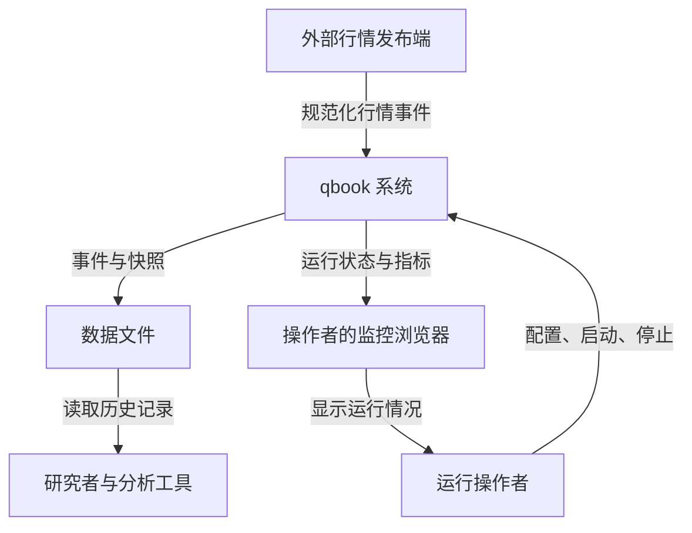
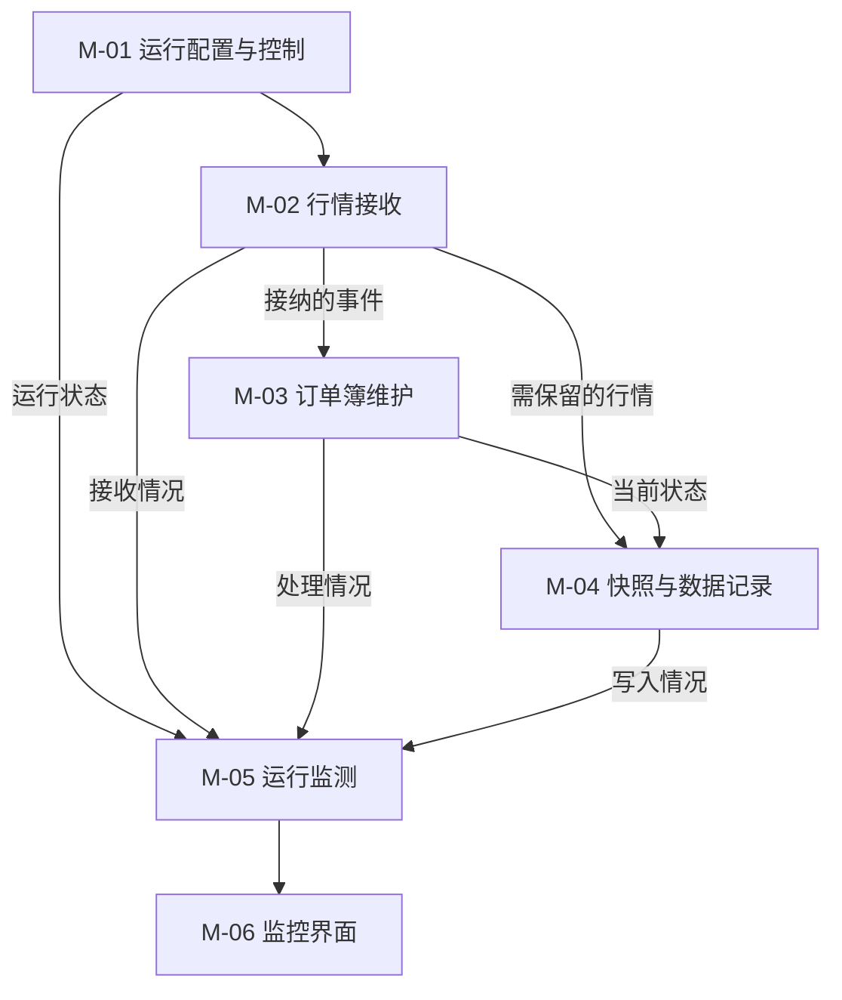

# qbook Requirement（需求文档）

文档版本：0.2｜日期：2026-10-20｜状态：开发前需求基线草案

本文规定 qbook 应提供的能力和验收方式，不表示这些能力已经实现。需求以本次上传的 nqbook v0.5.0 源码为主要参考，并补充从头开发所需的输入边界和验收约定。文中的“本版约定”是 qbook 的开发基线；它不代表所有交易所都采用相同规则。尚需外部信息才能决定的事项统一列在第 11 章。

## 0. Revision History

| 文档版本 | 日期 | 修改人 | 主要变更与原因 |
|---|---|---|---|
| 0.1 | 2026-10-20 | 项目负责人提出目标，Codex 起草 | 建立 qbook 的需求基线：参考 nqbook 重新开发，明确功能范围、业务规则、数据和外部接口、质量要求及验收条件；补充非法数量、正常停止和记录口径，避免开发与测试各自猜测。 |
| 0.2 | 2026-10-20 | Codex | 修正 AGENTS 相对链接，记录用户确认的本地 qlib 内容固定方式和 OI-01 验证；产品行为与验收要求保持不变。 |

这里的版本号表示需求文档版本，不是软件发布版本。后续增加、调整或删除需求时，应记录受影响的编号、变更内容和原因。

## 1. Introduction

### 1.1 文档目的

本文件是 qbook 的软件需求规格说明书（SRS），用于约定“系统需要做什么、什么结果算正确”。项目负责人据此控制范围，开发人员据此实现功能，测试人员据此编写测试和验收，后续维护人员据此判断行为是否符合约定。

本文覆盖完整目标产品，可以分多个软件版本交付；每个版本实际完成哪些需求，由后续任务清单和实现计划确定。内部类、容器、线程组织和算法应在技术规格中展开；开发工作规则见 [AGENTS.md](../AGENTS.md)。

### 1.2 产品概述

`qbook` 是一个根据行情维护订单簿并保存数据的服务。订单簿可以理解为一份持续更新的清单：某个交易品种目前有哪些买单、卖单，它们愿意以什么价格交易，还剩多少数量。行情发布端不断告诉 qbook“新增了订单”“订单改了数量”“发生了成交”或“撤掉了部分订单”，qbook 据此更新清单。

系统供个人开发者、研究人员和运行维护人员使用。开发者用它验证行情处理和订单簿行为；研究人员读取保存的事件和快照，作为后续分析或回放的输入；操作者通过日志和监控界面观察系统是否正常工作。这里的“回放”指由外部工具重新发送已知事件，qbook 本身不提供完整的回测引擎。

系统支持通过整数标识区分多个交易品种。具体交易所、品种名称以及价格和数量精度由上游接入约定提供，本版不宣称覆盖任意市场的全部规则。服务自动处理输入，操作者主要负责配置、启动、查看状态和停止服务。

**qbook 不主动撮合订单。** 例如，买单价格高于卖单价格时，系统不会自行产生交易；只有收到外部成交记录后，才按规定扣减相关订单。

### 1.3 项目范围

本项目参考 nqbook，从头完成 qbook 的需求、设计、实现和验证过程。目标是获得一个行为明确、能够重复验证、能够解释设计和性能结果的行情订单簿服务。

| 范围 | 本次完整目标包含的内容 |
|---|---|
| 运行控制 | 读取配置，启动服务，记录必要日志，响应正常停止请求。 |
| 行情输入 | 接收已规范化的行情事件，检查格式和基本有效性，按运行模式筛选事件。 |
| 逐笔建簿 | 根据单个订单的新增、修改、成交和撤单维护每个品种的订单状态。 |
| L2 建簿 | 根据价位总量更新维护聚合深度；L2 指只知道每个价格上的合计数量，不知道每张订单的明细。 |
| 快照与记录 | 周期输出每个品种的最优买卖一档，保存接纳的行情事件与生成的快照。 |
| 运行监测 | 提供处理计数、状态估计和抽样处理耗时；通过只读界面查看近期变化。 |
| 验证 | 提供确定性业务测试、完整链路验证和能够复现的性能测量结果。 |

本次范围不包含：交易所专用行情适配器、交易策略、主动撮合、交易下单、订单路由、账户和资金管理、交易风控、盈亏计算、完整回测平台、在线订单查询 API、多用户账号权限系统、监控历史数据库、自动补包和重同步、跨重启恢复订单簿、崩溃后数据恢复或高可用集群。本版快照每侧一档，多档输出作为后续需求变更处理。

### 1.4 需求来源与必要性

| 来源编号 | 来源与问题 | 为什么需要 | 对应需求 |
|---|---|---|---|
| SRC-01 | 用户希望完整复刻参考项目，并命名为 qbook。 | 开发过程需要清楚的边界和可逐步验收的目标，不能只以“代码能编译”为完成标志。 | 全部功能及第 9 章验收。 |
| SRC-02 | 本次上传的 nqbook v0.5.0 源码、README 和发布说明。 | 提供订单事件、L2、快照、文件记录和监控的参考行为，避免凭空扩展产品。 | BR-01 至 BR-15，FR-01 至 FR-17。 |
| SRC-03 | 本轮已形成的 qbook AGENTS.md 初始约定。 | 统一项目名称、拟运行环境和基础库复用方向，使需求与开发约定一致。 | 第 2.3—2.6 节、NFR-06、NFR-07。 |
| SRC-04 | 编写本需求时补充的可验证性要求，属于本草案约定。 | 原参考代码没有完整覆盖输入异常和验收边界，需要明确拒绝规则、数据记录口径及不能承诺的能力。 | BR-04、BR-05、BR-06、BR-14、BR-15，相关异常验收及非功能需求。 |

原始行情事件只是变化通知，研究者不能直接从一条撤单记录看出当前最优买价，因此需要持续维护状态和生成快照。运行过程中只有输出文件也不足以判断服务是否堵塞，因此需要监控处理计数。为了定位输入问题，合法但没有改变订单簿的事件仍需记录；为了不把错误数字当成真实行情，格式或基本数值不合法的输入则需要明确拒绝。

## 2. Overall Description

### 2.1 产品视角描述

qbook 是独立运行的新项目，不直接修改参考项目。它位于外部行情发布端和后续数据使用者之间：上游负责将交易所或测试数据整理成约定格式，qbook 负责维护状态和保存记录，下游分析工具负责读取记录并开展研究。

图中的 qbook 表示整个产品边界，不代表某个线程或类。行情发布端和分析工具均由外部提供；数据文件与监控页面是使用者能够看到的主要结果。监控页面用于观察，不向系统发起交易操作。

### 2.2 User Classes

| 角色 | 谁会担任、具备什么条件 | 使用目标与频率 | 能力边界 |
|---|---|---|---|
| 运行操作者 | 能操作 Linux / WSL 命令行并编辑配置的项目使用者。 | 每次运行时配置、启动和停止服务；运行中查看日志与监控。 | 通过操作系统管理进程和文件；本版不另设产品内管理员账号。 |
| 数据研究者 | 能使用数据分析工具的开发者或研究人员。 | 每次实验后读取事件和快照，检查行情变化或准备后续研究数据。 | 读取有权限访问的输出文件；不能通过监控页面修改订单簿。 |
| 开发与测试人员 | 负责实现、验证和性能实验的项目成员。 | 开发期间反复输入已知数据，比较结果并记录实验条件。 | 可在受控环境启动测试发布端和服务；不依赖真实资金或交易账户。 |
| 行情发布端（外部系统角色） | 测试发生器、历史数据回放工具或交易所适配器。 | 服务运行期间持续提供约定格式的事件。 | 负责品种映射、单位和事件顺序，不通过 qbook 获取交易执行能力。 |

同一位用户可以同时承担前三种角色。“角色”用于说明使用目的，并不表示本版需要实现账号权限管理。

### 2.3 Operating Environment

| 环境项目 | 本版要求与适用边界 |
|---|---|
| 服务端 | 以 Linux / WSL2、x86-64 为首个目标环境；具体发行版和工具链版本在验收记录中固定。原生 Windows 和其他架构不作为首轮兼容承诺。 |
| 开发与测试 | 能构建本项目和 qlib，能运行测试发布端，能读取输出数据。拟用 C++23 与 CMake，实际工具链需通过编译验证。 |
| 网络 | 行情端点和指标端点在使用者控制的本机或可信网络中可达；若使用容器，需要另外验证容器与宿主机之间的连接。 |
| 文件系统 | 操作者提供可写输出目录及足够空间；验收时明确输出位置并能用兼容工具打开记录文件。 |
| 浏览器 | 监控界面面向桌面浏览器，首轮至少在一个明确记录版本的 Chromium 系浏览器中验证；其他浏览器范围见 OI-05。 |
| 时钟 | 接收时间依赖运行机器时钟；处理耗时应以适合测量时长的时间源计算。不同机器的时间戳不能直接被当成已经校准的端到端延迟。 |

### 2.4 Constraints

- 本版保持“接收行情、维护状态、保存记录、展示运行情况”的产品定位，不能因项目中出现订单或成交就扩大为实盘交易系统。
- 初始技术约束沿用参考方案的 C++23、CMake、ZeroMQ 行情/指标传输和 Parquet 文件输出，拟复用 qlib。ZeroMQ 是进程间传送消息的通信组件；Parquet 是适合按列读取的数据文件格式。具体依赖版本与内部使用方式由技术规格确定。
- 逐笔模式与 L2 模式在启动时二选一。本版不支持同一运行实例混用两种模式，也不支持运行中切换模式。
- 上下游必须遵守冻结的数据协议、品种映射和数值单位。不能仅因为二进制消息长度相同，就认为它来自兼容版本。
- 本版没有内置登录、加密通道和公网访问防护要求，部署范围限定为受控环境；不得据此宣称可以直接作为开放互联网服务使用。
- 具体类、容器、线程数量、内存管理方式和算法不在本文规定；它们应服务于这里的可观察行为。

### 2.5 Assumptions

| 假设编号 | 当前前提 | 不成立时的影响 |
|---|---|---|
| AS-01 | 上游能从空订单簿开始提供完整的初始化事件，再连续提供后续变化。 | 中途接入纯增量可能缺少已有订单，结果不能代表完整市场。 |
| AS-02 | 同一品种的事件按约定顺序到达，上游不把需要去重的重复成交当作新事件反复发送。 | 本版不按时间戳重新排序，也不提供通用事件去重或补包能力。 |
| AS-03 | 上游、qbook 和文件使用者采用相同品种映射、价格精度和数量精度。 | 相同整数会被解释成不同价格或品种，无法形成有效结果。 |
| AS-04 | 正常验收期间输出介质可写，操作者使用正常停止方式并给服务完成停止的时间。 | 磁盘故障、强制杀进程和断电不适用正常停止的数据完整性保证。 |
| AS-05 | 操作者能够提供测试数据和基本环境信息。 | 无法复现行为或判断性能差异的原因，需要先补齐实验条件。 |

这些是需求成立的外部前提，不是 qbook 已经实现的保障。特别是 AS-01、AS-02 不成立时，不能用“进程还活着”证明订单簿仍然完整。

### 2.6 Dependencies

| 依赖 | 谁提供、需要提供什么 | 依赖未准备好时的影响 |
|---|---|---|
| qlib 基础库 | 项目负责人提供选定版本和可用接口，用于复用公共数据与基础组件。 | 必须先核对接口，不能假定它与参考 nlib 完全兼容；见 OI-01。 |
| 行情协议与发布端 | 接入方提供消息格式、品种映射、单位和初始化流程。 | 可先用确定性测试数据开发，但不能完成真实行情接入验收；见 OI-02。 |
| 通信与文件组件 | 开发环境提供与选定工具链匹配的通信和 Parquet 读写依赖。 | 相关边界功能无法构建或验收；不影响尚未依赖它们的早期核心功能验证。 |
| 输出数据读取工具 | 开发与测试人员提供能够读取实际 Parquet 输出的工具。 | 不能仅凭文件存在判定记录功能通过。 |
| 监控运行环境 | UI 实现阶段提供对应的运行环境和支持浏览器。 | 可以先验证指标输出，完整界面验收需要等待环境就绪。 |
| 性能实验条件 | 项目负责人选定机器、运行环境、代表性负载和目标。 | 可以记录测量结果，但不能声称达到了尚未确定的性能目标；见 OI-04。 |

### 2.7 系统模块与功能划分

以下按使用目标划分业务模块。模块名称不等于文件名、C++ 类名或线程名。

| 模块编号 | 业务模块 | 主要使用者 | 功能清单与边界 |
|---|---|---|---|
| M-01 | 运行配置与控制 | 运行操作者 | FR-01 配置加载与校验；FR-02 启动与正常停止。管理运行条件，不提供交易管理。 |
| M-02 | 行情接收 | 行情发布端、开发与测试人员 | FR-03 接收行情与记录接收时间；FR-04 输入检查与模式筛选。决定哪些事件进入后续处理。 |
| M-03 | 订单簿维护 | 数据研究者、开发与测试人员 | FR-05 新增订单；FR-06 修改订单；FR-07 处理成交；FR-08 部分与全部撤单；FR-09 更新 L2 价位。维护当前市场状态，不主动撮合。 |
| M-04 | 快照与数据记录 | 数据研究者、运行操作者 | FR-10 周期快照；FR-11 行情事件记录；FR-12 文件写入与关闭。提供历史结果，不提供在线查询服务。 |
| M-05 | 运行监测 | 运行操作者、开发与测试人员 | FR-13 处理计数与状态指标；FR-14 抽样处理耗时；FR-15 指标发布。观察服务，不改变业务状态。 |
| M-06 | 监控界面 | 运行操作者 | FR-16 实时指标展示；FR-17 趋势与连接状态。只读查看近期情况，不保存完整监控历史。 |

图中箭头表示业务上的信息来源，不规定内部执行顺序或通信方式。行情记录保留“输入发生了什么”，快照保留“某个时点看到的状态”，两者用途不同；监控负责让操作者知道这些工作是否持续进行。

### 2.8 核心业务流程

1. 操作者准备运行配置和行情发布端，启动 qbook；系统检查配置和必要外部资源。
2. 发布端发送事件；系统记录本机接收时间，检查消息格式、基本字段和运行模式。
3. 系统按交易品种处理接纳的事件；逐笔模式更新订单，L2 模式更新价位总量。
4. 系统保留接纳的行情事件，并按周期生成已知品种的快照；记录最终进入相应文件。
5. 操作者查看监控；系统展示计数、抽样耗时、近期趋势和连接情况。
6. 操作者请求正常停止；系统停止接纳新事件，完成已接纳数据的处理和写入，关闭文件并退出。

逐笔处理、L2、错误输入和停止过程的具体步骤分别见 UC-02、UC-03、UC-06、UC-05。

## 3. Business Rules

以下规则是本需求草案采用的明确行为。来自参考实现的选择也只适用于本项目，不应被解释为交易所通用规则。

| 规则编号 | 规则名称 | 规则与例子 |
|---|---|---|
| BR-01 | 按品种隔离 | 每个交易品种的状态独立。订单 ID 在同一品种的当前挂单中唯一，不要求跨品种唯一。品种 A 和 B 都有订单 10 时，撤销 A 的订单 10 不影响 B。 |
| BR-02 | 按接纳顺序处理 | 同一品种按进入处理链路的事件顺序更新，不按来源时间重新排序。事件序号保留为数据，不等于系统提供了丢包检测、去重或补历史。 |
| BR-03 | 新增与主动撮合边界 | 仅限价新增进入订单簿；市价新增可作为合法事件记录，但不形成挂单。同一品种当前已有相同订单 ID 时忽略重复新增，不覆盖原订单，也不增加价位总量。价格交叉不主动产生成交。 |
| BR-04 | 修改是新剩余总量 | 修改将剩余数量设置为 new_qty：原来 10、new_qty 为 6，结果是 6。new_qty ≤ 0 时移除订单；价格不变时保留同价顺序，即使数量增加；价格改变时进入新价位末尾。未知 ID 不创建订单。改单不改变买卖方向；已知订单方向与输入不一致时，忽略本次业务更新并诊断，已接纳事件仍按原字段记录。 |
| BR-05 | 成交扣减 | 成交数量必须为正。分别查找同一品种中的买方和卖方订单；找到的一侧扣减，未找到的一侧跳过。扣减量达到或超过剩余量时移除该订单，不产生负剩余量。成交一侧未知不使另一侧更新失效。 |
| BR-06 | 部分与全部撤单 | 撤单数量必须为正。剩余 10、撤销 4 后剩余 6；撤销量达到或超过剩余量时移除订单；未知 ID 不改变状态。这里明确沿用“超额扣减移除”，不同时规定为“超额必须报错”。 |
| BR-07 | L2 是价位绝对总量 | 同一品种、方向和价格确定一个价位。原总量 20，再收到总量 8，结果是 8；qty ≤ 0 时删除价位。L2 不提供单个订单明细；L2 模式中的成交仅记录，不再次扣减价位，防止与后续绝对量更新重复计算。 |
| BR-08 | 模式筛选 | 逐笔模式接纳订单、成交、撤单，过滤 L2 更新；L2 模式接纳 L2 更新和成交，过滤订单、撤单。过滤的消息不改变状态，也不作为已接纳业务事件写入文件。 |
| BR-09 | 价位总量与同价顺序 | 逐笔模式中，同一方向、同一价格的剩余订单数量之和等于该价位总量。同价订单按到达顺序排列，除 BR-04 规定的改价外不任意调换顺序；价位没有订单时删除。 |
| BR-10 | 最优一档快照 | 快照包含最高买价、最低卖价及各自价位总量。初版每侧一档；缺失的一侧用价格 0、数量 0 表示“没有报价”，不是一张真实零价订单。已知品种没有挂单时仍可生成空快照。 |
| BR-11 | 快照范围与时间 | 只为本次运行中已处理过接纳事件的品种生成快照；无新事件时仍按周期生成。快照携带该品种最近处理事件的来源时间和本机接收时间，两者都不是快照生成时间。合法但无状态变化的事件也可成为最近处理事件。正常停止不额外保证生成最终快照。 |
| BR-12 | 输入与记录分层 | 无法解码、字段不合法或模式不符的消息被拒绝；已接纳但业务无变化的事件仍记录，例如重复新增、市价新增和未知 ID 撤单。记录的是接纳的输入，不是“成功改变状态的操作清单”。进入处理链路后才发现方向冲突或计算结果越界时，不改变该事件涉及的状态，但仍保存原始事件并诊断；它与入站拒绝不同。不得悄悄把原始撤销量或改单量改成最终剩余量写入事件记录。 |
| BR-13 | 数量与时间含义 | 新增 qty 是初始数量；修改 new_qty 是新剩余总量；成交和撤单 qty 是扣减量；L2 qty 是价位总量。接收时间由本机赋值，来源时间只保留上游含义，不用它计算未经时钟校准的网络耗时。 |
| BR-14 | 非法输入不改状态 | 本版补充最小检查：未知类型/动作、非法方向、不可解码或超出协议表示范围的字段、非正新增量、非正成交量和非正撤销量均不得改变状态。修改和 L2 的非正数量按 BR-04、BR-07 解释为删除。两个有效、非保留值的成交订单 ID 相同时，在输入筛选阶段拒绝；已接纳事件的状态更新结果无法表示时，忽略该次事件的全部状态更新并诊断，原始事件仍记录。无法继续信任的配置在启动阶段报错。 |
| BR-15 | 停止与保存边界 | “已接纳”指事件通过输入筛选且成功交给内部处理链路。正常停止且写入介质正常时，这些事件必须处理并写入可正常读取的文件。网络中尚未收到、收到但尚未接纳的消息不在保证内；强杀、崩溃、断电和磁盘失败不在正常停止保证内。 |

“正数量”按协议采用的最小数量单位判断，例如整数 3 可以代表 3 个最小单位。价格和数量的具体倍率、ID 保留值和时间缺失表示需要在 OI-01、OI-02 中确定；不能根据本段示例直接推断真实交易单位。

## 4. Functional Requirements

优先级定义：**P0** 为核心运行和正确性必需；**P1** 为完整目标产品包含、可在核心链路之后交付的功能。P1 不表示最终交付时可以自动省略。下列功能名称与第 2.7 节保持一致，每项都包含可独立检查的结果。

### 4.1 运行配置与控制

该模块让操作者明确决定本次运行连接哪里、使用哪种模式、如何生成输出，并能正常结束工作。

#### 4.1.1 FR-01 配置加载与校验

为了让操作者重复使用同一组运行条件，系统启动时应从约定的配置文件读取行情端点、建簿模式、快照周期、缓冲容量、输出目录、写入批量和指标发布参数；未提供的配置项使用已公布的默认值，整个文件缺失时允许使用默认配置，但必须在日志中明确提示。配置语法错误、类型不匹配、非正周期、无效容量或非正写入批量应使启动失败，并指出有问题的配置项，不得进入看似正常的运行状态。优先级 P0；来源 SRC-01、SRC-02、SRC-04；关联 BR-08、BR-14。验收时分别提供完整配置、缺项配置和非法配置，核对实际采用的值与错误信息。

#### 4.1.2 FR-02 启动与正常停止

为了让一次数据采集有明确开始和结束，操作者启动服务后，系统应完成配置加载和本地必要资源初始化，记录启动结果；上游暂时没有发送数据不应被误报为已经收到了行情。收到 SIGINT 或 SIGTERM 等正常停止请求后，系统应停止接纳新事件、完成 BR-15 范围内的数据处理和写入、关闭文件并退出；资源初始化或写入失败时必须报告错误，不得以正常保存成功结束。优先级 P0；来源 SRC-01、SRC-02、SRC-04；关联 BR-11、BR-15。验收通过持续输入时请求停止，并比较停止前已接纳记录和最终可读文件，不要求额外生成最后一张快照。

### 4.2 行情接收

该模块接收外部变化通知，并把不能安全解释或不属于本次模式的数据挡在后续处理之外。

#### 4.2.1 FR-03 接收行情与记录接收时间

为了让订单簿随外部行情更新，行情发布端向约定端点发送事件时，系统应持续接收消息、统计接收条数与消息字节数，并为解码后的事件填写本机接收时间；保留来源事件时间，不使用发送方提供的接收时间冒充本机测量。暂时没有消息时服务继续等待，发生可报告的通信错误时记录原因；不能将“无消息”直接解释成已确认的连接正常或完整行情。优先级 P0；来源 SRC-02、SRC-04；关联 BR-02、BR-13。验收发送已知消息并核对字段、处理顺序及接收统计，不把它解释为可靠投递保证。

#### 4.2.2 FR-04 输入检查与模式筛选

为了避免错误输入污染状态，系统接收消息后应检查约定格式、类型、长度和基本字段，并按运行模式筛选事件；通过筛选且交给内部处理链路的事件才计为已接纳。在输入筛选阶段被拒绝的消息不得改变订单簿或进入业务事件文件，应计入拒绝统计，并通过受控日志或诊断信息说明原因；重复新增和未知 ID 等合法无变化事件按 BR-12 继续处理；进入链路后才发现的方向冲突或结果越界属于业务忽略，应保留原事件并诊断，不计入输入拒绝数。处理链路暂时繁忙时，不得静默丢弃已接纳事件；停止时尚未接纳的消息按 BR-15 处理。优先级 P0；来源 SRC-02、SRC-04；关联 BR-08、BR-12、BR-14、BR-15。验收混合输入合法帧、损坏帧、非法数量和错误模式记录，核对状态、计数和文件内容。

### 4.3 订单簿维护

该模块回答“每个品种当前有哪些挂单或价位”，并按约定变化更新它们。

#### 4.3.1 FR-05 新增订单

为了记住新出现的交易意愿，逐笔模式收到合法限价新增时，系统应在对应品种中保存订单 ID、方向、价格和数量，并增加相应价位总量，置于同价订单末尾；重复 ID 不重复加入，市价新增不形成挂单，非法新增不得改变状态。价格交叉时也不得自行产生成交。优先级 P0；来源 SRC-02、SRC-04；关联 BR-01、BR-03、BR-09、BR-14。验收检查同价合计、多价位最优价格、跨品种隔离、重复新增和交叉价格情形。

#### 4.3.2 FR-06 修改订单

为了反映已有订单的新价格或新剩余数量，逐笔模式收到修改事件时，系统应按同一品种和订单 ID 定位订单，将剩余量设为 new_qty，并依 BR-04 更新价位和同价顺序；新数量非正时移除订单，未知 ID 不新增订单，改变已知订单方向时应忽略本次更新、留下诊断信息，并保留已接纳的原始事件。优先级 P0；来源 SRC-02、SRC-04；关联 BR-01、BR-04、BR-09。验收覆盖同价增减量、改价后位置、非正量删除和未知 ID；对合法无变化事件仍按 FR-11 记录。

#### 4.3.3 FR-07 处理成交

为了反映外部已经发生的交易，系统收到合法成交记录后，在逐笔模式按其中的买卖订单 ID 分别扣减能够找到的订单；一侧未知时仍处理另一侧，扣减达到或超过剩余量时移除订单并更新价位。L2 模式保留成交记录但不据此扣减聚合深度；非正成交量应被拒绝，不得增加订单数量。优先级 P0；来源 SRC-02、SRC-04；关联 BR-01、BR-05、BR-07、BR-14。验收比较双侧存在、单侧存在、双侧未知、部分成交和超额成交的结果。

#### 4.3.4 FR-08 部分与全部撤单

为了反映订单被撤回的数量，逐笔模式收到合法撤单记录时，系统应在对应品种中按订单 ID 扣减指定数量；剩余量大于零时保留订单及原顺序，扣减达到或超过剩余量时删除订单并更新价位，未知 ID 不改变状态。非正撤销量应被拒绝；合法未知 ID 撤单仍需保存。优先级 P0；来源 SRC-02、SRC-04；关联 BR-01、BR-06、BR-09、BR-12、BR-14。验收覆盖部分撤销、恰好撤完、超额撤销和未知订单，确保没有负剩余量。

#### 4.3.5 FR-09 更新 L2 价位

为了处理只有价位合计量的行情，L2 模式收到合法价位记录时，系统应按品种、方向和价格将该价位总量设置为输入量；该量非正时删除价位，不存在的价位删除不改变其他状态。系统不得将输入总量当成增量累加，也不得从该总量推断真实订单笔数；逐笔模式中的 L2 输入按 FR-04 过滤。优先级 P0；来源 SRC-02；关联 BR-01、BR-07、BR-08。验收执行总量 20 → 8 → 0，并穿插成交记录，检查最终价位和快照。

### 4.4 快照与数据记录

该模块分别保留行情事件和订单簿状态，供研究者事后读取与核对。

#### 4.4.1 FR-10 周期快照

为了无需重新计算全部事件也能观察最优买卖价，系统应按配置周期为已知品种生成快照，包含品种标识、每侧最优一档价格和总量、最近处理事件的两种时间；没有新事件时仍生成，空侧使用约定缺失表示，尚未出现过的品种不凭空生成快照。快照必须反映一个完整事件处理前后的一致状态，不得混合半次更新的数据；繁忙时允许调度延后，但不能宣称满足硬实时期限。优先级 P0；来源 SRC-02；关联 BR-09、BR-10、BR-11。验收核对多价位选择、空侧、空簿、无新事件周期输出和时间含义。

#### 4.4.2 FR-11 行情事件记录

为了保留本次运行实际接纳过的行情，系统应分别保存订单、成交、撤单和 L2 记录，并保留其业务字段、来源时间及本机接收时间；合法但没有改变状态的事件也必须保存；已接纳后发现方向冲突或结果越界的事件仍记录，输入筛选阶段拒绝的消息不得混入这些业务文件。同一类型的记录保留处理顺序，不承诺不同文件的同一行号属于同一时刻；同一次运行中不得因内部转交而重复保存一条已接纳事件。优先级 P0；来源 SRC-02、SRC-04；关联 BR-02、BR-12、BR-13。验收将已知输入按类型与输出逐条对照，包括重复 ID 新增和未知 ID 撤单。

#### 4.4.3 FR-12 文件写入与关闭

为了让研究者能使用标准工具读取历史结果，系统应在配置目录中以 Parquet 格式分别保存四类事件和订单簿快照，按配置批量写入，正常停止时保存不足一批的剩余记录并关闭文件；新的运行不得覆盖以前的输出。目录不可写、空间不足或其他写入失败必须报错，不能继续把结果标为完整采集；具体故障退出流程见技术规格，但失败不能伪装成正常结束。优先级 P0；来源 SRC-02、SRC-04；关联 BR-12、BR-15。验收读取关闭后的文件，检查字段、行数、记录值、尾批次与重复启动的文件隔离。

### 4.5 运行监测

该模块提供服务正在处理什么、处理到哪一步、最近是否持续工作的证据。

#### 4.5.1 FR-13 处理计数与状态指标

为了让操作者发现输入异常、处理停滞和输出积压迹象，系统应提供接收消息数和字节数、各类有效解码事件数、拒绝数、已处理事件数、各类写入追加数，以及品种数、当前挂单数和订单簿存储估计等指标；名称和口径应符合第 6.4 节，订单类计数包含撤单时必须明确标注。没有新数据时不得凭空增长业务计数，正常重启后计数重新开始，L2 模式的挂单数不得解释成市场真实委托笔数。优先级 P1；来源 SRC-02、SRC-04；关联 BR-07、BR-12、BR-15。验收用固定输入对照计数，并区分“写入追加”与“已经安全落盘”。

#### 4.5.2 FR-14 抽样处理耗时

为了观察订单簿更新的成本而不把每一条输入都当成复杂性能实验，系统应对部分事件测量处理耗时，提供累计抽样耗时和样本数，并说明抽样规则及计时范围；结果只代表被抽样的业务处理，不包含网络接收、排队和文件写入时间，也不能被命名为 P99 等尾延迟。没有样本时显示无数据，不做除零计算。优先级 P1；来源 SRC-02、SRC-04；关联 BR-13。验收检查耗时与样本数的非负性、无样本显示、抽样均值计算以及公开的测量口径。

#### 4.5.3 FR-15 指标发布

为了让界面或外部观察程序获取运行情况，系统应按配置周期发布带采样时间的指标记录，遵守与消费者一致的字段和单位；慢消费者应能够继续看到近期状态，本版不要求补发全部历史指标。指标消费者断开不应改变订单簿业务结果；指标发布不可用时需留下可观察的错误信息，不把缺失样本伪装成零业务量。优先级 P1；来源 SRC-02、SRC-04；关联第 6.4 节与 EXT-04。验收接入、断开和恢复观察端，并核对记录格式、近期性及业务结果不受影响。

### 4.6 监控界面

该模块把运行指标转成操作者容易理解的数值、趋势和连接提示。

#### 4.6.1 FR-16 实时指标展示

为了让操作者不必直接阅读二进制指标，用户打开监控页面后，界面应按行情接收、订单簿处理和数据写入等业务阶段展示最近样本，显示清楚的名称、单位及计数口径；累计计数和每秒速率应区分，抽样耗时应标为相应均值。未收到数据、没有耗时样本或服务重启导致计数下降时，界面应显示合理状态，不产生负速率、无穷大或错误延迟。页面只读，不提供改订单或发交易的按钮。优先级 P1；来源 SRC-02、SRC-04；关联 FR-13、FR-14、FR-15。验收使用已知指标序列和重启情形核对显示值。

#### 4.6.2 FR-17 趋势与连接状态

为了区分业务暂时空闲和监控数据已经停止更新，界面应展示近期趋势，并区分正在连接、持续收到样本、样本长时间未更新和连接出错等状态；趋势的时间范围、速率计算窗口和停滞判断阈值必须有明确说明，数据不足时不得假装已经覆盖完整历史。收到连续样本但业务计数不变属于可能的空闲；页面失去样本只能说明监控状态未知，不能直接证明核心服务已停止。优先级 P1；来源 SRC-02、SRC-04；关联 EXT-05、NFR-05。验收分别模拟空闲、暂停指标和断开连接，窗口及阈值在 OI-05 关闭后固定。

## 5. Use Cases

### UC-01 启动一次数据采集

- **目标与关联：** 操作者以可重复的参数开始采集；FR-01、FR-02、FR-03、FR-04。
- **参与者与前提：** 运行操作者、行情发布端；配置和依赖已准备，协议兼容，输出位置可用。
- **触发与主流程：** ① 操作者填写配置并启动服务；② 系统校验配置并报告实际运行参数；③ 发布端按约定开始发送初始化和后续事件；④ 系统接纳事件、更新状态并产生处理和输出记录。
- **完成结果：** 已知事件的处理情况可观察，接纳记录进入记录流程；文件内容在 UC-05 正常关闭后核对。仅有启动日志不构成完整成功。
- **替代与异常：** 缺少配置文件时明确提示使用默认值；非法参数或输出位置不可用时启动失败；上游暂时无消息时可以等待，但不得声称行情已经正常流入。

### UC-02 维护一个品种的逐笔订单簿

- **目标与关联：** 正确反映挂单、改单、成交和撤单；FR-05、FR-06、FR-07、FR-08、FR-10、FR-11。
- **参与者与前提：** 测试人员通过发布端输入数据；逐笔模式从空状态启动，以下价格和数量均为约定整数单位。
- **触发与主流程：** ① 新增买单 B1，价格 100、数量 10；② 新增买单 B2，价格 100、数量 5，买一总量应为 15；③ 修改 B1 的 new_qty 为 6，买一总量变为 11；④ 撤销 B2 的 2，B2 剩余 3、买一总量为 9；⑤ 新增卖单 S1，价格 101、数量 8；⑥ 收到买方 B1、卖方 S1、数量 2 的成交，B1 剩余 4、S1 剩余 6，快照应为买一 100/7、卖一 101/6。
- **完成结果：** 订单、价位总量与快照一致；输入事件按类型保存。
- **替代与异常：** 另发重复 B1 新增不增加总量；另发未知 ID 撤单不改变状态，但合法事件仍记录；非正成交量被拒绝，不应把剩余量变大。

### UC-03 维护 L2 价位

- **目标与关联：** 用聚合价位输入得到正确深度；FR-04、FR-07、FR-09、FR-10、FR-11。
- **参与者与前提：** 测试人员与发布端；L2 模式从空状态启动。
- **触发与主流程：** ① 发送买侧价格 100、总量 20；② 再发同价总量 8，快照总量应变为 8；③ 发送该品种成交量 3，价位仍为 8，成交应记录；④ 发送同价总量 0，买侧变为空。
- **完成结果：** 系统按绝对量替换价位，不累加也不对成交重复扣减。
- **替代与异常：** 订单和撤单帧被模式过滤并计入拒绝；删除一个不存在的价位不影响其他价位；无效方向的记录不能生成价位。

### UC-04 查看运行状态

- **目标与关联：** 操作者判断业务是否持续处理；FR-13 至 FR-17。
- **参与者与前提：** 运行操作者；服务和监控界面已启动，指标协议一致。
- **触发与主流程：** ① 操作者打开页面；② 界面连接指标来源；③ 持续显示接收、处理、写入计数和趋势；④ 操作者停止发送行情但保持指标发布，页面显示近期样本、业务速率逐步降为零。
- **完成结果：** 操作者能区分“系统空闲”和“已经没有近期监控样本”。
- **替代与异常：** 暂停指标发布触发样本停滞提示；断开连接触发连接错误提示；服务重启后重新计算速率，不能显示负数。

### UC-05 正常停止并读取输出

- **目标与关联：** 保留已经接纳的数据并得到完整可读文件；FR-02、FR-11、FR-12。
- **参与者与前提：** 运行操作者、数据研究者；服务正在运行，输出介质正常，测试方能区分已接纳事件与仅发送事件。
- **触发与主流程：** ① 操作者发送正常停止信号；② 系统停止接纳新事件并完成内部待处理记录；③ 系统写入不足一批的尾部记录、关闭文件并退出；④ 研究者读取本次输出并核对字段与记录数量。
- **完成结果：** 每条已接纳事件恰有一份相应业务记录；已生成并交付写入的快照也可读取，不要求额外生成最终快照。
- **替代与异常：** 若出现写入错误，系统报告失败，不能把文件标为完整；强制杀进程不适用本用例的完整性结论。

### UC-06 排查被拒绝的输入

- **目标与关联：** 发现错误输入而不破坏已有状态；FR-03、FR-04、FR-13。
- **参与者与前提：** 开发与测试人员；服务中已有一组可核对的状态。
- **触发与主流程：** ① 记录当前状态；② 发送损坏长度、未知动作、错误模式和非正撤销量等输入；③ 系统计入相应接收/拒绝统计并提供诊断信息；④ 发送一条合法事件，确认系统仍能继续处理。
- **完成结果：** 被拒绝输入不改变订单簿、不进入业务文件，后续合法输入仍可工作。
- **替代与异常：** 无法解码的消息不要求保留为完整原始文件；诊断信息允许限频或汇总，但不能完全隐藏拒绝事实。

### UC-07 接收记录并进行离线核对

- **目标与关联：** 研究者理解输入与状态变化的区别；FR-05、FR-08、FR-11、FR-12。
- **参与者与前提：** 数据研究者；一次运行已正常关闭文件。
- **触发与主流程：** ① 读取订单、成交、撤单、价位和快照文件；② 按事件类型、品种、ID 和序号核对测试输入；③ 检查重复 ID 新增、未知 ID 撤单也有记录；④ 将状态变化与快照比较。
- **完成结果：** 可以解释哪些事件改变了状态、哪些没有；不同类型文件的行号不会被误认为统一顺序。
- **替代与异常：** 如果上游序号不具备跨类型全序，不能据此承诺离线恢复全部原始先后关系；该能力是否需要增加见 OI-06。

## 6. Data Requirements

### 6.1 公共数据约定

本章描述逻辑字段及其含义，不规定结构体内存排布。价格和数量使用固定精度整数：例如约定倍率为 100 时，整数 12345 表示 123.45；这里的 100 只是解释示例，真实倍率必须以冻结协议为准。不得在尚未核对 qlib 时擅自填入某个字节数或倍率。

| 字段或数据项 | 逻辑类型与必填性 | 来源、范围与默认约定 |
|---|---|---|
| instrument_id | 整数标识；所有事件和快照必填。 | 由上游提供，必须在本次接入的品种映射中可解释；不能靠 ID 数字推测品种名称。 |
| 事件种类 | 有限枚举；行情消息必填。 | 区分订单、成交、撤单和 L2；未知值拒绝。 |
| seq | 整数序号；事件必填，当前快照不要求此字段。 | 上游提供并原样保留；有效范围、是否全局递增与保留值由协议确定，不能据此默认获得去重能力。 |
| event_ns | 整数时间；字段必填，未知时是否允许哨兵值待协议确认。 | 上游提供的事件时间，单位为纳秒；纪元及未知时间表示必须统一，见 OI-02。 |
| recv_ns | 整数时间；接纳事件和快照必填。 | 由 qbook 在本机接收时赋值，表示自约定纪元起的纳秒数；输入中的同名值不作为本机事实。 |
| side | 买/卖枚举；相关事件必填。 | 表示订单、价位或上游成交方向；具体字段含义不跨类型混用。非法值拒绝。 |
| price | 固定精度整数；按事件类型提供。 | 使用本次接入约定的价格倍率和范围。为与空侧表示一致，初版真实挂单和价位使用正价格；负价格市场不在本次默认接入范围，变更需更新协议和缺失表示。 |
| qty / new_qty | 固定精度整数；按事件类型提供。 | 数量倍率统一；每种事件的正负要求及“总量/扣减量”含义见第 6.2 节。不能发生数值溢出后继续更新。 |

所有必填字段必须存在且在冻结协议的可表示范围内；缺失或不可表示的字段不能默默补成真实业务值。具体二进制位宽、枚举编码、填充字节和标记值在接口规格中确定，并与 qlib 接入结果一致。

### 6.2 核心业务数据

下表中的每种事件都包含第 6.1 节适用的公共字段。标注“条件必填”的字段必须在对应动作中提供；无关字段的编码和默认值由协议统一，接收方不能将它们误用为当前动作的数量。

| 数据对象 | 专有字段与必填规则 | 取值和处理要求 |
|---|---|---|
| 订单新增 | order_id、side、price、qty、type、action 必填；action 为 add；new_qty 对新增无业务作用。 | order_id 是当前品种中的订单标识；type 区分限价和市价。限价新增的 price、qty 为正；市价新增不形成挂单，其不使用字段按协议填充。 |
| 订单修改 | order_id、side、price、new_qty、action 必填；action 为 modify；qty 不作为修改量。 | new_qty 是新的剩余总量；非正表示移除；若保留订单则 price 为合法正价。已知订单的方向不允许改变。 |
| 成交 | buy_order_id、sell_order_id、price、qty、side 字段按冻结协议提供。 | qty 必须为正；有效订单 ID 可以在当前簿中找不到。某一侧完全不提供 ID 时使用什么保留值见 OI-02，不得把保留值当作普通订单去扣减；两个有效、非保留值的买卖 ID 不得相同；相同时在输入筛选阶段拒绝，避免重复扣减。成交价作为输入记录保留，不触发重新撮合。 |
| 撤单 | order_id、qty、side 必填。 | qty 是正的扣减量；订单查找以当前品种与 ID 为准，side 为上游方向元数据，不改变已有订单方向。 |
| L2 价位更新 | side、price、qty 必填。 | price 为合法正价；qty 是整个价位的绝对总量，非正值删除价位。没有 order_id，不要求虚构单个订单。 |
| 当前订单状态 | 品种、订单 ID、方向、价格、剩余数量及同价先后关系。 | 由合法逐笔事件形成，剩余数量为正；订单移除后不继续算作当前挂单。状态只在本次运行内维护。 |
| 当前价位状态 | 品种、方向、价格、总量。 | 逐笔模式由当前订单合计得到，L2 模式由价位事件给出；两种来源不得混用。 |

数量含义对照：当前数量为 10，新增数量 3 表示新建一张数量 3 的订单；修改 new_qty 为 3 表示原订单剩余 3；撤单或成交 qty 为 3 表示原订单剩余 7；L2 qty 为 3 表示整个价位总量变为 3。

### 6.3 快照数据

| 字段 | 必填与取值要求 | 含义 |
|---|---|---|
| instrument_id | 必填。 | 本快照所属的交易品种。 |
| bid_price、bid_qty | 必填，每侧一档。 | 最高买价及该价位合计量；空侧为 0/0。 |
| ask_price、ask_qty | 必填，每侧一档。 | 最低卖价及该价位合计量；空侧为 0/0。 |
| event_ns、recv_ns | 必填，沿用最近处理事件的值。 | 对应状态所经历的最近事件元数据，不表示文件写入时间或快照生成时间。 |

快照中的真实报价数量为正；0/0 是缺失报价的标记。快照不能用每侧一档的数据反推出更深档位、订单明细或同价顺序；这些行为需要通过业务测试或适当测试观察接口验证，不要求因此新增生产在线查询接口。

### 6.4 运行指标数据

指标记录包含采样时间，以及下列累计计数和最近状态。累计计数从本次运行起累加；“最近状态”可能按快照周期更新，不等于每次发布都重新计算。

| 指标组 | 所含数据 | 必须说明的口径 |
|---|---|---|
| 接收 | 消息数、消息字节数、订单类/成交/L2 有效解码数、拒绝数。 | 消息数包含被拒绝消息；字节数指接收到的消息内容，不含网络协议开销。订单类计数包含撤单，应明确标注。有效解码数指通过格式、基本字段和模式筛选后、交给内部链路前的事件数；它不自动等于已接纳数，停止前等待接纳的记录可能尚未进入链路。业务阶段的忽略不增加输入拒绝数。 |
| 业务处理 | 已处理事件数、累计抽样处理耗时、样本数。 | 已处理事件包括合法但无状态变化的事件；耗时只覆盖声明的业务处理范围。 |
| 订单簿状态 | 品种数、当前挂单数、订单簿存储估计。 | 逐笔挂单数指当前订单笔数；L2 可显示 0 或“不适用”，不能当作真实委托数。存储估计不等于整个进程占用的内存。 |
| 数据写入 | 订单类、成交、L2、快照的追加记录数。 | 订单类追加数包含撤单，但撤单数据文件仍独立；追加数不证明记录已安全落盘。 |
| UI 派生值 | 每秒速率、窗口内抽样均值、近期曲线和连接状态。 | 用明确的时间窗口和单位计算；未收到足够数据时注明，重启造成的计数下降不计算为负速率。 |

完整记录的字段顺序、整数位宽及版本兼容办法在外部接口规格中冻结；不直接将参考 nlib 的指标字节数当作 qlib 的已确认契约。

### 6.5 运行配置数据

以下默认值来自参考项目，作为本版初始配置基线，不代表已经达到任何性能目标。端点的具体地址由运行环境决定。

| 配置项 | 类型与默认值 | 合法性与用途 |
|---|---|---|
| 行情端点 | 字符串；初始本机示例为 tcp://127.0.0.1:5555。 | 必须符合支持的端点格式并指向实际发布端；容器环境另行配置。 |
| 建簿模式 | 逐笔 / L2；默认逐笔。 | 只允许两个已定义模式，启动后不动态切换。 |
| 输入与待写缓冲容量 | 正整数；各默认 16384。 | 实际可用容量和上限需与选定组件一致并在规格中公开；非法容量启动失败。 |
| 快照周期 | 正整数毫秒；默认 3000。 | 控制周期生成快照的目标间隔，不构成硬实时承诺。 |
| 输出目录 | 路径；默认 data_out。 | 可按约定创建，最终必须可写；不得覆盖以前运行的数据。 |
| 文件写入批量 | 正整数记录数；默认 1024。 | 控制每类记录的批量处理；不足一批的尾部记录在正常停止时仍保存。 |
| 指标端点 | 字符串；初始本机示例为 tcp://127.0.0.1:5556。 | 必须与观察端一致；如需其他机器访问，由操作者显式配置地址。 |
| 指标采样周期 | 正整数毫秒；默认 100。 | 控制指标记录的目标发布间隔；业务状态指标可能仍保持上次快照时的值。 |

本版采用文件配置；命令行和环境变量覆盖不作为必需能力。日志应能让操作者确认实际采用的关键参数。

### 6.6 数据关系、保存与生命周期

- 一个品种可以有多个当前订单和多个价位；逐笔模式中，每个当前订单只属于该品种的一个方向和价格。
- 当前状态会被后续事件更新或删除；历史事件文件保存接纳时的输入含义，不随当前状态变化回写旧行。
- 每次运行分别保存订单、成交、撤单、L2 和快照记录；空类型允许没有业务行，是否生成空文件由接口说明统一。
- 输出保存期限由操作者决定，本版不自动按天数删除或压缩历史目录。新的运行不得覆盖旧文件，系统不自动将旧文件加载为当前订单簿。
- 输出文件需要让读取者识别记录类型、字段名称和单位约定；同类型记录保留处理顺序，跨类型全序是否需要额外标识见 OI-06。
- 输入接收成功、事件已接纳、记录已追加以及文件正常关闭可读取是不同阶段。验收报告必须使用正确阶段，不以追加计数代替持久化证明。

## 7. External Requirements

本章仅规定系统与外部对象如何交换信息。内部模块的函数、类和调用方式由后续技术规格说明。

| 接口编号 | 外部对象与触发 | 输入或输出要求 | 不可用、错误与兼容边界 |
|---|---|---|---|
| EXT-01 配置与进程控制 | 操作者在启动前提供配置，运行时发送停止信号。 | 读取约定位置的配置文件，公开关键默认值和错误项；支持正常启动及 SIGINT/SIGTERM 停止。 | 非法配置不能进入正常运行；停止保证以 BR-15 为准。 |
| EXT-02 行情输入 | 外部发布端持续发布规范化事件。 | 初始方案通过 ZeroMQ 订阅端接收单条带类型标记的二进制记录；支持类型、字段和模式按第 3、6 章约定。 | 格式不匹配拒绝；上游暂不可用时不能编造行情。双方需冻结相同协议版本和布局，本版不保证跨字节序或任意版本兼容，也不保证自动识别所有同长度的错误版本。 |
| EXT-03 数据文件输出 | 系统接纳行情、生成快照并完成写入；研究者在文件关闭后读取。 | 以 Parquet 提供五类记录，字段名称、单位与类型可识别，保存本次运行数据且不覆盖旧输出。 | 写入失败明确报错；运行中的未关闭文件不承诺可完整读取；读取者需采用兼容工具。 |
| EXT-04 指标输出 | 系统周期发布，外部观察端订阅。 | 初始方案通过独立 ZeroMQ 发布端提供带采样时间的指标，消费者与服务使用相同的指标契约。 | 允许跳过中间样本，关注近期状态；不提供可靠历史补发。格式不符不能当成有效指标。 |
| EXT-05 浏览器界面 | 操作者打开监控页面。 | 浏览器通过界面服务获取指标并展示，不能要求浏览器直接解释底层 ZMQ 行情；名称、单位、时间窗口和连接状态清楚。 | 界面连接错误或样本停滞时显示相应状态；页面故障不能改变订单簿。首轮在指定浏览器版本验收。 |
| EXT-06 日志与诊断 | 启动、停止、输入拒绝、通信/写入错误等事件发生。 | 向操作者可访问的日志输出运行信息、错误位置和可区分的原因；连续同类错误可汇总或限频。 | 日志不能把拒绝输入写成处理成功，不能以日志存在代替文件和状态检查。本版不要求远程日志平台。 |

事件协议中用于实现的数据布局细节不得作为跨进程可直接使用的本地地址。发送方与接收方应共同确认支持的协议；任何实际内存链接信息都不能被解释为外部授予的本地访问能力。

## 8. Non-functional Requirements

| 编号与质量目标 | 来源、场景与优先级 | 可验证标准及适用条件 |
|---|---|---|
| NFR-01 正确性与确定性 | SRC-01、SRC-02、SRC-04；所有业务更新；P0。 | 从相同初始状态输入相同有效事件顺序，应得到相同订单簿状态和业务字段。不同品种互不影响，逐笔价位总量等于剩余订单合计，不产生负剩余量。接收时间、运行文件名和按墙钟触发的快照条数不要求不同运行逐字相同。 |
| NFR-02 正常停止的完整性 | SRC-02、SRC-04；采集结束；P0。 | 在介质正常且等待正常退出的条件下，已接纳事件没有内部丢失和重复，尾批次与已交付写入的快照可以读取。强杀、崩溃、断电和网络未接纳消息不在该指标范围。 |
| NFR-03 异常可识别与隔离 | SRC-04；非法输入、配置错误和写入失败；P0。 | 非法输入不改状态，后续合法输入仍可处理；非法配置阻止启动；写入失败不报告完整采集成功。测试需实际触发这些情形并检查状态和错误结果。 |
| NFR-04 性能结果可复现 | SRC-01、SRC-04；性能实验；P1。 | 记录机器/系统、构建模式、依赖版本、品种和订单规模、事件比例、输入速率、预热、测量时长、重复次数及统计方式；至少区分业务处理耗时和完整链路处理能力。吞吐、延迟及资源上限的数值目标见 OI-04，未确定前只能报告测量值，不能宣称达标。 |
| NFR-05 指标可解释 | SRC-02、SRC-04；运行监控；P1。 | 同一次运行的累计计数不因显示计算而倒退；计数口径与固定输入吻合；样本数为零时不除零；重启不显示负速率。界面能够区分仍有近期样本的业务空闲、样本停滞和连接错误。 |
| NFR-06 接口兼容与边界明确 | SRC-02、SRC-03；上游接入与下游读取；P0。 | 冻结双方的数据单位、字段、编码和兼容版本，并用已知测试数据往返核对；可识别的非法类型和长度被拒绝。未实现协议版本检测时，兼容版本应由部署检查保障，不能宣称自动拦截所有错误版本。 |
| NFR-07 可构建、可运行、可复验 | SRC-01、SRC-03；新的开发环境或重新验收；P0。 | 在记录的目标环境中，按文档和固定依赖版本能够构建当前交付范围、运行已登记的测试并完成示例数据验收。报告包含实际执行场景及结果；没有运行测试或没有测试被发现不能记为通过。 |
| NFR-08 受控环境使用 | SRC-03、SRC-04；部署和数据访问；P0。 | 文档明确网络访问和文件访问由运行环境管理；默认示例端点面向本机，验证日志和输出不要求交易账户或真实资金。不得将无账号、无加密的本版描述成已具备公网多租户安全能力。 |

不为本项目编造“每秒百万事件”“亚微秒延迟”“零丢失”“99.99% 可用性”等未经约定和测量的指标。具体性能门槛确定后应更新 OI-04 和本章，而不是把参考项目描述直接当成本项目成绩。

## 9. Acceptance Criteria（验收标准）

### 9.1 验收环境与证据

验收使用明确记录的代码版本、qlib 版本、目标环境、配置和确定性输入。业务场景可以在组件级检查，链路场景需要真实完成输入、处理和文件读取；不能只根据进程存活、日志打印或文件存在判定通过。

涉及同价顺序等未在生产快照中暴露的行为，可以通过测试观察手段检查；这不要求新增生产查询服务。正常停止的数据核对必须以“已接纳事件”为基准，不能用外部发布端尝试发送的数量直接替代。

### 9.2 验收覆盖表

| 验收编号 | 关联需求/规则 | 场景与操作 | 通过条件 |
|---|---|---|---|
| AC-01 配置 | FR-01；BR-14；NFR-03、NFR-07。 | 使用完整配置、缺项、缺文件和非法周期/容量/批量。 | 合法值生效；默认值有明确依据；缺文件有提示；非法值失败且指出问题。 |
| AC-02 输入筛选 | FR-03、FR-04；BR-08、BR-12、BR-14；NFR-03、NFR-06。 | 在两种模式分别发送四类记录、损坏帧和非法字段。 | 只接纳当前模式允许的合法记录；拒绝不改状态、不写业务文件，接收与拒绝计数可解释。 |
| AC-03 新增与隔离 | FR-05；BR-01、BR-03、BR-09；NFR-01。 | 同品种同价/异价新增、重复 ID、跨品种同 ID、市价新增、交叉价格及价位合计越界。 | 数量和价位正确，重复不累加，跨品种互不影响，市价不挂簿，交叉价格不主动成交；合计越界不部分更新，已接纳事件保留并诊断。 |
| AC-04 修改 | FR-06；BR-04、BR-09、BR-14；NFR-01、NFR-03。 | 同价增减量、改价、非正 new_qty、未知 ID、改变方向。 | 使用新总量而非差量；同价保留顺序、改价移到末尾；非正移除；未知不创建；方向冲突不改状态，但保留已接纳事件并诊断。 |
| AC-05 成交 | FR-07；BR-05、BR-07、BR-14；NFR-01。 | 双侧/单侧/双侧未知，部分/全部/超额扣减，非正成交量及双侧有效 ID 相同。 | 存在的订单正确扣减，未知不阻止另一侧，超额移除无负量，非正量和双侧有效 ID 相同的输入拒绝；L2 深度不被成交再次扣减。 |
| AC-06 撤单 | FR-08；BR-06、BR-09、BR-12、BR-14；NFR-01。 | 部分、恰好、超额撤销，未知 ID，非正撤销量。 | 按规则保留或移除订单，空价位删除；合法未知事件记录，非法数量不改状态。 |
| AC-07 L2 | FR-09；BR-07、BR-08；NFR-01。 | 执行 UC-03，并对不同品种、方向、价格交叉操作。 | 总量按绝对值替换，非正删除，相互隔离；不虚构订单明细。 |
| AC-08 快照 | FR-10；BR-10、BR-11；NFR-01。 | 多个买卖价位、空侧、空簿、暂停行情而保留运行。 | 买侧最高、卖侧最低，每侧一档数量正确；无新事件仍周期产生；空侧为 0/0；事件时间不被改成生成时间。 |
| AC-09 事件记录 | FR-11；BR-02、BR-12、BR-13；NFR-02、NFR-06。 | 保存固定输入，含重复新增、未知撤单和拒绝输入。 | 接纳事件按类型逐条相符，无内部重复；无变化事件保留；拒绝输入不进入业务文件。 |
| AC-10 文件与尾批次 | FR-12；BR-15；NFR-02、NFR-03。 | 输入少于一批及超过一批的记录，正常停止并用工具读取；再运行一次。 | 所有应保存记录可读，字段单位明确，尾部记录不缺失，第二次运行不覆盖第一次。 |
| AC-11 停止边界 | FR-02、FR-04、FR-12；BR-15；NFR-02。 | 在持续输入和内部存在待处理数据时请求正常停止。 | 已接纳记录完成处理和保存，进程正常退出；尚未接纳记录不被混称为丢失的已接纳记录，不强制生成最终快照。 |
| AC-12 故障报告 | FR-01、FR-02、FR-04、FR-12；NFR-03、NFR-08。 | 注入无效配置、不可写目录、受控写入失败和非法帧。 | 配置/存储失败清楚报告，不声称完整采集；非法帧不污染状态，合法后续事件仍可处理。 |
| AC-13 指标与耗时 | FR-13、FR-14、FR-15；NFR-05、NFR-06。 | 输入已知类型和数量，读取指标，覆盖无抽样记录情况。 | 计数口径正确，撤单合并统计有标注；抽样均值计算正确；没有样本显示无数据；追加量不被标为安全落盘量。 |
| AC-14 监控界面 | FR-16、FR-17；NFR-05。 | 输入已知指标序列，模拟业务空闲、样本暂停、连接断开和服务重启。 | 名称单位正确，空闲与缺失样本可区分，重启不显示负速率，窗口与停滞判断符合已冻结约定。 |
| AC-15 可复现性能 | NFR-04。 | 在冻结的实验环境与负载下进行测量，记录各次结果。 | 实验说明足以复现，计时口径清楚；OI-04 关闭后按明确阈值判定，不用实时监控的抽样均值代替全部性能验收。 |
| AC-16 完整运行复验 | FR-01 至 FR-17；NFR-01 至 NFR-08。 | 在记录的环境中按文档构建，执行 UC-01 至 UC-07 及相应验证。 | 当前声明交付的需求都有实际结果，无未说明的失败；依赖、配置、协议和已知限制均有记录。 |

### 9.3 整体通过条件

- 每个软件版本先明确本次覆盖的 FR 和 NFR，再按对应验收项检查；不能因后续功能尚未交付而把已声明的核心功能也跳过。
- 完整产品交付应覆盖全部 P0、P1 功能及相关验收；任何延期必须明确列出需求编号和原因。
- 影响当前交付的待确认问题必须已解决，或明确标注该部分尚未验收。例如 OI-04 未确定时，可以完成一次性能测量报告，但不能宣布性能门槛验收通过。
- 所有通过结论必须来自实际执行的检查。源码阅读、编译成功、测试零发现和人工估算均不能替代相应行为或性能证据。

## 10. Glossary（术语解释）

| 术语 | 在本项目中的含义 |
|---|---|
| 交易品种 / instrument | 被独立维护行情的对象，例如某个交易对；具体名称由上游映射提供。 |
| 订单簿 / order book | 某个品种当前买卖挂单或价位总量的集合。 |
| 限价单 | 带指定价格的订单；本项目将有效限价新增记录为挂单。 |
| 市价单 | 不以指定限价等待成交的订单类型；本项目不将其作为挂单维护，也不替它执行交易。 |
| 价位 / price level | 同一个品种、方向和价格上的订单集合及其总量。 |
| 挂单 / resting order | 当前仍在簿中、剩余数量大于零的订单。 |
| 逐笔 / MBO | Market By Order，按单个订单的变化维护状态。 |
| L2 / 聚合深度 | 按每个价格的总量维护状态，通常无法知道各个订单的明细。 |
| FIFO / 同价先后顺序 | 同价订单按到达顺序排列；本项目的改单例外见 BR-04。 |
| 成交 | 外部已经发生的交易通知，qbook 根据它扣减已有订单，不自行撮合。 |
| 撤单 | 从某张订单中撤去一部分或全部剩余数量。 |
| 最优买价、最优卖价 | 当前最高的买方报价和最低的卖方报价，常称买一、卖一。 |
| 快照 / snapshot | 在某次生成时观察到的订单簿摘要；本版每侧只输出最优一档。 |
| 来源时间 / event_ns | 上游赋予事件的时间；不是本机接收时间或快照生成时间。 |
| 接收时间 / recv_ns | qbook 本机收到消息时记录的时间。 |
| 固定精度整数 | 用整数加统一倍率表示小数价格或数量，避免不同组件对小数含义各自解释。 |
| 已接纳事件 | 已通过输入检查并成功交给内部处理链路的事件；可能最终不改变订单簿。 |
| 无状态变化事件 | 格式和语义允许处理，但没有改变当前状态的事件，例如未知 ID 的合法撤单。 |
| 追加与持久化 | 追加可能仅进入待写缓冲；本版正常保存验收以文件正常关闭并可读取为证据，不承诺断电安全。 |
| 背压 | 后续处理来不及时，前面的处理放慢或等待；它不能直接保证外部网络消息不丢失。 |
| 累计计数 | 从本次启动起累加的数量，如已处理事件数；不是每秒处理量。 |
| 状态指标 / gauge | 某次观察时的状态，如当前挂单数，可能上升或下降。 |
| 抽样均值 | 仅对被测量样本求得的平均耗时；不等于全部事件的最慢耗时或 P99。 |
| 吞吐量 | 在明确时间和负载条件下完成的处理量，例如每秒完成多少事件。 |
| Benchmark | 在说明清楚的负载和环境下反复测量性能的实验。 |
| ZeroMQ / ZMQ | 用来在不同进程之间传送消息的通信组件；本项目用于行情和指标。 |
| Parquet | 保存结构化数据的列式文件格式；研究者可按字段读取事件或快照。 |
| qlib | 本项目拟复用的基础库，提供公共类型或通用组件；接口兼容性需要核对。 |

## 11. Open Issues（待确认问题）

以下问题需要在对应里程碑前解决，不要求现在暂停所有开发。临时假设只用于有界的开发和测试，不能被写成已经确认的外部事实。

| 编号 | 待确认问题 | 影响范围 | 确认人及最晚时机 | 确认前的临时假设 |
|---|---|---|---|---|
| OI-01 | V0 已关闭：用户确认使用 `/mnt/d/Desktop/unsw/qlib` 当前源码，以 `third_party/qlib.sha256` 固定完整副本，无 Git 提交。实际接口、倍率、`qlib::qlib` 和 ABI 已核对。 | 数据协议、核心接入、EXT-02/04、NFR-06/07。 | 项目负责人确认来源，Codex 于 2026-10-20 验证；见本地 `docs/releases/V0.md`（不上传 GitHub）。 | 仅确认本地依赖与受控 ABI；实际行情映射仍由 OI-02/03 承担。 |
| OI-02 | 首个实际行情源和品种映射是什么？价格/数量倍率、ID 范围和保留值、未知来源时间、成交缺失一侧 ID 如何编码？ | 第 6 章、FR-03 至 FR-11、EXT-02。 | 项目负责人及行情接入方；真实行情接入前。 | 先用受控测试数据、正价格和明确单位；上游从空状态提供完整初始化及顺序事件，不接入单位未知的数据。 |
| OI-03 | 首个上游的改单优先级、超额扣减、L2 删除和成交语义是否与本版规则一致？ | BR-04 至 BR-07，FR-06 至 FR-09。 | 项目负责人及接入方；接入该上游前。 | 本地开发采用本文明确规则：同价改单保序、超额扣减移除、L2 非正量删除、L2 成交只记录。若上游不同，应转换或变更需求，不静默混用。 |
| OI-04 | 用哪台机器和运行环境做性能验收？品种数、活跃订单规模、事件比例、输入速率和吞吐/延迟/内存目标是什么？ | NFR-04、AC-15。 | 项目负责人；性能验收版本开始前。 | 先报告可复现实测结果，不设无依据的绝对门槛；WSL 测量结论只适用于记录的该环境。 |
| OI-05 | UI 支持哪些浏览器？趋势保留范围、速率窗口、停滞阈值和刷新容差取什么值？ | FR-16、FR-17、EXT-05、AC-14。 | 项目负责人和界面开发者；UI 实现与验收前。 | 以桌面 Chromium 浏览器为首轮；参考界面的近期滚动趋势可作为设计起点，具体时长须明确，不把样本数量直接冒充真实分钟数。 |
| OI-06 | 是否需要不同类型文件之间可严格恢复的统一事件顺序？ | FR-11、第 6.6 节、UC-07。 | 项目负责人和数据使用者；冻结输出字段前。 | 本版只保证同类型处理顺序，并保留上游序号和时间；不承诺在上游没有全序时完整还原跨文件顺序。若需要，应增加明确的外部数据要求。 |

问题关闭后，应记录结论和日期，更新受影响的规则、功能、数据及验收条目，并在第 0 章记录文档修订；不要只在聊天中达成结论而让正文保留旧假设。
