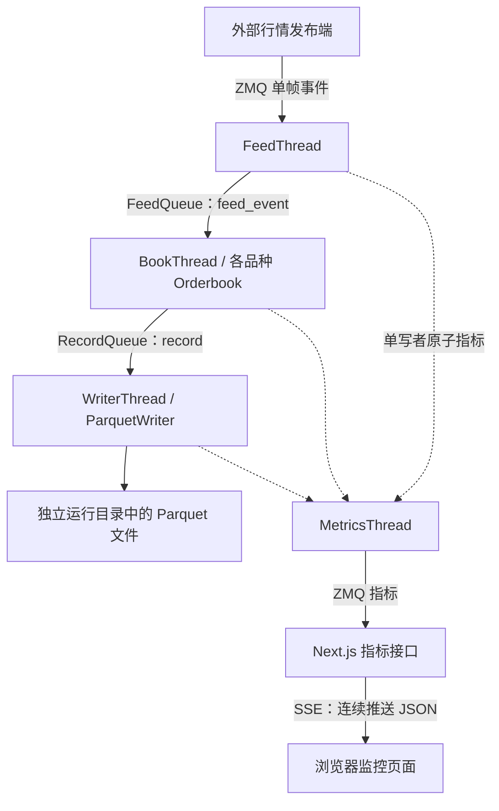
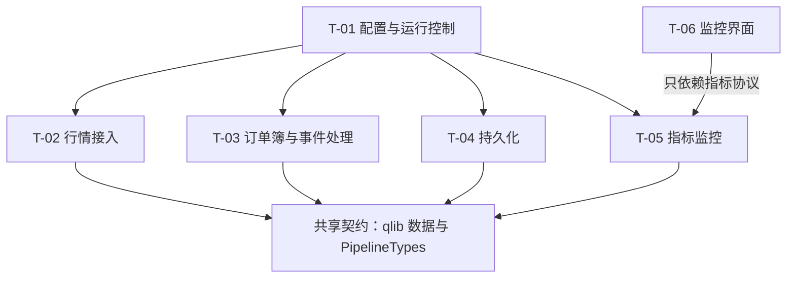
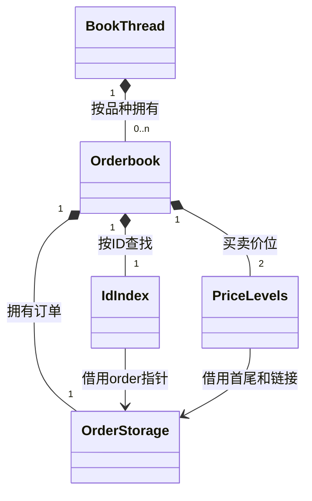

# qbook Spec（技术规格文档）

版本：0.3｜日期：2026-10-20｜状态：V0 已完成；V1 核心实现与验证已完成；后续阶段为设计基线

本文件依据 [requirement.md](requirement.md) 解释 qbook 的设计与接口契约，参考材料为 nqbook v0.5.0 与 qlib(V4) 源码。V0 已交付配置、共享类型与故障/指标基础；V1 已完成订单簿核心、同步快照及对应验证。网络、运行阶段、持久化、指标发布与 UI 等章节仍描述后续目标，不表示参考项目具备全部增强能力。具体编码步骤见 Implementation Plan，版本和任务顺序见 Sprint Backlog，仓库工作规则见 [AGENTS.md](../AGENTS.md)。

本文已核对 qlib 的实际接口，不把它机械视为 nlib 的改名。价格/数量倍率、队列容量语义与 CMake 目标已有源码依据；未确定的真实行情源、依赖锁定提交和性能门槛在第 7 章保留。代码块用于说明规划接口或协作方式，除明确列出的结构和断言外，不构成可直接编译的完整工程。

## 1. 项目概述

### 1.1 项目解决什么问题

行情输入是一连串变化，例如“新增订单 101”“订单 101 撤去 3”。qbook 把这些变化累积成每个交易品种的当前订单簿，周期输出最优买卖一档，并保存输入事件和快照。它让后续使用者能够检查当前报价、研究历史变化并观察处理服务的运行情况。

系统维护外部市场已经发生的事实，不自行撮合。买卖报价交叉仍可以同时挂在簿中，只有外部成交事件才触发逐笔订单扣减。

### 1.2 使用者与使用场景

操作者配置并运行服务；研究者读取正常关闭的 Parquet 文件；开发者用固定事件序列验证业务，再用明确负载做性能实验。监控页面只展示运行状态，不提供下单或改簿入口。初期使用 Linux / WSL2 的受控环境和本地测试发布端，再接入已经完成协议映射的真实行情源。

### 1.3 本次实现范围

对应需求 FR-01～FR-17：文件配置、运行与停止、输入检查、逐笔订单维护、L2 价位维护、周期快照、分类型文件记录、指标采集/发布以及只读监控界面。该范围是完整目标，可按后续版本计划逐步完成，不要求第一版一次性建立所有文件。

### 1.4 本次不实现的内容

不实现主动撮合、交易策略、下单、账户、风控、完整回测、在线订单查询接口、自动补历史、断线重同步、跨重启恢复、高可用集群、监控历史数据库或产品内账号系统。正常停止的保存保证不扩大到强杀、断电、磁盘失败，也不扩大到 ZMQ 尚未交付或内部尚未接纳的消息。

### 1.5 术语与概念

| 术语 | 本文中的含义 |
|---|---|
| 逐笔 / MBO | 按单个订单的 ID 和剩余数量维护状态。 |
| L2 | 只维护某个价格上的总量，不知道真实委托笔数。 |
| SPSC | 单生产者、单消费者：一条队列只有一个写入线程和一个读取线程。 |
| 所有权 | 哪个对象负责资源的生存和释放；借用指针或引用不能延长资源寿命。 |
| 侵入式链表 | 链接字段直接放在订单对象中，用 `prev/next` 连接同价订单。 |
| ABI / 本机布局 | 编译器和平台决定的字段偏移、填充和对象大小；不等于通用网络协议。 |
| 原子指标 | 可以在一个线程更新、另一个线程读取的独立数值；不保证一组指标来自同一瞬间。 |
| 已接纳 | 输入检查通过且成功进入 FeedQueue；仅收到或解码完成还不算。 |
| 业务忽略 | 已接纳事件不改变业务状态，例如重复 ID、未知 ID、方向冲突或合计溢出；原事件仍记录。 |
| 致命失败 | 分配、文件写入、工作线程或必要通信资源出现无法继续的错误；整次运行失败，停止排空保证不再成立。 |

## 2. 系统整体技术设计

### 2.1 系统技术架构图



三个业务阶段各做一件事：Feed 解释外部消息，Book 更新业务并产生记录，Writer 将记录写入文件。独立监控线程只读指标，不读订单簿容器或队列内部。SSE 是服务端持续向浏览器推送文本事件的连接；浏览器不直接使用 ZMQ。

### 2.2 技术模块图



这里的箭头表示依赖关系，不表示行情流动方向。共享契约保存公共记录和队列别名，不放业务逻辑；UI 只知道指标协议，不需要知道订单簿内部使用什么容器。

### 2.3 各模块的职责、边界与划分依据

| 技术模块 | 主要组件与文件 | 对应需求 | 边界 |
|---|---|---|---|
| T-01 配置与运行控制 | `Config.h/.cpp`、`Runtime.h/.cpp`、`main.cpp` | FR-01、FR-02 | 读参数、组装、管理停止和故障；不实现订单更新。 |
| T-02 行情接入 | `Protocol.h/.cpp`、`Threads/FeedThread.h/.cpp` | FR-03、FR-04 | 校验外部字段、解码、投递；不访问已有订单。 |
| T-03 订单簿与事件处理 | `Orderbook.h/.cpp`、`Threads/BookThread.h/.cpp` | FR-05～FR-10 | 管理业务状态、分发事件、生成快照；不调用 Arrow。 |
| T-04 持久化 | `ParquetWriter.h/.cpp`、`Threads/WriterThread.h/.cpp` | FR-11、FR-12 | 保存不可变记录；不重新计算订单簿。 |
| T-05 指标监控 | `Threads/MetricsThread.h/.cpp` 中的 `Metric/Metrics/MetricsThread` | FR-13～FR-15 | 更新/采样统计，不将普通 `qlib::metrics` 当原子共享对象。 |
| T-06 监控界面 | `ui/lib/metrics.ts`、`ui/lib/rate.ts`、`ui/app/api/metrics/route.ts`、`ui/app/page.tsx` | FR-16、FR-17 | 消费指标、计算显示值；不向核心发送修改请求。 |

文件组织中，公共声明位于 `include/`，实现位于 `src/`；`include/PipelineTypes.h` 定义 `BookMode` 和两条队列别名，避免 Writer 为获得类型而包含完整 BookThread。测试、性能实验、输出数据分别位于 `tests/`、`benchmarks/`、`data_out/`。这些是规划位置，实际创建随任务推进。

### 2.4 模块之间的依赖、协作关系及设计理由

```cpp
namespace qbook {
enum class BookMode : std::uint8_t { Mbo, L2 };
using FeedQueue = qlib::single_queue<qlib::feed_event>;
using RecordQueue = qlib::single_queue<qlib::record>;
}
```

入口创建两条固定容量队列和四个阶段对象，保证这些对象活到所有线程 `join()` 之后。Feed 是 FeedQueue 唯一生产者，Book 是其唯一消费者；Book 同时是 RecordQueue 唯一生产者，Writer 是唯一消费者。各阶段借用队列，不负责销毁它。

这种划分让网络和文件 I/O 不直接占住订单簿的操作线程，同时避免多个线程争抢同一订单簿的锁。代价是需要两个额外队列、记录副本和阶段间等待；文件写入跟不上时，背压会逐级传到接收阶段，仍不能保证外部 ZMQ 发布者的数据无丢失。

### 2.5 关键数据流与执行流程

**正常数据流：** Feed 接收一帧，记录本机时间，调用纯解码函数验证基础字段和模式；筛选通过后增加有效解码计数，投递成功才成为已接纳事件。Book 只读输入事件，更新自己拥有的订单簿，再把原始事件转为记录投递给 Writer。业务忽略同样转发；输入事件不会因挂单数量变化而被改写。

**快照流：** Book 使用 `steady_clock` 判断周期，为已知品种生成值拷贝。快照保存最近处理事件的时间；输出生成时间不能冒充该字段。忙碌后只生成当下快照并重新安排下一次到期，不在一个循环里无限补发历史到期次数。

**停止与故障流：** 普通停止按 Feed → Book → Writer 的顺序请求停止并逐个等待完成，最后停止 Metrics。Book、Writer 的普通停止先排空输入；任意阶段出现致命失败时，统一故障标志中止等待，所有线程停止，不再承诺完整排空。这样既能正常保存尾部数据，也能避免 Writer 已退出而 Book 永远等待满队列。

### 2.6 技术模块的划分方案与理由

核心业务和工作循环分开：`Orderbook` 负责“收到变化后状态应该是什么”，`BookThread` 负责“持续取事件、选择品种、安排快照”。同理，`ParquetWriter` 负责文件格式，`WriterThread` 负责持续消费记录。`Config` 是参数集合，不需要变成服务管理器；无状态解码使用自由函数，不为每个动作建立一个类。

没有采用一个大循环直接完成网络、更新和落盘，因为文件等待会直接阻塞全部工作；也不采用每品种一个线程或通用任务调度框架，因为当前需求没有相应吞吐证据，反而会引入跨品种调度和关闭复杂度。

### 2.7 整体架构的技术选型、替代方案与设计取舍

| 决策 | 需求依据与选定方案 | 可替代方案 | 理由与代价 |
|---|---|---|---|
| D-01 阶段协作 | FR-03～FR-12：三个业务阶段以 SPSC 交接，订单簿单线程拥有。 | 单线程全流程；多生产者工作池。 | 职责明确、状态同步简单；代价是队列等待、记录复制与停止协议。 |
| D-02 基础组件 | 复用当前 qlib 的记录、hive、map、single_queue。 | 标准容器；复制 nlib 实现。 | 与已有学习项目一致且避免重复实现；必须遵守 qlib 的移动、异常和容量契约。 |
| D-03 有序价位 | 双侧 `std::map<int64_t, qlib::price_level>`。 | 有序向量、稠密价格数组、其他树。 | 稀疏价格和动态增删适用，复杂度清楚；代价是节点分配和间接访问，后续由测量决定是否改变。 |
| D-04 行情与指标 | 继续使用 ZeroMQ，运行于受控的已约定 ABI 环境。 | 普通 TCP、自定义二进制协议、JSON。 | 接近参考项目，适合本机发布订阅；不提供可靠历史补发，也不是跨平台通用协议。 |
| D-05 数据输出 | Arrow 组织列数据，Parquet 保存五类文件；使用 ZSTD 压缩。 | CSV、逐行 JSON、数据库。 | 适合离线按列分析，字段类型明确；依赖和批量写入成本较高，实时未关闭文件不承诺可读。 |
| D-06 监控 UI | Next.js 服务端桥接 ZMQ 到 SSE，React 页面显示。 | CLI、原生桌面、浏览器 WebSocket。 | 保持参考技术栈，单向指标适合 SSE；引入 Node 环境和每客户端资源管理。 |
| D-07 验证范围 | 核心确定性测试、协议固定样本、链路与失败退出测试。 | 只检查日志；为每个私有函数建立镜像测试。 | 覆盖真实风险而不复制实现；性能阈值在实验条件确定后再冻结。 |

## 3. 数据模型与数据设计

### 3.1 数据含义与用途

直接使用 `qlib::order/trade/cancel/level/book/metrics`；不再定义一套看似一样的 qbook 行情结构。`order` 同时可表示输入事件和本地挂单，二者用途不同：输入副本保留原始 qty/new_qty；挂单副本的 qty 随事件变化，prev/next 仅是本地链接。`price_level` 保存价位总量和订单首尾；L2 价位的首尾都为空。

### 3.2 数据类型及其选择理由

| 项目 | 当前 qlib 定义 | 选择理由与约束 |
|---|---|---|
| 价格、数量 | `std::int64_t`；`price_scale=10'000'000'000`，`qty_scale=100'000'000`。 | 用固定精度整数表达价格和数量；换算和合计需检查溢出，不能未经检查先做有符号加法。 |
| 订单 ID、序号 | `std::int64_t`。 | 固定整数范围；qbook 的有效值规则在下方规定，不是 qlib 自动校验。 |
| 品种 ID | `std::uint32_t`。 | 固定宽度非负标识，0 可以是映射中的有效品种，不作为“空订单簿”的标记。 |
| 时间 | `std::int64_t` Unix epoch 纳秒。 | 与 qlib 契约一致；接收/采样用系统时钟，周期/耗时用单调时钟，两种时钟不混减。 |
| 方向、订单类型、动作 | 底层 `std::uint8_t` 的枚举。 | 编码分别 buy=0/sell=1、limit=0/market=1、add=0/modify=1；仍需检查枚举值是否属于已定义集合。 |
| 指标 | ts_ns 为 int64；其余 16 项为 uint64。 | 核心统计范围大；浏览器不能直接无损容纳任意 64 位整数，桥接时用十进制字符串。 |
| 快照深度 | `snapshot_depth=1`。 | 满足本版最优一档目标；不能仅改 UI 而忽略数据布局和文件格式。 |

**本版受控协议选择：** order/modify/cancel 的 order_id 必须大于 0；成交两侧 ID 允许为 0 表示没有该侧 ID，其他值必须为正，两侧有效非零 ID 不得相同；seq 非负但不要求接收方去重；event_ns 非负，0 表示上游时间未知，不能展示为真实 1970 年行情；recv_ns 始终由本机覆盖。真实挂单和价位价格为正，缺失快照一侧为价格 0、数量 0。实际行情接入方必须按此映射，不能在接收方悄悄重解释。

### 3.3 数据结构及其选择理由

逐笔状态使用 `hive<order>` 拥有对象，ID 哈希索引只保存指向这些对象的非拥有指针；买卖两侧各用有序价位树，价位中的首尾指针连接同价订单。这样 ID 定位、价格排序和对象生命周期各由一个结构负责，避免一个容器同时承担全部职责。

`qlib::hive` 可以增长而不移动现有订单；但其 `get_iterator(pointer)` 需要查找所属块，完整删除路径不能写成保证 O(1)。`qlib::map` 插入和重哈希后应重取其迭代器/引用；索引中的 `order*` 指向 hive 对象，所以索引扩容不会移动订单本体。

`qlib::single_queue` 使用 uint64 单调计数器的差值判满，容量向上取 2 的幂且全部可用。比如请求容量 3，实际容量 4，可以容纳 4 个元素；qbook 在配置层拒绝 0，虽然 qlib 本身把 0 映射到 1。

### 3.4 事件与快照模型及其设计理由

```cpp
// 这些别名由 qlib 提供，不在 qbook 中重新定义。
// qlib::feed_event = variant<order, trade, level, cancel>
// qlib::record     = variant<order, trade, level, cancel, book>
```

两个 variant 按值保存事件，前者用于输入，后者额外允许快照进入写入阶段。使用 `std::visit` 按真实记录类型分派，避免人为同步“类型字段＋无类型指针”。variant 的对象内存不能直接发送到网络。

输入 wire tag 为 order=0、trade=1、level=2、cancel=3，与 variant 的排列当前对应但两者仍是独立契约。一帧是 1 字节 tag 加该类型的本机布局记录。初版只支持已冻结的小端 x86-64、8 字节指针、标准布局配置；它沿用参考项目形式，不冒充可移植序列化。

| 类型 | 当前 ABI 字节数 | 关键字段偏移（字节） |
|---|---:|---|
| order | 80 | seq 0，order_id 8，price 16，qty 24，new_qty 32，prev 40，next 48，instrument_id 56，side 60，type 61，action 62，event_ns 64，recv_ns 72。 |
| trade | 64 | seq 0，buy_order_id 8，sell_order_id 16，price 24，qty 32，event_ns 40，instrument_id 48，side 52，recv_ns 56。 |
| cancel | 48 | seq 0，order_id 8，qty 16，instrument_id 24，side 28，event_ns 32，recv_ns 40。 |
| level | 48 | seq 0，price 8，qty 16，event_ns 24，instrument_id 32，side 36，recv_ns 40。 |
| book | 56 | event_ns 0，bid_price 8，bid_qty 16，ask_price 24，ask_qty 32，instrument_id 40，recv_ns 48。 |
| metrics | 136 | ts_ns 0；16 个 uint64 字段依 common.h 声明顺序从偏移 8 开始，每项占 8 字节。 |

这些数字已根据本次 qlib 源码与当前 x86-64 编译环境核对，是**该协议配置的约束**，不是 qlib 在所有平台上的承诺。工程需要用 `sizeof/offsetof` 和字节序断言锁定此配置，并用固定二进制样本验证发布端、接收端、TS 解码器；尺寸或偏移不符合时构建失败，不静默继续。协议没有版本头，因此某些同长度的错误版本无法自动检测，发布与部署必须固定兼容版本。

解析器从字节缓冲读取命名标量字段，枚举先按 uint8 检查再转换，本地记录先 `T{}` 初始化；订单 prev/next 始终设为 nullptr，不读取或解引用对方提供的地址。测试发布端先零填充字节缓冲，再写命名标量字段，避免把未初始化填充或真实进程地址带入协议。

### 3.5 数据之间的关系



图中的 OrderStorage、IdIndex、PriceLevels 是结构角色，不要求真的创建这些类。订单本体只保存一份，其他结构引用它；删除订单前必须先解除所有引用。

### 3.6 数据约束、状态变化与不变量

- 逐笔状态中，hive 活订单与 ID 索引一一对应；每张订单恰好属于一个同方向同价格的链表，剩余数量为正，价位总量等于链上数量之和。
- L2 状态中，不建立订单明细和 ID 索引；价位总量由绝对更新给出，head/tail 为空；成交只记录。
- 新增与改单先检查结果量能否表示；已接纳事件的方向冲突或合计溢出属于业务忽略，状态保持，最近处理事件时间仍更新，原事件继续记录。
- 输入拒绝、业务忽略和运行失败不同：拒绝尚未进入链路；忽略是正常处理结果；分配失败等致命故障使本次运行失败，不能用 Ignored 掩盖。
- 快照只包含值，不引用活订单；已投递快照不会因为后续事件而改变。全空快照同样有绑定的品种标识。

### 3.7 数据来源、流向与生命周期

| 数据 | 创建与所有者 | 更新、交接和结束 |
|---|---|---|
| 接收帧 | Feed 线程的 ZMQ message。 | 解码产生独立值；帧释放不影响队列记录。 |
| 接纳事件 | FeedQueue 中的 variant。 | Book 取出后仅用 const 引用应用，再复制/移动为原始记录；不携带可用的远端指针。 |
| 当前挂单 | 对应 Orderbook 的 hive。 | 数量与链接可变；被移除前解除索引和价位引用，地址随后不可再用。 |
| 快照 | Book 根据一致状态生成的值。 | 经 RecordQueue 交给 Writer，独立于后续订单状态。 |
| 写入批次 | ParquetWriter 的各 Sink。 | 达到批量或显式 Close 时写出；错误后不自动重试同一批次，防止不明状态下重复写入。 |
| 共享指标 | main 创建的 Metrics。 | 每项单写者，MetricsThread 仅读；所有线程结束后释放。 |
| 输出文件 | 每次运行排他创建的目录。 | 正常关闭后供分析；不自动恢复为订单簿，不自动按日期删除。 |

### 3.8 共享数据组织方案的选择与取舍

选择“业务对象单线程拥有、事件按值交接、监控使用独立原子数值”。相较于多个线程共享一棵可变订单簿，这样更容易判断指针什么时候有效；代价是传递副本和短暂排队。

不让 UI 或 MetricsThread 直接读取 qlib 容器。尤其 `single_queue::size()/empty()` 的并发观察契约仅适用于生产者/消费者，不能让第三方监控线程调用它们来估算占用。当前指标不包含精确队列深度；未来需要时由对应队列端显式发布估计，另行定义口径。

## 4. 各技术模块的详细规格

本章按六个技术模块展开。每个模块内部保留模板的“模块设计 → 类设计 → 模块整体协作”；类设计中的第 1～11 项对应模板的类设计条目。简单数据集合和无状态函数按实际形式说明，不为满足目录而强行创建类。

### 4.1 配置与运行控制模块

#### 4.1.1 模块设计

**1. 模块需求与设计目标。** 对应 FR-01、FR-02、BR-15：参数可验证，运行状态可解释，普通停止能排空，故障时不会永久等待已经退出的下游。

**2. 模块职责、边界及其理由。** 本模块决定“创建什么、什么时候停止”，不决定订单如何改变。主线程拥有队列、阶段对象和 Metrics，工作线程只在这些对象存活期间运行。

**3. 模块核心设计思路。** 文件配置转成强类型 Config；main 组装并启动工作线程；普通停止使用各 `std::jthread` 的 stop_token，致命失败使用独立的 RunControl 故障标志。二者分开，否则一个全局停止位会让 Writer 在 Book 排空前提前退出。

**4. 内部类与组件的划分及其理由。** Config 只存参数，LoadConfig/ValidateConfig 是配套自由函数；RunControl 只保存首个致命故障，不做通用调度框架；main/RunService 负责组装与 join。固定的 100ms 网络接收检查超时、100us 空队列休眠和 50us 满队列退避是命名内部策略常量，当前不增加用户调参入口；未来成为调优参数时再纳入配置。

**5. 模块对外接口。** `Config LoadConfig(const std::filesystem::path&)`、`void ValidateConfig(const Config&)`、`int RunService(const Config&)`；程序无业务命令行参数，从仓库根目录的 `config/config.yaml` 读取配置。主进程返回 0 表示正常结束，非零表示启动或运行失败。

**6. 模块与其他模块的关系。** Config 字段经构造传给对应阶段，`bool l2` 转为 BookMode。RunControl 对工作循环只提供 Failed 查询；线程包装函数捕获异常并调用 Fail，主线程在所有 join 完成后读取失败详情。

#### 4.1.2 类设计

##### 4.1.2.1 Config

**1. 类的用途与职责。** Config 是一次运行的已验证参数快照，启动后不热更新。

**2. 为什么需要这个类？** 将配置文件中的文本值转换为明确类型，避免各阶段各自解析 YAML 并采用不同默认值。

**3. 类与其他类的关系及其设计理由。** main 持有 Config，阶段构造时复制各自需要的字段；阶段不持有指向整个可变配置文件的全局指针。

**4. 类的内部数据与状态。** 只有值，没有套接字、线程或文件句柄；状态从“默认值＋文件覆盖”变成“通过验证后只读”。

**5. 成员变量及其设计理由。**

| 成员 | 类型与初始值 | 使用者与理由 |
|---|---|---|
| feed_endpoint | `std::string`，`tcp://127.0.0.1:5555` | Feed 连接外部发布端；不假定作者的 Docker 主机名可用。 |
| l2 | `bool`，false | main 转为 BookMode；不作为可动态改变的共享开关。 |
| feed_queue_capacity | `std::size_t`，16384 | FeedQueue 的最小请求容量；日志同时给出实际容量。 |
| snapshot_period | `std::chrono::milliseconds`，3000 | Book 的快照目标周期。 |
| record_queue_capacity | `std::size_t`，16384 | RecordQueue 的最小请求容量。 |
| out_dir | `std::filesystem::path`，`data_out` | Writer 排他创建本次运行目录的父目录。 |
| batch_rows | `std::int64_t`，1024 | Arrow/Parquet 每类记录的批量大小。 |
| metrics_endpoint | `std::string`，`tcp://127.0.0.1:5556` | Metrics 绑定；远程访问须显式配置。 |
| sample_period | `std::chrono::milliseconds`，100 | 指标发布目标周期。 |

**6. 数据容器、索引的技术选型与取舍。** 固定字段结构比通用字符串 map 更容易检查类型和发现拼写错误；代价是新增配置项需同步字段、解析和文档。YAML 沿用 fkYAML 头文件解析；不自行编写复杂配置语言。

**YAML 文件表示。** 使用上表九个同名 snake_case 平坦键，两个周期均为整数毫秒。
允许部分键和空映射 `{}`，缺项保留默认。根必须是单个映射文档，键必须为字符串；
空文档、多个文档、未知键、重复键及显式 null 均拒绝。
字符串、布尔与整数严格区分，容量 `"3"`、`3.0`、`l2: 0` 等不作隐式转换。
空输入路径、非普通文件和实际读取失败均报错；只有确定不存在的文件才警告并返回经验证的默认值。

**7. 成员函数及其设计理由。** Config 不需要业务成员函数。默认构造提供默认值，配套自由函数负责文件读取和验证，避免“创建一个参数对象”同时隐式启动服务。

**8. 成员函数详细规格（含配套自由函数）。**

```cpp
Config LoadConfig(const std::filesystem::path& path);
void ValidateConfig(const Config& config);
int RunService(const Config& config);
```

| 接口 | 输入、前置条件与返回 | 状态与后置条件 | 边界、异常、性能与线程 |
|---|---|---|---|
| Config 默认构造 | 无输入；返回默认参数集合。 | 不访问文件，不分配业务队列。 | 标准字符串/路径构造可能分配；仅启动阶段使用，不声明整体 noexcept。 |
| LoadConfig | path 指向配置位置；返回通过 ValidateConfig 的值。 | 先默认值，再覆盖提供字段；不启动线程。 | 文件缺失记录 warn 并用默认；文件存在但不可读、格式错误、字段类型错误、未知键或验证失败抛带字段路径的异常；复杂度与配置长度相关，主线程调用。 |
| ValidateConfig | 已解析 Config；成功返回 void。 | 不修改输入，不创建业务资源。 | 拒绝零容量、非正周期/批量、空路径/端点、无法表示的取整或字节运算；抛 invalid_argument。端点最终能否绑定/连接由实际 ZMQ 操作验证。 |
| RunService | Config 已验证；返回正常 0、失败非零。 | 创建并保持资源，结束前等待已启动线程；正常情况文件已显式关闭。 | 内存分配、线程创建和必要资源初始化失败进入失败退出；不能遗漏已启动线程。主线程唯一调用者。 |

容量必须在调用 `std::bit_ceil` 前检查其输入是否有可表示结果，并检查实际容量与单槽大小的乘积，以及 qlib 单调计数所需范围；不能先溢出再判断。正周期也要保证转换为实际时钟单位及计算下一到期时间可表示。批量与固定列表元素数的乘积同样检查。数值合法仅表示可表示，不意味着机器有足够内存；分配不足应报告启动失败。

**9. 类的关键算法与行为流程。** 读取文件 → 检查根和各段结构 → 覆盖指定字段 → 检查值与容量计算 → 输出实际配置摘要。完整配置与缺项配置最终走同一个验证函数，不把默认值当成免检路径。

**10. 类的技术选型、替代方案与设计取舍。** 选择单一 YAML 配置入口；暂不叠加环境变量和命令行优先级，减少排查“到底哪个值生效”的成本。文件不存在采用默认值与参考项目一致，但必须有提示；存在却读不出不能被误当缺文件。

**11. 创建、初始化与销毁。** Config 在启动初期创建，直到 RunService 返回后销毁。字符串和路径自行释放；没有额外 Close 或跨线程变更接口。

##### 4.1.2.2 RunControl

**1. 类的用途与职责。** RunControl 让所有工作阶段知道本次运行是否已经发生致命失败，并在退出后提供第一条失败原因。

**2. 为什么需要这个类？** 如果 Writer 写入失败而退出，Book 可能仍在等待 RecordQueue 空位。只靠普通 stop_token 和上游先停顺序可能无法解除这种等待，需要单独的失败通道。

**3. 类与其他类的关系及其设计理由。** main 拥有 RunControl；工作循环借用 const 引用并读取 Failed；工作线程最外层异常包装调用 Fail。业务忽略不调用 Fail，浏览器断开也不自动调用 Fail。

**4. 类的内部数据与状态。** Healthy → Failed 单向变化，不复用一个对象启动下一次运行。故障标志和诊断内容分开发布：其他线程只观察标志，不并发读取诊断内容。

**5. 成员变量及其设计理由。**

| 成员 | 类型 | 理由 |
|---|---|---|
| failed_ | `std::atomic<bool>{false}` | 多个阶段可以竞争报告失败，所有阶段可检查。 |
| error_ | `std::exception_ptr` | 保存首个异常，避免在错误路径重新分配和格式化大字符串。 |
| stage_ | `const char*`，初始 nullptr | 仅保存静态存储期的阶段名，例如字面量 `"writer"`，不借用临时字符串。 |

**6. 数据容器、索引的技术选型与取舍。** 无队列和容器。失败信息只保留首条；完整后续诊断可通过日志提供，不建立并发错误收集系统。

**7. 成员函数及其设计理由。** Fail 负责一次性记录，Failed 负责循环退出检查，Error/Stage 供全部线程结束后报告。不同读取时机写进接口契约，避免读取尚未写完的诊断数据。

**8. 成员函数详细规格。**

```cpp
class RunControl {
public:
  void Fail(const char* stage, std::exception_ptr error) noexcept;
  bool Failed() const noexcept;
  std::exception_ptr Error() const noexcept;
  const char* Stage() const noexcept;
};
```

| 接口 | 参数、返回与前置条件 | 状态、后置条件与边界 | 错误、性能与线程安全 |
|---|---|---|---|
| Fail | stage 必须指向静态字符串，error 为捕获到的非空异常；无返回。 | 对 failed_ 做 exchange；只有首个获得 false 的调用者写 stage_/error_，之后的调用不覆盖。 | noexcept；不格式化日志、不分配自定义诊断容器。允许多个工作线程调用。 |
| Failed | 无参数，返回原子失败状态。 | 一旦为 true 不再回到 false。 | 常量工作量；可在所有阶段检查，不意味着 error_ 已可并发读取。 |
| Error / Stage | **所有可能调用 Fail 的线程均已 join**；返回保存的首条详情，未失败时为空。 | 只读，不改变状态。 | noexcept；禁止在 worker 运行期间调用，join 保证写诊断已完成。 |

**9. 类的关键算法与行为流程。** 线程入口用 try/catch 包住阶段 Run；捕获后调用 Fail。Failed 标志可以先于诊断写完而被其他阶段看到，因为它们只需要退出；main 在所有线程 join 之后才读取诊断。这是有明确读取前提的简单方案，不是可随时查询的线程安全错误对象。

**10. 类的技术选型、替代方案与设计取舍。** 相较于直接从工作线程 abort，该方案能给其他阶段停止机会并提供统一非零退出；相较于完整事件循环/失败管理框架，它只新增一个原子标志和一份错误详情。致命失败后的文件只视为不完整输出，不能承诺自动修复。

**11. 创建、初始化与销毁。** 在所有线程之前创建，全部线程 join 后销毁；禁止复制或在运行时重置。保存 exception_ptr 的析构发生在主线程结束阶段。

#### 4.1.3 模块整体协作

**1. 类之间的调用与协作流程。** main 加载 Config，创建 Metrics、RunControl、两队列和阶段对象，通常先启动 Writer/Book/Metrics，再启动 Feed。ZMQ 资源由所属工作线程建立；main 的“线程已启动”日志不能声称所有端点已就绪或行情已流入，各阶段在初始化完成后单独报告。主线程观察用户停止标志和 Failed 状态。

**2. 模块完整使用示例。** 以下示例只展示运行控制接口，具体队列和阶段组装在 RunService 内完成：

```cpp
int main() {
  try {
    const qbook::Config config = qbook::LoadConfig("config/config.yaml");
    return qbook::RunService(config);
  } catch (const std::exception& e) {
    spdlog::critical("启动失败：{}", e.what());
    return 1;
  }
}
```

正常停止时，主线程先 request_stop Feed 并 join，再对 Book、Writer 依次进行相同操作，最后停止 Metrics。若此时任何阶段 Failed，工作循环的队列等待必须能退出；主线程切换为对全部已启动线程请求停止并 join，报告失败而不是宣布正常保存。线程创建中途失败也要停止并等待已经创建的线程，不依赖对象析构顺序碰巧解决。

**3. 模块级设计约束、不变量与风险。** 信号处理函数只设置经过目标平台验证的停止标志，不调用日志、分配或 join；主线程完成实际停止。队列销毁必须晚于所有使用者结束。普通停止不等于全部线程同时 request_stop；致命失败也不能继续等待绝不会到来的队列空间。对不可中断的系统调用没有硬性停止时限承诺，外部看门狗或强杀不在正常排空范围。

### 4.2 行情接入模块

#### 4.2.1 模块设计

**1. 模块需求与设计目标。** 本模块实现 FR-03、FR-04：从外部发布端接收一条消息，把它解释为明确的行情记录，再决定是否交给后续业务处理。目标是把坏输入挡在订单簿之前，同时明确“消息收到了”和“事件已经进入内部链路”的区别。

**2. 模块职责、边界及其理由。** 接入模块负责端点连接、接收时间、帧格式、基本字段及模式检查，不查订单是否已经存在，也不判断改单是否保持原方向。后两项需要当前订单簿，属于业务模块；这些事件若已接纳，随后被业务忽略也仍需记录。

**3. 模块核心设计思路。** `FeedThread` 管理接收循环；无状态的 `DecodeFrame()` 和 `ValidateEvent()` 负责解释字节和校验字段。这样，测试可以直接输入一小段字节验证解码，不必每次启动完整网络服务。通过检查后，事件按值交给 `FeedQueue`；`try_push()` 成功才算接纳。

**4. 内部类与组件的划分及其理由。** 仅保留一个工作类 `FeedThread`。解码函数及其结果类型放在 `Protocol.h/.cpp`，因为它们不需要对象生命周期或独立线程，不额外建立“解析管理器”。`FeedQueue` 是在 `PipelineTypes.h` 统一定义的 `qlib::single_queue<qlib::feed_event>` 别名，`BookMode` 也在该处定义；队列由入口拥有，接入模块只借用生产端角色。`RunControl` 来自 `Runtime.h`，不在本模块重复定义。

**5. 模块对外接口。** 对外提供 `FeedThread` 的构造与 `Run()`，供测试和其他组件使用的协议入口如下；这些是 qbook 的设计声明，不是已存在实现：

```cpp
namespace qbook {
enum class DecodeError : std::uint8_t {
  None, EmptyFrame, UnknownTag, WrongSize, ModeMismatch, InvalidField
};

struct DecodeResult {
  std::optional<qlib::feed_event> event;
  DecodeError error = DecodeError::None;
};

DecodeResult DecodeFrame(std::span<const std::byte> bytes,
                         std::int64_t recv_ns, BookMode mode) noexcept;
DecodeError ValidateEvent(const qlib::feed_event& event) noexcept;
}  // namespace qbook
```

`DecodeFrame()` 返回的 `DecodeResult` 满足 `event.has_value()` 当且仅当 `error == None`；默认构造的临时对象尚未代表解码结果。空帧、错误标签、错误长度、模式不符和字段不合法均返回空事件及对应错误；调用者不得把错误结果重新塞入队列。`ValidateEvent()` 只检查字段本身，不查询订单簿。

**6. 模块与其他模块的关系。** 入口传入已经校验的端点、模式和队列；接入模块更新自己拥有写权限的指标；Book 模块是该队列唯一消费者。指标线程不能为观察积压而调用这条队列的 `size()`：实际 qlib 规定第三方只能在双方停止并同步后观察它。

#### 4.2.2 类设计

##### 4.2.2.1 FeedThread

**1. 类的用途与职责。** 它表示“持续接收行情这一段工作”，保存这段工作所需的配置和输出队列引用；构造对象并不等于创建线程。

**2. 为什么需要这个类？** 接收循环有固定的端点、模式和目标队列，将它们放在对象中可以让 `main` 专注组装，也能避免每次接收都重复传一组不变参数。

**3. 类与其他类的关系及其设计理由。** `FeedThread` 借用 `FeedQueue`、`Metrics` 和 `RunControl`，不拥有订单簿或写入组件。`RunControl::Failed()` 用于发现其他阶段已经无法继续；它与正常停止令牌分开，避免写入失败后 Feed 仍永久等待满队列。

**4. 类的内部数据与状态。** 状态按“尚未运行 → 初始化网络资源 → 接收/等待入队 → 结束”变化。一次对象只执行一次 `Run()`，不能同时运行两个接收循环。`zmq::context_t` 和 `zmq::socket_t` 在 `Run()` 所在线程创建、使用和销毁，不由构造线程提前创建再交给工作线程使用。

**5. 成员变量及其设计理由。**

| 成员 | 类型 | 用途与所有权 |
|---|---|---|
| `endpoint_` | `std::string` | 拥有连接地址的副本，避免借用临时字符串。 |
| `mode_` | `BookMode` | 保存本次固定模式，明确区分逐笔与 L2。 |
| `feed_queue_` | `FeedQueue&` | 借用输出队列，不管理其内存和销毁。 |

接收超时 `kReceiveTimeout = 100ms` 和满队列退避 `kQueueRetryPause = 50us` 是本版有名的内部策略常量，不新增用户配置项。前者让接收循环定期检查停止，后者避免满队列时持续占满 CPU；实际等待可能因操作系统调度更长。这些数值不构成延迟或停止时限承诺。

**6. 数据容器、索引的技术选型与取舍。** 一个接收循环只有一个输出方向，选用固定容量 SPSC 队列即可，不需要多个生产者共用的队列或额外消息缓存。当前 qlib 在队列满时不会移动传入对象，因此可以对同一个事件安全重试；入队成功后不得再次发送这个已移动对象。队列容量向上取 2 的幂且全部槽位可用，容量的取整和字节数越界必须已由配置模块检查。

**7. 成员函数及其设计理由。** 公共接口只暴露构造和 `Run()`。`Connect()` 负责套接字选项与连接，`Receive()` 区分收到消息和超时，`Consume()` 组织统计、解码与入队，`Enqueue()` 集中处理满队列和停止；这些辅助函数不包含订单簿业务。

**8. 成员函数详细规格。**

```cpp
class FeedThread {
public:
  FeedThread(std::string endpoint, BookMode mode, FeedQueue& out);
  void Run(Metrics& metrics, std::stop_token stop,
           const RunControl& control);

private:
  void Connect(zmq::socket_t& sub);
  bool Receive(zmq::socket_t& sub, zmq::message_t& message);
  void Consume(std::span<const std::byte> bytes, std::int64_t recv_ns,
               Metrics& metrics, std::stop_token stop,
               const RunControl& control);
  bool Enqueue(qlib::feed_event&& event, std::stop_token stop,
               const RunControl& control);
};
```

| 接口 | 输入、返回与前后置条件 | 状态、边界与错误处理 | 性能与线程安全 |
|---|---|---|---|
| 构造函数 | 输入已校验端点、模式和有效队列引用；返回可运行对象，不接收数据。队列必须活到 `Run()` 完成之后。 | 保存配置；字符串分配失败向调用者抛出。此时不进行网络初始化，不报告链路已就绪。 | 一次性初始化；入口线程调用。 |
| `Run()` | 输入本次运行的指标、正常停止令牌及失败状态；无返回值。调用前没有另一个接收循环，返回后不再访问队列和局部网络对象。 | 创建局部 context/SUB，连接后循环。普通停止或全局失败均结束；未接纳的当前事件允许放弃。网络等致命异常向外传播，由工作线程包装器记录失败。 | 正常循环每次处理一帧；一次阻塞接收受接收超时约束；只能由指定 Feed 线程调用。 |
| `Connect()` | 输入当前线程拥有的 SUB；设置订阅全部消息、接收超时及零 linger，调用 `connect(endpoint_)`；无返回值。 | 设置失败抛出。`connect()` 成功只表示本地连接配置已提交，不证明发布端存在或已收到行情。 | 启动一次；不能从其他线程操作该 socket。 |
| `Receive()` | 输入 SUB 和可复用消息对象；收到一帧返回 `true`，超时或可重试的中断返回 `false`。 | `false` 不表示业务错误，也不增加收到消息数；其他 socket 错误抛出。接收结果的 `more()` 标记由 `Run()` 检查；多段消息要整体拒绝，不把后续片段再当成完整行情。 | 每次一次接收；由 Feed 线程调用，不能共享消息对象给 Book。 |
| `Consume()` | 输入一条完整消息及本机接收时间；无返回值。先增加消息数/字节数，成功解码后按类型增加有效解码数，再尝试接纳。 | 入站错误增加一次 `feed_dropped` 并诊断；不产生业务记录。订单和撤单均计入 `feed_orders`。因停止而未入队不算格式拒绝，也不冒充已接纳。 | 解码无动态分配，统计只有本线程写；连续同类拒绝日志需限频或汇总。 |
| `Enqueue()` | 输入本地事件；`true` 表示一次成功入队，`false` 表示停止/失败前尚未入队。 | 每次重试前检查 `stop` 与 `control.Failed()`。队列满时保留同一事件并退避；不重复增加解码计数。成功后不再使用该事件作第二次发送。 | 每次尝试 O(1)，整体等待不保证上限；只充当队列唯一生产者。 |

本版只接受单段 ZMQ 消息。`Run()` 收到首段且发现 `more()` 时，继续收完该消息的其余分段并合计长度，将整条消息的消息数与拒绝数各增加 1、字节数增加累计长度，不调用 `Consume()`；其中任何片段即使偶然像一条合法行情也不能被接纳。读取剩余分段仍需处理停止和不可恢复通信错误；失败运行不承诺留下完整拒绝统计。

`DecodeFrame()` 的前置条件仅要求 span 指向调用期间有效的字节和 `recv_ns` 是本机时间；它不依赖任何当前订单状态。先确认非空、标签、精确长度和模式，再读取业务标量字段；成功结果包含独立值副本，`order.prev/next` 为 `nullptr`，`recv_ns` 已被本机值覆盖。失败不修改输入、不修改指标或订单簿，返回值本身说明原因。总工作量只与固定大小的记录有关，不执行阻塞、日志或分配。

原协议是 `1 字节标签 + 本机记录布局`，不能把 `std::variant` 的对象表示直接发上网络。实现以 `offsetof` 和 `std::memcpy` 读取固定宽度标量：先将枚举读取为底层 `uint8_t` 并检查范围，再转换为枚举；不读取或复制发送方的指针字段，不依赖 padding 内容。长度使用冻结 ABI 下的 `sizeof(qlib::order/trade/level/cancel)`，部署同时校验布局；长度相同不能自动识别错误版本。

`ValidateEvent()` 的检查表如下。它通过不等于订单将被新增或修改成功，只代表这条输入有资格进入业务处理。

| 类型 | 本版基本合法输入 | 不在本函数判断的事项 |
|---|---|---|
| 所有事件 | `side` 必须是 buy/sell；`seq >= 0`；`event_ns >= 0`，其中 0 表示来源时间未知；字段必须具有已冻结的类型与单位。`instrument_id == 0` 允许，具体映射由输入方提供。 | 品种是否已有挂单；序号是否连续；是否缺失历史。 |
| 订单 add | ID 为正；类型 limit/market、动作 add 有效；qty 为正。限价 price 为正，市价的 price 不参与挂簿。 | 重复 ID、市价不挂簿、与对侧价格交叉。 |
| 订单 modify | ID 为正，枚举有效；new_qty > 0 时 price 为正；new_qty ≤ 0 为删除，不能因未使用的价格拒绝删除。 | 原订单是否存在，输入 side 是否与原订单一致，价位合计是否溢出。 |
| 成交 | qty、price 为正；两个订单 ID 均非负；0 表示该侧未提供 ID；两个非零 ID 不得相同。 | 一个或两个有效 ID 是否能在当前簿中找到。 |
| 撤单 | order_id、qty 为正；side 有效。 | 是否超出剩余量、未知 ID；这些依业务规则处理。 |
| L2 | price 为正；qty 的整个有符号范围可表达，非正值表示删除。 | 当前价位是否存在、总量是否与此前值相同。 |

正订单 ID、成交侧 ID 0 表示未提供，以及 `event_ns == 0` 表示未知来源时间，是 qbook 的初始协议选择，不是 qlib 自动保证的语义；真实发布端接入前必须确认或转换。`seq` 保留上游值，不因跳号或重复直接拒绝；事件时间不用于重新排序。

**9. 类的关键算法与行为流程。** `Receive → 立即取本机接收时间 → Consume → DecodeFrame → ValidateEvent → 更新解码计数 → Enqueue`。例如，L2 模式收到一张合法订单帧，消息数和字节数增加、拒绝数增加，但订单类有效解码数不增加；合法 L2 事件在满队列等待期间已经计入有效解码数，只有入队成功才成为已接纳事件。

**10. 类的技术选型、替代方案与设计取舍。** 保留 ZMQ SUB 可复用参考发布端；相比直接连接交易所，代价是必须由外部适配器负责规范化。采用短超时和有界重试检查停止，代码简单且容易验收，代价是增加空闲唤醒和调度等待；忙轮询、事件唤醒或网络专用优化应由测量决定，不在初版同时实现。值队列避免共享可变消息对象，代价是固定记录复制和预留队列内存。

**11. 创建、初始化与销毁。** 入口先创建队列和指标，再创建 `FeedThread`，最后在 `std::jthread` 中调用 `Run()`。局部 socket 在 Feed 线程返回时关闭；正常停止先结束并 join Feed，之后才停止 Book。所有工作线程 join 后才销毁队列。对象不支持拷贝后同时运行，也不支持把同一队列再交给第二个生产者。

#### 4.2.3 模块整体协作

**1. 类之间的调用与协作流程。** 入口提供配置和共享寿命；Feed 线程接收并把独立事件值交给 Book。网络资源、字节缓冲和解码中间对象从不交给 Book；Book 只接触 `qlib::feed_event`，不依赖 ZeroMQ 的消息类型。

**2. 模块完整使用示例。** 下面展示接入模块的一次独立测试。示例消费者只检查事件，没有实现订单簿，因此这里的 `consumed` 只说明队列交接成功，不说明已经保存文件。

```cpp
qbook::FeedQueue queue(16);
qbook::Metrics metrics;
qbook::RunControl control;
qbook::FeedThread feed("tcp://127.0.0.1:5555",
                       qbook::BookMode::Mbo, queue);
std::jthread worker([&](std::stop_token stop) {
  try {
    feed.Run(metrics, stop, control);
  } catch (...) {
    control.Fail("feed", std::current_exception());
  }
});

// 测试发布端发送固定序列；当前线程是队列唯一消费者。
std::size_t consumed = 0;
while (consumed < expected_count && !control.Failed()) {
  if (auto event = queue.try_pop()) {
    CheckExpected(*event, consumed);
    ++consumed;
  }
  // 测试必须有自身的超时退出条件，避免上游缺失时无限等待。
  if (TestDeadlineReached()) break;
}
worker.request_stop();
worker.join();
while (auto event = queue.try_pop()) {
  CheckExpected(*event, consumed++);
}
// 所有访问已经结束，随后销毁对象和 queue。
```

`expected_count`、`CheckExpected()` 和 `TestDeadlineReached()` 是测试场景提供的占位，生产程序的消费者是 Book 模块。真正的链路测试还必须检查处理和输出，不能用这里的交接计数代替持久化验收。

**3. 模块级设计约束、不变量与风险。** 一个 FeedQueue 只有一个生产者和一个消费者；成功接纳的事件只发送一次；入站拒绝没有业务记录。背压只限制内部交接，不能保证 ZMQ 发布端不丢消息。消息格式相容、初始化完整和事件顺序仍是上游前提；本模块不声称检测所有缺口或错误协议版本。

### 4.3 订单簿与事件处理模块

#### 4.3.1 模块设计

**1. 模块需求与设计目标。** 本模块落实 FR-05—FR-10：把接纳的行情事件变成每个品种的当前状态，并在指定周期输出最优一档快照。目标是数量、索引和价位关系始终一致，原始事件仍能原样交给记录模块；不主动撮合，不承担网络解析或文件写入。

**2. 模块职责、边界及其理由。** `Orderbook` 管理一个品种的业务状态，`BookThread` 管理多个品种、事件分发、快照周期和下游转交。这样单个订单簿可以脱离线程和网络测试，运行循环也不需要知道如何链接或删除某张订单。Feed 已完成格式、基本字段与模式筛选；状态相关判断仍留在订单簿中，例如重复 ID、改单方向冲突和价位合计越界。

**3. 模块核心设计思路。** 每张挂单只有一份拥有其生命周期的存储，ID 索引和价位链表只借用它的地址。订单簿处理事件时，先完成查找、边界判断和可能失败的准备，再提交数量与链接变化。一个 Book 工作线程顺序执行这些操作，使快照不会看到半次更新。已接纳事件即使业务结果为“忽略”，也继续进入记录链路。

**4. 内部类与组件的划分及其理由。** `Orderbook` 是业务类；`BookThread` 是运行阶段类；`ApplyResult` 是轻量结果值，用来区分业务更新和业务忽略，不承担流程管理。买卖价位使用 `qlib::price_level`，不再定义一个只包住相同字段的节点类。输入、输出队列别名和 `BookMode` 来自 `PipelineTypes.h`；共享失败状态来自 `Runtime.h`。

**5. 模块对外接口。** 组件测试直接调用 `Orderbook::OnOrder/OnTrade/OnCancel/OnLevel/OnSnapshot`。完整服务只让 Book 工作线程访问这些接口；上游提交 `qlib::feed_event`，下游消费 `qlib::record`。`BookThread::Run(Metrics&, std::stop_token, const RunControl&)` 是该运行阶段的入口。业务异常忽略通过返回值表达，分配失败等无法继续处理的错误通过异常交给工作线程外层包装处理。

**6. 模块与其他模块的关系。** Feed 是 `FeedQueue` 的唯一生产者，本模块是其唯一消费者；本模块是 `RecordQueue` 的唯一生产者，Writer 是其唯一消费者。Metrics 只能读取本模块发布的原子指标，不读取 `books_`、订单或价位。`main` 必须先结束 Feed，再请求 Book 正常停止，以便 Book 排空一个不会再增长的输入队列。

#### 4.3.2 类设计

##### 4.3.2.1 `Orderbook`

**1. 类的用途与职责。** `Orderbook` 保存一个交易品种的挂单或聚合价位，并根据外部事件更新它们。构造时绑定品种和建簿模式；公开接口不提供更换品种或混用模式的入口。

**2. 为什么需要这个类？** 一次撤单不仅改变一张订单，还可能改变价位总量、价位首尾链接、ID 索引和对象生命周期。把这些关系集中到一个业务类，调用者只需表达“撤掉多少”，不用在多个位置拼接更新操作。

**3. 类与其他类的关系及其设计理由。** `BookThread` 拥有并调用多个 `Orderbook`。`qlib::hive<qlib::order>` 拥有订单对象；`qlib::map<std::int64_t, qlib::order*>` 按 ID 找到订单；两侧 `std::map` 按价格组织价位。订单节点不拥有相邻订单，价位不拥有节点，ID 索引也不释放节点。销毁与移动必须维持这组所有权关系。

**4. 类的内部数据与状态。** 逐笔模式中的状态由“订单对象、ID 索引、买侧价位、卖侧价位”共同组成；L2 模式只使用价位总量，订单存储和 ID 索引保持为空。`event_ns_` 和 `recv_ns_` 表示最近完成业务处理的接纳事件，即使该事件没有改变数量。业务忽略只保证订单和价位状态不变，不要求这些事件元数据停留在旧值。

**5. 成员变量及其设计理由。**

| 成员 | 类型 | 用途与选择理由 |
|---|---|---|
| `instrument_id_` | `std::uint32_t` | 构造时绑定的品种标识，防止一个实例被误用为多个品种。 |
| `mode_` | `BookMode` | 区分逐笔与 L2；L2 成交只更新最近事件元数据，不扣减价位。 |
| `orders_` | `qlib::hive<qlib::order>` | 拥有挂单对象；其他容器只保存指向这些对象的借用指针。 |
| `by_id_` | `qlib::map<std::int64_t, qlib::order*>` | 由订单 ID 定位对象，避免遍历全部挂单。 |
| `bids_`、`asks_` | `PriceLevelMap`，即 `std::map<std::int64_t, qlib::price_level>` | 维护有序价格和价位总量。买侧从尾端取最优价，卖侧从首端取最优价。 |
| `event_ns_`、`recv_ns_` | `std::int64_t`，初始为 0 | 供快照复制最近处理事件的时间，不另行冒充快照生成时间。 |

建议声明订单存储在索引和价位容器之前，使默认销毁时先销毁借用关系，再销毁所指对象；即使 `price_level` 本身不解引用节点，也保持容易检查的生命周期顺序。品种和模式字段通过私有访问控制保持绑定，不必使用会妨碍移动赋值的 `const` 数据成员。

**6. 数据容器、索引的技术选型与取舍。** `hive` 的对象地址稳定，适合侵入式链表——也就是把 `prev/next` 直接放进订单对象中，避免每个链表节点再分配一层包装。代价是对象中混有输入字段和本地链接，必须清楚区分原始事件与当前状态。当前存储副本的 `qty/price/prev/next` 可被修改，不能再拿该副本当作未修改的输入事件序列化。

完整关系通过测试目录中的 `qbook::testing::OrderbookInspector` 只读检查。
生产头文件无条件前向声明该类型并声明友元，各翻译单元使用同一份类定义。
观察器先收集 hive 活订单地址，再验证 ID 项与活对象一一对应；每次解引用链指针前确认地址存活。
每条链最多访问活订单数个节点，检查首尾、双向链接、方向、价格、正数量及受检总量，防止错误链造成无限遍历。
最后核对全部活订单恰好属于一个价位，以及同步快照的两侧、品种和最近事件时间。
L2 检查订单与索引为空、价位正量且首尾为空。观察器不修改状态，不提供生产在线查询接口。

`by_id_` 的查找平均为常数级，但开放寻址哈希表在冲突集中或扩容时不能保证常数耗时。价格采用有序映射，新增或查找价位通常为 `O(log L)`，其中 `L` 是相关一侧价位数；这比每次生成快照都排序更直接。替代方案是将 ID 映射到完整订单并单独存地址稳定节点，或使用 `std::unordered_map`；本版不额外复制拥有对象，也不为未经测量的优势改造容器。

**已核对的 qlib 限制：** 当前 `hive::get_iterator(pointer)` 会寻找指针所属的块，成本为 `O(B)`，`B` 是块数；它不是任意旧指针的有效性检测。因而“按 ID 删除订单”不能直接写成整体 `O(1)`。本版保留原项目的指针索引方案，删除时用当前 `orders_` 重新得到迭代器；不把带旧容器所有者的 hive 迭代器长期存进索引。若性能测量确认此处是瓶颈，再独立比较稳定句柄或块定位方案。

**7. 成员函数及其设计理由。** 四种事件入口将不同数量语义隔开；`OnOrder` 再按 add/modify 分派，避免外部调用者自行选择内部步骤。`OnSnapshot` 只读当前状态，`size` 和 `MemoryBytes` 为监控提供轻量观察。`Add`、`Modify`、`Reduce`、`Erase` 等私有函数封装多容器更新；链接函数只提交已准备好的操作，不在修改链表之后再隐藏一次可能失败的分配。

**8. 成员函数详细规格。** V1 的公开接口声明位于 `include/Orderbook.h`，定义位于 `src/Orderbook.cpp`：

```cpp
enum class ApplyStatus : std::uint8_t { Applied, Ignored };
enum class IgnoreReason : std::uint8_t {
  None, DuplicateId, UnknownOrder, MarketOrder, Unchanged,
  SideMismatch, QuantityOverflow, L2Trade, MissingLevel
};
struct ApplyResult {
  ApplyStatus status;
  IgnoreReason reason;
};

class Orderbook {
 public:
  Orderbook(std::uint32_t instrument_id, BookMode mode);
  Orderbook(const Orderbook&) = delete;
  Orderbook& operator=(const Orderbook&) = delete;
  Orderbook(Orderbook&&) noexcept = default;
  Orderbook& operator=(Orderbook&&) noexcept = default;

  ApplyResult OnOrder(const qlib::order& event);
  ApplyResult OnTrade(const qlib::trade& event);
  ApplyResult OnCancel(const qlib::cancel& event);
  ApplyResult OnLevel(const qlib::level& event);
  qlib::book OnSnapshot() const;
  std::size_t size() const noexcept;
  std::size_t MemoryBytes() const noexcept;
};
```

公共事件方法共享以下契约：调用者传入已通过协议校验、属于本实例品种的事件；原始事件经 `const&` 借用，只在调用期间需要存活。由错误内部调用造成的品种或模式不匹配属于程序契约错误，应抛出明确异常并保持业务状态不变，不当作正常网络拒绝增加 `feed_dropped`。正常返回前，更新本实例最近处理事件的时间；致命异常时不承诺更新这些时间。所有接口仅允许所有者线程调用，`const` 方法也不允许与写入并发。直接组件测试应遵守同一前提；协议非法字段的测试属于解码模块。

| 函数 | 合法输入、前置条件 | 返回与后置条件、状态变化 | 边界与异常 | 性能要求 |
|---|---|---|---|---|
| 构造函数 | 传入已映射品种和有效 `BookMode`。 | 创建空状态，保留绑定，最近事件时间为 0。 | 不生成快照或虚构订单；不存在额外网络/文件资源。 | 初始化容器，不预先创建所有价位。 |
| `OnOrder` | 逐笔模式；add/modify 字段语义已经校验。 | 成功更新返回 `Applied/None`；重复新增、市价新增、未知改单、无变化改单分别返回相应 `Ignored`；保持输入对象不变。 | 已知改单方向冲突、合计越界返回 `Ignored` 并保持全部订单/价位状态。需要分配时可抛出，业务状态回滚到调用前；容器容量可变。 | 常见路径平均 `O(log L)`；哈希扩容可能搬迁 `O(N)` 个索引项。 |
| `OnTrade` | 正成交量；买卖有效 ID 不相同；0 表示缺失一侧，是 qbook 本版协议选择。 | 逐笔模式扣减找到的每一侧；至少改变一张订单返回 `Applied`，双侧未知为 `Ignored/UnknownOrder`。L2 为 `Ignored/L2Trade`，保留价位。 | 超额量直接移除，不计算负剩余量；成交 `side` 不改变挂单方向，订单自身方向决定操作哪一侧价位。 | 两次 ID 查找；部分扣减平均 `O(log L)`；发生删除时增加 `O(B)` 的 hive 指针定位。 |
| `OnCancel` | 逐笔模式；正撤销量；合法订单 ID。 | 部分扣减或移除，返回 `Applied`；未知 ID 返回 `Ignored/UnknownOrder`。 | 以订单自身方向维护价位；撤单方向元数据不改变挂单方向。无新分配。 | 平均 `O(log L)`；移除另含 `O(B)`。 |
| `OnLevel` | L2 模式；合法正价格；数量可非正。 | 正量设置绝对总量，变化返回 `Applied`；相同总量为 `Ignored/Unchanged`；非正量移除价位，原价位不存在为 `Ignored/MissingLevel`。 | `head/tail` 始终为空，不建立订单或 ID 项；新价位分配失败抛出且原状态保留。 | `O(log L)`。 |
| `OnSnapshot` | 状态不与写入并发。 | 按值返回 `qlib::book{}` 填充后的副本，每侧一档，空侧 0/0，复制绑定品种和最近事件时间；不改变状态。 | 空簿合法；无内部指针随快照泄露；不补生成时间字段。 | 当前深度为 1，仅访问两侧边界价位，不扫描全部挂单。 |
| `size` | 当前对象处于可用状态。 | 返回 `by_id_.size()`，L2 返回 0。 | 表示本地当前订单数，不表示 L2 真实市场委托数。 | `O(1)`，不分配。 |
| `MemoryBytes` | 同上。 | 返回明确标注为估计的字节数，不改变状态。 | 不等于进程 RSS，也不精确覆盖分配器和 hive 槽/块元数据；估计计算不能发生无提示回绕。 | 只使用容量/个数及已记录公式，不扫描每张订单。 |

`MemoryBytes` 使用以下固定逻辑存储估计。`C_order`、`C_id` 是 hive 与 ID 表的实际容量，`L_bid`、`L_ask` 是两侧价位数；每次加乘均在超界时饱和为 `SIZE_MAX`。

```text
order_bytes = sat_mul(C_order, sizeof(qlib::order))
id_slot_estimate = sizeof(IdMap::value_type) + sizeof(std::uint8_t)
id_bytes = sat_mul(C_id, id_slot_estimate)
level_node_estimate = sizeof(PriceLevelMap::value_type) + 4 * sizeof(void*)
level_bytes = sat_mul(sat_add(L_bid, L_ask), level_node_estimate)
estimate = sat_add(sat_add(order_bytes, id_bytes), level_bytes)
```

四个指针大小是树节点管理与对齐余量的估计，不是标准库布局承诺。
公式不含 `Orderbook` 本体、分配器开销、hive 块与槽管理信息，且不精确覆盖树节点颜色与对齐。
固定 qlib 的非空 ID 控制区实际为容量加 1 字节；估计只计每槽一个控制字节，省略额外哨兵及分配对齐。
容量在扩容、删除或失败回滚后可能变化，业务回滚比较排除容量与此估计。
内部饱和算术通过 `constexpr` 边界断言验证；普通测试使用真实容量和价位数核对整体公式。
后续指标沿用此估计口径；需要精确分配量时应增加独立分配统计。

私有操作按以下边界实现；名称可以与现有 `Orderbook.h` 对齐，但参数必须让“准备”和“提交”明确分离：

| 私有操作 | 计划声明/输入 | 结果、前后置与错误要求 |
|---|---|---|
| 新增与修改 | `ApplyResult Add(const qlib::order&);`、`ApplyResult Modify(const qlib::order&);` | 由 `OnOrder` 调用；完成 ID、方向、数量边界判断；按第 9 点算法更新，自己不修改输入或快照时间。 |
| 记录最近时间 | `void Touch(std::int64_t event_ns, std::int64_t recv_ns) noexcept;` | 只赋值最近时间；品种已绑定，不按任意输入重写品种。 |
| 提交链接 | `void LinkOrders(qlib::order* node, qlib::price_level& level, std::int64_t new_total) noexcept;` | 传入本簿存活节点、已存在的目标价位、已校验总量；连接到末尾并赋新总量，无查找、无分配、无日志。 |
| 解除链接 | `void UnlinkOrders(qlib::order* node);` | 节点必须在其当前价位；更新邻居与首尾，总量扣除该节点剩余量，最后一单离开时删除价位；不销毁订单。 |
| 销毁订单 | `void Erase(qlib::order* node);` | 节点来自本簿有效索引；先解除价位关系、移除 ID，再通过当前 hive 的合法迭代器销毁对象；之后不能继续访问节点。 |
| 扣减已有订单 | `bool Reduce(std::int64_t order_id, std::int64_t qty);` | 正 `qty`；未知/缺失 ID 返回 false，找到后部分扣减或调用 `Erase` 并返回 true；不分配，不自行调用 `Touch`。 |
| 查找价位 | `qlib::price_level& FindLevel(const qlib::order* node);` | 仅用于已在本簿中的节点；缺少价位是内部不变量破坏，不静默创建一个空价位来掩盖问题。返回引用不可跨该价位删除保存。 |

这些私有操作只能在有效指针、正确品种和一致状态下调用；它们不是外部容错 API。使用固定整数比较器、默认整数哈希以及平凡析构的 `qlib::order` 后，提交阶段不应执行会失败的用户代码。需要严格标注 `noexcept` 的函数应先验证实际调用链，不因为文字上“不分配”就盲目给所有函数添加 `noexcept`。

**9. 类的关键算法与行为流程。**

- **新增：** 先处理市价和重复 ID，再检查目标价位合计是否可表示。为新价位、hive 对象和 ID 索引完成准备，最后才将节点接到价位尾部。若 hive 创建后 ID 插入失败，删除本次创建的对象；若本次创建了空价位，一并移除。异常继续向上抛出，不能留下“有对象无索引”或“总量已加但对象未加入”。这只是新增路径的局部回滚，不引入通用事务框架。
- **同价修改：** 先验证方向；计算 `base = level.qty - order.qty`，再检查 `new_qty <= INT64_MAX - base`，通过后一次提交节点数量和价位总量。这样不先计算可能溢出的 `new_qty - old_qty`，同价顺序也不受影响。new_qty 非正按删除处理。
- **改价：** 在旧节点仍完整留在旧价位时，找到或创建目标价位，并检查目标总量。准备成功后解除旧链接，修改节点价格和数量，再连接到新价位末尾；节点地址、订单 ID 和买卖方向保持不变。不要先移除旧节点，再执行可能失败的新价位分配。
- **成交和撤单：** 对正扣减量先比较是否达到剩余量；达到则删除，否则执行不会下溢的减法。成交两个有效 ID 不相同，由输入检查保证；缺失 ID 为 0 时不查找普通订单。逐笔买卖两侧使用订单自己的价位关系，不使用成交价重新挑选订单。
- **L2：** 正总量直接设置价位 `qty`，非正总量删除。该价位保持空 `head/tail`。不会为了复用逐笔代码而制造一个虚构订单。
- **原始事件与最近时间：** `Orderbook` 始终接收 `const` 输入；改变的是 hive 中的存储副本。处理返回 `Applied` 或 `Ignored` 后，再记录本事件时间。Book 阶段将原输入转成 `record`，因此文件中的撤销量、新总量和输入价格不会被当前状态覆盖。

**10. 类的技术选型、替代方案与设计取舍。** 一个重要风险是外层 `qlib::map<std::uint32_t, Orderbook>` 扩容会移动 `Orderbook`，不能仅证明订单在 hive 内新增时地址稳定。本版让 `Orderbook` 禁止复制、允许不抛异常的移动，并对真实的 `OrderStore`、`IdMap`、`PriceLevelMap` 分别加入移动构造和移动赋值不抛异常的编译期检查，再检查 `Orderbook` 本身；同时检查 ID 键值对移动以及订单、价位析构不抛异常。已经核对的 qlib hive 移动转交存储块而不搬动活对象，qlib map 移动转交表存储；默认分配器下的两侧 `std::map` 移动转交节点。由此 `order*` 链接和 ID 索引仍指向原订单；旧 hive 迭代器因为含容器所有者而必须重取。

普通回归分别覆盖空与非空 MBO/L2 的移动构造、给非空目标移动赋值、来源重新赋值，以及外层品种表实际扩容后重新查找并改单撤单。
移动后的来源只保证可析构或重新移动赋值，不保证继续处理旧业务、自移动赋值或保留旧时间。

备选方案是外层保存 `std::unique_ptr<Orderbook>`，用一次独立分配换取 `Orderbook` 本体地址稳定。本版优先沿用按值保存，以减少一层拥有关系；若未来增加不能安全移动的成员，应重新评估并改变外层所有权，不勉强保留原声明。对 `qlib::map` 插入使用临时键，例如 `by_id_.try_emplace(std::int64_t{event.order_id}, node)`；当前库不提供接受 `const Key&` 的同名重载。

**11. 创建、初始化与销毁。** 第一个已接纳事件到达某品种时，由 `BookThread` 构造该品种的空簿，再应用事件。即使事件最终被业务忽略，这个品种也已成为已知品种，后续可以输出空快照。全部阶段结束后再销毁 Book 对象；不向其他线程泄露订单指针或价位引用。普通析构只释放本对象资源，不发快照、不写文件、不尝试继续处理事件。

##### 4.3.2.2 `BookThread`

**1. 类的用途与职责。** `BookThread` 把输入事件按品种交给正确的 `Orderbook`，将原始事件继续交给 Writer，并负责周期快照和 Book 指标。它是“执行这一套流程”的对象，创建对象本身不会启动操作系统线程。

**2. 为什么需要这个类？** 单个订单簿不知道输入从哪里来、多久需要快照或输出何处。将这些运行安排放在阶段类中，可以让业务类保持单线程和可测试，同时集中处理队列等待与正常停止。

**3. 类与其他类的关系及其设计理由。** 本类借用两条队列和运行控制，拥有品种索引中的所有订单簿。`Metrics` 由 main 持有，本类只写属于 Book 的指标单元。它不拥有 Writer，不直接调用 Parquet API，也不让 Metrics 线程访问 `Orderbook`。

**4. 类的内部数据与状态。** 常规运行期间，Book 重复取出一个事件、更新对应品种、转交记录，并检查快照时限。正常停止时，Feed 已结束，本类排空剩余事件后返回。致命失败时，`RunControl::Failed()` 优先于正常排空，不继续等待已经失败的下游。无需为这一流程建立复杂状态机类；这三条路径的条件和退出点应清楚。

**5. 成员变量及其设计理由。**

| 成员 | 类型 | 用途与理由 |
|---|---|---|
| `feed_queue_` | `FeedQueue&` | 借用输入队列，本类是唯一消费者。 |
| `record_queue_` | `RecordQueue&` | 借用输出队列，本类是唯一生产者。 |
| `mode_` | `BookMode` | 为每个新簿设置相同运行模式，不能在处理期间切换。 |
| `snapshot_period_` | `std::chrono::milliseconds` | 保存启动时已校验的正周期。 |
| `books_` | `qlib::map<std::uint32_t, Orderbook>` | 由品种 ID 找到该品种当前簿，本类独占访问。 |
| `events_` | `std::uint64_t`，初始为 0 | 选择每 1024 个处理事件中的一个进行计时；它不是网络序号。 |

下一次快照的 `steady_clock::time_point` 放在 `Run` 的局部变量中，只在本次运行有效；`Metrics`、停止 token 和失败控制按参数借用，不在对象中另存第二份所有权。

**6. 数据容器、索引的技术选型与取舍。** 品种 ID 无需排序，因此选择 `qlib::map`；遍历快照的品种顺序是内部槽位顺序，不是产品对外保证。插入新品种可能移动表内所有 `Orderbook`，因此不能长期保存 `books_` 元素的引用、指针或迭代器。一次应用中的引用可以使用，因为该次 `Orderbook` 方法不会反过来插入新的品种。

两条队列沿用 qlib 的 SPSC 约束，每条只有一个生产者和一个消费者。已经核对当前 `single_queue` 的申请容量全部可用，不是“总槽位必须再扣掉一个”。容量是有界缓冲，不能替代对持续过载的处理，也不能证明外部 ZMQ 消息可靠投递。

**7. 成员函数及其设计理由。** `Run` 处理生命周期；`Consume` 处理一条事件的完整步骤；`Apply` 负责分派；`Forward` 集中处理输出队列满的等待；`Snapshot` 生成所有已知品种的快照。这些函数分别对应一个明确动作，不为每个 `std::visit` 分支新增独立工作类。

**8. 成员函数详细规格。**

```cpp
class BookThread {
 public:
  BookThread(FeedQueue& input, RecordQueue& output,
             BookMode mode, std::chrono::milliseconds snapshot_period);
  void Run(Metrics& metrics, std::stop_token stop,
           const RunControl& control);

 private:
  bool Consume(qlib::feed_event&& event, Metrics& metrics,
               const RunControl& control);
  ApplyResult Apply(const qlib::feed_event& event);
  bool Forward(qlib::record&& record, const RunControl& control);
  bool Snapshot(Metrics& metrics, const RunControl& control);
};
```

所有方法只能由唯一 Book 工作线程调用；`Run` 每个实例仅调用一次。两条队列、Metrics 和 RunControl 必须存活到 `Run` 返回。构造函数不启动线程、不读取队列。构造传入非正周期或无效模式时抛出 `std::invalid_argument`，防止直接测试或内部调用绕过 Config 校验。

| 函数 | 参数、前置条件 | 返回、后置条件与状态变化 | 边界、错误和性能 |
|---|---|---|---|
| 构造函数 | 有效队列引用、模式和正周期。 | 绑定资源，创建空品种表，事件计数归零。 | 不消费数据，不创建任何品种订单簿。 |
| `Run` | main 已建立上下游线程；普通停止请求只在 Feed 已 join 后发出。 | 正常返回表示剩余输入已处理并转交；失败返回不承诺排空。 | 定期检查 `Failed()`；空队列短暂等待；未捕获的分配等异常由外层包装转成全局失败。 |
| `Consume` | 一个已接纳事件，原始值尚未被改成状态副本。 | 成功应用或业务忽略后增加处理指标，原事件转成 record 并转交；返回 true 表示转交成功，false 仅表示致命故障使转交中断。 | 只对抽样事件测量 `Apply`，转交与排队不计入处理耗时；业务忽略照常计为已处理。 |
| `Apply` | 合法事件；品种和模式符合全局约定。 | 按品种找到或创建簿，调用对应入口，返回其 `ApplyResult`。 | 新品种插入可分配、扩容；返回前不保存跨后续插入的引用。L2 成交也可建立已知空簿并更新时间。 |
| `Forward` | 当前对象仍拥有待转交记录；Writer 在普通停止排空期间仍运行。 | 成功入队返回 true；失败控制触发时返回 false。记录只成功入队一次。 | 队列满时按内部 50 微秒策略退避；不能因本线程普通 stop 就丢掉已接纳记录。当前 qlib 在满队列检查失败时不移动传入对象，因此可以安全重试同一记录。 |
| `Snapshot` | 本类独占所有簿，当前无进行中的半次更新。 | 为每个已知品种生成一个快照并转交，发布品种数、挂单数和存储估计；全部完成返回 true。 | 致命故障中断时返回 false，不承诺本轮所有品种均已输出。遍历成本随品种数增加；不按挂单数扫描求总量。 |

品种表接入必须遵守当前 qlib 的键形参，例如 `books_.try_emplace(std::uint32_t{id}, id, mode_)`。从 `feed_event` 转为 `record` 使用按记录类型访问并构造新 variant，不能按两个 variant 的索引数字盲目解释；两者的值类型相同不意味着 variant 对象内存是线协议。

**9. 类的关键算法与行为流程。**

1. `Run` 使用 `steady_clock` 设置下次快照时刻，先检查致命失败，再尝试消费输入；输入为空时按内部 100 微秒策略短暂休眠。
2. `Consume` 在计数选择为第 1、1025、2049……条时，测量 `Apply` 前后的单调时钟差；其他事件不做这对计时。业务忽略仍属于被处理事件。记录抽样总耗时和样本数，不把转交等待算进这项延迟。
3. `Apply` 提取品种，插入或查找簿，按事件类型调用入口。`SideMismatch` 和 `QuantityOverflow` 等结果可触发受控诊断；常见重复 ID 和未知 ID 不要求每条打印日志，也不增加输入拒绝计数。
4. `Consume` 把未被业务修改的原事件按值转为 `qlib::record`，成功交给 Writer 后才完成这一条的转交流程。队列满时等待，但始终观察致命失败，防止 Writer 已退出而 Book 永久等待。
5. 到达快照期限后执行一次 `Snapshot`；完成后用新的当前时间设置下一次期限，不连续补发过去漏掉的所有周期。这样保持周期采样的含义，也避免一次长时间存储阻塞结束后集中生成大量几乎相同快照。
6. 普通 stop 到达且没有致命失败时，停止安排新的周期快照，继续消费直到输入为空；由于 Feed 已 join，此时不会再有新输入。正常排空只转交剩余事件，不强制生成最后一张快照。
7. 任意时刻发现致命失败，尽快结束循环或队列等待，不承诺剩余记录保存；由 main 统一 join 各工作线程并报告失败，不能把该路径表述为正常采集完成。

**10. 类的技术选型、替代方案与设计取舍。** 单 Book 线程让每个品种的事件顺序、快照一致性与容器所有权直接成立，代价是全部品种共享一个处理能力上限。按品种分片到多个 Book 线程可以提高并行度，但会引入分片规则、多条队列、指标汇总和输出顺序问题；本版没有性能证据要求这一步，因此不提前实现。休眠式等待降低空闲占用，但会增加排队和唤醒延迟；当前只把固定短等待作为可测量基线，不宣称满足极端低延迟目标。

**11. 创建、初始化与销毁。** main 先建立队列和指标，再构造本对象并在 `std::jthread` 中调用 `Run`。对象和借用资源必须在工作线程结束后才销毁。阶段初始化不启动额外线程，不自动连接网络；首次遇到品种时才创建其空簿。析构只销毁本地订单簿，不能替代显式的正常停止和排空。

#### 4.3.3 模块整体协作

**1. 类之间的调用与协作流程。** Feed 成功入队标记一条事件已接纳；Book 取出事件后调用一个品种的 `Orderbook`，得到 `Applied` 或 `Ignored`，再把原事件交给 Writer。周期到来时 Book 读取各簿的快照并交给同一 Writer。业务对象从不直接访问队列或输出文件，Metrics 也不能反向调用订单簿。

**2. 模块完整使用示例。** 以下组件示例展示同价数量合计和修改的含义；数值按已核对 qlib 倍率填写，实际文件和网络字段同样使用这套单位。

```cpp
qbook::Orderbook book(1, qbook::BookMode::Mbo);

qlib::order first{};
first.instrument_id = 1;
first.order_id = 101;
first.side = qlib::side::buy;
first.type = qlib::order_type::limit;
first.action = qlib::order_action::add;
first.price = 100 * qlib::price_scale;
first.qty = 10 * qlib::qty_scale;
book.OnOrder(first);

auto second = first;
second.order_id = 102;
second.qty = 5 * qlib::qty_scale;
book.OnOrder(second);

auto change = first;
change.action = qlib::order_action::modify;
change.new_qty = 6 * qlib::qty_scale;
book.OnOrder(change);

const auto snapshot = book.OnSnapshot();
// 买一仍为 100，合计量为 11；修改后订单 101 仍排在 102 前面。
assert(snapshot.bid_price[0] == 100 * qlib::price_scale);
assert(snapshot.bid_qty[0] == 11 * qlib::qty_scale);
// 事件对象没有被改成挂单剩余量，便于随后原样记录。
assert(first.qty == 10 * qlib::qty_scale);
```

完整链路由 main 构造 `BookThread(feed_queue, record_queue, mode, snapshot_period)`，并将它的 `Run(metrics, stop, control)` 放入唯一 Book 线程。外层 `catch (...)` 调用 `control.Fail("book", std::current_exception())`；正常停止按 Feed → Book → Writer 排空，故障停止则使用共享失败状态结束等待。该示例说明调用关系，具体启动代码见运行控制模块。

**3. 模块级设计约束、不变量与风险。** 每张活订单恰有一个 hive 所有者、一个同品种 ID 索引和一个价位链表位置；价位数量始终等于链表内剩余数量之和，空价位不得残留。L2 价位没有订单链。hash 表迭代器不跨插入持有，hive 旧迭代器不跨簿移动持有，外部指针不能进入本地链接。业务忽略保留原事件，分配或下游失败属于致命失败；两者不可混用。需要用测试实际覆盖外层品种表扩容后再改单/撤单，以及新增中途失败后的逻辑回滚，才能验证组合容器关系，而不是只分别测试各容器。

### 4.4 持久化模块

#### 4.4.1 模块设计

**1. 模块需求与设计目标。** 对应 FR-11、FR-12、正常停止相关的 FR-02，以及 BR-12、BR-15。模块接收已决定保留的记录，保存输入原意，并在正常停止后提供能够读取的 Parquet 文件。它不能根据订单簿是否发生变化自行过滤事件。

**2. 模块职责、边界及其理由。** `WriterThread` 负责取记录和决定何时结束，`ParquetWriter` 负责字段、批次和文件。这一分离让线程退出逻辑不必了解 Arrow 的列构建器，也让文件测试不必启动完整行情服务。模块不重建订单簿，不转换价格倍率，不判断交易规则。

**3. 模块核心设计思路。** 一个写入执行线程按队列顺序消费 `qlib::record`，将订单、成交、撤单、L2 更新、快照分别交给五个文件写入对象。每类数据独立积累到 `batch_rows` 后写一个批次；正常关闭时把剩余行写完。采用 Parquet 的 ZSTD 压缩并保存 Arrow schema，使快照中的定长列表类型可以恢复。

**4. 内部类与组件的划分及其理由。** `WriterThread` 是工作类，组织持续消费；`ParquetWriter` 是资源与格式封装类；其私有 `Sink` 只是一个文件所需的 schema、列缓冲和 writer 的集合，不单独扩展成公共框架。新增记录类型需要增加对应 schema、追加函数、分发分支和文件测试。

**5. 模块对外接口。** `RecordQueue` 从 `PipelineTypes.h` 引用，`RunControl` 从 `Runtime.h` 引用，Writer 头文件不依赖整个 BookThread 声明。输入为 `RecordQueue&`、输出根目录和正的批量行数；正常处理入口为 `WriterThread::Run(Metrics&, std::stop_token, const RunControl&)`。输出为本次运行独占目录内的五类文件和日志中的实际路径。文件写入异常向外抛出，由线程边界统一调用 `RunControl::Fail`，而不是在 Arrow 检查函数中直接终止进程。

**6. 模块与其他模块的关系。** Book 阶段是记录队列唯一生产者，Writer 阶段是唯一消费者；Writer 只递增自己拥有的写入指标。正常停止必须等 Book 停止生产并 `join` 后才请求 Writer 排空。若任意阶段报告致命故障，Writer 可以停止排空，所有模块共同转入失败退出，不能继续宣称本次记录完整。

#### 4.4.2 类设计

##### 4.4.2.1 `WriterThread`

**1. 类的用途与职责。** 持续把队列记录交给文件写入器，在队列暂空时短暂等待，在正常停止时处理尾部记录并关闭输出。

**2. 为什么需要这个类？** 消费循环、停止条件和记录类型分发是一套长期运行流程。将它们放在这里，可以让 `main` 仅负责组装和线程生命周期，也让 `ParquetWriter` 保持普通同步对象。

**3. 类与其他类的关系及其设计理由。** 借用 `RecordQueue`；在本线程中创建和独占 `ParquetWriter`；借用 `Metrics` 和只读的 `RunControl`。队列及共享控制对象由入口持有，生命周期覆盖所有线程。

**4. 类的内部数据与状态。** 生命周期是“尚未运行 → 已打开输出 → 消费记录 → 正常关闭”或“任意工作步骤 → 失败退出”。一个实例只运行一次，不提供关闭后重新启动能力；重新运行服务创建新实例和新目录。

**5. 成员变量及其设计理由。**

| 成员 | 规划类型 | 作用与理由 |
|---|---|---|
| `record_queue_` | `RecordQueue&` | 借用输入队列，不复制其中的数据或队列所有权。 |
| `out_root_` | `std::filesystem::path` | 配置给出的输出根目录。 |
| `run_dir_` | `std::filesystem::path` | `Open()` 排他创建的本次运行目录；日志公布实际路径。 |
| `batch_rows_` | `std::int64_t` | 各类型写入批量，构造时验证为正。 |
| `writer_` | `std::unique_ptr<ParquetWriter>` | 延迟到工作线程打开文件，保证所有文件操作属于同一执行线程。 |
| `started_` | `bool` | 防止同一实例重复调用 `Run()`；仅由拥有它的线程访问。 |

**6. 数据容器、索引的技术选型与取舍。** 不在本类增加第二个记录容器。`RecordQueue` 已承担有界排队，`ParquetWriter` 已承担按列缓冲；再加无限列表会隐藏背压并增加内存。私有输出路径与指针不需要哈希索引。

**7. 成员函数及其设计理由。** `Run` 规定工作生命周期，`Open` 创建输出，`Consume` 做一次类型分发，`Close` 完成显式保存。把单次消费分离出来，可以直接用固定变体测试映射，而不靠持续运行时长猜测结果。

**8. 成员函数详细规格。** 以下为规划声明，不表示现有 qbook 已实现。

```cpp
class WriterThread {
public:
  WriterThread(RecordQueue& in, std::filesystem::path out_root,
               std::int64_t batch_rows);
  ~WriterThread() noexcept;
  void Run(Metrics& metrics, std::stop_token stop,
           const RunControl& control);
private:
  void Open();
  void Consume(const qlib::record& record, Metrics& metrics);
  void Close();
};
```

| 函数 | 参数、返回与前置条件 | 后置条件、状态变化与边界 | 错误、性能与线程安全 |
|---|---|---|---|
| 构造函数 | 有效队列引用、输出根路径、`batch_rows > 0`；无返回值。 | 保存配置，不启动线程、不打开文件。 | 非法批量抛 `std::invalid_argument`；路径字符串分配可能失败。不得与实例运行并发调用。 |
| `Run` | 指标和控制对象在返回前存活；本实例尚未运行；当前线程是唯一消费者。 | 打开输出并逐条消费。普通停止且无故障时排空并 `Close()`；致命故障时结束而不保证排空。所有返回和异常路径都在当前线程销毁并清空 `writer_`。 | 用 `noexcept` 作用域清理保留原始异常，文件/分配异常向线程边界传播。每次循环都检查 `control.Failed()`，不能无限等待已经失败的上游。 |
| `Open` | 仅首次 `Run` 调用。 | 创建独占 `run_dir_` 并建立 `writer_`。 | 根目录不可写或无法排他创建目录则抛异常；不重用已有目录。属于冷启动成本。 |
| `Consume` | 已打开、未失败；输入为五种合法变体之一。 | 调用对应 `Add`；仅在 `Add` 成功返回后增加对应追加计数。订单和撤单共同增加 `writer_orders`，文件仍分开。 | `Add` 失败时不增加成功追加数，异常向上传播；不修改输入。常规分发为固定分支成本，实际写入成本由批次决定。 |
| `Close` | 已创建 writer，可重复调用。 | 首次成功调用保存尾批次并关闭所有文件；成功后的重复调用无操作。 | 失败必须传播，不能写成正常停止成功。只由 Writer 线程调用，不和消费并发。 |
| 析构函数 | 所有使用本对象的线程已结束；`writer_` 已由 Run 清空，或从未创建。 | 释放空指针和路径资源，不再执行文件操作。 | `noexcept`；文件的失败清理已在 Writer 线程完成，不以实例析构替代正常保存验收。 |

**9. 类的关键算法与行为流程。** 每次 `try_pop()` 成功后只调用一次 `Consume`。队列空且未停止时可沿用参考项目的短暂休眠作为初始策略；初始空队列等待为命名策略常量 100 μs，不为本版增加新的配置项，也不宣称这已经是最优低延迟方案。普通停止分支只有在 `control.Failed()==false` 时排空；若排空过程中出现故障，立即停止继续消费。不得在错误后重投已经取出的记录，因为批次可能部分写入，盲目重试会造成重复。

输出使用 `out_root/run-<候选标识>/`，候选标识可以由高精度时间、进程标识和递增尝试编号组成，但唯一性由排他 `create_directory` 的成功结果保证，不能只相信时间戳。目录已存在就换候选值，其他文件系统错误则失败。这个规则修正参考项目仅用秒级时间命名可能碰撞的问题；不是要增加数据库或全局命名服务。

**10. 类的技术选型、替代方案与设计取舍。** 单独 Writer 线程可把文件操作与订单更新分开，代价是排队、一次变体转交以及写入滞后。直接在 Book 线程写文件更简单，但会把磁盘停顿带入业务处理；多写入线程能提高某些负载的吞吐，却会增加顺序、文件所有权和停止协调成本，本版不采用。

**11. 创建、初始化与销毁。** `main` 先创建队列和阶段对象，再启动 Writer 工作线程；文件在该线程的 `Open` 中建立。Run 在调用 Open 前建立清理守卫；正常路径先显式 Close，随后在 Writer 线程中 reset writer_，失败路径也在该线程中 reset，只做不抛异常的资源清理，不重试失败批次，不覆盖原始错误。正常停止顺序是 Book 完成、请求 Writer 停止、Writer 排空并关闭、`main` 等待 `join`。实例销毁发生在最后，此时 writer_ 为空，不依赖主线程析构偷偷完成业务保存。

##### 4.4.2.2 `ParquetWriter`

**1. 类的用途与职责。** 将五种已经确定要记录的数据转换为对应列，按批次写入文件，并明确报告写入和关闭结果。

**2. 为什么需要这个类？** Arrow 的列缓冲、Parquet schema 和文件状态属于持久化细节。集中封装后，业务代码只传入 `qlib` 记录，不会在多个线程类中重复拼字段或检查 Arrow 状态。

**3. 类与其他类的关系及其设计理由。** `WriterThread` 独占本类；本类独占五个 `Sink`。`Sink` 的 schema 和 builders 使用 Arrow 所需的拥有型智能指针，文件 writer 与输出流具有清楚的释放顺序。外部只接触 `Add` 和 `Close`，不能拿走 builder 或直接插入半行。

**4. 类的内部数据与状态。** 状态为 Open、Closed 或 Failed。Open 可 `Add`；`Close` 成功后 Closed；任何追加、刷新或关闭错误使对象进入 Failed，此后禁止业务追加和重试批次。关闭失败可能留下不完整文件，日志和进程结果必须说明失败。

**5. 成员变量及其设计理由。**

| 成员或内部类型 | 规划类型 | 作用与不变量 |
|---|---|---|
| `orders_` / `trades_` / `cancels_` / `levels_` / `books_` | 各一个 `std::unique_ptr<Sink>` | 一种类型一个文件；不按交易品种开文件，避免文件数量随品种数增长。 |
| `state_` | 私有枚举 `State` | 区分可追加、已关闭、已失败，阻止失败后的伪成功。 |
| `Sink::schema` | `std::shared_ptr<arrow::Schema>` | 固定列名、类型和顺序，运行中不改变。 |
| `Sink::builders` | `std::vector<std::shared_ptr<arrow::ArrayBuilder>>` | 与 schema 同序的列缓冲；完整追加后每列行数相同。 |
| `Sink::output` | `std::shared_ptr<arrow::io::OutputStream>` | 保持输出流生命周期，显式关闭并检查结果。 |
| `Sink::writer` | `std::unique_ptr<parquet::arrow::FileWriter>` | 写入 Parquet 数据及结束信息。 |
| `Sink::batch_rows` / `rows` | `std::int64_t` | 正的批量上限及尚未完成批量写出的行数；成功返回的可用状态下 `0 <= rows < batch_rows`。 |

`Sink` 是固定用途的内部数据结构，其字段不构成对外 API。订单中的 `prev`、`next` 是本机关系，不作为文件列保存。

**6. 数据容器、索引的技术选型与取舍。** 列缓冲使用 Arrow builders，不再缓存一份完整 `std::vector<qlib::record>`。这样保留列式写入路径，代价是 schema 与追加函数必须严格对应。五个具名 Sink 比可扩展插件注册表更直接；本版只有五类确定数据，没有必要建立通用注册框架。

**7. 成员函数及其设计理由。** 五个 `Add` 重载提供类型检查；`Open*` 与 `Append*` 成对维护一种数据的 schema 和追加顺序；`Reserve`、`Commit`、`Flush` 负责通用批次机制。这里继续沿用参考项目的结构，但把错误处理改为传播异常及不可继续写入的 Failed 状态。

**8. 成员函数详细规格。**

```cpp
class ParquetWriter {
public:
  ParquetWriter(const std::filesystem::path& run_dir,
                std::int64_t batch_rows);
  ~ParquetWriter() noexcept;
  ParquetWriter(const ParquetWriter&) = delete;
  ParquetWriter& operator=(const ParquetWriter&) = delete;
  void Add(const qlib::order& value);
  void Add(const qlib::trade& value);
  void Add(const qlib::cancel& value);
  void Add(const qlib::level& value);
  void Add(const qlib::book& value);
  void Close();
private:
  struct Sink;
  static void Reserve(Sink& sink);
  static void Commit(Sink& sink);
  static void Flush(Sink& sink);
  // OpenOrders/OpenTrades/OpenCancels/OpenLevels/OpenBooks
  // 与 AppendOrder/AppendTrade/AppendCancel/AppendLevel/AppendBook 成对定义。
};
```

| 函数组 | 参数与前置条件 | 返回、后置条件与状态变化 | 边界、异常、性能和线程安全 |
|---|---|---|---|
| 构造函数与 `Open*` | `run_dir` 是本次运行独占、可写目录，`batch_rows > 0`。 | 构造五个文件、schema 和容量。成功后 Open。`Open*` 返回拥有 Sink 的指针。 | 任一文件打开失败则构造失败，已打开资源自动清理；不保证失败目录为空。不得覆盖已有文件。只在 Writer 线程调用。 |
| `Add(order/trade/cancel/level)` | Open；输入是已接纳的原始事件，不要求它改变过订单簿。 | 无返回值；复制业务字段进入对应列，完整一行后 `Commit`。输入不被修改。 | 失败设 Failed 并抛异常，之后不再 Add。通常为固定字段追加；批量满时包含压缩和 I/O 成本，不承诺常数耗时。 |
| `Add(book)` | Open；快照含 `snapshot_depth` 个元素，本版为 1。 | 向四个定长列表列追加配对的价格/数量，再计一行。 | 空侧的 0/0 原样保存；列表长度不符属于实现错误。长度为 D 时追加 O(D)。 |
| `Reserve` | 新批次，正批量，列表容量乘法已检查不溢出。 | 每列预留下一批所需空间，列表子列预留 `batch_rows * D` 个值。 | 分配失败传播；预留不保证实际触盘时无错误。仅此后可以使用对应容量内的 `UnsafeAppend`。 |
| `Append*` | 对应 schema 与已预留容量；同一行未被部分追加。 | 按固定列顺序追加字段，不增加 `rows`；由 Add 完整成功后 Commit。 | 使用前置容量避免逐字段重复扩容；任何 Arrow 失败都禁止继续本批，不尝试拼补半行。 |
| `Commit` | 各列刚完成同一新行。 | 增加 `rows`；达到批量上限就 Flush。 | 错误传播到 Add；不是文件持久化确认接口。 |
| `Flush` | Open 且 Sink 未失败。 | 空批次无操作；非空批次完成列数组、构造 RecordBatch 并写入，成功后重置行计数及列容量。 | 失败后禁止盲目重试，因为库/文件可能已接受部分工作；对象进入 Failed。写入期间不与 Add 并发。 |
| `Close` | 可用于 Open 或已经成功 Closed 的对象。 | Open 时写尾批次、完成每个文件的结束信息和流关闭；全成功才 Closed。Closed 时无操作。 | 应尽力关闭其他已打开资源并保留首个错误，再抛出；Failed 对象仅清理，不能重新宣称成功。 |
| 析构函数 | 无其他线程使用。 | 释放剩余文件和内存资源。 | `noexcept`，捕获清理失败，不能在异常展开期间再抛异常；不作为数据完整性的证据。 |

五类文件及列顺序如下；所有整数保留 qlib 的原值，价格倍率 `10^10`、数量倍率 `10^8`、时间单位 Unix epoch 纳秒写入 schema 元数据或与输出一同公布的格式说明，不能把它们默默转换成浮点数。

| 文件 | 依次写入的列 |
|---|---|
| `orders.parquet` | `seq:int64`、`order_id:int64`、`price:int64`、`qty:int64`、`new_qty:int64`、`event_ns:int64`、`recv_ns:int64`、`instrument_id:uint32`、`side:uint8`、`type:uint8`、`action:uint8`。 |
| `trades.parquet` | `seq:int64`、`buy_order_id:int64`、`sell_order_id:int64`、`price:int64`、`qty:int64`、`event_ns:int64`、`recv_ns:int64`、`instrument_id:uint32`、`side:uint8`。 |
| `cancels.parquet` | `seq:int64`、`order_id:int64`、`qty:int64`、`event_ns:int64`、`recv_ns:int64`、`instrument_id:uint32`、`side:uint8`。 |
| `levels.parquet` | `seq:int64`、`price:int64`、`qty:int64`、`event_ns:int64`、`recv_ns:int64`、`instrument_id:uint32`、`side:uint8`。 |
| `books.parquet` | `event_ns:int64`、`recv_ns:int64`、`instrument_id:uint32`、`bid_price`、`bid_qty`、`ask_price`、`ask_qty`；后四列为长度 1 的 `fixed_size_list<int64>`。 |

本版固定创建五类文件；没有对应记录的文件允许零行。schema 元数据至少标明 qbook 文件格式版本、qlib 精度、快照深度和枚举含义。独立文件保留同类型队列消费顺序，不新增跨文件全局事件序号，也不承诺在上游没有全序的条件下重建全部类型的原始先后关系。

**9. 类的关键算法与行为流程。** 追加一条订单时，先确认 Open，再按 schema 顺序写入 11 个字段，所有列追加成功后增加行数。达到批量上限时将这些列完成为同长度数组并写出，写出成功后准备下一批。正常 Close 对每个 Sink 重复同一 Flush 逻辑，最后关闭 writer 和输出流；任何一步失败都向外报告，不能仅因为部分文件已经关闭就报告整体成功。

**10. 类的技术选型、替代方案与设计取舍。** Parquet 适合离线按列分析，也能保留准确整数，代价是批次内存、压缩 CPU 和关闭前不可完整读取。逐条 CSV 更直观但体积和格式校验较弱；数据库支持在线查询但增加服务依赖，本项目没有对应需求。ZSTD 是参考方案的默认压缩选择，实际性能应测量；本版不加入每条记录刷盘或崩溃恢复承诺。

**11. 创建、初始化与销毁。** WriterThread 取得独占目录后创建本类，构造完整成功才开始消费队列。正常运行必须显式调用 `Close` 并检查成功，再销毁对象。失败路径允许目录中残留不完整文件，不回收或覆盖旧运行目录；日志明确失败状态，后续分析不能把该次运行作为完整采集结果。

#### 4.4.3 模块整体协作

**1. 类之间的调用与协作流程。** Book 阶段向 RecordQueue 推送原始事件或快照；WriterThread 取出一次，按变体调用一次 `ParquetWriter::Add`，成功后递增追加指标。正常停止先让生产者退出，再排空队列、写尾批次并显式关闭。指标只证明 Add 已完成，不等价于磁盘断电安全。

**2. 模块完整使用示例。** 下例是规划的同步文件接口示例；测试准备一个新建、独占的临时目录，再执行这段逻辑，最后用 Parquet 读取工具核对三行及列值。这里仅展示文件组件，不假装 qbook 已有可执行示例程序。

```cpp
// run_dir 由测试排他创建；价格、数量按 qlib 的倍率填写。
qbook::ParquetWriter writer(run_dir, 2);
qlib::order event{};
event.instrument_id = 1;
event.side = qlib::side::buy;
event.type = qlib::order_type::limit;
event.action = qlib::order_action::add;
event.price = 100 * qlib::price_scale;
event.qty = qlib::qty_scale;
for (std::int64_t id = 1; id <= 3; ++id) {
  event.seq = id;
  event.order_id = id;
  writer.Add(event);
}
writer.Close();  // 前两行已成一批；最后一行必须在这里保存。
```

**3. 模块级设计约束、不变量与风险。** 单个写入器只有一个执行线程；schema 顺序、列顺序及完整行数必须一致；类型分流不能重复或漏写；新运行不得覆盖旧文件。每类批次的空间都计入内存预算，慢盘可能通过有界队列影响上游。故障期间不能同时保证快速退出和完成所有记录，本版选择明确失败退出，不伪装正常保存。需要通过不可写目录、尾批次、失败注入、重复启动和正常停止集成场景验证。

### 4.5 指标监控模块

#### 4.5.1 模块设计

**1. 模块需求与设计目标。** 本模块实现 FR-13、FR-14、FR-15。它让操作者知道收到多少输入、处理了多少事件、追加了多少记录，以及订单簿大致有多大；抽样耗时用于观察处理变化，不替代完整性能实验。

**2. 模块职责、边界及其理由。** 业务阶段只更新各自的指标单元，监控阶段读取这些单元并发布副本。监控不遍历订单簿，不检查队列内部，也不参与业务决策，因此观察端的断开不会改变订单簿结果。指标通道没有可靠历史保存承诺。

**3. 模块核心设计思路。** 用 16 个单写者原子整数形成 `Metrics`，每个单元单独按 `QLIB_CACHE_LINE` 对齐；`MetricsThread` 定期读取它们，连同当前采样时间形成 `qlib::metrics` 值，再通过独立 PUB 套接字发送。原子整数解决读写竞争，对齐降低相邻指标被不同线程写时互相影响的可能性；它们不构成一份跨字段同步事务快照。

**4. 内部类与组件的划分及其理由。** `Metric` 提供单个整数的更新和读取；`Metrics` 用有名字的成员表达指标口径和写入归属；`MetricsThread` 管理周期发布。将计时放在 Book 的事件处理边界，将发布留在监控线程，避免把网络操作塞入每次业务更新。无状态的 `SnapshotMetrics()` 负责字段映射，方便对照文件与 UI 协议测试。

**5. 模块对外接口。** 各阶段借用 `Metrics&` 更新自己的单元，监控借用 `const Metrics&` 读取；外部只接收普通数据 `qlib::metrics`。`Metric` 中的 `std::atomic` 和内存对齐不属于传输格式，不能直接发送整个 `Metrics` 对象。

**6. 模块与其他模块的关系。** 配置提供指标端点和采样周期；Feed、Book、Writer 分别是对应成员的唯一写者；指标线程是观察者；UI 服务是外部订阅者。所有阶段和观察线程结束后才能销毁 `Metrics`。

#### 4.5.2 类设计

##### 4.5.2.1 Metric

**1. 类的用途与职责。** `Metric` 是一个可以被一个线程更新、被其他线程读取的指标单元。它不拥有任何订单、队列或文件。

**2. 为什么需要这个类？** 将重复的原子读写和对齐约定集中起来，可以避免各阶段随意使用普通整数造成数据竞争，也能让代码直接写出 `feed_messages.Add()` 这样的业务含义。

**3. 类与其他类的关系及其设计理由。** `Metrics` 按值包含多个 `Metric`；每个字段的写者由流程分工确定。监控只调用 `Read()`，不会对业务阶段的计数执行清零。

**4. 类的内部数据与状态。** 初值是 0；累计计数只用 `Add()`，状态估计用 `Set()`。`Set()` 可以降低某个 gauge，例如订单删除后挂单数减少，但不能用于在运行中重置累计计数。

**5. 成员变量及其设计理由。** 唯一数据成员是 `std::atomic<std::uint64_t> value{0}`。64 位无符号整数适合非负计数和字节数；原子类型允许观察线程同时读取。声明使用 `alignas(QLIB_CACHE_LINE)`；当前 qlib 默认宏值是 64，必须全项目一致，不能把它写成不存在的 `qlib::cache_line_size`，也不能据此认定机器真实缓存行一定是 64 字节。

**6. 数据容器、索引的技术选型与取舍。** 一个指标只需要一个标量，不需要 map、锁或动态分配。相比把所有计数放在相邻普通整数中，对齐占用更多空间；相比每个更新使用共享锁，这种设计让写者之间保持独立。

**7. 成员函数及其设计理由。** `Add()` 表示累加一段工作量，`Set()` 表示替换最近观察状态，`Read()` 返回当前可见数值。保留不同操作名，防止将 gauge 和累计计数混用。

**8. 成员函数详细规格。**

```cpp
struct alignas(QLIB_CACHE_LINE) Metric {
  void Add(std::uint64_t n = 1);
  void Set(std::uint64_t n) noexcept;
  std::uint64_t Read() const noexcept;
  std::atomic<std::uint64_t> value{0};
};
```

| 函数 | 参数、返回与前后置 | 状态、边界与错误 | 性能与线程安全 |
|---|---|---|---|
| `Add(n)` | 接受非负增量；无返回值。单元有且仅有一个写者，结果可由 uint64 表示时，将旧值增加 n。 | `n == 0` 保持不变；加法越界时抛 `std::overflow_error`，保持旧值，由阶段包装器进入明确失败路径，不静默回绕。 | 正常路径 O(1)、不分配；使用 relaxed load/store，仅在单写者前提下不丢更新。 |
| `Set(n)` | 接受新的非负值；无返回值，之后读者可观察到新值。 | 用于状态指标，不能给运行中的累计计数随意清零；无异常。 | O(1)，单写者 relaxed store。 |
| `Read()` | 无参数，返回一次原子读取的 uint64 值；不改变单元。 | 不保证与其他指标处于同一业务瞬间；无异常。 | O(1)，relaxed load，可由监控线程并发调用。 |

采用 relaxed 内存序是因为这些整数只用于观察，不承担发布订单对象、通知队列可读或控制资源生命周期的职责。`load` 后加法再 `store` 不是多写者原子加；以后如需多个写者，必须改模型或使用真正的原子读改写操作，不能仅增加第二个调用线程。

**9. 类的关键算法与行为流程。** `Add` 先读取旧值，检查是否超出整数范围，然后保存相加结果；`Read` 只取一次值。加法检查是 qbook 为避免静默计数回绕增加的边界，不能把参考项目的耗时描述直接用作本实现性能结论。

**10. 类的技术选型、替代方案与设计取舍。** `fetch_add` 可以支持多个写者，但本项目没有这一需求；保留单写者有助于明确来源。逐项原子读写比整组互斥快照简单，代价是组内数值可能来自略有差异的时间。如果将来需要严格一致的审计快照，应另外设计一致性协议，不能假称当前方案已经满足。

**11. 创建、初始化与销毁。** 单元随 `Metrics` 初始化为 0。原子成员使它不应被当作普通值对象复制或移动；需要传输时读取为普通整数。所有写者与读者 join 后才可销毁。

##### 4.5.2.2 Metrics

**1. 类的用途与职责。** `Metrics` 是具有固定名称和归属的指标集合，便于操作者把数值对应到业务阶段。它是本地共享状态，不是 qlib 的传输记录。

**2. 为什么需要这个类？** 把零散计数集中到一个明确的集合，使入口能够统一管理寿命，指标发布和测试能够明确列出同一份字段；不需要运行时注册指标的管理框架。

**3. 类与其他类的关系及其设计理由。** Feed、Book、Writer 只写自己的字段；MetricsThread 只读。`SnapshotMetrics()` 将它变为按值独立的 `qlib::metrics`，UI 只认识后者的已冻结布局。

**4. 类的内部数据与状态。** 它包含 16 个 `Metric`，没有动态新增或删除字段。每次进程启动重新从 0 开始；Book 的状态指标按快照观察时刻更新，并非每条行情都重新计算。

**5. 成员变量及其设计理由。**

| 成员 | 唯一写者与更新方式 | 精确含义 |
|---|---|---|
| `feed_messages`、`feed_bytes` | Feed；每条收到的完整消息 `Add`。 | 消息条数与消息内容字节数，包含被拒绝输入，不包含网络协议开销。 |
| `feed_orders`、`feed_trades`、`feed_levels` | Feed；通过格式、基本字段和模式筛选后、入队前 `Add`。 | 有效解码事件数；orders 包含订单和撤单，未入队前遇停止的事件可能计入这里但尚未接纳。 |
| `feed_dropped` | Feed；入站拒绝时 `Add`。 | 不合法格式/字段和模式过滤的消息数；不包含业务阶段忽略，也不包含停止时未接纳事件。 |
| `book_events` | Book；完成一个已接纳事件的应用后 `Add`。 | 包括合法无变化和业务忽略；异常中止的未完成应用不能记为已处理。 |
| `book_apply_ns`、`book_samples` | Book；每次被抽样应用完成后分别 `Add`。 | 累计抽样处理耗时及样本数；默认每 1024 次应用取一次样本，详见 BookThread。 |
| `book_instruments` | Book；快照观察时 `Set`。 | 本次运行中已建立的品种数，不是交易所全部品种数。 |
| `book_resting_orders` | Book；快照观察时 `Set`。 | 本地逐笔当前挂单数；L2 模式为 0。UI 统一标为“本地逐笔挂单数”，并注明“L2 为 0，不代表真实委托数”；当前协议不携带模式，页面不能据此自动判断当前运行模式。 |
| `book_memory_bytes` | Book；快照观察时 `Set`。 | 公开口径下的订单簿存储估计，不是进程 RSS，也不包含全部网络/Arrow/UI 内存。 |
| `writer_orders`、`writer_trades`、`writer_levels`、`writer_books` | Writer；相应 `Add()` 成功后 `Add`。 | 向写入组件追加的记录数；orders 包含撤单，但撤单文件仍独立。不是 fsync 或断电安全落盘计数。 |

**6. 数据容器、索引的技术选型与取舍。** 固定成员比按字符串查询的动态 map 更容易检查遗漏，也免去热路径的哈希和分配。代价是增加指标需要同步修改集合、传输记录、字段映射和界面，不能只加一个本地计数便认为外部已经可见。

**7. 成员函数及其设计理由。** `Metrics` 保持简单聚合，不额外提供统一 `Update(string, value)`。采样是自由函数，明确读取方向：

```cpp
qlib::metrics SnapshotMetrics(const Metrics& source,
                              std::int64_t sample_ns) noexcept;
```

**8. 成员函数详细规格。** `Metrics` 没有自定义业务成员函数；其隐式初始化使 16 个指标均为 0。`SnapshotMetrics()` 输入可并发读取的集合及本机 Unix epoch 纳秒采样时间，返回一个独立值；按字段名把每个 `Read()` 的结果写入对应 `qlib::metrics` 字段并设置 `ts_ns`。它不改变源对象，不读队列或订单簿，不分配，不抛异常，工作量固定为 16 次读取。调用者必须保证集合在读取完成前存活；不同字段不保证来自同一时刻，不能用 `feed_messages == book_events` 等瞬时相等式判定数据丢失。

**9. 类的关键算法与行为流程。** 所有计数由业务阶段按其完成边界更新；发布时再读取。耗时和样本数也是两个独立原子，观察者可能短暂跨越一次抽样更新；用于 UI 的平均值是近似监控值，样本数为 0 时不显示均值。精确性能实验使用独立的实验结果，不依赖这份跨字段非同步采样。

**10. 类的技术选型、替代方案与设计取舍。** 与让监控遍历业务状态相比，专用计数避免破坏单线程订单簿所有权。与把指标写成事件队列相比，当前方案无需积压监控记录，也方便只保留最新状态；代价是不能重放每次指标变化。

**11. 创建、初始化与销毁。** 入口创建一个 `Metrics` 并以引用交给各阶段，整个运行期间不搬移。停止时等业务线程和指标线程全部结束后销毁。复制到网络的是 `qlib::metrics`，不是本对象。

##### 4.5.2.3 MetricsThread

**1. 类的用途与职责。** 它周期采集指标并向观察端发布，不计量业务函数本身，也不决定业务是否接受某个订单。

**2. 为什么需要这个类？** 周期调度和网络发送具有自己的状态和失败方式，将它们从业务处理里移开，可以使处理一条行情只承担必要的指标更新成本。

**3. 类与其他类的关系及其设计理由。** 它借用 `const Metrics&` 和 `const RunControl&`，拥有端点及周期配置。在自己的 `Run()` 线程创建并销毁 ZMQ context/PUB，不共享 Feed 的套接字或上下文成员。

**4. 类的内部数据与状态。** 生命周期为“未运行 → 本地绑定 → 周期采样/发送 → 关闭”。没有订阅者时仍可工作；消费者是否存在不作为业务启动前提。套接字本地绑定或不可恢复发送错误属于该阶段的失败，会由入口包装器触发统一失败停止。

**5. 成员变量及其设计理由。** `endpoint_` 为拥有地址副本的 `std::string`；`sample_period_` 为正的 `std::chrono::milliseconds`，默认由 Config 提供 100ms。下一次触发点、临时 `qlib::metrics` 和网络对象都是 `Run()` 的局部状态，不作为跨线程共享数据。

**6. 数据容器、索引的技术选型与取舍。** 本类不保存历史样本，只生成一个普通值并交给传输层；发布使用“近期样本优先”的策略，慢消费者可以跳过旧样本。需要历史监控数据库时应新增明确功能，不能靠无限增长本地数组实现。

**7. 成员函数及其设计理由。** 构造函数保存不变参数；`Run()` 管理定时循环；`Bind()` 设置 PUB；`Publish()` 完成一次采样和发送。时间调度使用 `steady_clock`，对外时间戳使用系统时钟，两者用途不能混用。

**8. 成员函数详细规格。**

```cpp
class MetricsThread {
public:
  MetricsThread(std::string endpoint,
                std::chrono::milliseconds sample_period);
  void Run(const Metrics& metrics, std::stop_token stop,
           const RunControl& control);

private:
  void Bind(zmq::socket_t& pub);
  bool Publish(zmq::socket_t& pub, const Metrics& metrics);
};
```

| 函数 | 输入、返回与前后置条件 | 状态、边界与错误 | 性能与线程安全 |
|---|---|---|---|
| 构造函数 | 输入合法端点与正周期；返回未运行对象，尚未绑定网络。 | 保存配置；无效周期由配置边界阻止，直接调用的测试也必须满足前置条件；字符串分配可抛出。 | 一次性初始化，由入口调用。 |
| `Run()` | 借用存活的 `Metrics`、停止令牌和失败状态；无返回值。返回后不再读取指标。 | 创建局部网络对象并绑定；到期采样，普通停止或全局失败均结束；致命异常向外传播。 | 每次采样固定工作量；等待期间分段检查停止，不忙循环，也不承诺准确调度时刻；仅专属线程调用。 |
| `Bind()` | 输入本线程拥有的 PUB；设置 conflate、零 linger，绑定端点；无返回值。 | 端点被占用或其他本地错误抛出。没有客户端不等于绑定失败。 | 启动一次，不跨线程操作。 |
| `Publish()` | 从当前指标形成一个带系统时间戳的 `qlib::metrics`，以单段消息发送；本地发送接受返回 `true`，非阻塞暂不可发送返回 `false`。 | `true` 不证明任何客户端收到；`false` 允许跳过此监控样本并提供必要诊断，不回滚业务计数；不可恢复 socket 错误抛出。 | 固定大小读取和发送，不阻塞等待消费者追赶；仅指标线程调用。 |

本机 ABI profile 下 `qlib::metrics` 是 136 字节，等于一个 `int64_t ts_ns` 加 16 个 `uint64_t`。发送普通记录副本，不发送原子对象；编译时检查字段偏移和 `sizeof`，并用 golden fixture 与 UI 解码对照。接收端只接受配置相同的协议版本，单纯长度相同不能证明兼容。

**9. 类的关键算法与行为流程。** 绑定完成后建立下一次采样时刻；到期读取并发送一个样本，再安排下一次触发。处理或调度延迟超过周期时只发布当前样本，不循环补发一串已经过时的历史样本。等待可按不超过 100ms 的内部检查片段分段，从而检查普通停止和失败状态；实际线程退出还受调度影响。

**10. 类的技术选型、替代方案与设计取舍。** 独立 ZMQ PUB 与参考服务保持接近，方便界面和其他观察程序共用数据。相比可靠消息日志，它允许丢掉中间样本，换取观察端不会通过积压拖慢业务；相比每个 HTTP 请求重新读取业务对象，它保持业务所有权清晰。网络实现本身可能有内部锁，因此不能据此宣传整个监控链路“完全无锁”。

**11. 创建、初始化与销毁。** 入口创建 `Metrics`、`RunControl` 和 `MetricsThread`，在专属 `std::jthread` 调用 `Run()`。正常停机时业务阶段先结束，最后请求监控停止并 join；不要求多发布一条“最终完整快照”。失败停机时监控和其他阶段一起结束，普通指标消息不作为错误报告的唯一通道。

#### 4.5.3 模块整体协作

**1. 类之间的调用与协作流程。** Feed、Book、Writer 更新各自单元；指标线程调用 `SnapshotMetrics()` 生成独立值，使用自己的 PUB 发送；UI 服务解码并转换为浏览器可用的数据。监控读者不反向修改 `Metrics`，也不以某条指标判断一个队列对象可以安全销毁。

**2. 模块完整使用示例。** 以下是单样本映射检查与发布线程的最小组合。更新动作模拟 Feed 的唯一写者，不应在真实 Feed 线程已经运行时再由 main 写同一单元。

```cpp
qbook::Metrics metrics;
metrics.feed_messages.Add(3);
metrics.feed_bytes.Add(150);
metrics.feed_orders.Add(2);
metrics.feed_dropped.Add(1);
const auto sample = qbook::SnapshotMetrics(metrics, 1'000'000'000);
// 测试应断言 messages=3、orders=2、dropped=1，并逐个核对其他字段。

qbook::RunControl control;
qbook::MetricsThread monitor("tcp://127.0.0.1:5556",
                            std::chrono::milliseconds{100});
std::jthread worker([&](std::stop_token stop) {
  try {
    monitor.Run(metrics, stop, control);
  } catch (...) {
    control.Fail("metrics", std::current_exception());
  }
});
// 测试订阅端等待并核对一个协议样本，必须设置测试超时。
CheckOnePublishedSample();
worker.request_stop();
worker.join();
```

`CheckOnePublishedSample()` 代表集成测试动作而非新增生产 API。它需要建立真正的订阅连接，允许初始连接建立期间未收到首条样本；检查的是后续有效样本，不能假定 PUB/SUB 提供启动握手确认。

**3. 模块级设计约束、不变量与风险。** 每个指标最多一个写者；字段口径、采样映射和 UI 解码必须一起维护。计数差值用于近期速率时必须处理服务重启和无样本，不能用普通 JavaScript `number` 直接保留任意 64 位累计值。状态估计有更新周期、组内读取有时间差、PUB 没有可靠历史保证；这些限制应同时出现在界面名称或说明中，不能在图表中被隐藏。

### 4.6 监控界面模块

#### 4.6.1 模块设计

**1. 模块需求与设计目标。** 对应 FR-16、FR-17、EXT-05 和 NFR-05。操作者应能看懂近期处理量、抽样耗时和连接状态，界面不提供订单修改或交易操作。

**2. 模块职责、边界及其理由。** Node 服务把 ZMQ 指标转为浏览器可接收的 SSE，浏览器负责近期曲线和显示。SSE（Server-Sent Events）是服务器持续向浏览器发送文本事件的 HTTP 通道；这里只需单向指标，因此不引入双向 WebSocket。UI 不直接访问订单簿、读取内部队列或判断市场状态正确性。

**3. 模块核心设计思路。** 沿用参考项目的 Next.js、React、TypeScript 和 `zeromq` 服务端桥接。每个页面连接有一个订阅对象，订阅端仅关注近期指标；浏览器用累计计数的差值估计每秒速率，用累计抽样耗时差值除以样本差值计算均值。实际版本和安装命令随锁文件固定，不把参考项目依赖版本描述成已经在 qbook 验证。

**4. 内部类与组件的划分及其理由。** `ui/lib/metrics.ts` 负责准确解码和字段类型，`SlidingRate` 负责一个数值流的窗口累计，`app/api/metrics/route.ts` 负责资源生命周期与 SSE，`app/page.tsx` 负责页面状态。前端是函数和组件组织，不为了对应 C++ 形式强行增加工作类。

**5. 模块对外接口。** 浏览器请求只读 `GET /api/metrics` 获取 SSE；桥接进程订阅配置的指标端点，默认本机 `tcp://127.0.0.1:5556`。UI 服务与 qbook 的 C++ 进程分别运行，UI 的端点配置方式在 `ui/README.md` 公布；这不为 C++ 服务增加新的环境变量覆盖机制。

**6. 模块与其他模块的关系。** UI 仅依赖指标外部协议。关闭浏览器只清理自己的订阅；页面故障不能修改核心状态。指标没有订单簿的完整信息，不能通过 UI 推断逐笔状态已无丢包。

#### 4.6.2 类与组件设计

##### 4.6.2.1 指标解码与 SSE 桥接组件

**1. 用途与职责。** 将本机 ABI 下的 `qlib::metrics` 样本转换成完整、可解释、不会丢失 64 位整数精度的 JSON，并随 SSE 发给浏览器。

**2. 为什么需要这个组件？** 浏览器不能直接使用 ZMQ。桥接端集中处理二进制长度、字段顺序和整数转换，页面无需了解底层字节布局。

**3. 与其他组件的关系及其设计理由。** `GET` 创建 `Subscriber` 并调用 `decode`；`decode` 返回传输对象；页面把字符串数值恢复为 `bigint` 后进行累计量差分。这些逻辑独立测试，避免把协议问题误认为曲线问题。

**4. 内部数据与状态。** 每个 HTTP 请求持有一个订阅、一个响应流、关闭标志以及至多一份尚未发出的最新样本。状态为 connecting、open、closing、closed；关闭动作幂等。

**5. 变量及其设计理由。**

| 数据 | 类型或表示 | 作用 |
|---|---|---|
| 指标端点 | 服务端字符串配置 | 决定订阅地址，不接受浏览器任意传入外部地址。 |
| `sub` | `Subscriber`，启用 `conflate` | 慢订阅方可以跳过中间样本；不把指标当作可靠历史日志。 |
| `closed` | `boolean` | 防止请求取消、读取错误和流结束重复释放同一资源。 |
| `latestPending` | `MetricsDto` 或空 | 下游没有读取能力时只保留最新值，不创建无限 SSE 队列。 |
| `MetricsDto` | 时间戳及全部整数均为十进制字符串的对象 | JSON 不直接支持 BigInt，字符串可准确携带 int64/uint64。 |
| `METRICS_SIZE` | 136，当前受支持的本机 ABI 契约 | 在当前已核对的 qlib 布局中为 17 个连续 8 字节字段；以布局断言和固定测试样本确认，不推广到任意 ABI。 |

**6. 数据容器、索引的技术选型与取舍。** 一次只解码一条 Buffer；不保留服务端历史数组。不将大整数直接转成 JavaScript `number`，因为 `number` 不能准确表示所有 64 位整数；先转字符串传输，客户端差分之后再把安全范围内的小数值转成 `number` 绘图。

**7. 函数及其设计理由。** `decode` 只做协议转换；`GET` 管理订阅与响应；`closeOnce` 集中清理；浏览器侧 `parseSample` 负责恢复准确数值与校验 DTO。解析失败不产生全零样本。

**8. 函数详细规格。** 以下是拟定 TypeScript 边界，具体字段完整列于解码映射表。

```typescript
type MetricsDto = { [K in MetricField]: string };
type MetricsSample = { [K in MetricField]: bigint };

export declare function decode(frame: Buffer): MetricsDto;
export declare function parseSample(dto: unknown): MetricsSample;
export declare function GET(request: NextRequest): Promise<Response>;
```

`MetricField` 为下面 17 个前端字段名的联合类型，不是任意字符串键。`tsNs` 用带符号 64 位解析，其余使用无符号 64 位解析。

| 偏移（字节） | qlib 字段 → DTO 字段 | 解析 |
|---|---|---|
| 0 | `ts_ns → tsNs` | `readBigInt64LE` 后转十进制字符串。 |
| 8、16、24、32、40、48 | `feed_messages / feed_bytes / feed_orders / feed_trades / feed_levels / feed_dropped → feedMessages / feedBytes / feedOrders / feedTrades / feedLevels / feedDropped` | 每项 `readBigUInt64LE`。 |
| 56、64、72 | `book_events / book_apply_ns / book_samples → bookEvents / bookApplyNs / bookSamples` | 每项 `readBigUInt64LE`。 |
| 80、88、96 | `book_instruments / book_resting_orders / book_memory_bytes → bookInstruments / bookRestingOrders / bookMemoryBytes` | 每项 `readBigUInt64LE`。 |
| 104、112、120、128 | `writer_orders / writer_trades / writer_levels / writer_books → writerOrders / writerTrades / writerLevels / writerBooks` | 每项 `readBigUInt64LE`。 |

| 函数 | 参数、前置条件与返回 | 后置条件、边界与错误 | 性能与执行安全 |
|---|---|---|---|
| `decode` | 受支持的小端 ABI 的完整 136 字节单帧，返回全部字段的字符串 DTO。 | 不修改输入；长度错误抛解析错误，不补零。不能仅凭长度检测所有同长度错误协议，兼容版本还需部署检查。 | 固定 17 字段，O(1)；纯同步函数，不持有订阅状态。 |
| `parseSample` | 来自 SSE 的未知 JSON 值，返回 bigint 样本。 | 检查全部字段、十进制格式和 int64/uint64 范围；错误样本丢弃并显示诊断，不更新最近有效样本。 | O(1) 字段数；不对累计量做浮点转换。 |
| `GET` | 有效 Next.js 请求；Node 运行时支持 zeromq，协议配置已固定。 | 返回 `text/event-stream`，发出连接说明，随后发指标 JSON；响应禁止缓存和代理改写。 | 每客户端独立资源，适合本版少量本机观察者。大量客户端的共享订阅属于后续扩展。 |
| `closeOnce` | 请求取消、流取消、意外订阅错误或正常完成时触发。 | 只关闭一次订阅和流，移除相关监听；意外错误需服务端诊断。 | 关闭导致的预期迭代结束可忽略，不能把所有异常无条件吞掉。 |

解码测试必须使用 C++ 构造的固定指标样本，包含超过 `2^53` 的累计值和纳秒时间戳，核对每一字段。C++ 侧静态检查 `sizeof(qlib::metrics)` 及所用字段偏移；不符合当前布局就拒绝构建此协议路径，不在 JavaScript 中猜偏移。

**9. 关键算法与行为流程。** 请求到达后创建并连接订阅，注册取消处理，再等待指标帧。有效帧被解码；若响应有下游需求就发送，否则只覆盖 `latestPending`，有需求时发送其最新值。`conflate` 只能限制 ZMQ 层积压，不能替代 HTTP 响应流的背压处理。请求取消时关闭订阅，使等待迭代能结束。建立响应前失败可以返回明确 HTTP 错误；建立后意外失败需关闭流并让页面显示连接错误，不伪造零值。

**10. 技术选型、替代方案与设计取舍。** SSE 自带文本事件和浏览器重连机制，足够满足只读指标；轮询更容易部署但有重复请求和固定查询间隔；WebSocket 适合双向交互，本版没有该需求。采用原始 ABI 指标能减少 C++ 端转换，但把兼容性负担交给双方固定布局和测试；未来跨平台协议变更必须两端一起升级。

**11. 创建、初始化与销毁。** 资源按 HTTP 请求创建，在请求取消或流完成时清理。不能把 socket 泄漏到页面关闭后；不能在部署重载后继续使用旧布局的缓存。界面端点默认仅面向本机，外部暴露和身份验证不在本版实现范围。

##### 4.6.2.2 `SlidingRate`

**1. 类的用途与职责。** 保存最近一段时间收到的计数增量，并返回窗口内的准确总量，供速率与抽样均值计算使用。

**2. 为什么需要这个类？** 累计计数告诉人“从启动到现在总共处理了多少”，不能直接告诉人“最近一秒多快”。窗口对象将过期增量移出，同时保持当前总和，避免每次刷新重新扫描全部历史。

**3. 类与其他组件的关系及其设计理由。** 页面先对两个准确 bigint 累计值做差，再将非负增量交给窗口。窗口不了解字段名称或订单业务；计数重置由页面识别后调用 `reset()`。

**4. 类的内部数据与状态。** 窗口只包含时间戳递增的增量项；有效区间为 `(now - windowMs, now]`。时间使用浏览器单调时钟 `performance.now()`，避免调整系统时钟改变窗口长度。

**5. 成员变量及其设计理由。**

| 成员 | 类型 | 作用 |
|---|---|---|
| `windowMs` | 正有限 `number`，默认 1000 | 规定速率估计范围。 |
| `entries` | `{ t: number; v: bigint }[]` | 保存到达时间和非负增量。 |
| `head` | `number` | 指向第一个未过期元素，避免每次 `shift()` 移动整个数组。 |
| `sum` | `bigint`，初始 `0n` | 维护未过期增量总量，不提前丢失整数精度。 |
| `lastNow` | `number` 或空 | 检查本对象收到的时间不倒退。 |

**6. 数据容器、索引的技术选型与取舍。** 使用数组加头下标，在被淘汰前缀足够大时压缩数组。它比每次遍历近一分钟曲线计算速率简单，也比引入通用双端队列依赖轻。压缩可能一次复制当前窗口元素，因此单次最坏复杂度并非 O(1)。

**7. 成员函数及其设计理由。** `push` 增加一个增量，`total` 清理后读取总量，`reset` 处理重连或累计值重置；`evict` 是内部清理函数，不向调用者暴露存储细节。

**8. 成员函数详细规格。**

```typescript
export declare class SlidingRate {
  constructor(windowMs?: number);
  push(t: number, increment: bigint): void;
  total(now: number): bigint;
  reset(): void;
  private evict(now: number): void;
}
```

| 函数 | 合法输入、返回和前置条件 | 状态、后置条件及边界 | 异常、复杂度与线程安全 |
|---|---|---|---|
| 构造函数 | `windowMs` 是正有限数；新对象。 | 空窗口，sum 为零。 | 非法值抛参数错误；页面事件循环中使用。 |
| `push` | 单调不减、有限的毫秒时间；`increment >= 0n`。 | 加入增量并淘汰过期项；返回 void。 | 负增量或时间倒退属调用错误，不偷偷取绝对值。摊销 O(1)，最坏 O(m)。 |
| `total` | 不早于此前操作的有限时间；返回 bigint。 | 淘汰 `t <= now-windowMs` 的项并返回剩余总量；空窗口为 0n。 | 摊销 O(1)；会清理内部状态，不能按纯 const 查询理解。 |
| `reset` | 无参数。 | 清空条目、sum、头下标和最后时间。 | O(m) 释放引用；不会修改外部累计样本。 |
| `evict` | 由 push/total 调用，时间已验证。 | 每移走一项从 sum 扣除其增量，必要时压缩数组。 | 仅内部使用；单线程事件循环，不共享到 Web Worker。 |

**9. 类的关键算法与行为流程。** 例如最近累计量依次为 1000、1012、1020，页面只提交 12、8 两个增量，而不是把 1000 作为瞬时流量。窗口总量为 20；完整覆盖一秒时速率为 20/s。首次样本仅建立基线，尚未建立可测量区间时显示“积累数据中”。

**10. 类的技术选型、替代方案与设计取舍。** 默认 1 秒窗口较单样本差分平稳，但会平滑短时突发；更长窗口更稳却反应慢。页面按下一节的采样周期约定传入实际窗口长度。窗口量仍是根据指标到达时间分配的估计，不是每条业务事件的精确时间分布。遇到超过窗口长度的指标间隔时，页面重建基线，不把整个断档期间的增量挤进最后一个窗口。

**11. 创建、初始化与销毁。** 页面为每个需要差分的计数建立窗口，在卸载时释放。SSE 重连、检测到任一累计计数下降或长间隔后，清空相关窗口并以新样本为基线；状态指标下降不表示重启。现有指标协议不含运行 ID，因此不能保证识别所有极短重启，只保证不产生负差分。

##### 4.6.2.3 页面组件与趋势展示

**1. 用途与职责。** 展示最近有效样本、阶段分组指标、近期曲线及连接提示，避免让“没有数据”看起来像“业务量为零”。

**2. 为什么需要这个组件？** 解析出的数字仍需业务解释：`writerOrders` 包含撤单，`bookMemoryBytes` 只是估计，抽样耗时并非端到端延迟。`bookRestingOrders` 标为“本地逐笔挂单数”，并固定注明“L2 为 0，不代表真实委托数”；指标协议没有模式字段，不能由零值推断运行模式。页面负责把这些标签与单位带到使用者面前。

**3. 与其他组件的关系及其设计理由。** 页面订阅 `/api/metrics`，调用 `parseSample`，使用 SlidingRate 计算窗口结果，将可绘制的有限数值交给曲线组件；原始累计值使用字符串展示以保留精度。

**4. 内部数据与状态。** 保存最近准确样本、最近有效样本的到达时间、当前连接状态、每项窗口以及按实际到达时间排列的历史点。显示状态为 `connecting`、`live`、`stalled`、`offline`；没有指标时不显示伪造的业务结果。

**5. 变量及其设计理由。**

| 状态 | 表示 | 作用 |
|---|---|---|
| `previousSample` | bigint 样本或空 | 精确计算计数差，首次连接只建立基线。 |
| `lastArrivalMs` | `performance.now()` 的值或空 | 判断距最近有效样本经过多久。 |
| `history` | `{arrivalMs, values}[]` | 保留真实时间范围内的曲线点；图上横轴使用这些到达时间。 |
| `connectionState` | 四种状态枚举 | 区分正在连接、有近期数据、无近期样本和连接错误。 |
| `expectedSamplePeriodMs` | 正安全整数毫秒，默认 100 | UI 部署参数 `NEXT_PUBLIC_METRICS_SAMPLE_PERIOD_MS`；应与 C++ 的 sample_period 一致，构建时固定，页面显示该期望值。指标帧本身不携带周期。 |
| `rateWindowMs / stallAfterMs` | `max(1000, 2 × expectedSamplePeriodMs)` / `max(1500, 3 × expectedSamplePeriodMs)` | 默认得到 1 秒窗口和 1500 ms 停滞阈值，慢采样时一起放宽。派生结果也须为安全整数，否则显示配置错误并停止速率估计。 |
| 其他设计默认 | 趋势 60000 ms、检查 500 ms | 落实 requirement 的 OI-05 数值部分；不是已验证的性能承诺。 |

部署时必须同步 C++ 采样周期与 UI 的期望周期；UI 参数不是新增 C++ YAML 字段。未设置 UI 参数时使用 100 ms，非法值不得静默回退。比如 sample_period 为 2000 ms 时，UI 同步设为 2000，速率窗口为 4000 ms、停滞阈值为 6000 ms；不会因正常两秒一帧而持续重置或误报停滞。页面展示实际窗口长度；配置不匹配或出现长间隔时显示“样本间隔超出当前窗口，正在重建基线”，不能伪造一秒速率。仅靠到达间隔无法区分配置不匹配和真实数据停顿，因此部署核对仍是必要条件。

**6. 数据容器、索引的技术选型与取舍。** 曲线按 `arrivalMs < now-60000` 淘汰，不采用“600 个样本就等于一分钟”的假设。页面同时设置显示点数上限，例如 2000 点；高频输入超过上限时只对绘图点降采样，并标示范围，累计量和速率计算仍处理每个有效样本。图上数据点减少不改变计数或伪造历史。

**7. 函数及其设计理由。** 将 `onSample`、`resetBaseline`、`pruneHistory` 和 `evaluateConnection` 分离为小函数，便于使用虚拟到达时间验证。曲线组件只绘制传入数据，不自行读取网络或决定重启逻辑。

**8. 函数详细规格。**

```typescript
declare function onSample(sample: MetricsSample, arrivalMs: number): void;
declare function resetBaseline(sample: MetricsSample, arrivalMs: number): void;
declare function pruneHistory(nowMs: number): void;
declare function evaluateConnection(nowMs: number): ConnectionState;
```

| 函数 | 参数与前置条件 | 状态变化与可观察结果 | 边界、错误与成本 |
|---|---|---|---|
| `onSample` | 完整有效样本、单调到达时间。 | 更新原始显示、差分窗口、当前状态和曲线。首次或重置后不把启动累计量当成一秒增量。 | 累计项下降则清基线，gauge 下降正常。BigInt 差分后仅把安全有限值转换为 number；超出绘图范围时显示文字提示，不静默舍入。 |
| `resetBaseline` | 新有效样本。 | 清空速率窗口，以新值作为下一次差分起点；不生成负速率。 | 重连或样本间隔大于 rateWindowMs 时使用；历史可留有分段标记，不能跨断档连成确定连续曲线。 |
| `pruneHistory` | 当前单调时间。 | 移除 60 秒之外的点，并按已公布上限减少绘图点。 | 定时检查和新样本到来时均调用，暂停数据时也不无限保留“最近一分钟”。成本 O(m)，m 有界。 |
| `evaluateConnection` | 当前单调时间和已记录连接事件。 | SSE 出错为 offline；连通但无首个样本为 connecting；有样本且超 stallAfterMs 未更新为 stalled；否则 live。 | 每 500 ms 检查，提示可存在检查周期的延后。stalled 表示监控缺少新样本，不证明业务线程已经停止。 |

窗口内计数速率按“窗口增量总和 ÷ 已覆盖秒数”计算，覆盖长度最长为 rateWindowMs / 1000 秒；首次基线后不足一个窗口时使用实际经过时长。抽样均值是同一窗口内 `ΔbookApplyNs / ΔbookSamples`，分母为零时显示无数据，不显示 0 ns。由于各指标单独原子采样不是全局事务快照，页面不能强制样本内的阶段计数绝对相等，也不能据此报警为确定丢包。

**9. 关键算法与行为流程。** 页面打开后创建 EventSource，并显示 connecting。收到有效样本才更新最近时间；周期样本持续到来但业务计数不动时，速率自然降到零且状态仍为 live。样本停止时保留最后一次结果并标注其时间，不由定时器伪造“新零值”；超过阈值改为 stalled。SSE 错误改为 offline，浏览器重连成功后的第一条样本重新建立基线。

**10. 技术选型、替代方案与设计取舍。** React 状态适合显示，数值窗口可放在稳定引用中减少无关重建；SVG 足以绘制少量近期曲线，避免仅为几条折线引入复杂图表系统。每个页面订阅一次而不是每个指标卡片单独连接，可减少连接数并保持同一页面样本来源一致。

**11. 创建、初始化与销毁。** 组件挂载时建立 EventSource 和检查定时器，卸载时关闭两者并清理监听。开发环境重复挂载也应释放旧连接。任何 UI 状态变化都不向 C++ 服务发送交易或配置修改请求。

#### 4.6.3 模块整体协作

**1. 组件之间的调用与协作流程。** MetricsThread 发布 136 字节样本；Node 桥接检查并解码，经过 SSE 传输准确数字字符串；页面恢复 bigint、计算差值和窗口指标、生成曲线点并显示解释文字。解析错误、连接错误和没有新样本分别处理，不统一转换为零。

**2. 模块完整使用示例。** 界面验证可用一个受控指标发布端：先发送 `bookEvents="9007199254740993"`，200 ms 后发送 `bookEvents="9007199254741003"`。页面应先保存基线，再准确得到增量 10，而不是因浮点舍入得到 8 或 12；当前覆盖时间为 0.2 秒时估计速率为 50/s。继续每 100 ms 发送相同计数，窗口内速率最终为零但状态保持 live；停止发布超过 1500 ms 后，在下次 500 ms 检查时显示 stalled；断开 SSE 后显示 offline。原始累计值仍按字符串准确显示。这是验证流程，不是已运行结果。

**3. 模块级设计约束、不变量与风险。** 协议字段顺序与 C++ 断言一致；所有累计量先精确差分；UI 不能承诺发现所有服务重启，也不能把缺失指标当作零流量。图中一分钟由实际时间决定，窗口和趋势内存有界。测试覆盖大整数、无样本、零采样分母、计数下降、长间隔、慢 SSE 客户端、取消请求和页面重复挂载；网络公开访问、账号权限和历史指标存储均不在本模块范围。

## 5. 全局行为与质量设计

### 5.1 错误处理与异常安全

| 错误类别 | 例子 | 状态、记录与运行结果 |
|---|---|---|
| 配置错误 | 零容量、负周期、YAML 类型错误。 | 在线程创建前报错并返回非零；不静默转成合法值。 |
| 输入拒绝 | 帧长度不符、未知枚举、非正成交量、两个有效成交 ID 相同、模式不符。 | 不入 FeedQueue、不改变业务、不写业务文件；增加 feed_dropped 并提供受控诊断。 |
| 业务忽略 | 重复 ID、未知 ID、改单方向冲突、价位结果溢出。 | On* 返回 Ignored；业务订单/价位不变，最近处理事件时间更新，事件照常转发记录。 |
| 致命失败 | 分配失败、必要套接字初始化失败、Arrow/Parquet 失败、工作线程未处理异常。 | 线程包装捕获并设置 RunControl；等待循环退出，主线程等待所有线程并返回非零，不能宣布输出完整。 |
| 消费者离线 | 没有指标订阅者、浏览器关闭。 | 不属于订单簿致命故障；监控按其连接约定清理或重连。 |

业务更新只对可能失败的局部步骤做准备和回滚：例如先得到目标价位/节点/索引，再提交无抛出的链接更新。不会建立跨线程事务框架，也不为每次事件复制整本订单簿。业务忽略需要保持业务状态不变；内存不足等致命失败至少保证对象可安全销毁，不要求服务在异常后继续处理新的行情。

所有工作线程入口均有异常边界。正常路径通过显式 Close 检查写入完成；析构只负责不抛异常地释放资源，不能代替“成功关闭”的证据。写入失败后不自动重试状态不明的批次，也不把已经调用 Add 当作断电安全落盘。

日志使用 spdlog：启动、阶段初始化完成和正常停止用 info；可继续处理的输入异常或暂时拥塞用受控 warn；运行失败用 error/critical 并返回非零。正常行情不逐条打印，满队列重试不能每次都写日志。

### 5.2 并发模型、同步方式与线程安全

| 对象 | 写入者 | 读取者 | 同步与生命周期约定 |
|---|---|---|---|
| FeedQueue | Feed | Book | 由 qlib SPSC 契约同步；main 在两端结束后销毁。 |
| RecordQueue | Book | Writer | 同上；正常停止时 Writer 必须晚于 Book 结束。 |
| 订单簿及其容器 | Book | Book | 无并发访问，不依赖外部大锁。 |
| ParquetWriter 与 Sink | Writer | Writer | 同一线程组织、追加、关闭；不向其他线程暴露 builder。 |
| 一个 Metric | 对应阶段的唯一写线程 | MetricsThread | relaxed 原子 load/store；不承载业务数据的发布关系。 |
| RunControl.failed_ | 任意工作线程 | 工作线程、main | 原子标志；诊断 payload 只在所有线程 join 后由 main 读取。 |
| ZMQ context/socket | 所属 Run 线程 | 同一 Run 线程 | 在线程内创建、使用、销毁；main 通过停止请求，不直接调用它们。 |

`Metric::Add` 的 load 加 store 只有在单写者前提下正确，不能因为字段是 atomic 就让两个线程同时累加。对业务事件的发布同步由队列完成，不用指标的 memory_order_relaxed 代替。

正常关闭顺序固定为 Feed 停止并 join → Book 排空并 join → Writer 排空、Close 并 join → Metrics 停止并 join。它是资源依赖顺序，不是把 stop_token 同时发给全部阶段。致命失败走单独的快速取消检查：队列满等待、空等待、定时等待和接收超时之后都检查 Failed；本次失败不再套用正常排空保证。

程序不宣称整个系统端到端无锁。业务队列采用无锁算法，但分配器、ZMQ、日志、文件系统或标准库内部可能有锁；原子类型是否 lock-free 也应在目标平台检查。

### 5.3 性能目标、资源使用与设计取舍

当前没有已批准的绝对吞吐或延迟阈值。目标是先建立可复现基线，确认正确性，再根据测量解释瓶颈；不能用命名为“高性能”的容器代替性能证据。

| 工作 | 预期成本与资源 | 不应作出的承诺 |
|---|---|---|
| 输入校验/解码 | 固定类型和字段数量，单条工作量有界；ZMQ 和队列等待另外计量。 | 不等于整个接收延迟固定。 |
| ID 定位 | qlib::map 正常分布下平均常数级，碰撞/重哈希可能更贵。 | 不写“严格 O(1)”或“绝不分配”。 |
| 价位维护 | 有序树查找/增删通常 O(log L)，L 为该侧价位数；新增价位可能分配。 | 不因 ID 查找快就把完整新增/删除说成 O(1)。 |
| hive 删除定位 | 由指针找迭代器 O(B)，B 为块数；找到后解除链接和减少数量是局部操作。 | 不忽略当前 qlib API 的块遍历成本。 |
| 快照 | 每个品种每侧一档，但遍历所有已知品种和估算统计也有成本；入队可能等待。 | 不以深度一档承诺全市场快照总耗时为常数。 |
| 写入 | 每类一个缓冲批次，批满或关闭时写出；压缩、系统 I/O 可产生长等待。 | 不把追加耗时当磁盘同步持久化耗时。 |
| 监控 | 每 1024 条业务事件抽样一次处理时间；周期读取 16 个原子值。 | 不称抽样均值为 P99，也不称开销“固定 1ns”。 |

队列存储量随实际容量和 slot 大小增长；请求容量经过取整后应在启动日志显示。订单和价位状态随输入增长，本版不自动驱逐活订单或限制到某个无依据的内存上限。资源压力过大可能导致分配失败并终止本次运行；面向真实负载的容量预算必须在性能验收时确定。

先分别测核心订单更新、输入解码、快照和持久化，再测完整链路。使用 Release 构建，固定数据和种子，将准备输入、分配初始化、业务执行和结果检查的计时范围说清楚。必要时用 perf 定位 CPU 热点或缓存行为，并核对测量权限与环境；这些是实验工具，不嵌入业务类。

### 5.4 平台、语言版本与兼容性

基线为 Linux / WSL2、x86-64、小端、C++23、CMake 3.28 或以上版本。所用编译器和标准库必须实际支持项目使用的特性，不能只依据 `--version` 认定可用。数据协议固定 ABI，另一个平台只有通过同一组布局和固定样本测试后才被视为兼容。

qlib 当前为头文件接口库，可使用 `add_subdirectory(third_party/qlib)` 后链接 **`qlib::qlib`**。当前源码没有提供可直接假定存在的安装导出包，不写成 `find_package(qlib CONFIG)` 已经可用。作为子目录时按需关闭其 `QLIB_BUILD_TESTS`，qbook 自己的业务验证仍由本项目注册。

| 构建部分 | 拟定方式与验证 |
|---|---|
| V0 支持库 | `qbook_support` 包含 Config、RunControl 与指标基础，独立于网络和文件服务。`qbook_tests` 通过 Catch2 v3 和 CTest 注册；实际结果见本地 `docs/releases/V0.md`（不上传 GitHub）。 |
| V1 核心 | `qbook_core` 仅包含 `src/Orderbook.cpp`，公开 include、C++23 与 `qlib::qlib`；独立于支持库、日志、网络和文件。 |
| 完整服务 | `qbook` 主程序加入配置、协议、线程和持久化实现；使用实际环境提供的 `cppzmq`、`Arrow::arrow_shared`、`Parquet::parquet_shared` 等已确认目标。若包导出名称变化，应在构建接入时明确适配。 |
| 配置与日志 | 初始采用 fkYAML、spdlog 头文件依赖，保留版本来源与许可证，不假定容器里已经安装。 |
| 功能测试 | 固定 Catch2 v3 与 CTest；`qbook_tests` 含 V0 30 项和 V1 24 项普通测试，注册前缀 `unit::`。独立的 `qbook_allocation_tests` 含分配辅助自测及 F01～F05 五项故障测试，前缀 `allocation::`；仅此程序链接分配替换。 |
| 性能实验 | 独立 benchmark 目标，默认不作为普通功能测试门槛；先采用最小测量程序，是否引入额外框架由性能版本的实验需求决定。 |
| UI | 沿用参考项目 Next.js 15 / React 19 的起点，Node、包补丁版本和平台依赖由实际接入锁定；不能声称上传源码已在新环境完成安装验证。 |

`BUILD_TESTING` 控制本项目测试，完整服务依赖可由 `QBOOK_BUILD_SERVICE` 选项控制，使只验证核心的阶段不被 Arrow 或 ZMQ 阻塞；`QBOOK_BUILD_BENCHMARKS` 默认关闭。各版本只在实际构建验证后更新 README 的可用命令。本规格不提供未经验证的依赖安装命令。

当前服务/benchmark 开关为 ON 时明确拒绝配置。`BUILD_TESTING=OFF` 构建支持库与核心库，不查找 Catch2，也不包含检查器和分配替换。
qlib 按用户 2026-10-20 授权，以 `/mnt/d/Desktop/unsw/qlib` 的完整源码副本和
`third_party/qlib.sha256` 固定内容版本，原目录只读；当前无 Git 提交可记录。
依赖版本、许可证和构建接入见 [README](../README.md)。

### 5.5 其他质量设计及其依据

**可解释性：** 从 input rejected、business ignored、event processed 到 record appended 分开描述；诊断包含阶段和必要原因，而非把所有情况统称“成功”或“丢失”。

**可复验性：** 配置、代码/依赖版本、协议配置、样本数据和实验条件可对应到一次运行。输出采用独占运行目录，避免同秒重启覆盖；文件名称只是组织方式，不自动提供跨类型全局事件顺序。

**浏览器数值精度：** 64 位计数与纳秒时间通过十进制字符串传输并用 BigInt 做差，差值确认可安全表示后再转换为绘图 number。没有样本、观察断档或进程重启时重建计算基线，不伪造过去窗口的速率。

**资源有界性：** 内部队列容量固定，UI 趋势按实际时间淘汰历史，慢 SSE 客户端只保留最新待发送样本；不让一个慢浏览器无限累积监控数据。订单簿本身仍随活跃状态增长，不能混称全进程内存有固定上限。

**受控环境：** 本机端点为默认示例；要让其他机器访问，由操作者配置网络和权限。本项目不保存交易凭据，不声称提供公网认证或加密方案。

### 5.6 跨模块技术决策、限制与风险

| 风险或限制 | 本版处理与代价 |
|---|---|
| 尚未接入完整初始行情或发生网络缺口。 | 本版不自动检测/修复全部缺口；未知 ID 事件可以合法无变化，但不能据此证明市场簿完整。恢复需外部重新提供初始化与顺序事件。 |
| qlib 容器失效规则被误用。 | map 插入后重取引用，hive 移动后不复用旧迭代器，长期保存的是活订单指针；删除前解链。 |
| 原始 ABI 协议没有版本头。 | 锁定版本、编译断言和固定样本联合验证；同长度不兼容帧仍可能无法自动识别。 |
| 各原子指标不是一致快照。 | 界面用于观察趋势，抽样均值是从样本计数派生的监控近似，不作逐条审计或尾延迟依据。 |
| 启动线程不等于端点或行情已就绪。 | 分阶段初始化日志，完整链路用真实测试事件核对；没有输入不直接判断网络坏或完好。 |
| 文档引用依赖准确路径。 | 根目录为 `AGENTS.md`，需求与规格分别为 `docs/requirement.md`、`docs/specs.md`；V0 已同步涉及的链接。 |
| 设计相对参考项目有所增强。 | 明确增加基础校验、业务忽略结果、故障取消、独占输出目录、JS整数精度和真实时间趋势；这些不是对参考代码现有能力的宣称。 |

## 6. 验收标准

### 6.1 正常功能的验收场景

| 规格检查 | 需求追溯 | 需要观察的结果 |
|---|---|---|
| 两张同价买单＋改单＋撤单＋成交。 | AC-03～AC-06、UC-02。 | 数量、价位合计和 FIFO 正确；最终例子仍为买一100/7、卖一101/6。 |
| 多品种、相同订单 ID。 | BR-01、AC-03。 | 修改一个品种不会影响另一品种；外层 map 扩容后已有订单指针及快照仍有效。 |
| L2 的20→8→0，穿插成交。 | AC-07。 | 绝对量替换，成交不二次扣减，订单数不被当成市场真实委托数。 |
| 暂停新事件后的快照。 | AC-08。 | 已知品种继续生成最优一档，时间字段保持最近处理事件含义，未知品种不凭空出现。 |
| 五类输出逐项读取。 | AC-09、AC-10。 | 业务字段和字段顺序符合 schema；无状态变化事件也保存；旧运行不被覆盖。 |
| 完整指标和只读页面。 | AC-13、AC-14。 | 计数口径清楚，抽样均值有单位，页面没有改簿或下单入口。 |

### 6.2 边界与错误场景

- 输入协议：空帧、错误 tag/长度、未知枚举、负序号、负来源时间、非正新增/成交/撤销量、错误模式、成交双侧相同有效 ID；多段 ZMQ 消息应整体拒绝，不能将后续段误当独立事件。
- 业务状态：重复新增、未知修改/撤单、同价改单增量不改序、改价排到末尾、方向冲突、价位合计接近 int64 边界；忽略时不部分更新，原事件仍保留。
- 生命周期：新增中分配失败、索引插入失败、改价准备失败；已有业务状态不出现悬空引用，致命退出仍可安全销毁。不得用失败注入测试要求建立没有需求的通用事务系统。
- 输入容量：0、取整边界、字节乘积边界和机器无法分配的合法大值；在发生未定义溢出前拒绝或按分配失败退出。
- 记录：少于一批、恰好一批、跨批次、Close重复调用、不可写目录、受控写入失败；显式关闭可观察错误，析构不抛第二次异常。
- UI：超过 `Number.MAX_SAFE_INTEGER` 的累计数、没有样本、窗口断档、累计数下降、不同字段先后更新；不显示负速率、Infinity 或伪精确大整数。另用 2000 ms 采样及匹配的 UI 配置验证窗口为 4000 ms、停滞阈值为 6000 ms，正常帧间隔不误报；非法 UI 周期显示配置错误。

V1 的分配失败测试使用正常 `qbook_core`，在专用进程内替换全局普通与对齐 new/new[]，并提供对应的 sized、aligned、nothrow 分配与释放形式。
工具以固定大小的 thread-local 状态观察和过滤分配，命中后立即关闭注入，再抛 `std::bad_alloc`；作用域退出再次关闭。
先在同路径成功探针中观察实际分配，再仅围绕一次 `OnOrder` 或 `OnLevel` 开启失败，关闭后执行 Catch2 断言与全状态检查。
F01～F05 分别命中新订单价位、hive 块、hive 对象建立后的 ID 扩容、改价目标与 L2 新价位。
ID 扩容夹具使用固定 qlib 下同价六单、hive 与 ID 容量均为 8 的状态，第七单触发 ID 表扩至 16。
每项分别确认命中、异常、业务回滚、输入不变及重试可用；容量可变化，异常后的最近事件时间不作为通过条件。
这些测试只证明组件局部回滚；后续完整服务遇到分配失败仍按致命故障退出。

### 6.3 多模块协作场景

重点验收正常与失败的两种关闭路径。正常停止期间输入队列和记录队列都应有待处理项，验证 Feed 停止后 Book 仍能排空、Book 结束后 Writer 才排空并关闭；以成功入 FeedQueue 的记录数为基准核对文件。

失败场景在 RecordQueue 已满或接近满时注入 Writer 写入错误，确认 Book 的 Forward 能观察 Failed 而退出，Feed 的重试也能退出，主线程完成所有 join 并返回非零。还要检查线程创建部分成功后失败、指标端口绑定失败，以及正常停止过程中出现写错误的路径。

业务与日志不能只靠“没有挂起几秒”验收。测试要明确完成条件、故障已被报告、线程都已结束及输出完整性结论；限时防挂起可以作为测试保护，但不是产品硬实时停止承诺。

### 6.4 性能验收条件与测量环境

记录 CPU、内存、操作系统/WSL、编译器与标准库、Release 参数、依赖版本、核分配或亲和性设置、数据规模、事件比例、输入方式和输出介质。预热、重复次数、计时范围、吞吐分母、延迟统计方式和检查结果的位置都应写清。

核心微基准与完整链路分开：前者回答某个操作在受控状态下的成本，后者包括接收、队列等待和写入影响。使用 perf 等分析工具时记录权限和采样设置；性能分析帮助解释原因，不能替代优化前后相同条件下的 benchmark。

绝对阈值仍由需求 OI-04 决定。未确定阈值时可以交付实验报告和基线，不能将“已运行测试”写成“满足吞吐目标”。实时监控的每1024条抽样均值不代替专门测量的完整延迟分布。

### 6.5 完成条件

1. 当前版本声明涉及的需求已映射到实现与实际执行的验收，不存在仅靠空跑 CTest 得到的通过结论。
2. 已选 qlib 版本、协议 ABI、数据倍率、头文件和链接目标与实际构建一致；发送端、C++ 解码、指标 TS 解码和文件字段通过固定样本核对。
3. 关键业务、正常停止和致命失败退出均有结果；输出正常关闭并由读取工具核对，失败输出没有被标为完整。
4. 所有线程借用对象的生命周期与 qlib 容器失效规则满足约定；不以平均性能掩盖错误或未定义行为。
5. 文档中未完成事项明确列出；设计默认值与已验证能力区分，真实行情兼容性和性能阈值未验收时如实说明。

## 7. 待确认问题

| 编号 | 当前结论或待决问题 | 影响与确认时机 |
|---|---|---|
| SP-01 对应 OI-01 | V0 已核对本地 qlib 公共字段、倍率、接口和 `qlib::qlib`，编译期 ABI 断言与队列测试通过。 | 2026-10-20 用户确认以本地完整源码与 SHA-256 固定，OI-01 的 V0 接入已关闭；无 Git 提交。 |
| SP-02 对应 OI-02 | 本规格已选本地测试协议：order ID正数、trade侧0缺失、event_ns0未知、seq非负、正价、Unix纳秒及 qlib 倍率。首个真实源和品种映射尚未确定。 | 真实接入前由项目负责人确认上游是否能转换到此契约，不能声称已验证实际市场。 |
| SP-03 对应 OI-03 | 本版采用需求中的同价改单保序、超额扣减移除、L2成交只记录。 | 若目标市场规则不同，显式转换或修改需求，不能偷偷改变已有处理语义。 |
| SP-04 对应 OI-04 | 性能验收机器、代表性负载和绝对目标未确定。 | 性能版本开始前确认；当前只承诺方法与证据完整，不承诺某个纳秒数或每秒条数。 |
| SP-05 对应 OI-05 | 本规格选择 UI 初始默认：采样100ms时为1秒速率窗口、60秒真实到达时间趋势、1500ms样本停滞阈值、500ms检查；其他周期按4.6.2.3同步UI配置并调整窗口与阈值；首轮用记录版本的桌面Chromium。 | 这些是设计默认，不是已通过界面验收；需要在UI接入时锁定版本并验证。 |
| SP-06 对应 OI-06 | 本版保留上游seq，不额外增加跨文件本地总序号。 | 若后续需要严格回放所有类型的统一先后顺序，必须修改外部数据和验收，不承诺现有文件天然提供。 |
| SP-07 构建依赖 | V0 已固定 fkYAML、spdlog、Catch2；Arrow/Parquet、cppzmq 和 UI 包留待对应版本。 | 不阻塞核心设计；阻塞相应完整构建和部署声明。 |

以上“已选择”只说明本规格给出了设计决策，不自动修改上一份需求文件的历史记录。后续将这些文档纳入同一仓库时，应同步关闭已经决定的问题、统一实际文件名，并对改变产品范围的事项保留明确变更记录。

## 8. 变更记录

| 文档版本 | 日期 | 修改人 | 内容与原因 |
|---|---|---|---|
| 0.1 | 2026-10-20 | 项目负责人提出目标，Codex起草 | 按用户模板建立 qbook 技术规格，逐模块展开类、内部数据和函数契约；核对当前 qlib API；补充正常/失败停止、业务忽略、独占文件目录与浏览器整数精度处理。此时只完成设计文档，尚未实现或完成运行验收。 |
| 0.2 | 2026-10-20 | Codex | 固定 V0 YAML 九键表示、支持库/测试构建与本地 qlib 内容版本，更新对应验收边界；保留后续业务契约。 |
| 0.3 | 2026-10-20 | Codex | 同步 V1 已实现的核心与两个测试目标、只读观察器、固定饱和内存估计、成员移动检查及专用分配失败机制；业务语义与 ABI 保持原约定。 |
